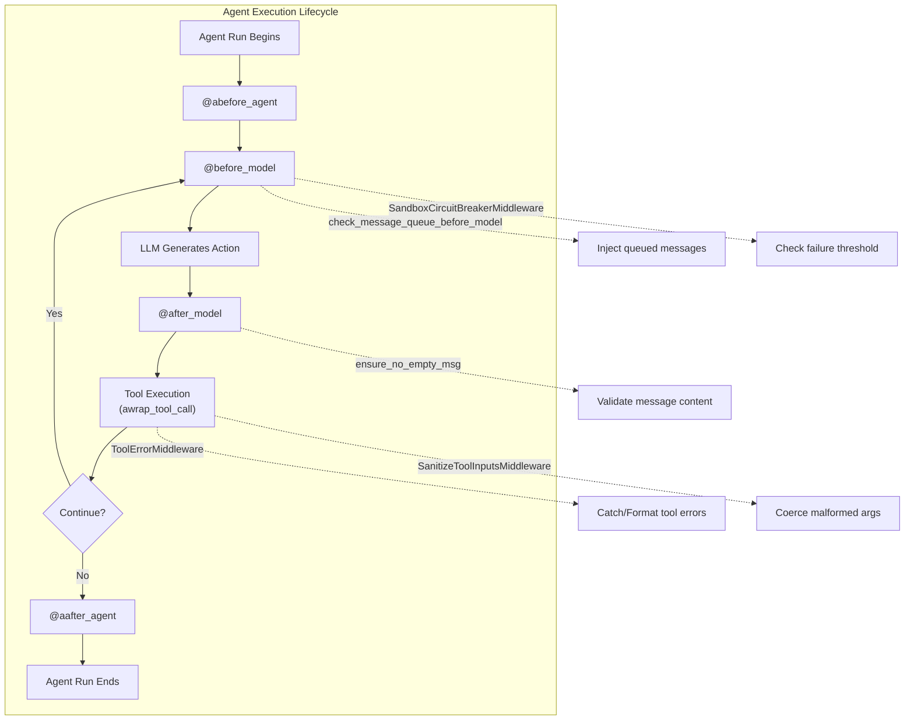
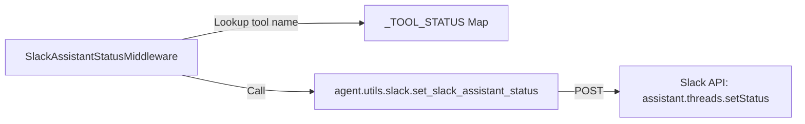
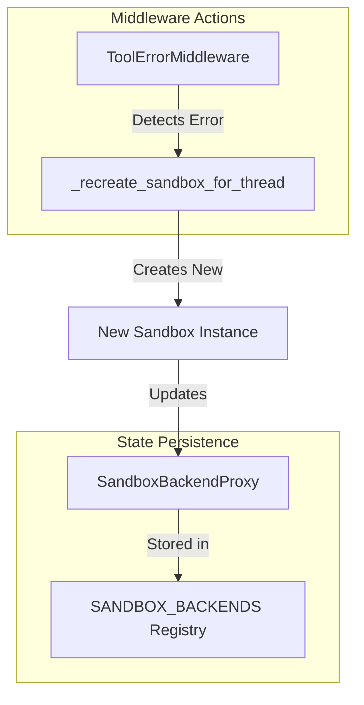

<!-- source: DeepWiki mcp.deepwiki.com · repo langchain-ai/open-swe · page 3.3 Middleware System · fetched 2026-10-26 -->

# Middleware System

Relevant source files

The following files were used as context for generating this wiki page:

- [agent/middleware/__init__.py](agent/middleware/__init__.py)
- [agent/middleware/ensure_no_empty_msg.py](agent/middleware/ensure_no_empty_msg.py)
- [agent/middleware/model_fallback.py](agent/middleware/model_fallback.py)
- [agent/middleware/notify_step_limit.py](agent/middleware/notify_step_limit.py)
- [agent/middleware/refresh_slack_status.py](agent/middleware/refresh_slack_status.py)
- [agent/middleware/sandbox_circuit_breaker.py](agent/middleware/sandbox_circuit_breaker.py)
- [agent/middleware/sanitize_tool_inputs.py](agent/middleware/sanitize_tool_inputs.py)
- [agent/middleware/tool_error_handler.py](agent/middleware/tool_error_handler.py)
- [agent/utils/sandbox.py](agent/utils/sandbox.py)
- [agent/utils/sandbox_state.py](agent/utils/sandbox_state.py)
- [tests/middleware/test_sandbox_recovery.py](tests/middleware/test_sandbox_recovery.py)
- [tests/test_ensure_no_empty_msg.py](tests/test_ensure_no_empty_msg.py)
- [tests/test_model_fallback_middleware.py](tests/test_model_fallback_middleware.py)
- [tests/test_notify_step_limit_middleware.py](tests/test_notify_step_limit_middleware.py)
- [tests/test_refresh_slack_status_middleware.py](tests/test_refresh_slack_status_middleware.py)
- [tests/test_sanitize_tool_inputs.py](tests/test_sanitize_tool_inputs.py)
- [tests/test_slack_assistants_status.py](tests/test_slack_assistants_status.py)

The middleware system provides deterministic hooks that execute around the agent's LLM decision-making loop. Middleware enables safety nets (like automatic PR creation), real-time interaction (message queue injection), and error handling without relying on the LLM's behavior. This architectural pattern ensures critical operations happen reliably regardless of model outputs.

For information about the tools the agent can call, see [Tool System](#3.2). For information about subagent spawning and orchestration, see [Subagent Orchestration](#3.4).

---

## Middleware Execution Points

Middleware functions are registered in the `create_deep_agent()` call and execute at multiple points: before model calls, after model calls, around tool execution, and before/after the entire agent run.

### Agent Loop with Middleware Hooks

**Sources:** [agent/middleware/__init__.py:1-21](), [agent/middleware/refresh_slack_status.py:125-155](), [agent/middleware/tool_error_handler.py:159-165]()

---

## Built-in Middleware Components

Open SWE ships with several middleware components registered in the agent factory:

| Middleware | Hook Type | Purpose |
|------------|-----------|---------|
| `ToolErrorMiddleware` | `awrap_tool_call` | Catches exceptions and recreates sandboxes on client errors [agent/middleware/tool_error_handler.py:159-165]() |
| `check_message_queue_before_model` | `@before_model` | Injects messages that arrived during agent execution [agent/middleware/check_message_queue.py:1-10]() |
| `ensure_no_empty_msg` | `@after_model` | Forces `no_op` or `confirming_completion` if the model is silent [agent/middleware/ensure_no_empty_msg.py:57-58]() |
| `SanitizeToolInputsMiddleware` | `awrap_tool_call` | Coerces malformed integer fields in `read_file` calls [agent/middleware/sanitize_tool_inputs.py:54-61]() |
| `SlackAssistantStatusMiddleware` | Multi-hook | Updates Slack's "thinking" status and loading messages [agent/middleware/refresh_slack_status.py:125-128]() |
| `SandboxCircuitBreakerMiddleware` | `@before_model` | Halts execution if the sandbox fails repeatedly [agent/middleware/sandbox_circuit_breaker.py:10-13]() |

---

## Reliability and Recovery

### ToolErrorMiddleware & Sandbox Recovery
The `ToolErrorMiddleware` is critical for sandbox reliability. If a tool call fails due to a `SandboxClientError` (e.g., the sandbox became unreachable), the middleware automatically attempts to recreate the sandbox for that thread and instructs the LLM to retry the operation.

1.  **Catch Error**: Intercepts `SandboxClientError` during `awrap_tool_call` [agent/middleware/tool_error_handler.py:197]().
2.  **Recreate**: Calls `_recreate_sandbox_for_thread` which creates a new backend and updates thread metadata [agent/middleware/tool_error_handler.py:116-124]().
3.  **Proxy Update**: Updates the `SandboxBackendProxy` so subsequent tool calls in the same run use the new backend [agent/middleware/tool_error_handler.py:121]().
4.  **LLM Feedback**: Returns a `ToolMessage` explaining the recovery and suggesting a workspace re-initialization if necessary [agent/middleware/tool_error_handler.py:75-80]().

### SanitizeToolInputsMiddleware
This middleware prevents unnecessary LLM retries by fixing common formatting errors in tool arguments, specifically for `read_file`. It uses regex to extract leading integers from strings like `"1, 80"` or `"170, 'limit': 60"` [agent/middleware/sanitize_tool_inputs.py:25-38]().

**Sources:** [agent/middleware/tool_error_handler.py:159-205](), [agent/middleware/sanitize_tool_inputs.py:1-61]()

---

## Interaction and State Middleware

### check_message_queue_before_model
This middleware enables real-time interaction. When users post follow-up messages while the agent is executing, those messages are queued in the LangGraph store. Before each model call, this middleware checks the queue and injects pending messages into the agent's state [agent/middleware/check_message_queue.py:1-10]().

### SlackAssistantStatusMiddleware
This middleware maintains the Slack "Assistant" status indicator. Since Slack's status expires after two minutes, the middleware implements a heartbeat mechanism:
- **Heartbeat**: Periodically calls `assistant.threads.setStatus` every 60 seconds [agent/middleware/refresh_slack_status.py:37, 203-210]().
- **Contextual Status**: Updates the status text based on the tool currently being executed (e.g., "searching the codebase..." for `grep`) [agent/middleware/refresh_slack_status.py:46-71, 107-108]().

### Code Entity Mapping: Middleware to Slack API

**Sources:** [agent/middleware/refresh_slack_status.py:46-71](), [agent/middleware/refresh_slack_status.py:171-173](), [tests/test_slack_assistants_status.py:53-65]()

---

## Safety and Guardrails

### ensure_no_empty_msg
This middleware prevents the agent from entering a "silent loop" where the model returns an empty response without tool calls.
- If the message is empty and no user-facing tool (Slack/Linear) was called, it injects a `no_op` tool call to prompt the model to continue [agent/middleware/ensure_no_empty_msg.py:62-79]().
- If the model provides text but no tool calls (and hasn't messaged the user), it injects a `confirming_completion` tool call to ensure the task isn't being terminated prematurely [agent/middleware/ensure_no_empty_msg.py:81-101]().

### SandboxCircuitBreakerMiddleware
To prevent infinite loops or burning tokens on a broken environment, this middleware monitors consecutive sandbox failures. If the threshold (default: 3) is reached, it jumps to the `end` node and notifies the user [agent/middleware/sandbox_circuit_breaker.py:10-13](), [tests/middleware/test_sandbox_recovery.py:93-110]().

### Sandbox State Management
Middleware interacts with sandboxes through a `SandboxBackendProxy`. This proxy allows the underlying sandbox to be swapped out (e.g., during recovery) while the middleware and tools maintain a stable reference to the same object [agent/utils/sandbox_state.py:27-43]().

**Sources:** [agent/middleware/ensure_no_empty_msg.py:57-101](), [agent/utils/sandbox_state.py:27-43](), [tests/middleware/test_sandbox_recovery.py:50-90]()

---

