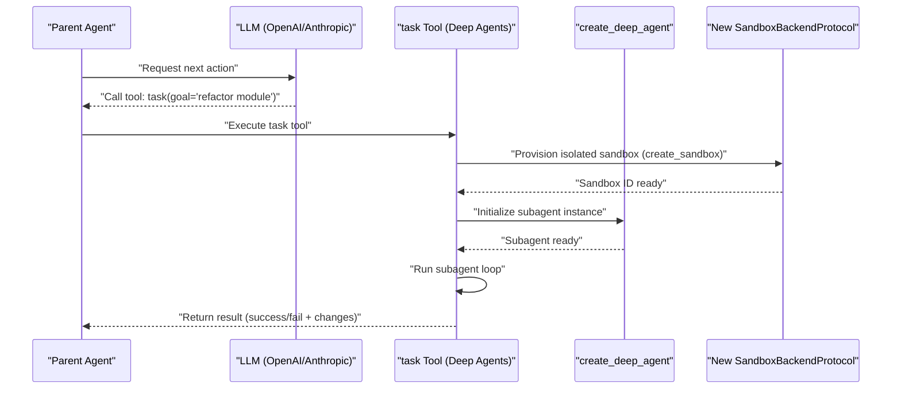
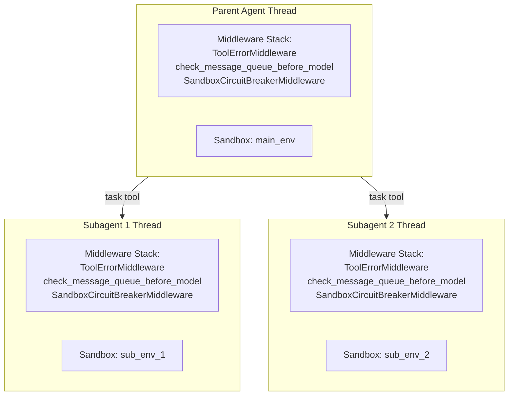

<!-- source: DeepWiki mcp.deepwiki.com · repo langchain-ai/open-swe · page 3.4 Subagent Orchestration · fetched 2026-10-26 -->

# Subagent Orchestration

<details>
<summary>Relevant source files</summary>

The following files were used as context for generating this wiki page:

- [CUSTOMIZATION.md](CUSTOMIZATION.md)
- [INSTALLATION.md](INSTALLATION.md)
- [README.md](README.md)
- [agent/server.py](agent/server.py)
- [agent/tools/__init__.py](agent/tools/__init__.py)

</details>


This page documents how Open SWE enables parallel work decomposition through subagent spawning. The `task` tool, inherited from the Deep Agents framework, allows the main agent to delegate independent subtasks to child agents that run in isolated sandboxes with their own middleware stacks and file operations.

For information about the main agent assembly and execution, see [3.1 Agent Assembly](). For details on the middleware system, see [3.3 Middleware System](). For sandbox architecture fundamentals, see [4.1 Sandbox Architecture]().

---

## Overview

Subagent orchestration in Open SWE provides a mechanism for decomposing complex tasks into independent parallel subtasks. Each subagent:

- Runs in its own isolated cloud sandbox environment [README.md:52-54]().
- Maintains its own middleware stack (including message queue and error handling) [README.md:88-97]().
- Has its own todo list and file operation history [README.md:88-91]().
- Operates independently of other subagents and the parent agent [README.md:60-62]().
- Can spawn further subagents (nested subagents are supported) [README.md:88-91]().

This architecture follows the principle of isolating first and then providing full permissions inside the boundary, ensuring that the blast radius of any mistake is contained within the subagent's specific sandbox [README.md:54-58]().

**Sources:** [README.md:52-62](), [README.md:88-97]()

---

## The `task` Tool

The `task` tool is the primary interface for spawning subagents. It is a built-in tool provided by the `deepagents` framework, which Open SWE composes upon [README.md:38-40](), [README.md:77-78]().

### Tool Interface

The `task` tool allows the agent to delegate work to a child agent with a specific goal. The tool signature follows the Deep Agents protocol:

```python
task(
    goal: str,           # The objective for the subagent to accomplish
    context: str = None  # Optional additional context
) -> dict
```

The tool returns a dictionary containing the subagent's execution results, including any files modified, errors encountered, and the final state.

### Invocation Pattern

The parent agent invokes the `task` tool through standard tool calling. When `task` is called, it triggers the creation of a new agent instance via the core orchestration logic [agent/server.py:29]().

**Subagent Spawning Sequence**



**Sources:** [README.md:38-40](), [README.md:77-78](), [README.md:88-91](), [agent/server.py:29-31](), [agent/utils/sandbox.py:80]()

---

## Subagent Isolation Model

Each subagent operates in complete isolation. This is enforced at the sandbox level and the orchestration level.

### Sandbox Isolation

Every subagent receives its own dedicated sandbox instance. Open SWE supports multiple providers such as LangSmith, Modal, Daytona, and Runloop [README.md:56-57]().

| Isolation Aspect | Implementation |
|---|---|
| **Filesystem** | Separate repository clone managed by `aresolve_sandbox_work_dir` [agent/server.py:81](). |
| **Process Space** | Independent remote Linux environment [README.md:52-54](). |
| **Git Auth** | Isolated proxy authentication for LangSmith sandboxes via `_configure_github_proxy` [agent/server.py:121-139](). |
| **State** | No shared memory or variables between parent and subagent. |

### Middleware Stack Isolation

Each subagent receives its own middleware stack, assembled identically to the parent agent to ensure consistent safety and behavior [README.md:88-97]().

**Middleware Distribution**



**Sources:** [README.md:52-57](), [README.md:88-97](), [agent/server.py:81](), [agent/server.py:121-139](), [agent/middleware/__init__.py:44-53]()

---

## Middleware Execution in Subagents

Each subagent executes the same middleware hooks as the parent, but scoped to its own thread and sandbox.

### `ToolErrorMiddleware`
This middleware catches and handles tool errors gracefully, allowing the subagent to attempt recovery or report failure back to the parent without crashing the entire orchestration [agent/server.py:49]().

### `check_message_queue_before_model`
This middleware allows human intervention during a subagent's run [README.md:92-94](). If a user sends a message to the subagent's thread (e.g., via Slack or Linear), it is injected into the context before the next model call [agent/server.py:50]().

**Sources:** [README.md:92-96](), [agent/server.py:44-53]()

---

## Parallel Execution Guarantees

Open SWE ensures that multiple tasks run in parallel without queuing by leveraging isolated sandboxes for each run [README.md:60-62]().

### Concurrency and Threading
When the `task` tool is invoked, the subagent runs within its own execution context. This allows the parent agent to fan out independent subtasks to isolated subagents, similar to child sessions for parallel work [README.md:88-91]().

**Code Entity Association**

| System Name | Code Entity | File Path |
|---|---|---|
| **Agent Factory** | `create_deep_agent` | [agent/server.py:29]() |
| **Sandbox Creator** | `create_sandbox` | [agent/utils/sandbox.py:80]() |
| **Tool Definition** | `task` | [README.md:77]() |
| **Sandbox Backend** | `SandboxBackendProtocol` | [agent/server.py:31]() |
| **Proxy Config** | `_configure_github_proxy` | [agent/server.py:43]() |

**Sources:** [README.md:60-62](), [README.md:77-78](), [README.md:88-91](), [agent/server.py:29-31](), [agent/utils/sandbox.py:80]()

---

## Result Aggregation

When a subagent completes its task, the results (including modifications and status) are returned to the parent agent. The parent agent then decides how to proceed based on the output.

### Validation and Commit
The agent is instructed to run linters, formatters, and tests before committing [README.md:108-109](). Subagents follow the same end-to-end responsibility for validation within their isolated boundaries before the results are bubbled back up to the parent.

**Sources:** [README.md:108-109]()

---

