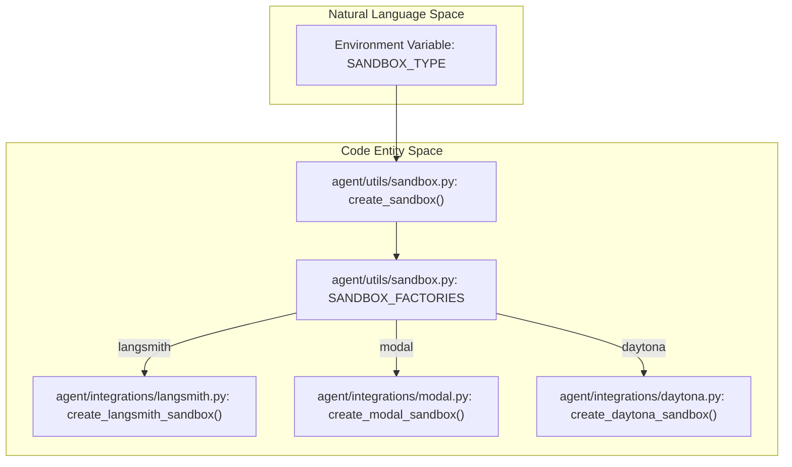

<!-- source: DeepWiki mcp.deepwiki.com · repo langchain-ai/open-swe · page 4 Sandbox Execution · fetched 2026-10-26 -->

# Sandbox Execution

<details>
<summary>Relevant source files</summary>

The following files were used as context for generating this wiki page:

- [agent/integrations/langsmith.py](agent/integrations/langsmith.py)
- [agent/middleware/sandbox_circuit_breaker.py](agent/middleware/sandbox_circuit_breaker.py)
- [agent/middleware/tool_error_handler.py](agent/middleware/tool_error_handler.py)
- [agent/utils/sandbox.py](agent/utils/sandbox.py)
- [agent/utils/sandbox_state.py](agent/utils/sandbox_state.py)
- [pyproject.toml](pyproject.toml)
- [tests/middleware/test_sandbox_recovery.py](tests/middleware/test_sandbox_recovery.py)
- [uv.lock](uv.lock)

</details>


## Purpose and Scope

Sandbox Execution encompasses the isolated execution environments where Open SWE agents operate. Each agent task runs in its own **sandbox** — a remote Linux container or virtual machine with full shell access where the repository is cloned and commands are executed. This architecture ensures that mistakes are contained, tasks run in parallel without interference, and the agent has unrestricted permissions within safe boundaries.

This page covers:
- The `SandboxBackendProtocol` interface and provider abstraction.
- Sandbox lifecycle management through the `get_agent()` and `create_sandbox()` flow.
- The `SandboxBackendProxy` mechanism for stable per-thread handles.
- Error recovery and circuit breaker logic for unrecoverable failures.

For specific provider implementations, see [Sandbox Providers](#4.2). For agent assembly and tool execution that occurs *within* sandboxes, see [Agent Core](#3).

---

## Core Architecture

### Isolation Model

Every agent invocation operates in a dedicated sandbox. The isolation guarantees are:

| Property | Implementation |
|---|---|
| **Process isolation** | Each sandbox is a separate container/VM with its own filesystem. |
| **Network isolation** | Sandboxes cannot access internal networks (enforced by provider). |
| **Credential isolation** | Git credentials handled via LangSmith proxy or ephemeral tokens. |
| **Persistence** | Sandboxes remain alive across follow-up messages on the same thread using `sandbox_id`. |

The key design principle: **isolate first, then give full permissions inside the boundary**. The agent can run any shell command, install packages, or modify files without confirmation prompts because the blast radius is fully contained.

**Sources:** [agent/integrations/langsmith.py:126-170](), [agent/utils/sandbox_state.py:27-43](), [agent/middleware/sandbox_circuit_breaker.py:24-25]()

---

### Protocol Interface

All sandbox providers implement `SandboxBackendProtocol` from the `deepagents` framework. This protocol defines the contract for interacting with sandboxes. Open SWE uses a `SandboxBackendProxy` to maintain a stable reference even if the underlying backend needs to be recreated.

**Sandbox Backend Class Diagram**
```mermaid
classDiagram
    class "SandboxBackendProtocol" {
        <<interface>>
        +id: str
        +execute(command, timeout) ExecuteResponse
        +ls(path) LsResult
        +read(file_path) ReadResult
        +write(file_path, content) WriteResult
        +edit(file_path, old, new) EditResult
    }
    
    class "SandboxBackendProxy" {
        -_backend: SandboxBackendProtocol
        +current: SandboxBackendProtocol
        +replace_backend(backend)
        +execute(command)
    }
    
    class "LangSmithSandbox" {
        +id: str
        +execute(command)
    }
    
    class "ModalSandbox" {
        +id: str
        +execute(command)
    }
    
    class "DaytonaSandbox" {
        +id: str
        +execute(command)
    }
    
    SandboxBackendProtocol <|.. SandboxBackendProxy
    SandboxBackendProtocol <|.. LangSmithSandbox
    SandboxBackendProtocol <|.. ModalSandbox
    SandboxBackendProtocol <|.. DaytonaSandbox
```

**Key methods:**

- **`execute(command, timeout)`**: Run arbitrary shell commands, returns `ExecuteResponse` with `output` and `exit_code` [agent/utils/sandbox_state.py:114-118]().
- **File operations**: `read()`, `write()`, `edit()`, `ls()`, and `glob()` provide atomic file manipulation [agent/utils/sandbox_state.py:44-100]().
- **Async support**: Every sync method has a corresponding `a`-prefixed async version (e.g., `aexecute`) [agent/utils/sandbox_state.py:117-118]().

**Sources:** [agent/utils/sandbox_state.py:27-120](), [agent/integrations/langsmith.py:203-214]()

---

## Provider Factory System

Sandbox creation is routed through a factory pattern based on the `SANDBOX_TYPE` environment variable.

**Sandbox Provider Resolution**


The factory registry maps configuration strings to creation functions [agent/utils/sandbox.py:11-17]():

| Provider | Factory Function | Integration File |
|---|---|---|
| `langsmith` | `create_langsmith_sandbox` | `agent/integrations/langsmith.py` |
| `daytona` | `create_daytona_sandbox` | `agent/integrations/daytona.py` |
| `modal` | `create_modal_sandbox` | `agent/integrations/modal.py` |
| `runloop` | `create_runloop_sandbox` | `agent/integrations/runloop.py` |
| `local` | `create_local_sandbox` | `agent/integrations/local.py` |

**Sources:** [agent/utils/sandbox.py:1-37](), [agent/integrations/langsmith.py:126-170]()

---

## Lifecycle and Error Management

### Thread-Sandbox Mapping

Sandboxes are cached per thread ID in the `SANDBOX_BACKENDS` dictionary [agent/utils/sandbox_state.py:121-122](). When an agent is requested, the system retrieves the backend from cache or reconnects using the `sandbox_id` stored in LangGraph thread metadata [agent/utils/sandbox_state.py:153-178]().

### Recovery and Circuit Breaker

The system includes automated recovery for `SandboxClientError` (e.g., timeouts or network failures).

1. **`ToolErrorMiddleware`**: Catches sandbox errors mid-run, triggers `_recreate_sandbox_for_thread`, and updates thread metadata with the new ID [agent/middleware/tool_error_handler.py:116-125]().
2. **`SandboxCircuitBreakerMiddleware`**: Prevents infinite retry loops. If the agent experiences a streak of failures (default threshold is 2), it halts the run and notifies the user via Slack, Linear, or GitHub [agent/middleware/sandbox_circuit_breaker.py:24-26](), [agent/middleware/sandbox_circuit_breaker.py:168-189]().

**Sources:** [agent/middleware/tool_error_handler.py:159-204](), [agent/middleware/sandbox_circuit_breaker.py:67-102](), [tests/middleware/test_sandbox_recovery.py:50-90]()

---

## Repository Management

### Cloning and Identity

When a sandbox is created or recreated, the system configures the git identity (name and email) and sets up authentication. For LangSmith sandboxes, `_configure_github_proxy` is used to inject the GitHub token into the sandbox's network traffic so that credentials never touch the sandbox disk [agent/integrations/langsmith.py:98-124]().

**Sources:** [agent/integrations/langsmith.py:70-95](), [agent/middleware/tool_error_handler.py:116-124]()

---

## Child Pages

For more details on specific aspects of sandbox execution, refer to the following child pages:

- **[Sandbox Architecture](#4.1)**: Deep dive into the `SandboxBackendProtocol`, the proxy pattern, and isolation principles.
- **[Sandbox Providers](#4.2)**: Configuration and setup for LangSmith, Modal, Daytona, Runloop, and Local modes via `SANDBOX_TYPE`.
- **[Sandbox Lifecycle Management](#4.3)**: Details on caching in `SANDBOX_BACKENDS`, persistence in thread metadata, and recreation logic.
- **[Repository Management](#4.4)**: How the agent interacts with git, manages clones, and handles authentication within the sandbox environment.

---

