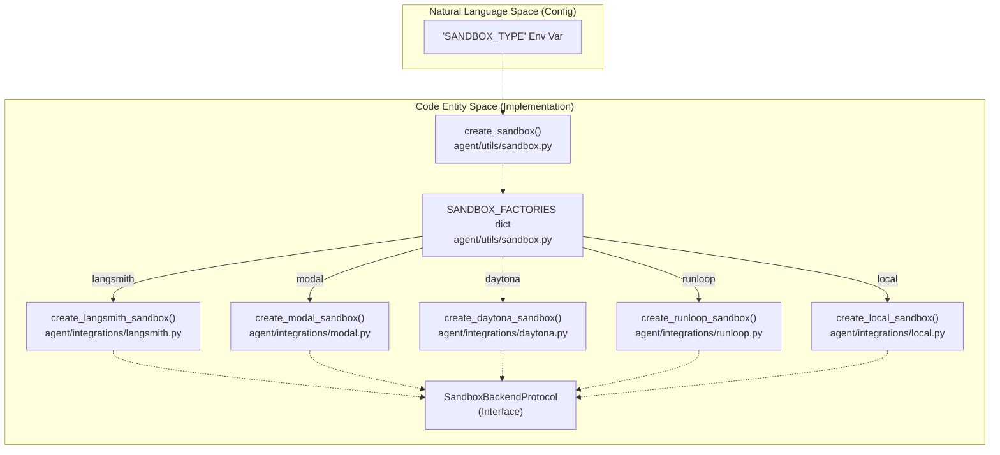
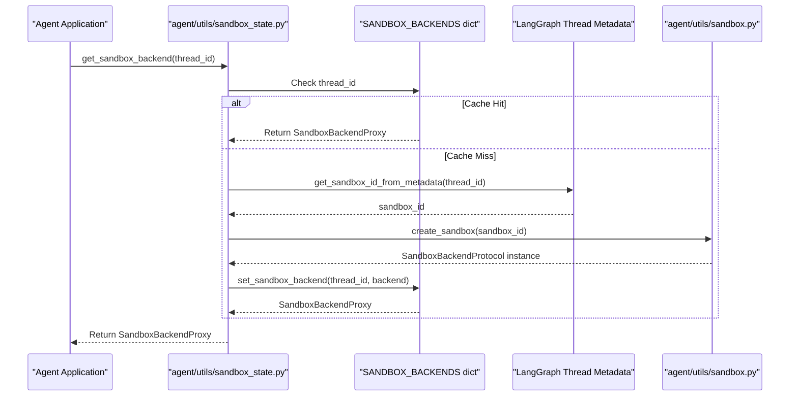

<!-- source: DeepWiki mcp.deepwiki.com · repo langchain-ai/open-swe · page 4.1 Sandbox Architecture · fetched 2026-10-26 -->

# Sandbox Architecture

Relevant source files

The following files were used as context for generating this wiki page:

- [CUSTOMIZATION.md](CUSTOMIZATION.md)
- [INSTALLATION.md](INSTALLATION.md)
- [README.md](README.md)
- [agent/middleware/sandbox_circuit_breaker.py](agent/middleware/sandbox_circuit_breaker.py)
- [agent/middleware/tool_error_handler.py](agent/middleware/tool_error_handler.py)
- [agent/utils/sandbox.py](agent/utils/sandbox.py)
- [agent/utils/sandbox_state.py](agent/utils/sandbox_state.py)
- [tests/middleware/test_sandbox_recovery.py](tests/middleware/test_sandbox_recovery.py)

## Purpose and Scope

This document describes the sandbox architecture that provides isolated execution environments for Open SWE agents. Each agent task runs in its own sandbox—a remote Linux environment with full shell access where the agent can safely execute commands, read and write files, and make changes to repositories without affecting production systems or other concurrent tasks [README.md:52-58]().

The architecture is designed to be provider-agnostic, supporting various backends from local development shells to managed cloud environments like LangSmith, Modal, and Runloop [CUSTOMIZATION.md:54-65]().

## Core Principles

The sandbox architecture is built on three foundational principles:

*   **Isolation First**: Every task runs in a completely isolated environment. The blast radius of any mistake is fully contained within the sandbox boundary [README.md:52-54]().
*   **Per-Thread Persistence**: Each thread (identified by a deterministic `thread_id`) gets a persistent sandbox that is reused across follow-up messages, maintaining state and uncommitted changes [README.md:60](), [agent/utils/sandbox_state.py:121-122]().
*   **Parallel Execution**: Multiple tasks run in parallel—each in its own sandbox—with no queuing [README.md:62]().

**Sources:** [README.md:52-62](), [agent/utils/sandbox_state.py:121-122]()

## Sandbox Protocol Interface

All sandbox providers implement the `SandboxBackendProtocol` from the `deepagents` framework [CUSTOMIZATION.md:101-106](). This protocol defines a standard interface that allows tools and agent code to work uniformly across all providers.

### Protocol Methods

| Method | Description | Returns |
| :--- | :--- | :--- |
| `execute(command, timeout=None)` | Execute a shell command in the sandbox | `ExecuteResponse` [CUSTOMIZATION.md:104](), [agent/utils/sandbox_state.py:114-118]() |
| `ls(path)` | List directory contents | `LsResult` [agent/utils/sandbox_state.py:44-48]() |
| `read(path, offset, limit)` | Read file contents | `ReadResult` [agent/utils/sandbox_state.py:50-54]() |
| `write(path, content)` | Write file contents | `WriteResult` [agent/utils/sandbox_state.py:78-82]() |
| `edit(path, old, new)` | Apply string-based edits | `EditResult` [agent/utils/sandbox_state.py:84-100]() |
| `glob(pattern, path)` | Find files matching pattern | `GlobResult` [agent/utils/sandbox_state.py:72-76]() |
| `grep(pattern, path)` | Search files for pattern | `GrepResult` [agent/utils/sandbox_state.py:56-70]() |
| `id` (property) | Unique sandbox identifier | `str` [CUSTOMIZATION.md:106](), [agent/utils/sandbox_state.py:38-40]() |

**Sources:** [CUSTOMIZATION.md:101-130](), [agent/utils/sandbox_state.py:27-120]()

## Sandbox Provider Architecture

The system uses a factory pattern to instantiate the correct sandbox backend based on the `SANDBOX_TYPE` environment variable [agent/utils/sandbox.py:32-37]().

### Natural Language to Code Entity Mapping

The following diagram bridges the configuration space (Environment Variables) to the implementation classes and functions.

### Available Providers

| `SANDBOX_TYPE` | Integration File | Required Config / Env Vars |
| :--- | :--- | :--- |
| `langsmith` (default) | [agent/integrations/langsmith.py]() | `LANGSMITH_API_KEY_PROD`, `DEFAULT_SANDBOX_SNAPSHOT_ID` [CUSTOMIZATION.md:37](), [CUSTOMIZATION.md:60]() |
| `daytona` | [agent/integrations/daytona.py]() | `DAYTONA_API_KEY` [CUSTOMIZATION.md:61]() |
| `runloop` | [agent/integrations/runloop.py]() | `RUNLOOP_API_KEY` [CUSTOMIZATION.md:62]() |
| `modal` | [agent/integrations/modal.py]() | Modal credentials [CUSTOMIZATION.md:63]() |
| `local` | [agent/integrations/local.py]() | No isolation—development only [CUSTOMIZATION.md:64-66]() |

**Sources:** [CUSTOMIZATION.md:58-65](), [agent/utils/sandbox.py:11-17]()

## Sandbox Lifecycle and Recovery

Sandboxes are managed through a combination of in-memory caching and persistent thread metadata. Open SWE includes a `SandboxBackendProxy` to allow the underlying sandbox to be swapped out (recreated) without breaking the agent's reference to the backend [agent/utils/sandbox_state.py:27-42]().

### Lifecycle Data Flow

### Automatic Recovery and Circuit Breaker

The system implements a `ToolErrorMiddleware` that catches `SandboxClientError` exceptions. If a sandbox becomes unreachable mid-run, the middleware automatically triggers `_recreate_sandbox_for_thread`, which provisions a fresh sandbox, updates the thread metadata, and returns an error message to the agent suggesting a retry [agent/middleware/tool_error_handler.py:176-182](), [agent/middleware/tool_error_handler.py:75-80]().

To prevent infinite loops of recreation, a `SandboxCircuitBreakerMiddleware` monitors the message history. If it detects consecutive sandbox failures or recreations (default threshold: 2), it interrupts the agent run with a "Sandbox circuit breaker triggered" message and stops further model calls [agent/middleware/sandbox_circuit_breaker.py:24-27](), [agent/middleware/sandbox_circuit_breaker.py:167-172]().

**Sources:** [agent/utils/sandbox_state.py:121-184](), [agent/middleware/tool_error_handler.py:159-205](), [agent/middleware/sandbox_circuit_breaker.py:1-102](), [tests/middleware/test_sandbox_recovery.py:50-89]()

## Security and Isolation

### Isolation Guarantees
*   **Remote Providers**: Providers like LangSmith, Modal, and Runloop run code in isolated Linux environments. The blast radius of any mistake is fully contained [README.md:54]().
*   **Local Warning**: The `local` provider runs commands directly on the host with no sandboxing. It is intended for development only [CUSTOMIZATION.md:66]().

### Credential Proxying
For LangSmith sandboxes, Open SWE configures proxy rules so that the sandbox can access GitHub without storing permanent tokens in the environment. `github.com` requests receive Basic auth, and `api.github.com` requests receive Bearer auth, both using tokens minted at runtime from GitHub App credentials [CUSTOMIZATION.md:47-53]().

**Sources:** [README.md:52-54](), [CUSTOMIZATION.md:47-53](), [CUSTOMIZATION.md:66]()

---

