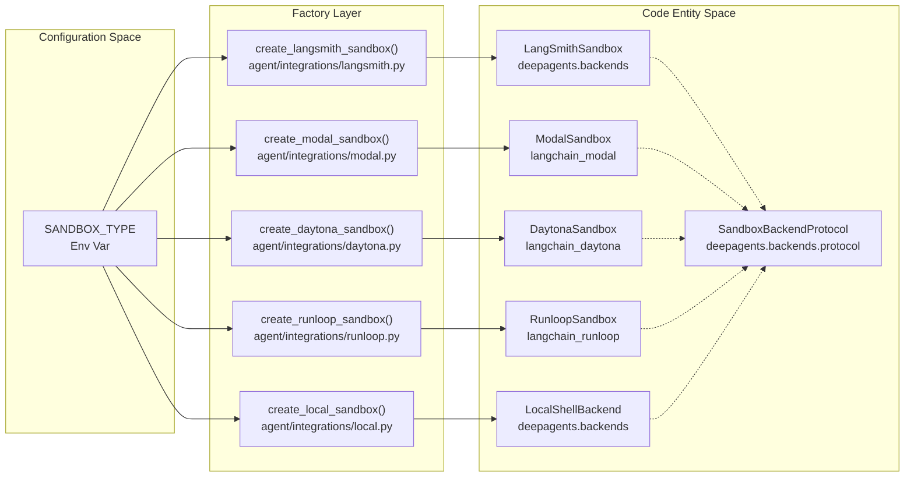
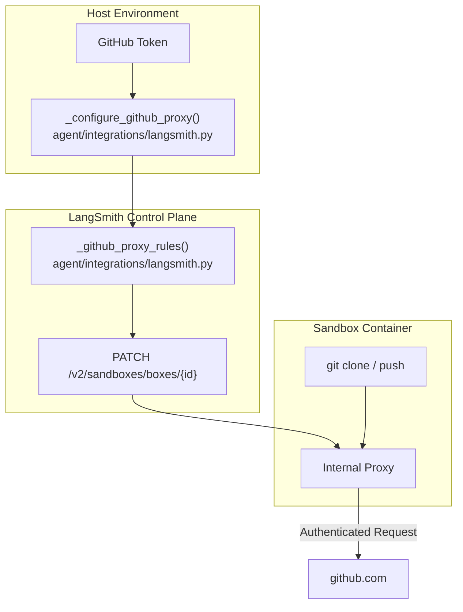

<!-- source: DeepWiki mcp.deepwiki.com · repo langchain-ai/open-swe · page 4.2 Sandbox Providers · fetched 2026-10-26 -->

# Sandbox Providers

Relevant source files

The following files were used as context for generating this wiki page:

- [agent/integrations/daytona.py](agent/integrations/daytona.py)
- [agent/integrations/langsmith.py](agent/integrations/langsmith.py)
- [agent/integrations/local.py](agent/integrations/local.py)
- [agent/integrations/modal.py](agent/integrations/modal.py)
- [agent/integrations/runloop.py](agent/integrations/runloop.py)
- [agent/utils/sandbox_paths.py](agent/utils/sandbox_paths.py)
- [pyproject.toml](pyproject.toml)
- [tests/test_daytona_integration.py](tests/test_daytona_integration.py)
- [tests/test_langsmith_sandbox_config.py](tests/test_langsmith_sandbox_config.py)
- [uv.lock](uv.lock)

This page documents the pluggable sandbox provider system in Open SWE, covering all supported execution environments and how to configure them via the `SANDBOX_TYPE` environment variable.

## Overview

Open SWE supports multiple sandbox providers through a factory pattern that abstracts the underlying execution environment. Each provider implements the `SandboxBackendProtocol` [agent/integrations/langsmith.py:13-13]() from the Deep Agents framework, allowing agents to execute commands and perform file operations in isolated Linux environments.

The system is designed to be **pluggable**: you can switch providers by changing a single environment variable, or add custom providers by implementing the protocol and registering a factory function in the `SANDBOX_FACTORIES` dictionary.

**Sources:** [agent/integrations/langsmith.py:12-13](), [pyproject.toml:9-28]()

## Supported Providers

Open SWE includes five built-in sandbox providers:

| Provider | Type | Use Case | Required Env Vars | Implementation File |
|----------|------|----------|-------------------|-----------------|
| **langsmith** | Docker containers | Production, full observability | `LANGSMITH_API_KEY` or `LANGSMITH_API_KEY_PROD` | [agent/integrations/langsmith.py]() |
| **modal** | Serverless containers | Cloud execution, auto-scaling | Modal credentials | [agent/integrations/modal.py]() |
| **daytona** | Development environments | Development workflows | `DAYTONA_API_KEY` | [agent/integrations/daytona.py]() |
| **runloop** | Managed environments | Devbox-based execution | `RUNLOOP_API_KEY` | [agent/integrations/runloop.py]() |
| **local** | Shell subprocess | Local development only | None | [agent/integrations/local.py]() |

**Default Provider:** `langsmith` is the primary production backend, offering sophisticated features like snapshotting and proxy-based authentication.

**Sources:** [agent/integrations/langsmith.py:1-170](), [agent/integrations/modal.py:1-26](), [agent/integrations/daytona.py:1-29](), [agent/integrations/runloop.py:1-30](), [agent/integrations/local.py:1-26]()

## Provider Selection

### Factory Pattern

The selection of a sandbox provider is handled by checking the `SANDBOX_TYPE` environment variable. Each provider has a corresponding factory function that returns a `SandboxBackendProtocol` implementation.

Title: Sandbox Provider Architecture

**Sources:** [agent/integrations/langsmith.py:126-129](), [agent/integrations/modal.py:9-9](), [agent/integrations/daytona.py:17-17](), [agent/integrations/runloop.py:7-7](), [agent/integrations/local.py:6-6]()

## LangSmith Sandbox

### Overview
The `langsmith` provider uses the `LangSmithSandbox` backend [agent/integrations/langsmith.py:12-12](). It supports advanced lifecycle management, including custom resource allocation and idle timeouts.

### Resource Configuration
The provider allows fine-grained control over the sandbox environment via environment variables:

| Variable | Default Value | Description |
|----------|---------------|-------------|
| `DEFAULT_SANDBOX_VCPUS` | 2 | Number of vCPUs [agent/integrations/langsmith.py:19-19]() |
| `DEFAULT_SANDBOX_MEM_BYTES` | 7936 MiB | Memory limit [agent/integrations/langsmith.py:20-20]() |
| `DEFAULT_SANDBOX_IDLE_TTL_SECONDS` | 600 | Time before idle sandbox stops [agent/integrations/langsmith.py:21-21]() |
| `DEFAULT_SANDBOX_SNAPSHOT_FS_CAPACITY_BYTES` | 32 GiB | Filesystem capacity [agent/integrations/langsmith.py:18-18]() |

### Proxy Authentication
LangSmith sandboxes utilize a specialized proxy configuration to inject GitHub authentication headers. This allows the agent to perform `git` operations without persisting sensitive tokens to the sandbox's disk [agent/integrations/langsmith.py:98-124]().

Title: LangSmith Proxy Data Flow

**Sources:** [agent/integrations/langsmith.py:70-95](), [agent/integrations/langsmith.py:98-124]()

## Modal Sandbox
The `modal` provider leverages `modal.Sandbox` [agent/integrations/modal.py:22-24](). It looks up a Modal App defined by `MODAL_APP_NAME` (default: "open-swe") and creates or reconnects to sandboxes within that app context [agent/integrations/modal.py:6-19]().

**Sources:** [agent/integrations/modal.py:1-26]()

## Daytona Sandbox
The `daytona` provider uses the `Daytona` client to manage environments [agent/integrations/daytona.py:22-22](). It defaults to using the `daytonaio/sandbox:0.6.0` snapshot, which can be overridden via `DAYTONA_SANDBOX_SNAPSHOT` [agent/integrations/daytona.py:6-11]().

**Sources:** [agent/integrations/daytona.py:1-29]()

## Runloop Sandbox
The `runloop` provider integrates with Runloop's "devboxes" [agent/integrations/runloop.py:23-28](). It requires a `RUNLOOP_API_KEY` and wraps the resulting devbox in a `RunloopSandbox` adapter [agent/integrations/runloop.py:19-30]().

**Sources:** [agent/integrations/runloop.py:1-31]()

## Local Sandbox
The `local` provider uses `LocalShellBackend` [agent/integrations/local.py:3-3](). 
**Warning:** This provider provides **no isolation** and runs commands directly on the host machine [agent/integrations/local.py:9-10](). It is intended for development and requires `LOCAL_SANDBOX_ROOT_DIR` to be set, otherwise it defaults to the current working directory [agent/integrations/local.py:21-24]().

**Sources:** [agent/integrations/local.py:1-26]()

## Path Resolution Utilities

Regardless of the provider, Open SWE uses `agent/utils/sandbox_paths.py` to resolve writable directories for repository operations. This utility checks multiple candidates (provider methods like `get_work_dir`, shell commands like `pwd`, and environment variables like `$HOME`) to find a valid, writable path [agent/utils/sandbox_paths.py:34-86]().

**Key Functions:**
- `resolve_repo_dir`: Joins the work directory with the repository name [agent/utils/sandbox_paths.py:20-26]().
- `resolve_sandbox_work_dir`: Iterates through candidates and tests for writability using `test -d && test -w` [agent/utils/sandbox_paths.py:34-45]().

**Sources:** [agent/utils/sandbox_paths.py:20-146]()

---

