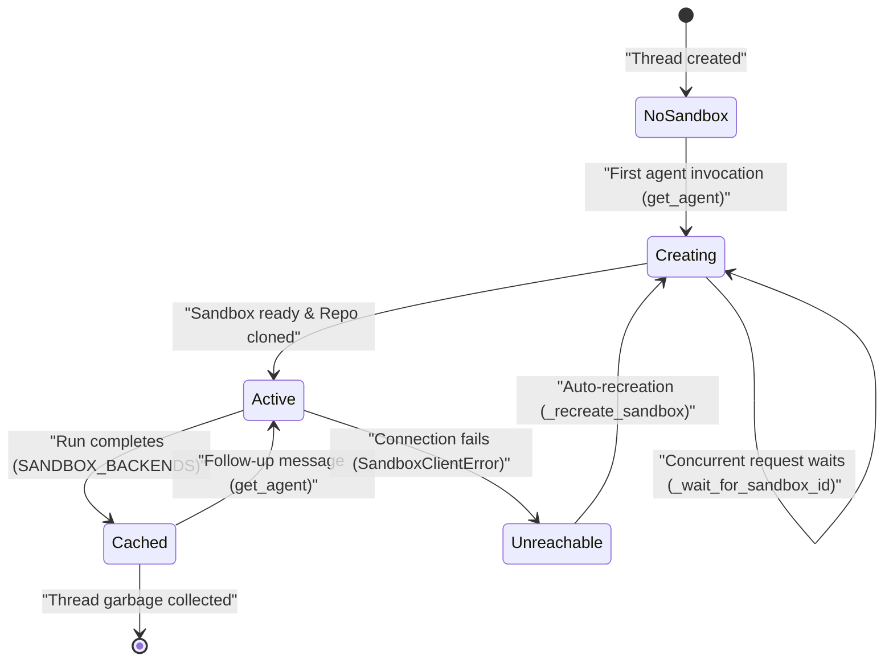
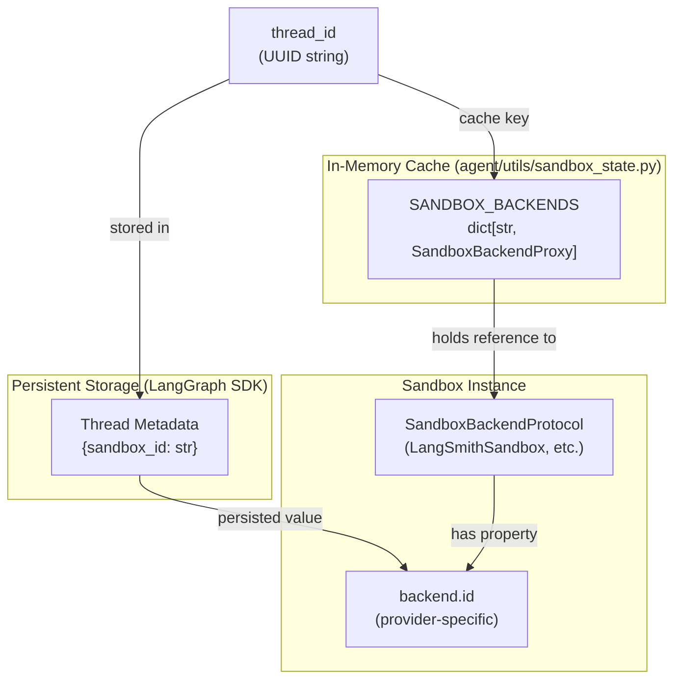
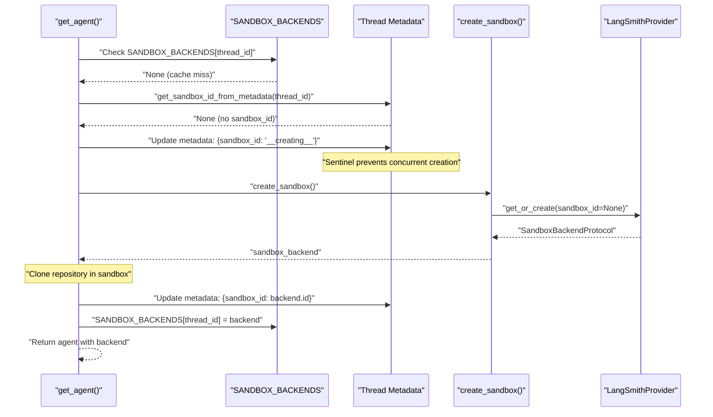
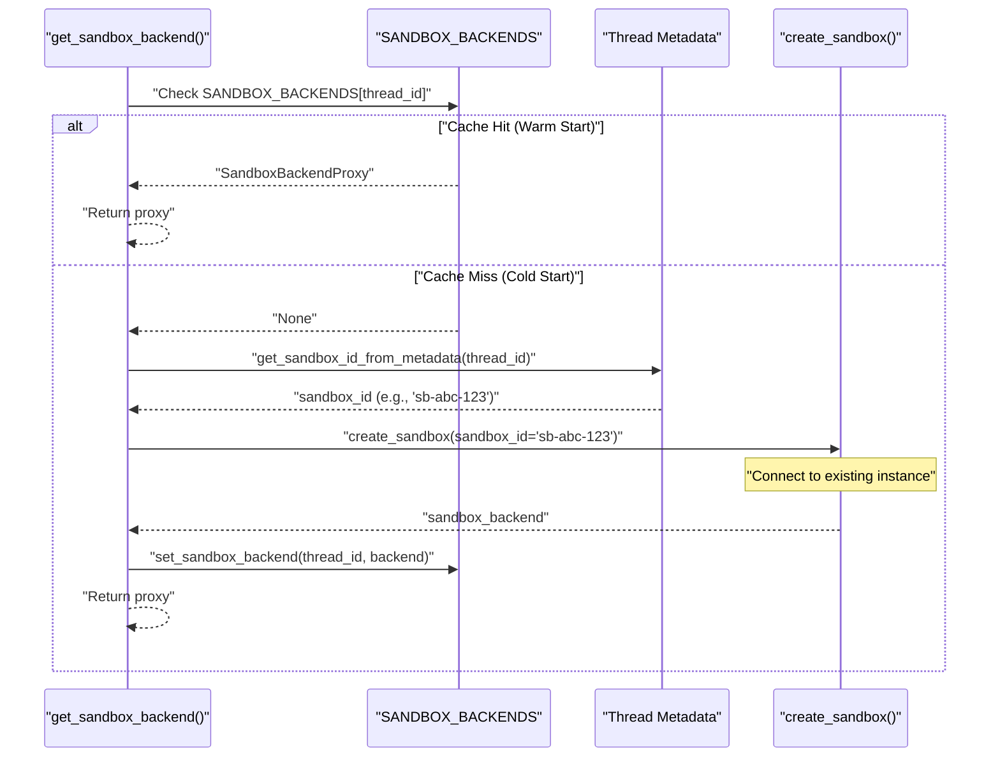
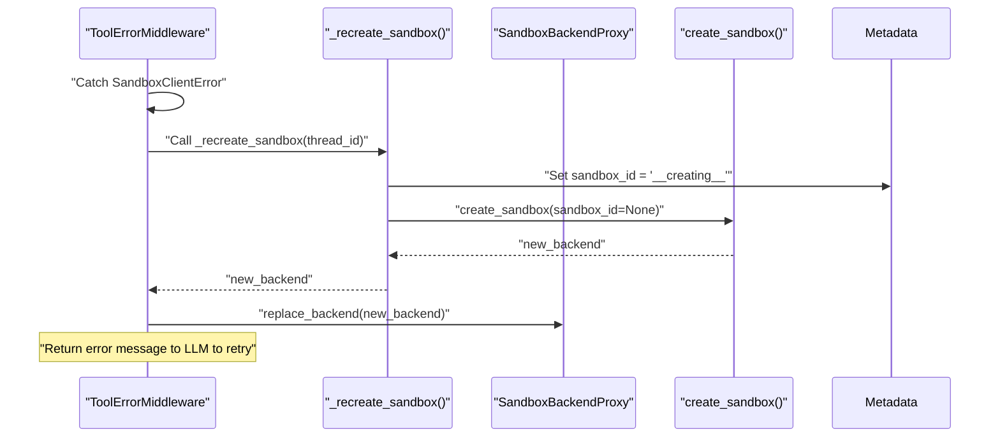

<!-- source: DeepWiki mcp.deepwiki.com · repo langchain-ai/open-swe · page 4.3 Sandbox Lifecycle Management · fetched 2026-10-26 -->

# Sandbox Lifecycle Management

Relevant source files

The following files were used as context for generating this wiki page:

- [agent/integrations/langsmith.py](agent/integrations/langsmith.py)
- [agent/middleware/sandbox_circuit_breaker.py](agent/middleware/sandbox_circuit_breaker.py)
- [agent/middleware/tool_error_handler.py](agent/middleware/tool_error_handler.py)
- [agent/server.py](agent/server.py)
- [agent/tools/__init__.py](agent/tools/__init__.py)
- [agent/utils/sandbox.py](agent/utils/sandbox.py)
- [agent/utils/sandbox_state.py](agent/utils/sandbox_state.py)
- [pyproject.toml](pyproject.toml)
- [tests/middleware/test_sandbox_recovery.py](tests/middleware/test_sandbox_recovery.py)
- [uv.lock](uv.lock)

This page documents the lifecycle management of sandbox execution environments in Open SWE, including creation, caching, persistence, reconnection, and automatic recreation. Each agent task runs in an isolated sandbox that persists across follow-up messages on the same thread.

For information about sandbox architecture and the protocol interface, see **4.1 Sandbox Architecture**. For details on specific sandbox provider implementations, see **4.2 Sandbox Providers**. For repository cloning and management within sandboxes, see **4.4 Repository Management**.

---

## Lifecycle States

A sandbox progresses through several states during its lifecycle, managed by the `get_agent()` function in coordination with thread metadata and an in-memory cache.

### Sandbox State Transitions

**Sources:** [agent/server.py:85-87](), [agent/server.py:188-203](), [agent/middleware/tool_error_handler.py:176-185]()

---

## Thread-to-Sandbox Mapping

Each thread is mapped to exactly one sandbox using a deterministic thread ID. The mapping is maintained in two places: an in-memory cache (`SANDBOX_BACKENDS`) and persistent thread metadata managed via the LangGraph `client`.

### Mapping Architecture

| Storage | Purpose | Lifetime | Source |
|---------|---------|----------|--------|
| `SANDBOX_BACKENDS` | Fast in-memory lookup via `SandboxBackendProxy` | Process lifetime | [agent/utils/sandbox_state.py:122-146]() |
| Thread metadata `sandbox_id` | Persistent across restarts | Thread lifetime | [agent/integrations/langsmith.py:173-192]() |

**Sources:** [agent/utils/sandbox_state.py:27-122](), [agent/integrations/langsmith.py:173-192]()

---

## Sandbox Creation Flow

When a thread has no sandbox (first invocation), `get_agent()` creates a new sandbox and persists its ID to thread metadata.

### Creation Sequence

**Key Steps:**
1. **Check cache** - Lookup in `SANDBOX_BACKENDS` [agent/utils/sandbox_state.py:169]().
2. **Check metadata** - Fetch persisted `sandbox_id` [agent/utils/sandbox_state.py:153-164]().
3. **Set sentinel** - Write `SANDBOX_CREATING` (`"__creating__"`) to metadata [agent/server.py:85]().
4. **Create sandbox** - Call `create_sandbox()` via `asyncio.to_thread` [agent/server.py:127-139]().
5. **Configure Proxy** - For LangSmith sandboxes, `_configure_github_proxy` injects the GitHub App installation token [agent/integrations/langsmith.py:98-124]().
6. **Persist ID** - Update metadata with real `sandbox_id` [agent/integrations/langsmith.py:165-170]().
7. **Cache reference** - Store backend in `SANDBOX_BACKENDS` via `set_sandbox_backend` [agent/utils/sandbox_state.py:131-146]().

**Sources:** [agent/server.py:121-139](), [agent/integrations/langsmith.py:126-170](), [agent/utils/sandbox_state.py:167-179]()

---

## Sandbox Caching Strategy

The `SANDBOX_BACKENDS` dictionary provides fast in-memory access to `SandboxBackendProxy` instances. This proxy allows the underlying backend to be swapped (e.g., during recreation) while maintaining a stable reference for the agent.

| Property | Behavior |
|----------|----------|
| **Scope** | Process-local (not shared across deployments) |
| **Eviction** | Manual via `clear_sandbox_backend(thread_id)` |
| **Invalidation** | On `SandboxClientError` caught by `ToolErrorMiddleware` |
| **Proxy Pattern** | `SandboxBackendProxy` delegates all calls to `self._backend` |

**Sources:** [agent/utils/sandbox_state.py:27-122](), [agent/middleware/tool_error_handler.py:176-185]()

---

## Sandbox Reconnection

When a thread already has a sandbox (follow-up message), `get_sandbox_backend()` retrieves the cached proxy or reconnects using the persisted `sandbox_id`.

### Reconnection Logic

**Reconnection Scenarios:**
- **Warm start**: Proxy exists in `SANDBOX_BACKENDS`. The system proceeds immediately [agent/utils/sandbox_state.py:169-171]().
- **Cold start**: Backend missing from cache but `sandbox_id` exists in metadata. The system calls `create_sandbox(sandbox_id=...)` [agent/utils/sandbox_state.py:173-178]().

**Sources:** [agent/utils/sandbox_state.py:167-179](), [agent/utils/sandbox.py:20-37]()

---

## Sandbox Recreation

If a sandbox becomes unreachable (e.g., provider-side termination), `ToolErrorMiddleware` catches `SandboxClientError` and triggers `_recreate_sandbox_for_thread()`.

### Recreation Sequence

**Atomic Recreation:**
1. **Set sentinel** - Write `SANDBOX_CREATING` to metadata [agent/server.py:195-198]().
2. **Create new sandbox** - Call `_create_sandbox_with_proxy()` [agent/server.py:200]().
3. **Swap Backend** - The `SandboxBackendProxy` is updated with the new instance via `replace_backend` [agent/utils/sandbox_state.py:41-42]().
4. **LLM Recovery** - A `ToolMessage` is returned to the agent explaining that a fresh sandbox has been created and it should re-clone or retry [agent/middleware/tool_error_handler.py:64-81]().

**Sources:** [agent/server.py:188-203](), [agent/middleware/tool_error_handler.py:116-124](), [agent/utils/sandbox_state.py:41-42]()

---

## Concurrent Creation Handling

When multiple events arrive simultaneously for the same thread, the `SANDBOX_CREATING` sentinel prevents duplicate creation.

**Constants:**
- `SANDBOX_CREATING`: `"__creating__"` [agent/server.py:85]().
- `SANDBOX_CREATION_TIMEOUT`: `180` seconds [agent/server.py:86]().
- `SANDBOX_POLL_INTERVAL`: `1.0` second [agent/server.py:87]().

---

## Circuit Breaker

To prevent infinite loops of sandbox recreation, the `SandboxCircuitBreakerMiddleware` monitors the message history for consecutive failures.

| Feature | Description |
|---------|-------------|
| **Threshold** | Triggers after 2 consecutive failures [agent/middleware/sandbox_circuit_breaker.py:24]() |
| **Detection** | Scans `ToolMessage` content for `SandboxClientError` or `RECREATED` markers [agent/middleware/sandbox_circuit_breaker.py:72-92]() |
| **Action** | Jumps to `end` and notifies the user via Slack, Linear, or GitHub [agent/middleware/sandbox_circuit_breaker.py:168-193]() |

**Sources:** [agent/middleware/sandbox_circuit_breaker.py:24-28](), [agent/middleware/sandbox_circuit_breaker.py:67-102](), [agent/middleware/sandbox_circuit_breaker.py:168-193]()

---

