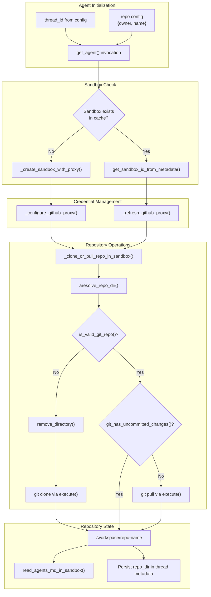
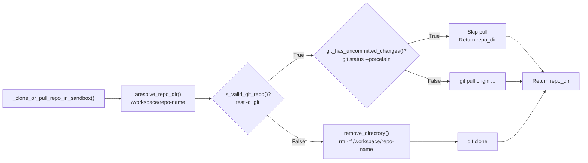
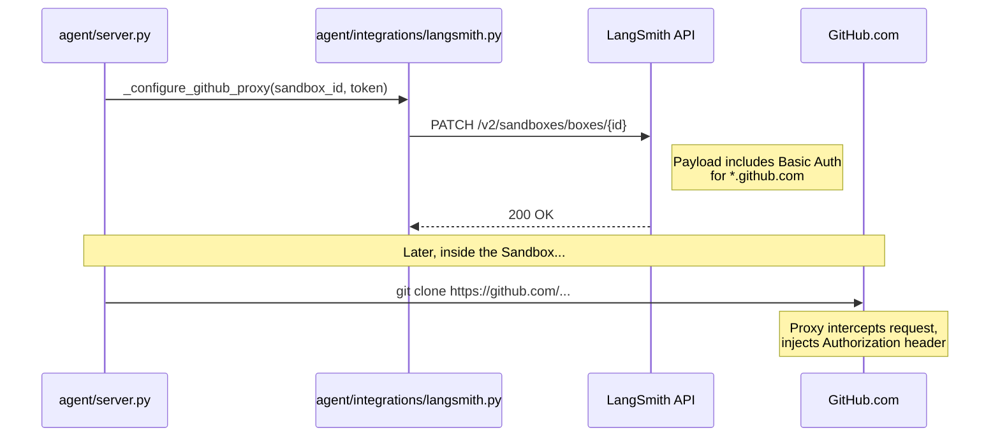
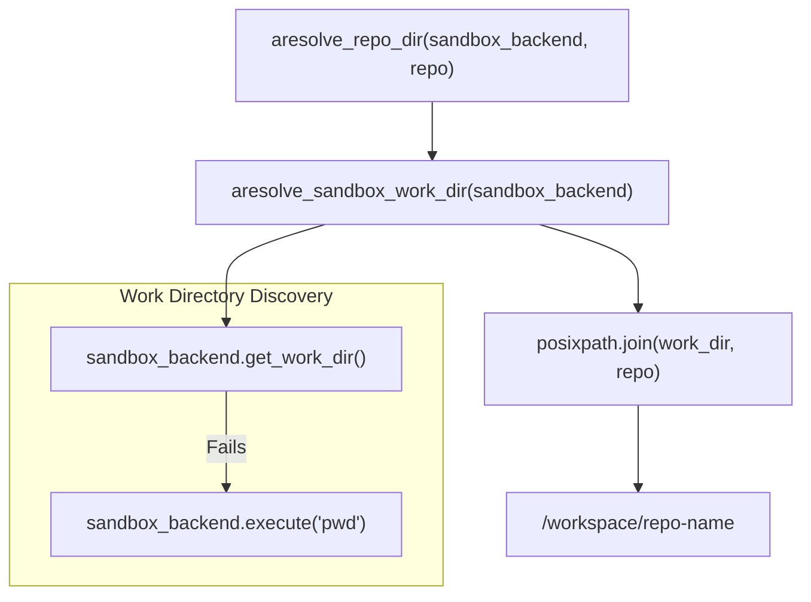

<!-- source: DeepWiki mcp.deepwiki.com · repo langchain-ai/open-swe · page 4.4 Repository Management · fetched 2026-10-26 -->

# Repository Management

<details>
<summary>Relevant source files</summary>

The following files were used as context for generating this wiki page:

- [agent/prompt.py](agent/prompt.py)
- [agent/utils/authorship.py](agent/utils/authorship.py)
- [agent/utils/repo.py](agent/utils/repo.py)
- [scripts/__init__.py](scripts/__init__.py)
- [scripts/check_pr_merge_status.py](scripts/check_pr_merge_status.py)
- [tests/test_github_comment_prompts.py](tests/test_github_comment_prompts.py)
- [tests/test_repo_extraction.py](tests/test_repo_extraction.py)

</details>


Repository management in Open SWE handles cloning GitHub repositories into sandboxes, maintaining repository state across agent runs, managing git credentials securely, and detecting changes. Each thread receives its own isolated copy of the target repository within a dedicated sandbox environment.

For information about sandbox lifecycle and persistence, see **4.3 Sandbox Lifecycle Management**. For authentication and token handling, see **7.1 GitHub Token Resolution**.

---

## Repository Lifecycle

The repository lifecycle is managed within the `get_agent()` and `_clone_or_pull_repo_in_sandbox()` functions. It ensures that every agent run has access to a functional git repository, either by reusing a cached sandbox or provisioning a new one.

### Lifecycle Data Flow

Title: Repository Provisioning Flow

**Sources:** [agent/server.py:81-172](), [agent/server.py:175-214](), [agent/server.py:275-310](), [agent/utils/github.py:26-44]()

---

## Clone and Pull Logic

The `_clone_or_pull_repo_in_sandbox` function orchestrates repository provisioning with intelligent decision-making based on repository state.

### Repository State Detection

Title: State Transition for Repo Sync


| Condition | Action | Reason |
|-----------|--------|--------|
| `.git` directory missing | Remove directory, clone fresh | Invalid/corrupted repository |
| Uncommitted changes present | Skip pull, return existing | Preserve agent's work in progress |
| Clean working tree | Execute `git pull` | Update to latest remote state |

**Sources:** [agent/server.py:81-172](), [agent/utils/github.py:26-44]()

### Clone Operation

When cloning a fresh repository, the system uses the `git clone` command. Authentication is handled transparently by the sandbox proxy (for LangSmith providers), so the URL remains clean.

```python
# Executed in sandbox via sandbox_backend.execute()
# [agent/server.py:159]
f"git clone {shlex.quote(clean_url)} {shlex.quote(repo_dir)}"
```

The clone command:
- Uses the clean HTTPS URL: `https://github.com/{owner}/{repo}.git`
- Clones to a deterministic path resolved by `aresolve_repo_dir()`
- Exits with code 0 on success, raising `RuntimeError` otherwise [agent/server.py:166-169]().

### Pull Operation

When updating an existing repository:

```python
# Executed in sandbox
# [agent/server.py:138]
f"cd {shlex.quote(repo_dir)} && git pull origin $(git rev-parse --abbrev-ref HEAD)"
```

The pull command:
- Updates the current branch from its upstream origin.
- Is skipped if `git_has_uncommitted_changes()` returns `True` [agent/server.py:128-130]().
- Logs a warning if the exit code is non-zero but does not necessarily halt the agent [agent/server.py:141-146]().

**Sources:** [agent/server.py:81-172](), [agent/utils/github.py:41-44]()

---

## Git Credential Handling

Open SWE uses a sophisticated proxy-based approach for git credentials when using LangSmith sandboxes. This prevents tokens from being written to disk or appearing in command-line arguments within the sandbox environment.

### Proxy Authentication Configuration

For LangSmith sandboxes, `_configure_github_proxy` is called during sandbox creation or reconnection.

Title: LangSmith Proxy Credential Injection


**Implementation Details:**
- **Token Source**: Uses the GitHub App installation token via `get_github_app_installation_token()` [agent/server.py:185]().
- **Proxy Rules**: Configures a rule to match `github.com` and `*.github.com` [agent/integrations/langsmith.py:60]().
- **Header Injection**: Injects an `Authorization` header with `Basic` auth containing the base64-encoded installation token [agent/integrations/langsmith.py:61-67]().

**Sources:** [agent/integrations/langsmith.py:37-80](), [agent/server.py:175-192](), [tests/test_proxy_auth.py:17-53]()

---

## Repository Directory Resolution

Repository directories are resolved dynamically using the `aresolve_repo_dir` utility.

### Path Resolution Strategy

Title: Sandbox Path Resolution Logic


The `aresolve_sandbox_work_dir` function first attempts to use the provider's native `get_work_dir()` method. If that fails or is unavailable, it falls back to executing `pwd` within the sandbox [agent/utils/sandbox_paths.py:34-56](). The repository directory is then formed by joining this work directory with the repository name.

**Sources:** [agent/utils/sandbox_paths.py:34-56](), [agent/utils/sandbox_paths.py:58-71]()

---

## Uncommitted Change Detection

Open SWE monitors the state of the repository to prevent accidental overwrites and to determine if a PR needs to be opened.

### Change Detection Functions

| Function | Implementation | Purpose |
|----------|----------------|---------|
| `git_has_uncommitted_changes` | `git status --porcelain` | Returns `True` if there are staged or unstaged changes in the working tree [agent/utils/github.py:41-44](). |
| `git_has_unpushed_commits` | `git log --oneline @{upstream}..HEAD` | Returns `True` if there are local commits that have not been pushed to the remote origin [agent/utils/github.py:52-59](). |

### Usage in Middleware

The `open_pr_if_needed` middleware uses these checks as a "safety net". If the agent finishes its task but hasn't called the `commit_and_open_pr` tool, the middleware checks for changes.

```python
# [agent/middleware/open_pr.py:120-129]
has_uncommitted_changes = await asyncio.to_thread(
    git_has_uncommitted_changes, sandbox_backend, repo_dir
)
await asyncio.to_thread(git_fetch_origin, sandbox_backend, repo_dir)
has_unpushed_commits = await asyncio.to_thread(
    git_has_unpushed_commits, sandbox_backend, repo_dir
)

has_changes = has_uncommitted_changes or has_unpushed_commits
```

If `has_changes` is `True`, the middleware automatically proceeds to configure the git user, commit the changes, push the branch, and open a PR [agent/middleware/open_pr.py:131-176]().

**Sources:** [agent/utils/github.py:41-59](), [agent/middleware/open_pr.py:120-176]()

---

## Commit Attribution and Identity

Open SWE supports collaborative attribution by injecting `Co-authored-by` trailers into commits and adding collaboration notes to PR descriptions.

### Identity Resolution

The `resolve_triggering_user_identity` function determines the user's git identity (name and email) by checking the GitHub token or falling back to Slack/Linear metadata [agent/utils/authorship.py:117-128]().

### Attribution Implementation

| Code Entity | File Path | Role |
|-------------|-----------|------|
| `CollaboratorIdentity` | `agent/utils/authorship.py` | Data class holding user identity for trailers [agent/utils/authorship.py:19-25](). |
| `add_user_coauthor_trailer` | `agent/utils/authorship.py` | Appends `Co-authored-by: name <email>` to commit messages [agent/utils/authorship.py:131-143](). |
| `add_pr_collaboration_note` | `agent/utils/authorship.py` | Appends a collaborative note to the PR body [agent/utils/authorship.py:146-165](). |

The agent's system prompt explicitly instructs it to set a specific bot identity immediately after cloning: `git config user.name 'open-swe[bot]'` and `git config user.email 'open-swe@users.noreply.github.com'` [agent/prompt.py:93]().

**Sources:** [agent/utils/authorship.py:1-166](), [agent/prompt.py:80-106]()

---

## Tool-Based Git Management

The agent primarily interacts with the repository through the `commit_and_open_pr` tool. This tool encapsulates the complex logic of preparing a submission.

### Commit and PR Workflow

1. **Change Validation**: Checks `git_has_uncommitted_changes` and `git_has_unpushed_commits` [agent/tools/commit_and_open_pr.py:147-152]().
2. **Branch Management**: Switches to a feature branch (e.g., `open-swe/{thread_id}`) [agent/tools/commit_and_open_pr.py:157-173]().
3. **Identity Resolution**: Resolves the triggering user's identity to add co-author trailers to the commit message [agent/tools/commit_and_open_pr.py:144-145](), [agent/tools/commit_and_open_pr.py:183]().
4. **Git Configuration**: Configures `user.name` and `user.email` within the sandbox [agent/tools/commit_and_open_pr.py:175-180]().
5. **Staging and Committing**: Executes `git add -A` and `git commit -m ...` [agent/tools/commit_and_open_pr.py:181-185]().
6. **Pushing**: Executes `git push origin {branch}` [agent/tools/commit_and_open_pr.py:192]().
7. **PR Creation**: Calls `create_github_pr` via the GitHub API [agent/tools/commit_and_open_pr.py:202-210]().

**Sources:** [agent/tools/commit_and_open_pr.py:120-212](), [agent/utils/github.py:139-176]()

---

