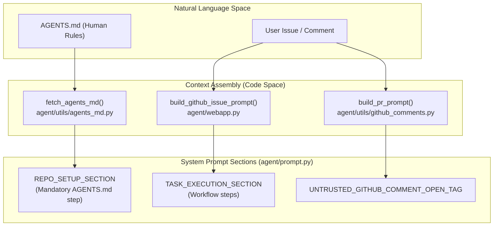
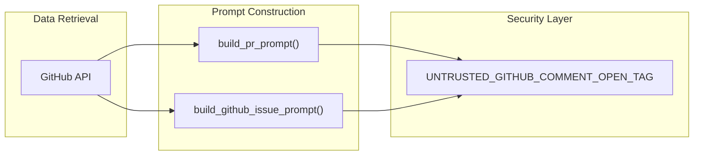

<!-- source: DeepWiki mcp.deepwiki.com · repo langchain-ai/open-swe · page 5 Context Engineering · fetched 2026-10-26 -->

# Context Engineering

Relevant source files

The following files were used as context for generating this wiki page:

- [agent/prompt.py](agent/prompt.py)
- [agent/utils/agents_md.py](agent/utils/agents_md.py)
- [tests/test_github_comment_prompts.py](tests/test_github_comment_prompts.py)

This page documents how Open SWE gathers and injects context into the agent's system prompt from two primary sources: repository-specific conventions via `AGENTS.md` files, and invocation-specific details from Linear issues, Slack threads, or GitHub PRs.

For information about how the agent is assembled with this context, see [Agent Assembly](#3.1). For details on the invocation surfaces that provide source context, see [Invocation Surfaces](#2).

---

## Overview

Open SWE implements a **context engineering** strategy that minimizes tool calls by front-loading the agent with rich context before execution begins. This approach follows the principle observed in elite internal coding agents: pre-hydrate context rather than force agents to discover information through iterative tool calls.

The system gathers context from two complementary sources:

1.  **Repository context** via `AGENTS.md` files that encode project-specific conventions, testing requirements, and architectural guidelines. [agent/prompt.py:66]()
2.  **Source context** from the triggering event (Linear issue details, Slack thread history, or GitHub PR comments) that provides full task information upfront.

### Context Mapping: Natural Language to Code Space

The following diagram bridges the natural language requirements (Issues/Comments) to the specific code entities and prompt sections that handle them.

**Sources:** [agent/prompt.py:80-106](), [agent/utils/agents_md.py:20-27](), [agent/utils/github_comments.py:10-19]()

---

## AGENTS.md Convention

The `AGENTS.md` convention allows repository owners to encode project-specific knowledge that should inform every agent run. This file is treated with the same authority as the system prompt. [agent/prompt.py:102]()

### Mandatory Discovery
The agent is explicitly instructed in the `REPO_SETUP_SECTION` that reading `AGENTS.md` is **mandatory** immediately after cloning a repository. [agent/prompt.py:102-104]()

### Remote Fetching for Reviewers
While the standard agent reads the file from the sandbox, the Reviewer Agent uses `fetch_agents_md` to pull the file via the GitHub API. This allows the reviewer to understand repository conventions without needing a full clone. [agent/utils/agents_md.py:20-32]()

| Feature | Implementation |
| :--- | :--- |
| **Max Size** | Capped at 64KB to prevent context bloat. [agent/utils/agents_md.py:17]() |
| **Auth** | Uses GitHub App or OAuth tokens for private repos. [agent/utils/agents_md.py:41-43]() |
| **Enforcement** | Violating `AGENTS.md` is defined as a "CRITICAL FAILURE". [agent/prompt.py:102]() |

For details, see [AGENTS.md Convention](#5.1).

**Sources:** [agent/prompt.py:80-106](), [agent/utils/agents_md.py:15-73]()

---

## Source Context Assembly

Source context is gathered from the invocation surface (Linear, Slack, or GitHub) before the agent run is created.

### GitHub Context & Security
When processing GitHub comments, Open SWE distinguishes between trusted internal users and external contributors. External comments are wrapped in specific XML-like tags to alert the model. [agent/utils/github_comments.py:6](), [tests/test_github_comment_prompts.py:21-24]()

### Collaborative Identity
If a specific user triggers the agent, their identity is injected into the prompt to allow for "Co-authored-by" attribution in git commits. [agent/prompt.py:5-6](), [tests/test_github_comment_prompts.py:49-64]()

For details, see [Source Context Assembly](#5.2).

**Sources:** [agent/prompt.py:5-6](), [agent/utils/github_comments.py:6-23](), [tests/test_github_comment_prompts.py:9-114]()

---

## Prompt Structure

The system prompt is composed of modular sections defined in `agent/prompt.py`:

*   **`WORKING_ENV_SECTION`**: Defines the Linux sandbox environment and tool usage rules. [agent/prompt.py:38-55]()
*   **`SELF_AWARENESS_SECTION`**: Instructions on when the agent should consider itself the target of the task (the `open-swe` repo). [agent/prompt.py:69-77]()
*   **`TASK_EXECUTION_SECTION`**: Defines the 5-step workflow: Understand, Implement, Verify, Submit, Comment. [agent/prompt.py:119-137]()
*   **`CUSTOM_INSTRUCTIONS`**: Loaded from a local `default_prompt.md` file if it exists, allowing for global deployment-level overrides. [agent/prompt.py:10-35]()

**Sources:** [agent/prompt.py:10-137]()

---

