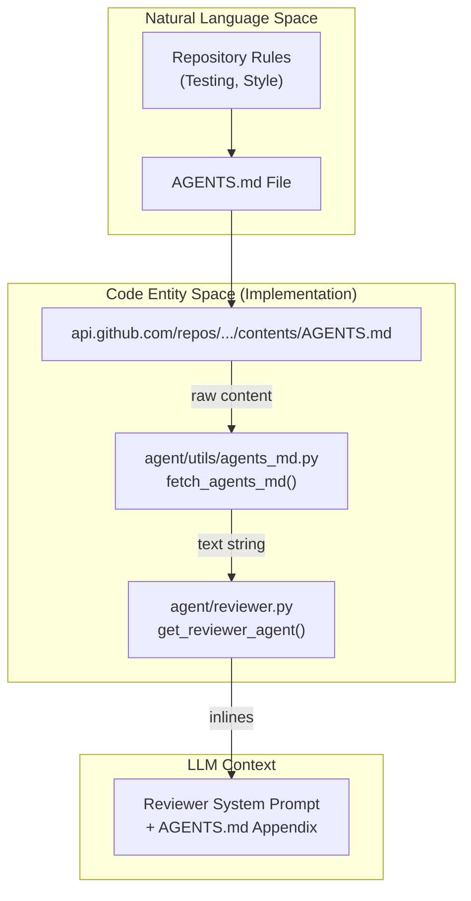
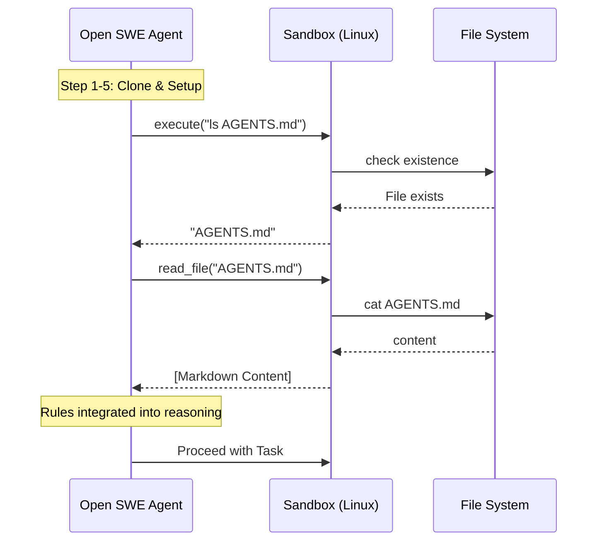

<!-- source: DeepWiki mcp.deepwiki.com · repo langchain-ai/open-swe · page 5.1 AGENTS.md Convention · fetched 2026-10-26 -->

# AGENTS.md Convention

Relevant source files

The following files were used as context for generating this wiki page:

- [.dockerignore](.dockerignore)
- [AGENTS.md](AGENTS.md)
- [CLAUDE.md](CLAUDE.md)
- [agent/prompt.py](agent/prompt.py)
- [agent/utils/agents_md.py](agent/utils/agents_md.py)
- [tests/test_github_comment_prompts.py](tests/test_github_comment_prompts.py)

This page documents the `AGENTS.md` file format and the mechanism by which repository-specific conventions, testing requirements, and architectural guidelines are injected into every agent run.

## Overview

The `AGENTS.md` file is Open SWE's primary mechanism for encoding repository-level knowledge that guides the agent's behavior. Unlike the global system prompt, `AGENTS.md` allows individual project owners to define mandatory rules that override or extend the agent's default behavior for a specific codebase [agent/prompt.py:102-104]().

**Key Characteristics:**
- **Authority**: The contents of `AGENTS.md` are treated with the same authority as the system prompt. Violating these rules is considered a critical failure [agent/prompt.py:102]().
- **Mandatory Discovery**: The agent is explicitly instructed to check for and read this file immediately after cloning a repository, before performing any implementation work [agent/prompt.py:102-104]().
- **Scope**: Covers project-specific commands (testing, linting), architectural patterns, and development workflows [AGENTS.md:11-36]().

**Sources:** [agent/prompt.py:82-106](), [AGENTS.md:1-10]()

## Injection Mechanism

Open SWE uses two distinct methods to handle `AGENTS.md` depending on the graph type (Coding Agent vs. Reviewer Agent).

### 1. Agent-Led Discovery (Main Agent)
For the main coding agent (`agent.server:get_agent`), the file is not pre-injected into the prompt. Instead, the system prompt contains a mandatory instruction requiring the agent to use its file-reading tools to discover the file [agent/prompt.py:102]().

### 2. Automated Injection (Reviewer Agent)
For the reviewer graph (`agent.reviewer:get_reviewer_agent`), the system proactively fetches `AGENTS.md` using the GitHub API to ensure the reviewer has context without needing to perform a full clone and manual read [agent/utils/agents_md.py:1-5]().

**Data Flow: Reviewer Context Injection**

**Sources:** [agent/utils/agents_md.py:1-73](), [agent/reviewer.py:41-42](), [agent/prompt.py:102-106]()

## Implementation Details

### Fetching Logic
The `fetch_agents_md` function retrieves the file content via the GitHub API using a specific ref (branch/commit). It includes a size cap (default 64KB) to prevent context bloat [agent/utils/agents_md.py:17-31]().

| Feature | Implementation | File Reference |
| :--- | :--- | :--- |
| **API Endpoint** | `repos/{owner}/{repo}/contents/AGENTS.md` | [agent/utils/agents_md.py:36]() |
| **Size Limit** | `_MAX_AGENTS_MD_BYTES` (64 KB) | [agent/utils/agents_md.py:17]() |
| **Auth** | Bearer token injection | [agent/utils/agents_md.py:42]() |
| **Error Handling** | Returns `None` on 404 or timeout | [agent/utils/agents_md.py:51-61]() |

### Agent Instructions
The `REPO_SETUP_SECTION` of the system prompt enforces the "Step 6: MANDATORY: READ AGENTS.md" rule. This section explicitly states that these rules override default behavior [agent/prompt.py:102]().

**Sequence: Mandatory Discovery in Sandbox**

**Sources:** [agent/prompt.py:82-106](), [agent/utils/agents_md.py:20-73]()

## Recommended Content Structure

Based on the `AGENTS.md` used within the `open-swe` repository itself, the following sections are recommended:

| Section | Description | Example (from Open SWE) |
| :--- | :--- | :--- |
| **Project** | High-level architecture and framework choice. | "Built on LangGraph + Deep Agents" [AGENTS.md:7]() |
| **Commands** | Dependency management and test execution. | "Dependencies managed with uv. Tests use pytest." [AGENTS.md:13]() |
| **Architecture** | Entrypoints, lifecycle, and middleware order. | Explains `get_agent` vs `get_reviewer_agent` [AGENTS.md:40-42]() |
| **Lifecycle** | Details on sandbox persistence and reconnection. | Explains `ensure_sandbox_for_thread` logic [AGENTS.md:48-55]() |

### Sandbox Lifecycle Conventions
A critical use of `AGENTS.md` in this repository is documenting the sandbox state management. It defines how `SANDBOX_BACKENDS` are keyed by `thread_id` and the four cases for sandbox resolution (cached, creating, disconnected, or non-existent) [AGENTS.md:48-55]().

### Middleware Order
The file documents the specific order of the middleware stack, which is vital for understanding how messages are intercepted or modified before reaching the LLM [AGENTS.md:59-73]().

**Sources:** [AGENTS.md:1-82](), [agent/prompt.py:38-55]()

## Integration with Global Prompts

The `AGENTS.md` content complements the global `DEFAULT_PROMPT_PATH` [agent/prompt.py:10-13](). While the default prompt provides the "Working Environment" and "Self-Awareness" sections [agent/prompt.py:38-77](), `AGENTS.md` provides the "ground truth" for the specific repository being modified.

**Sources:** [agent/prompt.py:10-77](), [AGENTS.md:1-10]()

---

