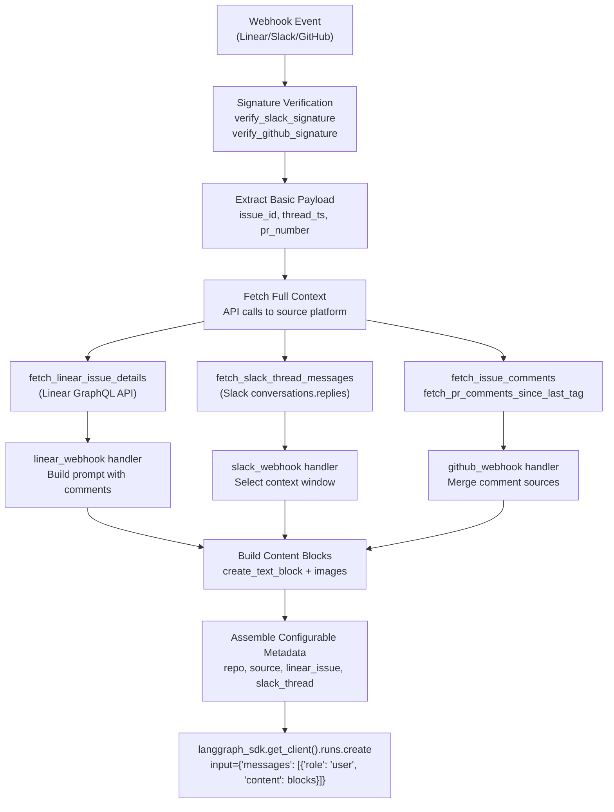
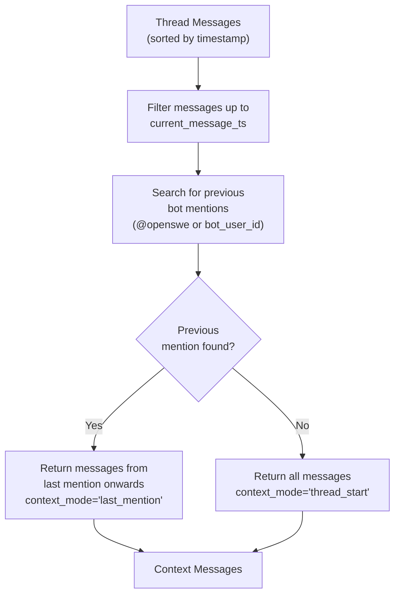
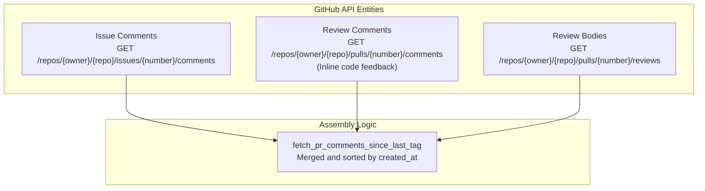

<!-- source: DeepWiki mcp.deepwiki.com · repo langchain-ai/open-swe · page 5.2 Source Context Assembly · fetched 2026-10-26 -->

# Source Context Assembly

<details>
<summary>Relevant source files</summary>

The following files were used as context for generating this wiki page:

- [agent/utils/multimodal.py](agent/utils/multimodal.py)
- [agent/utils/slack.py](agent/utils/slack.py)
- [agent/webapp.py](agent/webapp.py)
- [tests/test_github_issue_webhook.py](tests/test_github_issue_webhook.py)

</details>


Source Context Assembly is the process of gathering full invocation context from the triggering platform (Linear, Slack, or GitHub) and pre-hydrating it into the agent's initial prompt. This minimizes the overhead of the agent discovering context through tool calls by providing rich structured information upfront.

For information about repository-level context injection via `AGENTS.md`, see [AGENTS.md Convention](#5.1).

---

## Purpose and Architecture

When an agent is triggered by a Linear comment, Slack mention, or GitHub PR comment, the system immediately fetches the complete context before creating the LangGraph run. This includes:

- **Linear**: Full issue details, description, all comments, project/team metadata, and triggering user information.
- **Slack**: Thread history with intelligent context windowing from the last bot mention or thread start.
- **GitHub**: Issue/PR details, all comments across three GitHub comment types (issue comments, review comments, reviews), ordered chronologically.

The assembled context is passed as the initial user message in the run's `input` payload, eliminating the need for the agent to call tools like `fetch_url` or `http_request` to discover basic task information.

**Sources:**
- [agent/webapp.py:481-949]()
- [agent/webapp.py:1028-1240]()

---

## Data Flow: Webhook to Context Assembly

The following diagram illustrates how incoming webhook events from "Natural Language Space" (Slack/Linear/GitHub) are transformed into structured "Code Entity Space" objects within the `agent/webapp.py` FastAPI application.



**Sources:**
- [agent/webapp.py:34-53]() (Imported verification and fetch utilities)
- [agent/webapp.py:481-696]() (Linear processing logic)
- [agent/webapp.py:698-810]() (Slack processing logic)
- [agent/webapp.py:1028-1240]() (GitHub processing logic)

---

## Linear Issue Context Assembly

### Fetching Full Issue Details

The webhook payload from Linear contains minimal issue metadata. The system immediately calls `fetch_linear_issue_details()` to retrieve complete information via the Linear GraphQL API.

**Function:** `fetch_linear_issue_details` [agent/webapp.py:228-293]()

**GraphQL Query Fields:**
- `id`, `identifier`, `title`, `description`, `url`
- `project { id, name }`
- `team { id, name, key }`
- `comments { nodes { id, body, createdAt, user { id, name, email } } }`

### Comment Processing and Filtering

Linear issues may accumulate many comments over time, including bot-generated status messages. The system applies intelligent filtering:

1. **Triggering Comment Detection**: If the webhook includes a `triggering_comment_id`, only comments from that point forward are included ([agent/webapp.py:633-640]()).
2. **Bot Message Exclusion**: Comments starting with bot prefixes defined in `_GITHUB_BOT_MESSAGE_PREFIXES` are filtered out ([agent/webapp.py:164-172](), [agent/webapp.py:612-660]()).
3. **Fallback to Recent Comments**: If no triggering comment is identified, `get_recent_comments()` retrieves the most recent non-bot comments ([agent/webapp.py:40-40](), [agent/webapp.py:642-642]()).

### Multimodal Content Handling

The system extracts image URLs from both the issue description and comments using `extract_image_urls()` ([agent/utils/multimodal.py:25-37]()). For each discovered URL, it fetches the image content as a base64-encoded block using `fetch_image_block()` ([agent/utils/multimodal.py:40-99]()).

**Image URL Deduplication:** `dedupe_urls()` [agent/utils/multimodal.py:102-103]()

### Prompt Construction

The final prompt combines all elements into a structured message:

```python
prompt = (
    f"Please work on the following issue:\n\n"
    f"## Title: {title}\n\n"
    f"{triggered_by_line}"
    f"## Linear Ticket: {identifier} - Ticket ID: {issue_id}\n\n"
    f"## Description:\n{description}\n"
    f"{comments_text}\n\n"
    f"Please analyze this issue and implement the necessary changes. "
    f"When you're done, commit and push your changes. {tag_instruction}"
)
```

**Sources:**
- [agent/webapp.py:481-696]()
- [agent/utils/multimodal.py:25-99]()

---

## Slack Thread Context Assembly

### Thread Message Fetching

Slack threads are retrieved using `fetch_slack_thread_messages()`, which calls the `conversations.replies` API with pagination support.

**Function:** `fetch_slack_thread_messages` [agent/utils/slack.py:384-420]()

### Intelligent Context Windowing

Slack applies windowing to avoid overwhelming the agent with irrelevant history. The `select_slack_context_messages()` function implements two strategies based on previous bot mentions.



**Function:** `select_slack_context_messages` [agent/utils/slack.py:207-251]()

**Context Modes:**
- `"thread_start"`: Include all messages from the beginning of the thread.
- `"last_mention"`: Include only messages since the last time the bot was mentioned.

### User Name Resolution

Slack user IDs (e.g., `U01ABC123`) are resolved to display names by calling `get_slack_user_names()`, which batches `users.info` API calls.

**Function:** `get_slack_user_names` [agent/utils/slack.py:364-381]()

### Message Formatting

The `format_slack_messages_for_prompt()` function converts Slack messages into a readable conversation format, replacing bot ID tokens with readable usernames.

**Function:** `format_slack_messages_for_prompt` [agent/utils/slack.py:254-286]()
**Mention Utility:** `replace_bot_mention_with_username` [agent/utils/slack.py:93-99]()

**Sources:**
- [agent/webapp.py:698-810]()
- [agent/utils/slack.py:93-286]()
- [agent/utils/slack.py:384-420]()

---

## GitHub Issue and PR Context Assembly

GitHub context is assembled by unifying three distinct comment types into a single chronological stream.

### GitHub Comment Sources



### Fetching PR Comments Since Last Tag

For PR review workflows, the system only fetches comments since the last `@openswe` mention to avoid reprocessing.

**Function:** `fetch_pr_comments_since_last_tag` [agent/utils/github_comments.py:214-318]()

**Tag Detection:** The system searches for `OPEN_SWE_TAGS` (`@openswe`, `@open-swe`, `@openswe-dev`) in the comment bodies ([agent/utils/github_comments.py:25-25](), [agent/utils/github_comments.py:304-308]()).

### Untrusted User Handling

GitHub issues are public. To prevent prompt injection, comments from users not in `GITHUB_USER_EMAIL_MAP` are wrapped in safety tags.

**Function:** `format_github_comment_body_for_prompt` [agent/utils/github_comments.py:74-84]()
**Security Tags:** `UNTRUSTED_GITHUB_COMMENT_OPEN_TAG` [agent/utils/github_comments.py:1-1]()

### PR Review Prompt Construction

The `build_pr_prompt()` function formats PR comments with file context (path and line number) for inline review comments.

**Function:** `build_pr_prompt` [agent/utils/github_comments.py:386-412]()

**Sources:**
- [agent/utils/github_comments.py:183-448]()
- [agent/webapp.py:1028-1240]()

---

## Configurable Metadata Assembly

Metadata is assembled into a `configurable` dict passed to the LangGraph run. This drives agent tools and authentication.

### Linear Configurable
- `repo`: Repository configuration.
- `linear_issue`: Includes `id`, `identifier` (e.g., "ENG-123"), and `url`.
- `user_email`: Used for GitHub token resolution.

**Sources:** [agent/webapp.py:650-663]()

### Slack Configurable
- `slack_thread`: Includes `channel_id`, `thread_ts`, and `triggering_user_id`.
- `user_email`: Resolved from Slack profile.

**Sources:** [agent/webapp.py:787-799]()

### GitHub Configurable
- `github_issue`: Includes `number` and `title`.
- `branch_name`: Extracted from the PR or issue context.

**Sources:** [agent/webapp.py:1208-1238]()

---

## Tool-Level Context Usage

Once the agent is running, it uses specific tools to interact with these sources:
- `slack_thread_reply`: Uses `configurable["slack_thread"]` to post replies ([agent/tools/slack_thread_reply.py:20-30]()).
- `linear_comment`: Posts comments to the issue identified in metadata ([agent/prompt.py:83-85]()).
- `github_comment`: Replies to the triggering GitHub issue or PR ([agent/prompt.py:94-95]()).

**Sources:**
- [agent/tools/slack_thread_reply.py:1-37]()
- [agent/prompt.py:67-95]()

---

