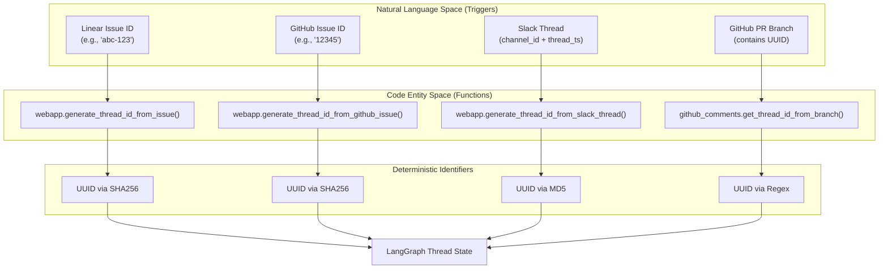
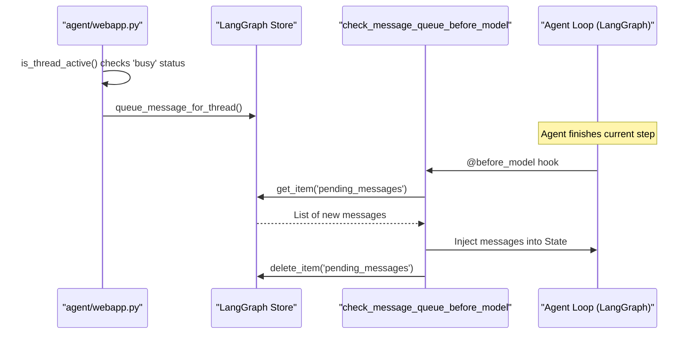
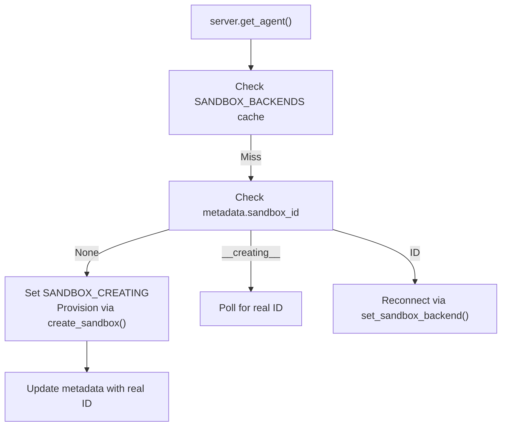

<!-- source: DeepWiki mcp.deepwiki.com · repo langchain-ai/open-swe · page 6 Thread Management and State · fetched 2026-10-26 -->

# Thread Management and State

Relevant source files

The following files were used as context for generating this wiki page:

- [agent/server.py](agent/server.py)
- [agent/tools/__init__.py](agent/tools/__init__.py)
- [agent/webapp.py](agent/webapp.py)
- [tests/test_github_issue_webhook.py](tests/test_github_issue_webhook.py)

This page documents how Open SWE manages conversation threads, deterministic thread ID generation, message queueing, and the persistence of metadata across agent invocations. These mechanisms enable persistent interactions, allowing users to send follow-up messages and maintain context across Linear issues, Slack threads, and GitHub PRs.

For details on how sandbox environments are managed per thread, see [Sandbox Lifecycle Management](#4.3). For details on token encryption within threads, see [Token Encryption and Storage](#7.3).

## Overview

Open SWE leverages LangGraph's thread abstraction to maintain conversation state. Each external trigger maps to a unique, deterministic LangGraph thread ID. This persistence allows the agent to maintain awareness of previous work and reuse resources like sandboxes and authentication tokens.

- **Follow-up Handling**: Users can continue conversations on the same Linear issue or Slack thread.
- **State Persistence**: Metadata such as `sandbox_id`, `repo_dir`, and encrypted tokens are stored within the thread.
- **Concurrency Control**: Concurrent events on the same thread are queued to ensure sequential processing.

**Sources:** [agent/webapp.py:90-91](), [agent/server.py:195-201](), [agent/server.py:258-336]()

---

## Thread ID Generation

Thread IDs are generated deterministically from the invocation source. This ensures that follow-up messages from the same external entity (e.g., a specific Slack thread) are routed to the same LangGraph state.

### Deterministic Thread ID Mapping

The mapping from "Natural Language Space" (where users interact via Slack, Linear, or GitHub) to "Code Entity Space" (the LangGraph `thread_id`) is handled by specific utility functions in `agent/webapp.py` and `agent/utils/github_comments.py`.

Title: Thread ID Generation Flow

**Sources:** [agent/webapp.py:239-268](), [agent/utils/github_comments.py:53-57](), [tests/test_github_issue_webhook.py:64-70]()

For details on the specific hashing algorithms used for each platform, see [Thread ID Generation](#6.1).

---

## Message Queueing

When multiple events arrive for the same thread while the agent is already busy, Open SWE uses a queueing system to prevent lost messages and race conditions. This is managed by `queue_message_for_thread` and checked via middleware.

### Queue Architecture

Title: Message Queueing and Middleware Integration

**Sources:** [agent/webapp.py:90-91](), [agent/server.py:50-51](), [agent/middleware/__init__.py:1-10]()

The `check_message_queue_before_model` middleware ensures that any user feedback provided while the agent was "thinking" is incorporated before the next model invocation. For details, see [Message Queueing](#6.2).

---

## Thread Metadata Storage

Thread metadata acts as the "memory" for the agent's infrastructure needs. It persists the environment configuration so that subsequent runs can reconnect to the same workspace.

### Metadata Schema and Usage

| Key | Purpose | Code Reference |
|---|---|---|
| `sandbox_id` | ID of the isolated environment (e.g., LangSmith, Modal) | [agent/utils/sandbox_state.py:91-92]() |
| `repo` | Dict containing `owner` and `name` | [agent/webapp.py:175-198]() |
| `github_token_encrypted` | Fernet-encrypted user or bot token | [agent/utils/auth.py:36-38]() |
| `reviewer_pr_meta` | Metadata for the Reviewer Agent runs | [agent/reviewer_findings.py:30-33]() |

### Sandbox State Transitions
The system uses a sentinel value `SANDBOX_CREATING` (`"__creating__"`) in the `sandbox_id` field to prevent multiple concurrent requests from attempting to provision a sandbox for the same thread simultaneously.

Title: Sandbox Metadata State Machine

**Sources:** [agent/server.py:85-94](), [agent/server.py:195-201](), [agent/server.py:258-336](), [agent/utils/sandbox_state.py:90-94]()

For details on how these fields are updated and retrieved, see [Thread Metadata Storage](#6.3).

---

## Repo Configuration Persistence

Repository configuration is extracted from the initial trigger and stored to ensure consistency. For example, in Slack, the agent can be told which repo to use via a `repo:owner/name` syntax, which is then persisted.

- **Linear**: Resolved via `LINEAR_TEAM_TO_REPO` mapping in `agent/webapp.py`.
- **Slack**: Resolved via `get_slack_user_info` and repository extraction from the message body.
- **GitHub**: Extracted directly from the repository payload in the webhook.

**Sources:** [agent/webapp.py:175-198](), [agent/utils/github_comments.py:45-57](), [agent/utils/repo.py:65-65]()

---

