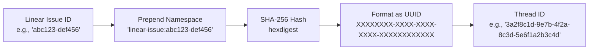
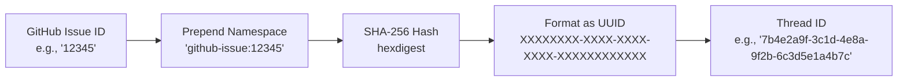
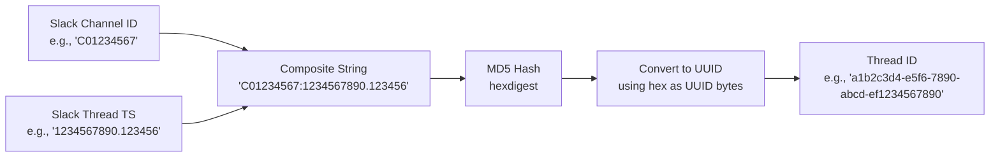
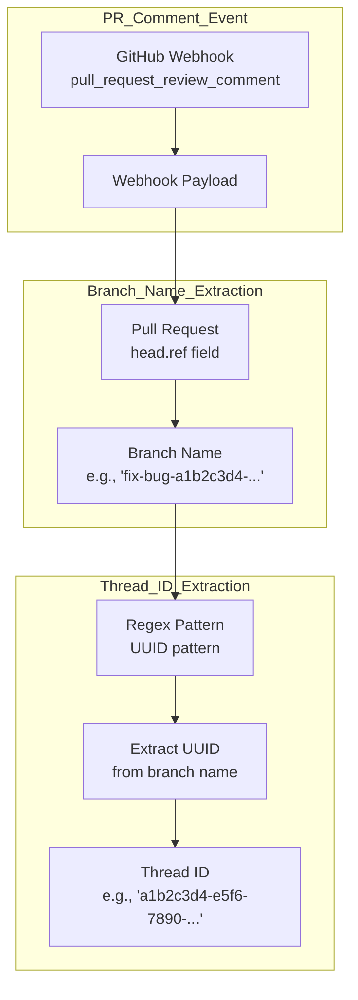
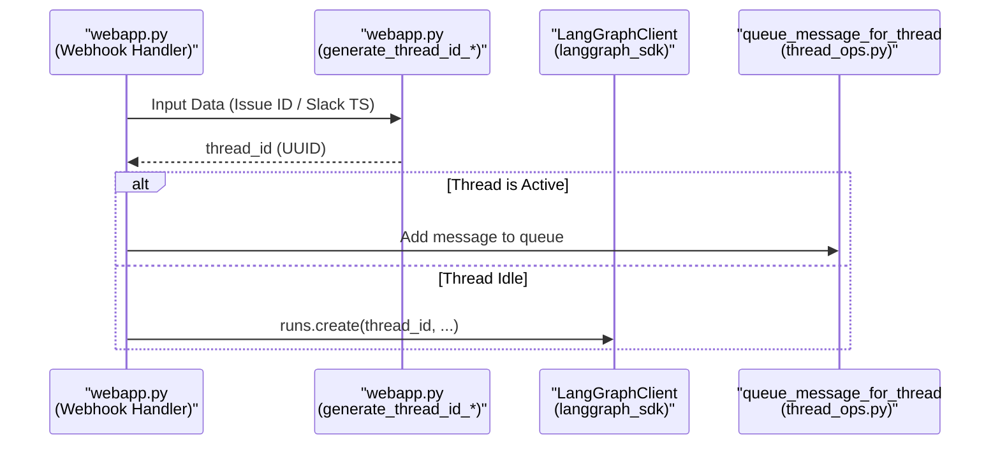

<!-- source: DeepWiki mcp.deepwiki.com · repo langchain-ai/open-swe · page 6.1 Thread ID Generation · fetched 2026-10-26 -->

# Thread ID Generation

Relevant source files

The following files were used as context for generating this wiki page:

- [agent/webapp.py](agent/webapp.py)
- [tests/test_github_issue_webhook.py](tests/test_github_issue_webhook.py)
- [tests/test_slack_context.py](tests/test_slack_context.py)

Thread ID generation is the mechanism by which Open SWE creates deterministic, unique identifiers for conversation threads from different invocation sources. These thread IDs route follow-up messages to the correct LangGraph thread, enabling sandbox reuse, metadata persistence, and conversation continuity across multiple invocations.

---

## Overview

Open SWE generates thread IDs differently depending on the invocation source (Linear, Slack, GitHub issues, or GitHub pull requests). Each generation method ensures that:

1. **Determinism**: The same input always produces the same thread ID.
2. **Uniqueness**: Different inputs produce different thread IDs.
3. **Format consistency**: All thread IDs conform to UUID format (`xxxxxxxx-xxxx-xxxx-xxxx-xxxxxxxxxxxx`).
4. **Reversibility**: For GitHub PRs, the thread ID can be extracted from the branch name.

The thread ID serves as the primary key for:
- LangGraph thread persistence via `langgraph_sdk` [agent/webapp.py:17-18]().
- Sandbox backend caching and lifecycle management [agent/webapp.py:66]().
- Encrypted GitHub token storage and retrieval [agent/utils/auth.py:36-37](), [agent/utils/github_token.py:60]().
- Message queueing for handling concurrent events [agent/utils/thread_ops.py:90]().

**Sources:** [agent/webapp.py:239-268](), [agent/utils/github_comments.py:51-57](), [agent/utils/thread_ops.py:90]()

---

## Thread ID Generation by Source

### Linear Issues

Linear thread IDs are generated deterministically from the Linear issue ID.

Linear Thread ID Generation Flow:

The `generate_thread_id_from_issue()` function creates deterministic thread IDs for Linear issues by:
1. **Namespacing**: Prepending `"linear-issue:"` to the Linear issue ID [agent/webapp.py:240]().
2. **Hashing**: Computing the SHA-256 hash of the namespaced string [agent/webapp.py:240]().
3. **Formatting**: Extracting the first 32 hex characters and formatting as a UUID using string slicing [agent/webapp.py:242-245]().

**Sources:** [agent/webapp.py:239-252]()

---

### GitHub Issues

GitHub issue thread IDs follow a similar pattern to Linear but use a distinct namespace to prevent collisions.

GitHub Issue Thread ID Generation Flow:

The `generate_thread_id_from_github_issue()` function implements this logic [agent/webapp.py:255-261](). This is used for both GitHub issue mentions and issue comment events where the user tags `@openswe`. Determinism is verified in the test suite [tests/test_github_issue_webhook.py:64-70]().

**Sources:** [agent/webapp.py:255-261](), [tests/test_github_issue_webhook.py:64-70]()

---

### Slack Threads

Slack thread IDs are generated using a composite key of the channel and the thread timestamp.

Slack Thread ID Generation Flow:

The `generate_thread_id_from_slack_thread()` function uses MD5 hashing and the `uuid.UUID` constructor with the `hex` parameter [agent/webapp.py:264-268](). All replies in a Slack thread share the same `thread_ts`, ensuring they all route to the same deterministic thread ID [tests/test_slack_context.py:46-53]().

**Sources:** [agent/webapp.py:264-268](), [tests/test_slack_context.py:46-53]()

---

### GitHub Pull Requests

Unlike other sources, GitHub PRs use a **reverse extraction** approach. The thread ID is embedded in the branch name when the PR is first created, then extracted when processing PR comments to maintain conversation continuity.

GitHub Pull Request Thread ID Extraction Flow:

The `get_thread_id_from_branch()` function extracts the thread ID using a UUID regex [agent/utils/github_comments.py:51-57](). This allows the agent to resume the exact same LangGraph thread and sandbox environment that was used to create the PR. If a PR comment is made, the system first tries to find the thread ID from the branch name; if no ID is found, it falls back to generating one from the PR's issue ID [agent/utils/github_comments.py:49-57]().

**Sources:** [agent/utils/github_comments.py:51-57]()

---

## Thread ID Usage Flow

The thread ID is the central identifier used to bridge Natural Language events to Code Entities like sandboxes and LangGraph states.

System Component Interaction:

### Key Data Mappings

| Entity | Purpose | Code Reference |
| :--- | :--- | :--- |
| **LangGraph Thread** | Persistent storage of conversation state and checkpoints | [agent/webapp.py:17-18]() |
| **Thread Metadata** | Storage of `sandbox_id`, `repo_dir`, and encrypted tokens | [agent/utils/auth.py:36-37](), [agent/reviewer_findings.py:32]() |
| **Message Queue** | Handles concurrent events on the same `thread_id` | [agent/utils/thread_ops.py:90]() |

**Sources:** [agent/webapp.py:17-18](), [agent/utils/thread_ops.py:90](), [agent/utils/auth.py:36-37]()

---

## Implementation Comparison

| Source | Algorithm | Input Namespace | Implementation Method | Reversible? |
| :--- | :--- | :--- | :--- | :--- |
| **Linear** | SHA-256 | `linear-issue:` | Manual string formatting [agent/webapp.py:240-245]() | No |
| **GitHub Issue** | SHA-256 | `github-issue:` | Manual string formatting [agent/webapp.py:255-261]() | No |
| **Slack** | MD5 | `channel:ts` | `uuid.UUID(hex=...)` [agent/webapp.py:264-268]() | No |
| **GitHub PR** | N/A | Branch name | Regex extraction [agent/utils/github_comments.py:51-57]() | Yes |

**Sources:** [agent/webapp.py:239-268](), [agent/utils/github_comments.py:51-57]()

---

