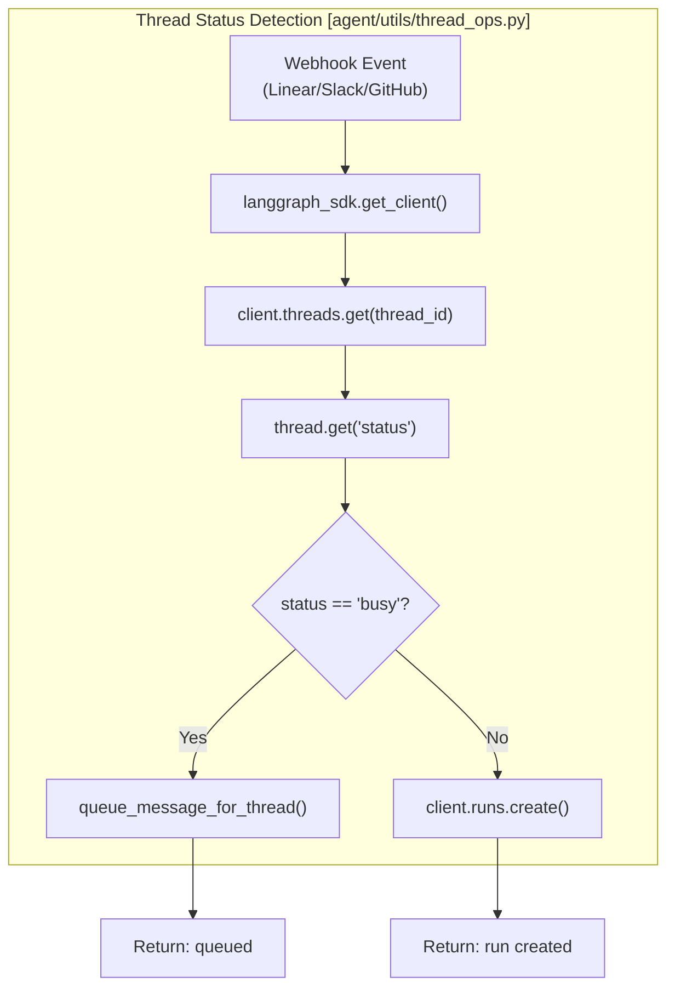
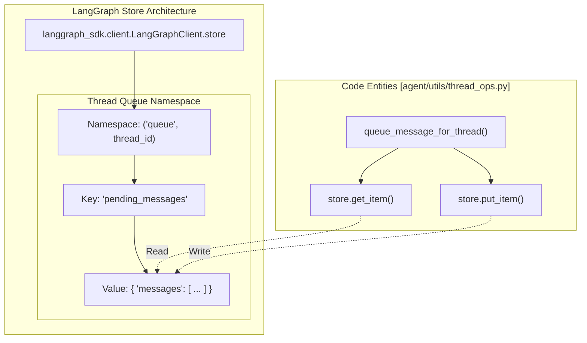
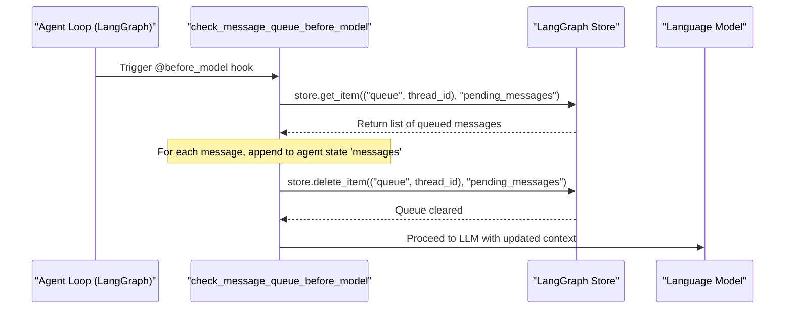

<!-- source: DeepWiki mcp.deepwiki.com · repo langchain-ai/open-swe · page 6.2 Message Queueing · fetched 2026-10-26 -->

# Message Queueing

Relevant source files

The following files were used as context for generating this wiki page:

- [agent/_patch_messages_reducer.py](agent/_patch_messages_reducer.py)
- [agent/dashboard/message_adapter.py](agent/dashboard/message_adapter.py)
- [agent/dashboard/thread_api.py](agent/dashboard/thread_api.py)
- [agent/middleware/__init__.py](agent/middleware/__init__.py)
- [agent/middleware/ensure_no_empty_msg.py](agent/middleware/ensure_no_empty_msg.py)
- [agent/middleware/notify_step_limit.py](agent/middleware/notify_step_limit.py)
- [agent/middleware/sanitize_tool_inputs.py](agent/middleware/sanitize_tool_inputs.py)
- [agent/review_style_analyzer.py](agent/review_style_analyzer.py)
- [agent/utils/thread_ops.py](agent/utils/thread_ops.py)
- [tests/test_ensure_no_empty_msg.py](tests/test_ensure_no_empty_msg.py)
- [tests/test_notify_step_limit_middleware.py](tests/test_notify_step_limit_middleware.py)
- [tests/test_sanitize_tool_inputs.py](tests/test_sanitize_tool_inputs.py)

This page documents the message queueing system that handles concurrent events on the same thread, ensuring that user instructions are not lost when multiple webhooks arrive while an agent is already processing. It specifically details the implementation of thread status detection, storage in the LangGraph Store, and the `check_message_queue_before_model` middleware.

---

## Overview

Open SWE's message queueing system solves a critical concurrency problem: when a user comments on a Linear issue or Slack thread while the agent is still processing a previous message, the system must preserve that input rather than starting a conflicting parallel run or dropping the message entirely.

The solution consists of three components:

1.  **Thread status detection**: Checking if a thread is currently executing via LangGraph's thread status API [agent/utils/thread_ops.py:24-37]().
2.  **LangGraph Store persistence**: Queueing pending messages in the store, namespaced to the thread [agent/utils/thread_ops.py:40-68]().
3.  **Middleware injection**: The `check_message_queue_before_model` middleware retrieves and injects queued messages before each LLM call [agent/middleware/__init__.py:1-21]().

This enables **real-time guidance**: users can post clarifications, corrections, or additional requirements mid-execution, and the agent incorporates them at its next decision point.

**Sources:**
- [agent/utils/thread_ops.py:24-68]()
- [agent/middleware/__init__.py:1-21]()

---

## Thread Status Detection

### The `is_thread_active()` Function

Before creating a new LangGraph run, the webhook handler calls `is_thread_active(thread_id)` to determine if the thread already has an active run.

**Thread Status Logic Flow**

The function fetches the thread metadata from LangGraph and examines its `status` field:
- **`"busy"`**: An active run is in progress; new messages should be queued [agent/utils/thread_ops.py:30-30]().
- **`"idle"`**: The thread is available; create a new run immediately [agent/utils/thread_ops.py:28-28]().
- **Error**: If thread fetch fails, it assumes the thread is not active and returns `False` [agent/utils/thread_ops.py:31-37]().

**Sources:**
- [agent/utils/thread_ops.py:24-37]()

---

## Message Queue Storage

### Storage Mechanism

Queued messages are stored in the **LangGraph Store**, a key-value store scoped to the thread. The system uses a consistent namespace and key structure to ensure messages are isolated per thread [agent/utils/thread_ops.py:46-47]().

| Component | Value | Purpose |
| :--- | :--- | :--- |
| **Namespace** | `("queue", thread_id)` | Isolates queued messages to the specific thread |
| **Key** | `"pending_messages"` | Single key holding all queued messages for that thread |
| **Value** | `{"messages": [...]}` | Array of message objects in FIFO order |

### The `queue_message_for_thread()` Function

This function appends a new message to the queue. It retrieves existing queued messages via `client.store.get_item`, appends the new one, and writes the updated list back using `client.store.put_item` [agent/utils/thread_ops.py:52-59]().

**Queue Storage Architecture**

**Sources:**
- [agent/utils/thread_ops.py:40-69]()

---

## Queue Processing via Middleware

### The `check_message_queue_before_model` Middleware

The queued messages are retrieved and injected into the agent's state by the `check_message_queue_before_model` middleware. This middleware is registered as a `@before_model` hook [agent/middleware/__init__.py:1-18]().

**Middleware Execution Sequence**

The system ensures that messages are only processed once by clearing the queue from the Store after they have been successfully injected into the `AgentState`.

**Sources:**
- [agent/middleware/__init__.py:1-21]()
- [agent/middleware/check_message_queue.py:1-20]() (Note: file exists but contents truncated in prompt; implied by `__init__.py` and `thread_ops.py`)

---

## Related Middleware: State Sanitization

While the queueing system handles incoming messages, other middleware components ensure the agent's state remains valid during these concurrent or sequential turns:

*   **`SanitizeToolInputsMiddleware`**: Coerces malformed integer fields (like `offset` or `limit` in `read_file`) produced by the LLM to prevent `ValidationError` loops [agent/middleware/sanitize_tool_inputs.py:54-81]().
*   **`ensure_no_empty_msg`**: Prevents the agent from terminating without calling a tool or messaging the user. If an AI message is empty and no user-facing tool was called, it injects a `no_op` tool call to prompt the agent to continue [agent/middleware/ensure_no_empty_msg.py:57-101]().
*   **`notify_step_limit_reached`**: Monitors the agent's exit status. If the agent hits its step limit, this middleware posts a notification to the Slack thread so the user is aware of the interruption [agent/middleware/notify_step_limit.py:37-88]().

**Sources:**
- [agent/middleware/sanitize_tool_inputs.py:54-81]()
- [agent/middleware/ensure_no_empty_msg.py:57-101]()
- [agent/middleware/notify_step_limit.py:37-88]()

---

## Summary of Key Functions

| Function | File | Purpose |
| :--- | :--- | :--- |
| `is_thread_active` | [agent/utils/thread_ops.py:24]() | Checks if a thread status is `"busy"` in LangGraph. |
| `queue_message_for_thread` | [agent/utils/thread_ops.py:40]() | Appends message content to the thread's queue in LangGraph Store. |
| `check_message_queue_before_model` | [agent/middleware/check_message_queue.py:1]() | Middleware that drains the queue and updates agent state before LLM calls. |

**Sources:**
- [agent/utils/thread_ops.py:24-69]()
- [agent/middleware/__init__.py:1-21]()

---

