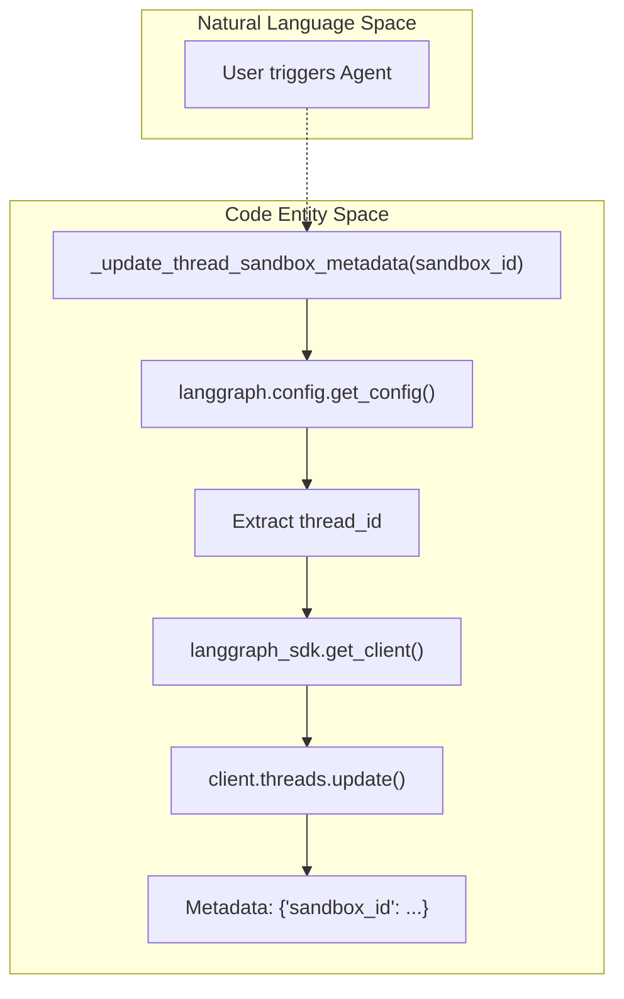
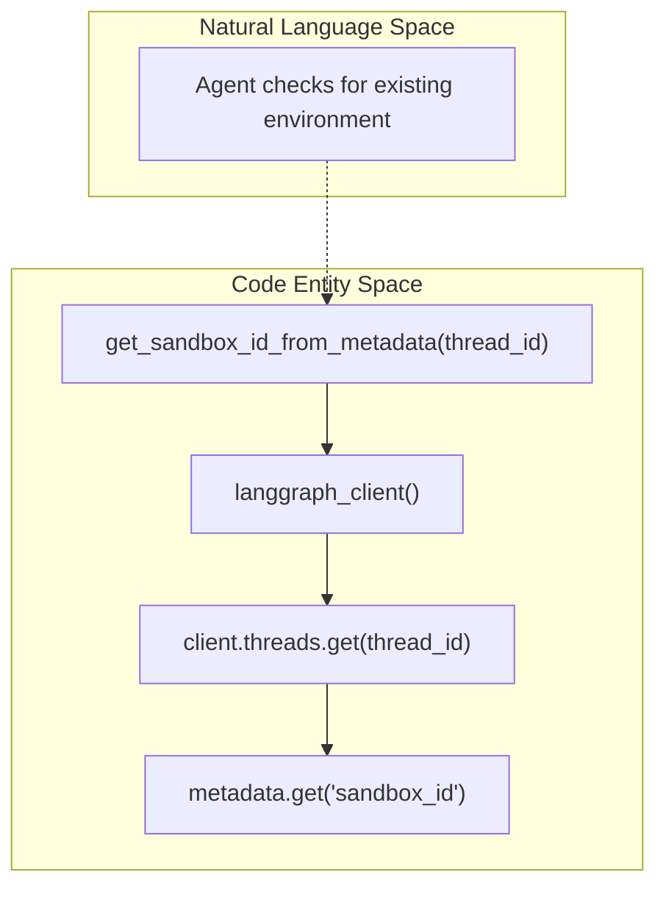

<!-- source: DeepWiki mcp.deepwiki.com · repo langchain-ai/open-swe · page 6.3 Thread Metadata Storage · fetched 2026-10-26 -->

# Thread Metadata Storage

<details>
<summary>Relevant source files</summary>

The following files were used as context for generating this wiki page:

- [agent/_patch_messages_reducer.py](agent/_patch_messages_reducer.py)
- [agent/dashboard/message_adapter.py](agent/dashboard/message_adapter.py)
- [agent/dashboard/thread_api.py](agent/dashboard/thread_api.py)
- [agent/integrations/langsmith.py](agent/integrations/langsmith.py)
- [agent/review_style_analyzer.py](agent/review_style_analyzer.py)
- [agent/server.py](agent/server.py)
- [agent/tools/__init__.py](agent/tools/__init__.py)
- [agent/utils/thread_ops.py](agent/utils/thread_ops.py)
- [pyproject.toml](pyproject.toml)
- [uv.lock](uv.lock)

</details>


Thread metadata storage provides a persistent key-value store for each LangGraph thread, enabling state to be preserved across multiple agent invocations. This system stores critical data like sandbox identifiers, encrypted authentication tokens, and repository configurations, allowing the agent to reuse resources and maintain context when processing follow-up messages.

## Overview

Thread metadata is managed via the LangGraph SDK's `threads.update()` API, which persists arbitrary key-value data associated with a `thread_id`. This metadata survives across independent agent runs, enabling resource reuse and stateful conversations between the user and the agent.

**Sources:** [agent/server.py:195-198](), [agent/integrations/langsmith.py:173-191]()

## Metadata Schema

The following fields are frequently persisted or retrieved from thread metadata to maintain agent state:

| Field | Type | Purpose | Set By |
|-------|------|---------|--------|
| `sandbox_id` | `str` | Unique identifier of the sandbox backend (e.g., LangSmith box ID) | [agent/integrations/langsmith.py:188-191]() |
| `github_login` | `str` | The GitHub username of the user who initiated the thread | [agent/dashboard/thread_api.py:90-91]() |
| `source` | `str` | Origin of the thread (e.g., "dashboard", "slack", "linear") | [agent/dashboard/thread_api.py:98-99]() |
| `latest_run_status` | `str` | Status of the most recent execution (e.g., "success", "failed") | [agent/dashboard/thread_api.py:137-141]() |
| `repo_owner` | `str` | GitHub organization or user owning the target repository | [agent/dashboard/thread_api.py:103-104]() |
| `repo_name` | `str` | Name of the target repository | [agent/dashboard/thread_api.py:104-105]() |

### Special Sentinel Values

The `sandbox_id` field uses a specific sentinel value during the provisioning phase:

```python
SANDBOX_CREATING = "__creating__"
```

This sentinel prevents concurrent runs or race conditions from attempting to create duplicate sandboxes for the same thread while a creation task is already in progress.

**Sources:** [agent/server.py:85-85](), [agent/server.py:197-197]()

## Storage Mechanism

Thread metadata is persisted via the `langgraph_sdk.get_client()` instance, which communicates with the LangGraph server's persistence layer.

### Write Operations

The `_update_thread_sandbox_metadata` function handles the asynchronous update of thread state by extracting the `thread_id` from the current `RunnableConfig`.



**Sources:** [agent/integrations/langsmith.py:173-191]()

### Read Operations

The system retrieves the `sandbox_id` from metadata to determine if it can reconnect to an existing environment instead of provisioning a new one.



**Sources:** [agent/utils/sandbox_state.py:91-91]()

## Lifecycle Operations

### Sandbox Persistence and Reconnection

The `sandbox_id` field tracks the lifecycle of sandbox backends. For LangSmith sandboxes, the ID is captured immediately upon creation. If a run fails or the agent is re-invoked, the `sandbox_id` allows the system to refresh credentials or recreate the sandbox if it has become stale.

**Sources:** [agent/server.py:162-177](), [agent/integrations/langsmith.py:126-170]()

### Token Persistence

Encrypted GitHub tokens are persisted in thread metadata to ensure the agent can perform authenticated `git` operations (like `push` or `pull`) throughout the duration of a multi-turn conversation.

```python
async def _persist_dashboard_github_token(thread_id: str, login: str) -> None:
    token = await get_valid_access_token(login)
    # ... logic to encrypt and store
    await persist_encrypted_github_token(thread_id, token, expires_at=expires_at)
```

**Sources:** [agent/dashboard/thread_api.py:76-86](), [agent/utils/auth.py:17-17]()

## Concurrency and Re-use

### In-Memory Cache vs. Persistent Metadata

Thread metadata works in conjunction with the in-memory `SANDBOX_BACKENDS` dictionary. While the metadata ensures the `sandbox_id` survives server restarts, the `SANDBOX_BACKENDS` cache provides immediate access to active `SandboxBackendProtocol` instances during a single execution session.

**Sources:** [agent/utils/sandbox_state.py:90-94]()

### GitHub Proxy Configuration

For LangSmith sandboxes, metadata storage of the `sandbox_id` is essential for the `_refresh_github_proxy` logic. This function uses the persisted ID to inject a fresh `installation_token` into the sandbox's network proxy rules, allowing the agent to interact with GitHub without writing credentials to the sandbox disk.

**Sources:** [agent/server.py:142-160](), [agent/integrations/langsmith.py:98-124]()

---

