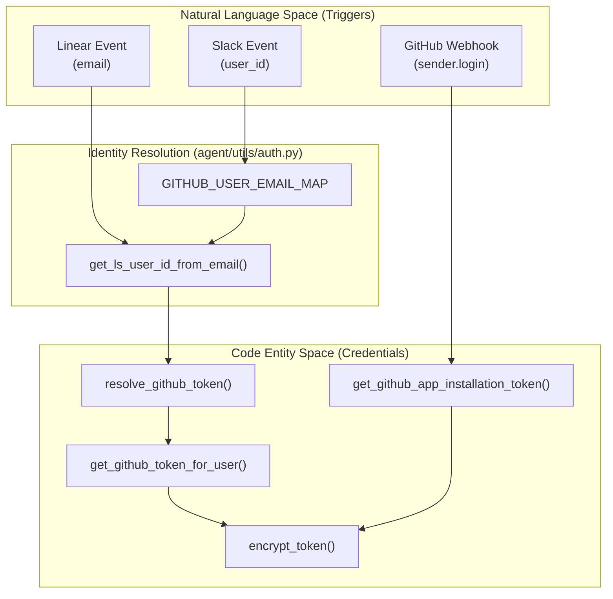

<!-- source: DeepWiki mcp.deepwiki.com · repo langchain-ai/open-swe · page 7 Authentication and Security · fetched 2026-10-26 -->

# Authentication and Security

<details>
<summary>Relevant source files</summary>

The following files were used as context for generating this wiki page:

- [SECURITY.md](SECURITY.md)
- [agent/utils/auth.py](agent/utils/auth.py)
- [agent/utils/github_app.py](agent/utils/github_app.py)
- [agent/utils/github_comments.py](agent/utils/github_comments.py)
- [agent/utils/github_token.py](agent/utils/github_token.py)
- [tests/test_github_token_ttl.py](tests/test_github_token_ttl.py)
- [tests/test_proxy_auth.py](tests/test_proxy_auth.py)

</details>


Open SWE implements a multi-layered security architecture that handles GitHub authentication, token encryption, and sandbox security. The system supports two primary modes: a per-user OAuth mode integrated with LangSmith and a "bot-token-only" mode for simpler deployments.

This is a **PARENT** page. For deep technical details, see the following child pages:
- **[GitHub Token Resolution](#7.1)** — Detailed flow of `resolve_github_token`, email mapping, and LangSmith Host API integration.
- **[Bot Token Only Mode](#7.2)** — Configuration and behavior when per-user OAuth is disabled.
- **[Token Encryption and Storage](#7.3)** — Technical implementation of Fernet encryption and thread metadata persistence.
- **[Security Policy](#7.4)** — Official security policy and vulnerability reporting procedures.

---

## Architecture Overview

The authentication system bridges "Natural Language Space" (identifying users by Slack/Linear emails) to "Code Entity Space" (GitHub tokens and API calls).

### Authentication Flow Diagram
This diagram shows how the system resolves a user's identity from a webhook event into a usable GitHub credential.


**Sources:** [agent/utils/auth.py:138-182](), [agent/utils/github_user_email_map.py:1-10](), [agent/utils/github_app.py:31-67]()

---

## Token Management

Open SWE prioritizes secure handling of GitHub tokens to prevent leakage while ensuring the agent has sufficient permissions to perform git operations.

### GitHub Token Resolution
The system attempts to resolve a GitHub token for the specific user who triggered the agent. It uses the user's email to find their LangSmith user ID via `get_ls_user_id_from_email` [agent/utils/auth.py:96-122]() and then fetches an OAuth token via the LangSmith Host API using `get_github_token_for_user` [agent/utils/auth.py:138-182](). If no user token is available, it falls back to a GitHub App installation token. For details, see [GitHub Token Resolution](#7.1).

### Encryption and Persistence
To avoid repeated OAuth flows, tokens are encrypted using the Fernet algorithm and stored in the LangGraph thread metadata under the key `github_token_encrypted` [agent/utils/github_token.py:18-19](). The system also tracks `github_token_expires_at` to proactively re-authenticate before tokens expire [agent/utils/github_token.py:45-78](). For details, see [Token Encryption and Storage](#7.3).

**Sources:** [agent/utils/auth.py:138-182](), [agent/utils/github_token.py:18-100](), [agent/encryption.py:1-30]()

---

## Sandbox and Tool Security

Security extends beyond authentication to the execution environment. Open SWE implements safeguards to prevent the agent from performing SSRF (Server-Side Request Forgery) or accessing internal resources.

### GitHub Proxy Configuration
For LangSmith-hosted sandboxes, Open SWE configures a secure GitHub proxy. The function `_configure_github_proxy` [agent/integrations/langsmith.py:11-13]() (tested in [tests/test_proxy_auth.py:14-61]()) injects GitHub credentials into the sandbox environment via opaque headers. This ensures that the agent's git operations within the sandbox are authenticated without exposing raw tokens to the agent's process space.

```mermaid
sequenceDiagram
    participant Srv as "agent/server.py"
    participant LS as "LangSmith API"
    participant Box as "Sandbox Environment"

    Srv->>Srv: get_github_app_installation_token()
    Srv->>LS: PATCH /v2/sandboxes/boxes/{id} (proxy_config)
    Note over LS: Rules for api.github.com<br/>and github.com
    LS-->>Srv: 200 OK
    Srv->>Box: Execute Git Command
    Box->>LS: Outbound Request
    LS->>GitHub: Authenticated Request (Opaque Header)
```
**Sources:** [tests/test_proxy_auth.py:17-61](), [agent/server.py:125-145]()

---

## Operational Security Policies

### Bot-Token-Only Mode
In environments where per-user OAuth is not configured (missing `X_SERVICE_AUTH_JWT_SECRET` and `USER_ID_API_KEY_MAP`), Open SWE defaults to "Bot-Token-Only" mode. This is checked via `is_bot_token_only_mode()` [agent/utils/auth.py:44-52](). In this mode, all operations are performed using the GitHub App's installation token. For details, see [Bot Token Only Mode](#7.2).

### Webhook Verification
All incoming GitHub webhooks are verified using the `X-Hub-Signature-256` header and a configured `GITHUB_WEBHOOK_SECRET` via the `verify_github_signature` function [agent/utils/github_comments.py:52-68]().

### Security Policy
Official security concerns and vulnerability reports should be directed to the contact information provided in the security policy. For details, see [Security Policy](#7.4).

**Sources:** [agent/utils/auth.py:44-52](), [agent/utils/github_comments.py:52-68](), [SECURITY.md:1-4]()

---

