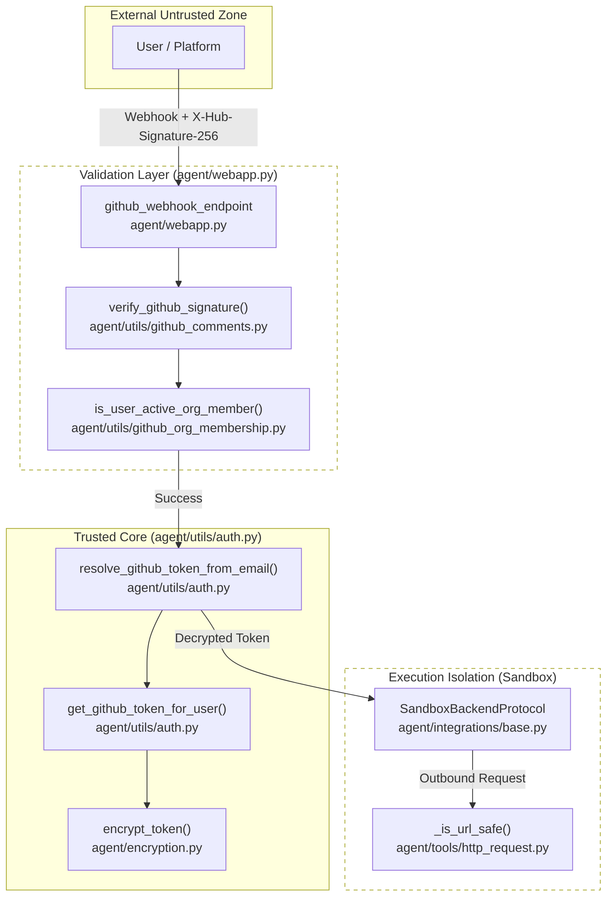
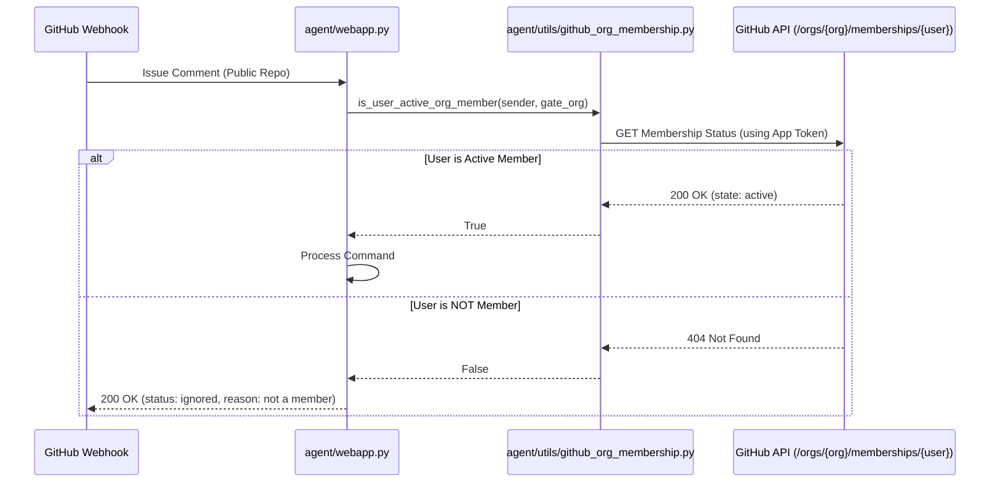

<!-- source: DeepWiki mcp.deepwiki.com · repo langchain-ai/open-swe · page 7.4 Security Policy · fetched 2026-10-26 -->

# Security Policy

Relevant source files

The following files were used as context for generating this wiki page:

- [SECURITY.md](SECURITY.md)
- [agent/utils/github_org_membership.py](agent/utils/github_org_membership.py)
- [tests/test_public_repo_org_gate.py](tests/test_public_repo_org_gate.py)

This document describes the security policy for the Open SWE framework, including vulnerability reporting procedures, contact information, and technical implementation of security gates. It details the security boundaries, data flow protections, and implementation of safety mechanisms like organization-level gating for public repositories.

## Purpose and Scope

This page covers:
- Security vulnerability reporting procedures and contact information.
- Security boundaries and trust model in the Open SWE architecture.
- Implementation of the Public Repository Organization Gate.
- Networking security and SSRF prevention in agent tools.
- Best practices for secure deployment and credential management.

For authentication implementation details, see [7.1 GitHub Token Resolution](), [7.2 Bot Token Only Mode](), and [7.3 Token Encryption and Storage](). For sandbox isolation mechanisms, see [4.1 Sandbox Architecture]().

---

## Vulnerability Reporting

### Contact Information

For any security concerns or vulnerabilities, contact:

**Email:** `security@langchain.dev`

This email address is monitored by the LangChain security team and should be used for all security-related reports.

**Sources:** [SECURITY.md:1-4]()

### What to Report

Security vulnerabilities in Open SWE should be reported if they could lead to:

| Vulnerability Type | Description | Example |
|-------------------|-------------|---------|
| **Authentication Bypass** | Circumventing token verification or webhook signature validation. | Accepting unsigned GitHub webhook payloads. |
| **Credential Exposure** | Leaking encrypted GitHub tokens or API keys. | Logging decrypted tokens in error messages. |
| **Sandbox Escape** | Breaking out of sandbox isolation to access host system. | Exploiting `execute` tool to run commands on the host machine. |
| **SSRF / Internal Access** | Forcing the agent to scan or request internal network resources. | Bypassing IP filters in `http_request`. |
| **Unauthorized Access** | Accessing repositories without valid GitHub OAuth or App tokens. | Reading private code via a leaked session ID. |
| **Public Repo Abuse** | Non-members triggering agent runs on public repositories. | External users consuming compute by commenting on public PRs. |

**Sources:** [SECURITY.md:1-4](), [tests/test_public_repo_org_gate.py:55-99]()

---

## Security Architecture

### Security Boundaries and Data Flow

The following diagram associates high-level security zones with specific code entities responsible for maintaining those boundaries.

**System Security Entity Map**

**Sources:** [agent/webapp.py:77-110](), [agent/utils/github_org_membership.py:16-65](), [agent/utils/auth.py:175-200](), [agent/tools/http_request.py:11-40]()

---

## Public Repository Gating

To prevent compute abuse on public repositories, Open SWE implements an organization membership gate. When the system receives a webhook from a public repository, it verifies that the sender is an active member of a trusted organization.

### Membership Verification Logic
The `is_user_active_org_member` function performs a "fail-closed" check against the GitHub API.

**Gating Flow**

**Key Implementation Details:**
- **App Token Usage**: The check uses `get_github_app_installation_token()` to ensure it can view private memberships if necessary [agent/utils/github_org_membership.py:27-32]().
- **Fail-Closed**: Any API error or unexpected status code results in a `False` return, blocking the agent invocation [agent/utils/github_org_membership.py:45-58]().
- **Private Repo Bypass**: This gate is automatically skipped for private repositories, as access is already controlled by repository permissions [tests/test_public_repo_org_gate.py:143-182]().
- **Internal Bots**: Known internal bot logins (e.g., `open-swe[bot]`) are defined in `INTERNAL_BOT_LOGINS` [agent/utils/github_org_membership.py:13]().

**Sources:** [agent/utils/github_org_membership.py:1-66](), [tests/test_public_repo_org_gate.py:55-142]()

---

## Networking Security: SSRF Prevention

Open SWE includes specific protections to prevent Server-Side Request Forgery (SSRF) when the agent uses tools to fetch external data.

### URL Validation Logic
The `http_request` and `fetch_url` tools utilize `_is_url_safe()` to validate every URL and redirect target. This function resolves hostnames to IP addresses and blocks any that fall into private or reserved ranges.

**Implementation Details:**
- **Private IP Blocking**: Blocks ranges like `127.0.0.1`, `10.0.0.0/8`, and the AWS metadata IP `169.254.169.254` [agent/tools/http_request.py:34-35]().
- **Redirect Validation**: The system follows up to 5 redirects, but re-validates the safety of the `Location` header at every step [agent/tools/http_request.py:64-97]().
- **Scheme Enforcement**: Only `http` and `https` schemes are permitted [agent/tools/http_request.py:15-16]().

**Sources:** [agent/tools/http_request.py:11-97](), [agent/tools/fetch_url.py:35-46]()

---

## Sensitive Data Management

### Token Encryption
GitHub OAuth tokens are never stored in plain text within the thread metadata. They are encrypted using the `encrypt_token` utility before being persisted [agent/utils/auth.py:16]().

### Bot Token Only Mode
In environments where per-user OAuth is not configured (missing `X_SERVICE_AUTH_JWT_SECRET`), the system defaults to "Bot Token Only Mode". In this mode, it uses the GitHub App's installation token for all operations, reducing the surface area for user credential handling [agent/utils/auth.py:44-52]().

### Webhook Verification
GitHub webhooks are verified using the `X-Hub-Signature-256` header and a configured `GITHUB_WEBHOOK_SECRET`. If the secret is missing or the signature does not match the HMAC of the body, the request is rejected [tests/test_public_repo_org_gate.py:17-32]().

**Sources:** [agent/utils/auth.py:44-52](), [agent/encryption.py:1-20](), [tests/test_public_repo_org_gate.py:17-32]()

---

## Security Best Practices for Deployment

| Category | Best Practice | Implementation Reference |
| :--- | :--- | :--- |
| **Secrets** | Never hardcode keys. Use environment variables. | [agent/utils/auth.py:27-32]() |
| **Sandboxing** | Use `langsmith` or `modal` backends for production isolation. | [agent/integrations/base.py]() |
| **Tokens** | Ensure `FERNET_KEY` is rotated periodically. | [agent/encryption.py]() |
| **Public Gating** | Set `PUBLIC_REPO_ORG_GATE` to your GitHub Org name. | [tests/test_public_repo_org_gate.py:49]() |

### Environment Variable Protection
The following variables are critical for security and must be protected:
- `GITHUB_WEBHOOK_SECRET`: Used to verify incoming GitHub events.
- `PUBLIC_REPO_ORG_GATE`: Defines the organization required to trigger agents on public repos [tests/test_public_repo_org_gate.py:49]().
- `X_SERVICE_AUTH_JWT_SECRET`: Used to generate service keys for LangSmith auth [agent/utils/auth.py:83-85]().
- `FERNET_KEY`: Used for encrypting tokens in the database [agent/encryption.py]().

**Sources:** [agent/utils/auth.py:83-85](), [agent/encryption.py](), [tests/test_public_repo_org_gate.py:47-53]()

---

