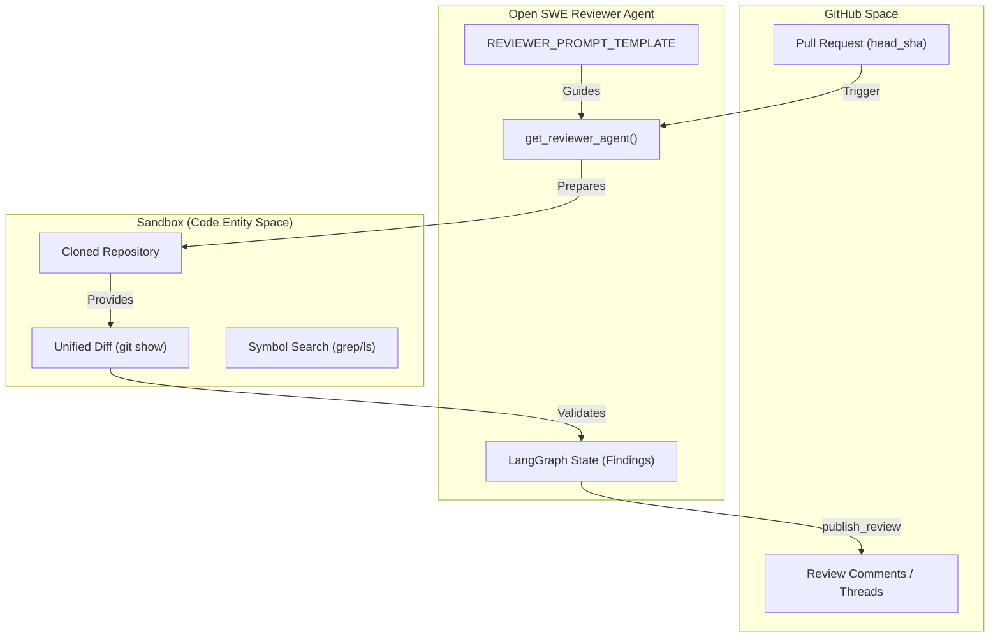
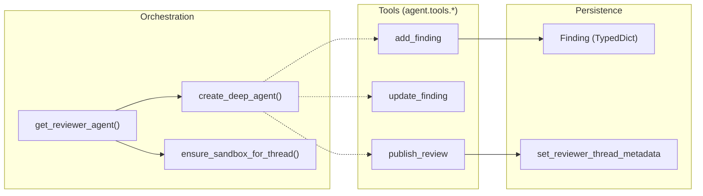

<!-- source: DeepWiki mcp.deepwiki.com · repo langchain-ai/open-swe · page 8 Reviewer Agent · fetched 2026-10-26 -->

# Reviewer Agent

Relevant source files

The following files were used as context for generating this wiki page:

- [agent/reviewer.py](agent/reviewer.py)
- [agent/tools/publish_review.py](agent/tools/publish_review.py)
- [tests/test_reviewer.py](tests/test_reviewer.py)
- [tests/test_reviewer_publish.py](tests/test_reviewer_publish.py)

The **Reviewer Agent** is a specialized LangGraph-based agent designed to perform automated code reviews on GitHub Pull Requests. Unlike the general-purpose coding agent, the Reviewer Agent is optimized for high-precision defect detection, adherence to repository-specific styles, and persistent findings management across multiple commits.

## Overview

The Reviewer Agent operates within a controlled sandbox environment, mirroring the repository state at the PR's head SHA. It utilizes a multi-pass workflow to identify bugs, validate them against the PR diff, and manage a lifecycle of "Findings" that can be published as inline GitHub comments.

### Core Responsibilities
*   **Deterministic Preparation**: Automatically clones the repository and checks out the target SHA before the first model call [agent/reviewer.py:6-7]().
*   **Precision Tooling**: Uses a specialized toolset (`add_finding`, `update_finding`, `list_findings`, `publish_review`) focused on review state rather than code modification [agent/reviewer.py:11-12]().
*   **Diff Discipline**: Enforces strict rules to only file findings anchored to changed lines or proven regressions [agent/reviewer.py:97-107]().
*   **Context Awareness**: Injects repository-specific conventions from `AGENTS.md` and historical review styles [agent/reviewer.py:62, 181-190]().

### High-Level System Flow
The following diagram illustrates how the Reviewer Agent bridges the gap between GitHub PR events and the internal code entity representation.

**Reviewer System Architecture**

Sources: [agent/reviewer.py:1-15](), [agent/reviewer.py:68-95](), [agent/tools/publish_review.py:38-75]()

---

## Sub-Pages

### [Reviewer Architecture and Workflow](#8.1)
The reviewer is instantiated via `get_reviewer_agent()`, which configures a `deep_agent` with specialized system prompts and tools [agent/reviewer.py:3-15](). It follows a lifecycle that includes sandbox preparation, diff analysis, and a "watch-mode" for re-reviews when new commits are pushed.
For details, see [Reviewer Architecture and Workflow](#8.1).

### [Findings Management](#8.2)
Findings are the primary data structure for the reviewer. Each `Finding` includes severity, file/line anchors, and suggestions [agent/reviewer_findings.py:10-33](). The agent uses `add_finding` to record issues and `update_finding` to manage their status (e.g., "resolved") during re-reviews [agent/reviewer.py:90-95]().
For details, see [Findings Management](#8.2).

### [Review Style System](#8.3)
To ensure reviews feel native to a team, the system includes a Review Style Analyzer. This component crawls historical PR feedback to generate a `repo_style_prompt`, which is then injected into the agent's system prompt [agent/reviewer.py:25-35]().
For details, see [Review Style System](#8.3).

### [Reviewer Evaluation Infrastructure](#8.4)
The quality of the reviewer is measured using an offline LangSmith evaluation framework. This includes a benchmark dataset and a "judge model" that evaluates the accuracy and relevance of the agent's findings without posting to GitHub [agent/tools/publish_review.py:97-104](), [tests/test_reviewer_publish.py:91-128]().
For details, see [Reviewer Evaluation Infrastructure](#8.4).

---

## Reviewer Agent Entity Map

This diagram maps the internal Python classes and functions to the conceptual stages of a code review.

**Code Entity Mapping**

Sources: [agent/reviewer.py:34-61](), [agent/tools/publish_review.py:10-18](), [agent/reviewer_findings.py:10-33]()

## Key Constraints
The Reviewer Agent is explicitly instructed to avoid:
1.  **Style Nits**: No naming or extraction suggestions unless they break behavior [agent/reviewer.py:128-132]().
2.  **Speculation**: No "potential" race conditions without a reachable trigger [agent/reviewer.py:133-135]().
3.  **Overlap**: It must not duplicate existing human review threads [agent/reviewer.py:110-127]().

Sources: [agent/reviewer.py:1-15](), [agent/reviewer.py:68-150](), [agent/tools/publish_review.py:38-75](), [agent/reviewer_findings.py:10-33](), [tests/test_reviewer.py:11-35]()

---

