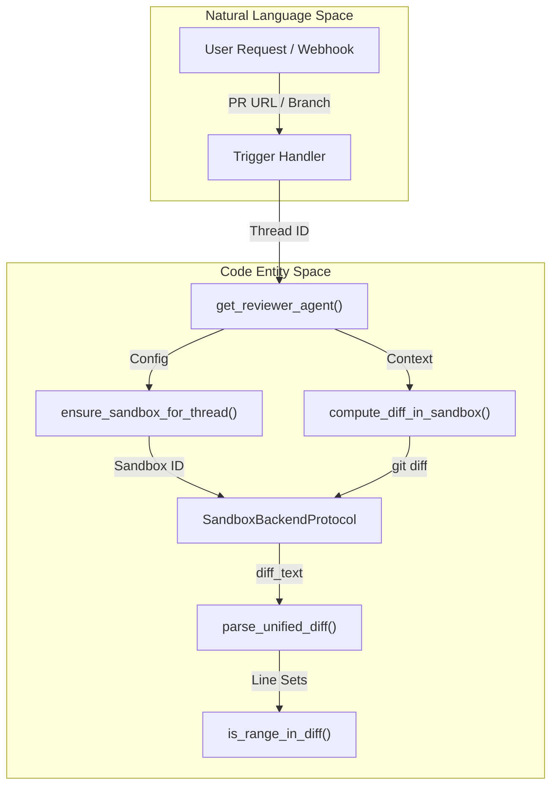
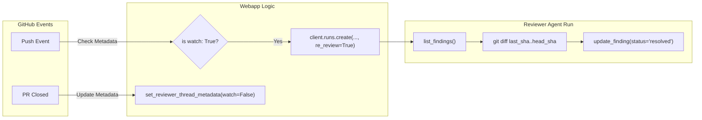

<!-- source: DeepWiki mcp.deepwiki.com · repo langchain-ai/open-swe · page 8.1 Reviewer Architecture and Workflow · fetched 2026-10-26 -->

# Reviewer Architecture and Workflow

Relevant source files

The following files were used as context for generating this wiki page:

- [REVIEWER_DESIGN.md](REVIEWER_DESIGN.md)
- [agent/reviewer.py](agent/reviewer.py)
- [agent/reviewer_diff.py](agent/reviewer_diff.py)
- [agent/reviewer_publish.py](agent/reviewer_publish.py)
- [agent/tools/list_findings.py](agent/tools/list_findings.py)
- [tests/test_reviewer.py](tests/test_reviewer.py)
- [tests/test_reviewer_watch.py](tests/test_reviewer_watch.py)

The Reviewer Agent is a specialized LangGraph-based agent designed to perform automated code reviews on GitHub Pull Requests. Unlike the general-purpose coding agent, the reviewer focuses on identifying defects, enforcing repository-specific styles, and maintaining an evolving list of "Findings" across the PR lifecycle. It supports a "watch-mode" that automatically re-evaluates the PR when new commits are pushed.

## Reviewer Agent Factory

The `get_reviewer_agent()` function is the primary factory for assembling the reviewer. It mirrors the standard agent setup but specializes the configuration for review tasks [agent/reviewer.py:1-15]().

### Configuration and Tools
The factory configures a `deep_agent` with a specific toolset and middleware:
*   **Specialized Tools**: `add_finding`, `update_finding`, `list_findings`, and `publish_review`. It explicitly excludes tools for committing, pushing, or opening PRs to ensure it remains a read-only observer of the codebase [agent/reviewer.py:53-61]().
*   **Model Setup**: Uses `make_model` to initialize the LLM, supporting reasoning efforts (e.g., "high" for O1/Claude models) and adaptive thinking [agent/reviewer.py:65](), [tests/test_reviewer.py:86-128]().
*   **Middleware**: Includes `SanitizeToolInputsMiddleware`, `SlackAssistantStatusMiddleware`, and `ToolErrorMiddleware` to handle common execution issues [agent/reviewer.py:37-41]().

### Deterministic Preparation
Before the agent's first model call, the factory performs "deterministic repo prep." This involves cloning the repository and checking out the specific `head_sha` in the sandbox. This saves tokens by preventing the LLM from having to manually run `gh repo clone` or `git checkout` commands [agent/reviewer.py:6-10]().

Sources: [agent/reviewer.py:1-67](), [tests/test_reviewer.py:86-128]()

## Multi-Pass Review Workflow

The reviewer follows a structured prompt-driven workflow defined in the `REVIEWER_PROMPT_TEMPLATE`. This template enforces a high bar for findings and a specific sequence of operations.

### Review Phases
| Phase | Action | Purpose |
| :--- | :--- | :--- |
| **1. Discovery** | `gh pr diff` | Read the PR diff end-to-end to identify changed lines [agent/reviewer.py:72-76](). |
| **2. Contextualization** | `gh repo clone` | Obtain full file context and grep for callers/implementers if signatures changed [agent/reviewer.py:84-88](). |
| **3. Analysis** | Base-vs-Head | Use `git show <base_sha>:path` to compare old vs. new logic, looking for dropped behaviors like nil-checks or error handling [agent/reviewer.py:154-158](). |
| **4. Reporting** | `add_finding` | Record concrete defects anchored to specific lines in the diff [agent/reviewer.py:90-95](). |
| **5. Finalization** | `publish_review` | Batch findings and post them to GitHub as a single review [agent/reviewer.py:91-92](). |

### Finding Criteria ("The Bar")
The agent is instructed to only file findings that:
1.  Can be anchored to a specific changed line [agent/reviewer.py:99]().
2.  Name a concrete failure mode (build-time, runtime, or user-facing) [agent/reviewer.py:100-101]().
3.  Exist within the PR diff hunk or represent a proven regression on a changed symbol [agent/reviewer.py:102-106]().

Sources: [agent/reviewer.py:68-164](), [REVIEWER_DESIGN.md:75-86]()

## Sandbox Preparation and Diff Management

The reviewer relies on a robust sandbox environment to execute `gh` and `git` commands. It uses specialized utilities to manage diffs and validate findings before they are sent to GitHub.

### Diff Line Validation
To prevent "out-of-bounds" comments that GitHub's API would reject, the system computes a `diff_line_set` [agent/reviewer_diff.py:125-138](). The `add_finding` tool uses `is_range_in_diff` to verify that the suggested comment falls within the actual changes of the PR [agent/reviewer_diff.py:166-183]().

### Code Entity Space to Sandbox Flow
The following diagram illustrates how the system prepares the sandbox for a review run.

**Sandbox Initialization Flow**

Sources: [agent/reviewer.py:50](), [agent/reviewer_diff.py:125-138](), [agent/reviewer_diff.py:166-193]()

## Findings Lifecycle and State

Findings are treated as first-class state, persisted in **LangGraph thread metadata** rather than temporary sandbox files. This ensures they survive sandbox evictions [REVIEWER_DESIGN.md:31-34]().

### Finding Data Structure
Each `Finding` (defined in `agent/reviewer_findings.py`) includes:
*   `id`: A stable, unique identifier (e.g., `f_<uuid>`) [REVIEWER_DESIGN.md:37]().
*   `severity`: From `informational` to `critical` [REVIEWER_DESIGN.md:38]().
*   `suggestion`: Optional replacement text for GitHub's "Commit suggestion" UI [REVIEWER_DESIGN.md:45]().
*   `status`: `open`, `resolved`, or `dismissed` [REVIEWER_DESIGN.md:46]().
*   `github_review_comment_id`: The ID returned by GitHub after publishing, used to track threads [REVIEWER_DESIGN.md:49]().

### Mutation Tools
The agent manages findings through three primary tools:
1.  `add_finding`: Creates a new record in thread metadata [agent/tools/add_finding.py]().
2.  `update_finding`: Modifies existing findings (e.g., changing status to `resolved`) [agent/tools/update_finding.py]().
3.  `list_findings`: Retrieves findings for the current thread, allowing the agent to see what was previously reported [agent/tools/list_findings.py:16-36]().

Sources: [REVIEWER_DESIGN.md:31-74](), [agent/tools/list_findings.py:1-37]()

## Watch-Mode and Re-Review Lifecycle

The "watch-mode" enables the reviewer to act as a continuous integration component, updating its review as the PR evolves.

### Triggering the Lifecycle
1.  **Push Event**: When a new commit is pushed to a branch, `process_github_push_event` checks if the corresponding thread has the `watch: True` flag in its metadata [tests/test_reviewer_watch.py:78-133]().
2.  **Re-Review Run**: If watching, a new LangGraph run is created with `re_review: True` and `last_reviewed_sha` passed in the configuration [tests/test_reviewer_watch.py:139-141]().
3.  **Lifecycle Management**: The watch is automatically disabled when a PR is closed and re-enabled if it is reopened [tests/test_reviewer_watch.py:185-206]().

### Re-Review Reconciliation
During a re-review, the agent's prompt instructs it to:
*   Fetch the diff between the `last_reviewed_sha` and the current `head_sha` [agent/reviewer.py:78-82]().
*   Use `list_findings` to see existing issues [agent/reviewer.py:93]().
*   Call `update_finding(id, status="resolved")` for issues that are no longer present [agent/reviewer.py:93-94]().
*   Add net-new findings for defects introduced in the latest commits [agent/reviewer.py:95]().

**Watch-Mode Data Flow**

Sources: [agent/reviewer.py:78-96](), [tests/test_reviewer_watch.py:1-206](), [REVIEWER_DESIGN.md:10-12]()

---

