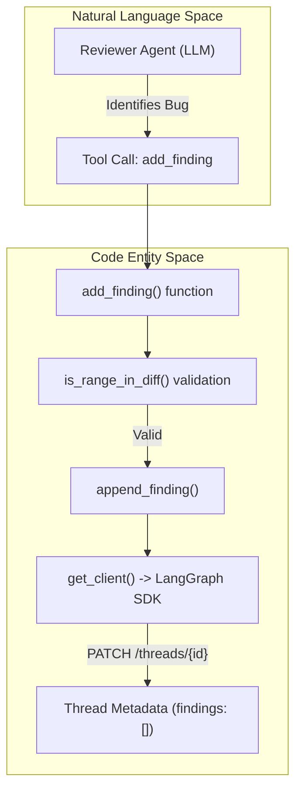
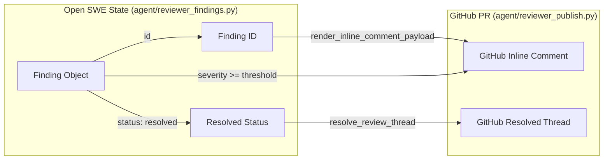

<!-- source: DeepWiki mcp.deepwiki.com · repo langchain-ai/open-swe · page 8.2 Findings Management · fetched 2026-10-26 -->

# Findings Management

<details>
<summary>Relevant source files</summary>

The following files were used as context for generating this wiki page:

- [agent/reviewer_findings.py](agent/reviewer_findings.py)
- [agent/tools/add_finding.py](agent/tools/add_finding.py)
- [agent/tools/publish_review.py](agent/tools/publish_review.py)
- [agent/tools/update_finding.py](agent/tools/update_finding.py)
- [tests/test_reviewer_findings.py](tests/test_reviewer_findings.py)
- [tests/test_reviewer_publish.py](tests/test_reviewer_publish.py)
- [tests/test_reviewer_tools.py](tests/test_reviewer_tools.py)

</details>


The **Findings Management** system provides a structured way for Reviewer Agents to record, update, and persist code review feedback. Unlike standard agent tool outputs which are ephemeral, Findings are stored in **LangGraph thread metadata** to ensure they persist across sandbox evictions and multiple agent runs, enabling "watch-mode" re-reviews and a historical record of PR health.

## The Finding Data Structure

A `Finding` is a structured record of a single issue discovered during a code review. It is defined as a `TypedDict` to facilitate partial updates while maintaining a strict schema for the UI and automated publishing.

### Key Schema Fields
| Field | Type | Description |
| :--- | :--- | :--- |
| `id` | `str` | A stable, short, URL-friendly ID (e.g., `f_a1b2c3d4e5`) [agent/reviewer_findings.py:102-104](). |
| `severity` | `Severity` | One of `low`, `medium`, `high`, `critical` [agent/reviewer_findings.py:42](). |
| `status` | `Status` | `open`, `resolved`, or `dismissed` [agent/reviewer_findings.py:44](). |
| `file` | `str` | Repo-relative path of the affected file [agent/reviewer_findings.py:70](). |
| `start_line` | `int \| None` | 1-based start line in the post-PR file [agent/reviewer_findings.py:71](). |
| `end_line` | `int \| None` | 1-based end line (the anchor for GitHub comments) [agent/reviewer_findings.py:72](). |
| `suggestion` | `str \| None` | A concrete code replacement block [agent/reviewer_findings.py:75](). |
| `first_seen_sha` | `str` | The HEAD SHA when the finding was first recorded [agent/reviewer_findings.py:77](). |

**Sources:** [agent/reviewer_findings.py:59-81](), [agent/reviewer_findings.py:107-139]()

## Tooling and Validation

The agent interacts with findings through a set of specialized tools that enforce validation logic before persisting data to the thread.

### `add_finding`
This tool creates a new finding. It performs two critical validations:
1.  **Diff-Line Validation**: It checks if the `start_line` and `end_line` are actually within the PR's changed lines using `is_range_in_diff` [agent/tools/add_finding.py:107-116](). Findings outside the diff are rejected to prevent the agent from flagging unrelated "pre-existing" code.
2.  **Suggestion Clipping**: Suggestions are capped at **4 lines** (`MAX_SUGGESTION_LINES`) [agent/reviewer_findings.py:30](). If a suggestion is too long, it is dropped, and the finding is recorded with only a description to prevent cluttered "rewrite" comments [agent/tools/add_finding.py:124-150]().

### `update_finding`
Used primarily during re-reviews, this tool allows the agent to mutate an existing finding. It is frequently used to move a finding from `open` to `resolved` when a developer pushes a fix [agent/tools/update_finding.py:36-37]().

### `list_findings`
Retrieves all findings currently stored in the thread metadata, allowing the agent to "remember" what it previously flagged [agent/tools/list_findings.py:1-25]().

**Sources:** [agent/tools/add_finding.py:24-86](), [agent/tools/update_finding.py:18-50](), [agent/reviewer_findings.py:33-40]()

## Data Flow and Persistence

Findings are stored in the `metadata` field of a LangGraph thread. This architectural choice allows findings to be queried via the LangGraph SDK without needing a separate database.

### Finding Persistence Flow
The following diagram shows how a tool call from the Reviewer Agent reaches the persistent storage.


**Sources:** [agent/tools/add_finding.py:101-141](), [agent/reviewer_findings.py:205-210](), [agent/reviewer_findings.py:199-202]()

## Severity Rubric

The system uses a strict severity hierarchy to determine which findings are "surfaced" (posted as GitHub comments) versus which stay "hidden" (only visible in the internal UI).

| Severity | Order Value | Typical Usage |
| :--- | :--- | :--- |
| `critical` | 3 | Security vulnerabilities, data loss, or certain crashes. |
| `high` | 2 | Logic errors, broken requirements, or major performance regressions. |
| `medium` | 1 | Code smells, missing edge case handling, or significant style violations. |
| `low` | 0 | Minor style nits or documentation typos. |

By default, the `publish_review` tool uses a `severity_threshold` of `medium` [agent/tools/publish_review.py:39]().

**Sources:** [agent/reviewer_findings.py:47-52](), [agent/tools/publish_review.py:48-50]()

## Publishing to GitHub

The `publish_review` tool translates the internal `Finding` list into a GitHub PR Review.

### Publishing Logic
1.  **Filtering**: Only `open` findings meeting the `severity_threshold` are selected [agent/tools/publish_review.py:48-50]().
2.  **Capping**: To avoid spam, the tool caps the number of inline comments (default 4) [agent/tools/publish_review.py:40]().
3.  **Rendering**: Each finding is converted into a GitHub comment payload. If a `suggestion` exists, it is wrapped in a Markdown ` ```suggestion ` block [agent/reviewer_publish.py:26-27]().
4.  **Thread Resolution**: On re-reviews, if a previously `open` finding is now `resolved`, the tool calls the GitHub GraphQL API to resolve the corresponding review thread [agent/tools/publish_review.py:61-63]().

### Review Lifecycle Diagram
This diagram bridges the internal Finding state to the external GitHub PR entities.


**Sources:** [agent/tools/publish_review.py:38-75](), [agent/reviewer_publish.py:11-29](), [agent/reviewer_findings.py:158-162]()

---

