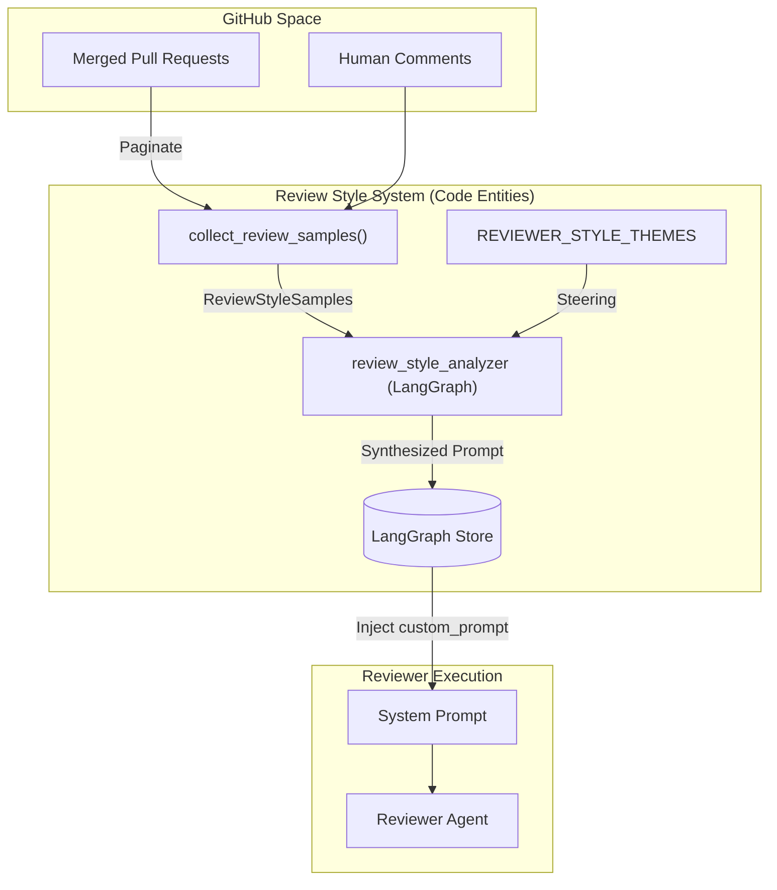
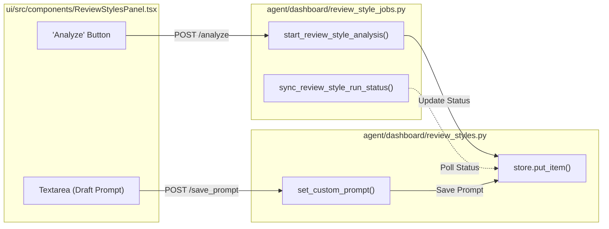

<!-- source: DeepWiki mcp.deepwiki.com · repo langchain-ai/open-swe · page 8.3 Review Style System · fetched 2026-10-26 -->

# Review Style System

Relevant source files

The following files were used as context for generating this wiki page:

- [agent/dashboard/oauth.py](agent/dashboard/oauth.py)
- [agent/dashboard/review_style_jobs.py](agent/dashboard/review_style_jobs.py)
- [agent/dashboard/review_styles.py](agent/dashboard/review_styles.py)
- [agent/review_style_collector.py](agent/review_style_collector.py)
- [agent/review_style_guidance.py](agent/review_style_guidance.py)
- [tests/test_github_oauth_refresh.py](tests/test_github_oauth_refresh.py)
- [tests/test_review_style_sync.py](tests/test_review_style_sync.py)
- [ui/src/components/ReviewStylesPanel.tsx](ui/src/components/ReviewStylesPanel.tsx)

The Review Style System is a specialized analysis pipeline that allows Open SWE to adapt its PR review feedback to the specific cultural and technical norms of a repository. Instead of applying a generic set of rules, the system analyzes historical Pull Request (PR) feedback from human reviewers to synthesize a custom system prompt for the reviewer agent.

## System Overview

The system consists of a background analysis graph (`review_style_analyzer`), a collection utility for gathering historical GitHub data, and a management interface within the dashboard.

### Data Flow

1.  **Trigger**: A user adds a repository to the "Review Styles" panel in the dashboard and clicks "Analyze".
2.  **Collection**: The system paginates through the last ~20 merged PRs, extracting substantive comments from human reviewers while filtering out bots [agent/review_style_collector.py:149-168]().
3.  **Analysis**: A LangGraph-based analyzer (the `review_style_analyzer` assistant) processes these samples against a set of guidance themes [agent/review_style_guidance.py:3-17]().
4.  **Synthesis**: The analyzer generates a "Review Style Prompt"—a concise set of instructions that steer the reviewer agent's tone, severity, and focus areas.
5.  **Injection**: During a standard reviewer run, this custom prompt is fetched from the LangGraph Store and injected into the agent's system instructions.

### Review Style Architecture
The following diagram illustrates how the natural language feedback from GitHub is transformed into a structured prompt used by the code-level Reviewer Agent.

**Review Style Synthesis Flow**

Sources: [agent/review_style_collector.py:149-168](), [agent/dashboard/review_style_jobs.py:88-105](), [agent/review_style_guidance.py:3-17](), [agent/dashboard/review_styles.py:1-5]()

## Historical Feedback Collection

The `collect_review_samples` function in `agent/review_style_collector.py` is responsible for gathering the raw data needed for analysis.

### Key Logic:
*   **Filtering**: It explicitly ignores comments from users ending in `[bot]` or `-bot` to ensure the style is derived from humans [agent/review_style_collector.py:86-98]().
*   **Substance Check**: Comments shorter than 20 characters are discarded to filter out "LGTM" or simple acknowledgments [agent/review_style_collector.py:101-105]().
*   **Sampling Strategy**: It identifies the "top reviewers" (most active humans) and samples up to 6 comments per reviewer across the most recent 20 merged PRs [agent/review_style_collector.py:15-17]().

Sources: [agent/review_style_collector.py:86-105](), [agent/review_style_collector.py:149-200]()

## Analysis and Persistence

The analysis is performed as a background job managed by `agent/dashboard/review_style_jobs.py`.

### Job Lifecycle
1.  **`start_review_style_analysis`**: Initializes the thread, collects samples, and creates a run on the `review_style_analyzer` assistant [agent/dashboard/review_style_jobs.py:38-43]().
2.  **State Management**: The status is tracked in the LangGraph Store under the `["review_styles"]` namespace [agent/dashboard/review_styles.py:18-20]().
3.  **`reconcile_running_status`**: Handles terminal states (success/failure) and ensures that if a prompt was successfully saved, the status is marked as `completed` even if the run technically failed or timed out later [agent/dashboard/review_styles.py:147-182]().

### Review Style Record Structure
| Field | Description |
| :--- | :--- |
| `full_name` | The `owner/repo` identifier. |
| `status` | `idle`, `running`, `completed`, or `failed`. |
| `custom_prompt` | The synthesized markdown prompt used by the reviewer. |
| `top_reviewers` | List of human logins identified during collection. |
| `prs_sampled` | Total count of PRs scanned. |

Sources: [agent/dashboard/review_style_jobs.py:38-111](), [agent/dashboard/review_styles.py:78-96](), [agent/dashboard/review_styles.py:147-182]()

## Dashboard Integration

The `ReviewStylesPanel` React component provides the UI for managing these styles. It uses TanStack Query to poll the status of running analyses every 4 seconds [ui/src/components/ReviewStylesPanel.tsx:51-54]().

**UI to Backend Mapping**

Sources: [ui/src/components/ReviewStylesPanel.tsx:48-137](), [agent/dashboard/review_style_jobs.py:38-43](), [agent/dashboard/review_styles.py:138-145]()

## Prompt Injection

When the Reviewer Agent is invoked (e.g., via a GitHub PR comment), it retrieves the `custom_prompt` for the current repository. If a custom prompt exists, it is appended to the `REVIEWER_PROMPT_TEMPLATE`. This allows the agent to adopt repository-specific instructions such as:
*   "Prioritize security boundaries in this auth-heavy repo."
*   "Ignore style nits; only flag correctness regressions."
*   "Tone should be direct and cite specific line numbers."

This system bridges the gap between a generic LLM reviewer and a team-specific automated collaborator.

Sources: [agent/dashboard/review_styles.py:1-5](), [agent/review_style_guidance.py:3-17]()

---

