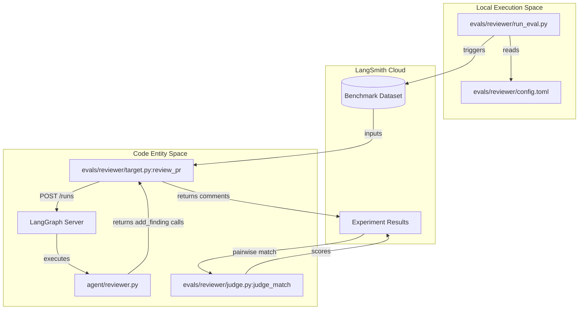
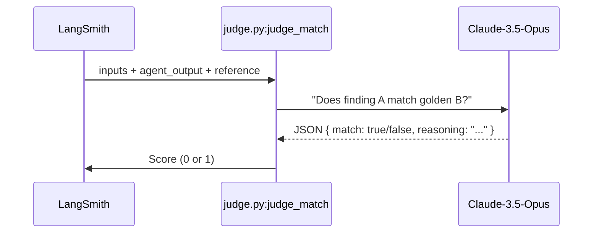

<!-- source: DeepWiki mcp.deepwiki.com · repo langchain-ai/open-swe · page 8.4 Reviewer Evaluation Infrastructure · fetched 2026-10-26 -->

# Reviewer Evaluation Infrastructure

<details>
<summary>Relevant source files</summary>

The following files were used as context for generating this wiki page:

- [agent/utils/model.py](agent/utils/model.py)
- [evals/reviewer/README.md](evals/reviewer/README.md)
- [evals/reviewer/build_dataset.py](evals/reviewer/build_dataset.py)
- [evals/reviewer/config.toml](evals/reviewer/config.toml)
- [evals/reviewer/golden_comments/cal_dot_com.json](evals/reviewer/golden_comments/cal_dot_com.json)
- [evals/reviewer/golden_comments/discourse.json](evals/reviewer/golden_comments/discourse.json)
- [evals/reviewer/golden_comments/grafana.json](evals/reviewer/golden_comments/grafana.json)
- [evals/reviewer/golden_comments/keycloak.json](evals/reviewer/golden_comments/keycloak.json)
- [evals/reviewer/golden_comments/sentry.json](evals/reviewer/golden_comments/sentry.json)
- [evals/reviewer/run_eval.py](evals/reviewer/run_eval.py)
- [evals/reviewer/target.py](evals/reviewer/target.py)
- [tests/test_anthropic_effort.py](tests/test_anthropic_effort.py)
- [tests/test_reviewer_eval_run.py](tests/test_reviewer_eval_run.py)
- [tests/test_reviewer_eval_target.py](tests/test_reviewer_eval_target.py)

</details>


The Reviewer Evaluation Infrastructure provides an offline framework for benchmarking the automated PR reviewer agent. It utilizes [LangSmith](https://smith.langchain.com/) to run the agent against a curated dataset of 50 pull requests, scoring the results using a high-fidelity LLM judge. This infrastructure allows developers to quantify the impact of changes to the reviewer's prompt, model, or tools without deploying to production.

## Infrastructure Overview

The evaluation system is located in the `evals/reviewer/` directory [evals/reviewer/README.md:10-17](). It follows a standard "Target-Dataset-Judge" pattern:

1.  **Target**: A wrapper that invokes the LangGraph reviewer assistant via the SDK [evals/reviewer/target.py:114-129]().
2.  **Dataset**: A collection of 50 real-world PRs from high-profile open-source repositories (Sentry, Keycloak, Grafana, Discourse, Cal.com), derived from the `withmartian/code-review-benchmark` [evals/reviewer/README.md:3-5]().
3.  **Judge**: An LLM-based evaluator (defaulting to `claude-opus-4-5`) that performs pairwise matching between agent findings and "golden" human-verified comments [evals/reviewer/judge.py:22-23]().

### Data Flow Diagram

The following diagram illustrates how the evaluation script coordinates between the local environment, the running LangGraph server, and LangSmith.

**Reviewer Evaluation Data Flow**

Sources: [evals/reviewer/run_eval.py:129-170](), [evals/reviewer/target.py:114-129](), [evals/reviewer/README.md:1-17]()

## Target Invocation

The `review_pr` function serves as the entry point for LangSmith. It translates dataset examples into the input schema expected by the reviewer agent.

### Key Functions
- `_build_configurable`: Prepares the `configurable` dict, setting `reviewer_eval: True` to ensure the agent does not actually post comments to GitHub [evals/reviewer/target.py:91-111]().
- `_extract_comments`: Collects every `add_finding` tool call from the agent's message stream and normalizes them into a standard `{file, line, body, severity}` shape for the judge [evals/reviewer/target.py:131-164]().
- `drain_thread_ids`: Tracks created LangGraph threads so they can be deleted after the experiment finishes to save storage [evals/reviewer/target.py:38-48]().

### Configuration Mapping
The infrastructure allows overriding model parameters specifically for the eval via environment variables or `config.toml` [evals/reviewer/config.toml:1-18]():

| Config Key | Environment Variable | Purpose |
| :--- | :--- | :--- |
| `model_id` | `REVIEWER_EVAL_MODEL_ID` | Overrides the agent's LLM (e.g., `openai:gpt-4o`) [evals/reviewer/target.py:66-68]() |
| `reasoning_effort` | `REVIEWER_EVAL_REASONING_EFFORT` | Sets reasoning effort for models like O1/O3 [evals/reviewer/target.py:71-73]() |
| `score_mode` | `REVIEWER_EVAL_SCORE_MODE` | Switches between `all_findings` (raw output) and `surfaced_findings` (after thresholding) [evals/reviewer/target.py:59-63]() |

Sources: [evals/reviewer/target.py:1-164](), [evals/reviewer/run_eval.py:99-113]()

## Evaluation Components

### Benchmark Dataset
The dataset is built from JSON files in `evals/reviewer/golden_comments/` [evals/reviewer/README.md:11](). Each entry contains:
- Repository and PR number [evals/reviewer/target.py:92-99]().
- Base and Head SHAs for precise diffing [evals/reviewer/target.py:101-102]().
- "Golden" comments provided by human reviewers [evals/reviewer/golden_comments/cal_dot_com.json:1-15]().

### Judge Logic
The `judge_match` evaluator uses a high-capability model to determine if an agent's finding matches a golden comment. This is necessary because findings may be phrased differently but describe the same underlying bug [evals/reviewer/README.md:102-105]().

**Judge Interaction Logic**

Sources: [evals/reviewer/judge.py:22-23](), [evals/reviewer/README.md:92-97]()

## Execution and Interpretation

### Running an Evaluation
To run a full benchmark, ensure a LangGraph server is running locally (usually on port 2024), then execute:

```bash
uv run python -m evals.reviewer.run_eval
```
[evals/reviewer/README.md:49]()

For faster iteration, use the `--limit` flag to test only a subset of PRs:
```bash
uv run python -m evals.reviewer.run_eval --limit 3
```
[evals/reviewer/README.md:55]()

### Interpreting Results
The evaluation produces two primary metrics in LangSmith:
1.  **Micro-averages**: Success rate across all individual findings.
2.  **Macro-averages**: Success rate aggregated at the PR level [evals/reviewer/README.md:92-97]().

If `score_mode` is set to `surfaced_findings`, the infrastructure applies the `filter_findings_for_publish` logic [evals/reviewer/target.py:172-176](), which uses the `severity_threshold` and `cap` defined in the configuration [evals/reviewer/config.toml:16-18](). This simulates production behavior where low-confidence or excessive findings are suppressed.

Sources: [evals/reviewer/run_eval.py:129-162](), [evals/reviewer/target.py:126-128](), [evals/reviewer/README.md:81-88]()

---

