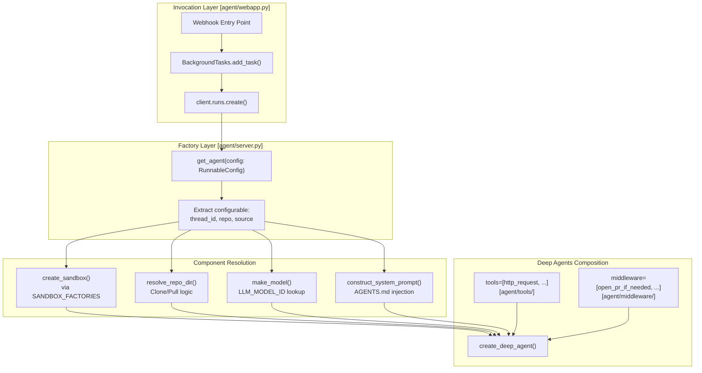
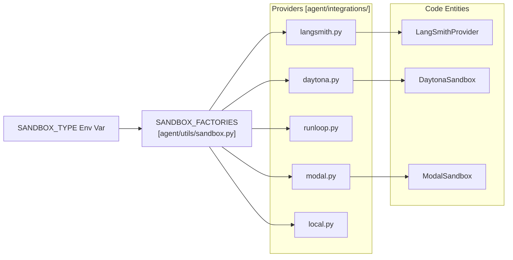

<!-- source: DeepWiki mcp.deepwiki.com · repo langchain-ai/open-swe · page 9 Customization Guide · fetched 2026-10-26 -->

# Customization Guide

Relevant source files

The following files were used as context for generating this wiki page:

- [CUSTOMIZATION.md](CUSTOMIZATION.md)
- [INSTALLATION.md](INSTALLATION.md)
- [README.md](README.md)

This guide explains how to extend and customize Open SWE for your organization's specific needs. All customization happens through a composable architecture where components can be swapped, extended, or replaced without modifying the core framework.

For detailed implementation guides on specific customization types, see:
- **[Custom Sandbox Providers](#9.1)** — Implementing new execution environments by implementing the `SandboxBackendProtocol`.
- **[Custom Tools](#9.2)** — Adding agent capabilities to the tool suite.
- **[Custom Middleware](#9.3)** — Extending agent behavior via `@before_model` and `@after_agent` hooks.
- **[Custom Triggers](#9.4)** — Creating new invocation surfaces beyond Slack, Linear, and GitHub.

## Architecture Overview

Open SWE's customization architecture centers on the `get_agent()` function in `agent/server.py`, which assembles all components into a working agent. This function is called by the LangGraph orchestration layer whenever a new agent run is needed.

### Agent Assembly Process

The following diagram illustrates how `get_agent()` composes the system by pulling from various configuration sources and passing them to `create_deep_agent`.

Title: Agent Composition Flow

**Sources:** [agent/server.py:249-376](), [CUSTOMIZATION.md:1-24](), [agent/webapp.py:58-650]()

### Customization Points Table

| Component | Configuration Location | Factory/Registry | Implementation Files |
|-----------|----------------------|------------------|---------------------|
| **Sandbox** | `SANDBOX_TYPE` env var | `SANDBOX_FACTORIES` dict in `agent/utils/sandbox.py` | `agent/integrations/*.py` |
| **Model** | `get_agent()` in `agent/server.py` | `make_model()` helper | `agent/utils/model.py` |
| **Tools** | `get_agent()` in `agent/server.py` | `tools=[...]` array | `agent/tools/*.py` |
| **Middleware** | `get_agent()` in `agent/server.py` | `middleware=[...]` array | `agent/middleware/*.py` |
| **Triggers** | `agent/webapp.py` | FastAPI `@app.post` routes | `agent/webapp.py` |
| **System Prompt** | `agent/prompt.py` | `construct_system_prompt()` | `agent/prompt.py` |

**Sources:** [CUSTOMIZATION.md:1-407](), [agent/server.py:249-376](), [agent/utils/sandbox.py:9-15]()

## Sandbox Customization

Sandboxes provide isolated execution environments. The architecture uses a factory pattern where the `SANDBOX_TYPE` environment variable selects the provider.

### Sandbox Provider Mapping

The `SANDBOX_FACTORIES` dictionary maps environment variable values to creation functions.

Title: Sandbox Backend Resolution

**Sources:** [agent/utils/sandbox.py:9-15](), [CUSTOMIZATION.md:58-64](), [agent/integrations/__init__.py:1-8]()

### Sandbox Provider Requirements

All sandbox providers must implement the `SandboxBackendProtocol` from the `deepagents` framework. This requires implementing file operations (`ls`, `read`, `write`, `edit`, `glob`, `grep`) and shell execution (`execute`).

The easiest approach is extending `BaseSandbox` from `deepagents.backends.sandbox`, which implements file operations by delegating to `execute()`.

For detailed instructions on adding custom sandbox providers, see **[Custom Sandbox Providers](#9.1)**.

**Sources:** [CUSTOMIZATION.md:101-130]()

## Tool Customization

Open SWE ships with specialized tools like `commit_and_open_pr`, `linear_comment`, and `slack_thread_reply` on top of the built-in Deep Agents suite.

### Adding a Custom Tool

1. **Create tool file** in `agent/tools/` (e.g., `agent/tools/my_tool.py`).
2. **Define function** with a clear docstring; the LLM uses the docstring to understand when to invoke the tool.
3. **Register in server.py** by adding it to the `tools` list in `get_agent()`.

Tools have access to the LangGraph configuration via `get_config()` and the sandbox backend via `get_sandbox_backend_sync()`.

For detailed instructions and examples, see **[Custom Tools](#9.2)**.

**Sources:** [CUSTOMIZATION.md:173-251](), [agent/server.py:267-272]()

## Middleware Customization

Middleware provides deterministic hooks around the agent loop. Open SWE uses these for safety and state management.

### Middleware Types

| Middleware | Hook | Purpose |
|-----------|------|---------|
| `check_message_queue_before_model` | `@before_model` | Injects follow-up messages from webhooks mid-run. |
| `open_pr_if_needed` | `@after_agent` | Safety net that commits and opens a PR if the agent fails to do so. |
| `ToolErrorMiddleware` | Error Handler | Gracefully handles tool failures. |

Custom middleware can be added by defining functions with `@before_model` or `@after_agent` decorators and including them in the `middleware` list in `agent/server.py`.

For detailed instructions on writing custom middleware, see **[Custom Middleware](#9.3)**.

**Sources:** [CUSTOMIZATION.md:370-407](), [README.md:92-97](), [agent/middleware/open_pr.py:59-158]()

## Model Customization

The model is configured via `make_model()` in `agent/server.py`. While `openai:gpt-5.5` is the default, it can be overridden by the `LLM_MODEL_ID` environment variable.

### Dynamic Selection

The `make_model()` helper in `agent/utils/model.py` wraps `langchain.chat_models.init_chat_model`. You can route to different models based on context by modifying the logic in `get_agent()`.

For detailed instructions on model configuration, see **[Custom Sandbox Providers](#9.1)** (covered in Sandbox/Model context).

**Sources:** [CUSTOMIZATION.md:134-171](), [agent/server.py:255-265]()

## Trigger Customization

Triggers are FastAPI endpoints in `agent/webapp.py` that receive webhooks and dispatch agent runs.

### Creating a New Trigger

1. **Add Route**: Define a new `@app.post` endpoint in `agent/webapp.py`.
2. **Assemble Context**: Extract repo details, user info, and thread IDs.
3. **Dispatch Run**: Use the `LangGraphClient` to call `runs.create()`.

For detailed instructions on creating custom triggers, see **[Custom Triggers](#9.4)**.

**Sources:** [CUSTOMIZATION.md:252-349](), [agent/webapp.py:12-53]()

## System Prompt Customization

The system prompt is constructed in `agent/prompt.py`. It is modular, allowing you to edit specific sections like `CODING_STANDARDS_SECTION` or `COMMIT_PR_SECTION`.

### AGENTS.md Convention

Repository-specific instructions can be added via an `AGENTS.md` file at the root of the target repo. This file is automatically read and injected into the prompt, serving as the primary way to customize behavior per-project without changing code.

**Sources:** [README.md:79-85](), [CUSTOMIZATION.md:352-369]()

---

