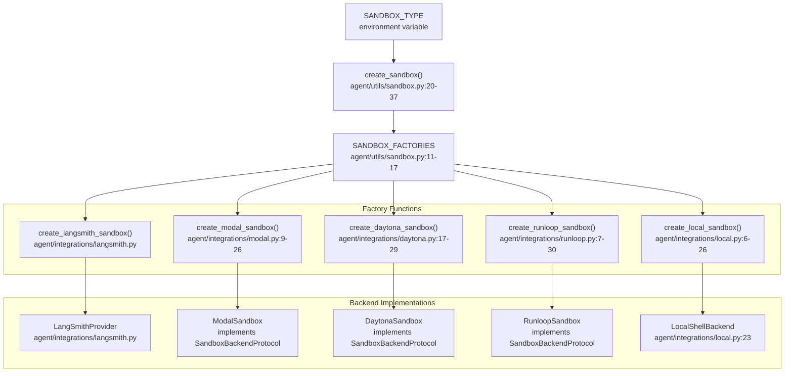
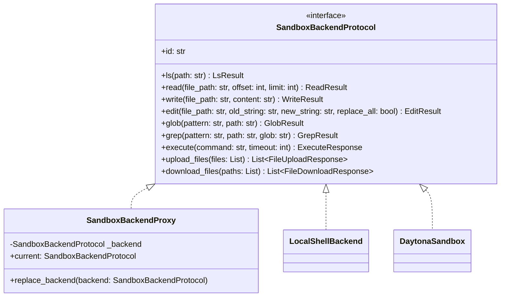
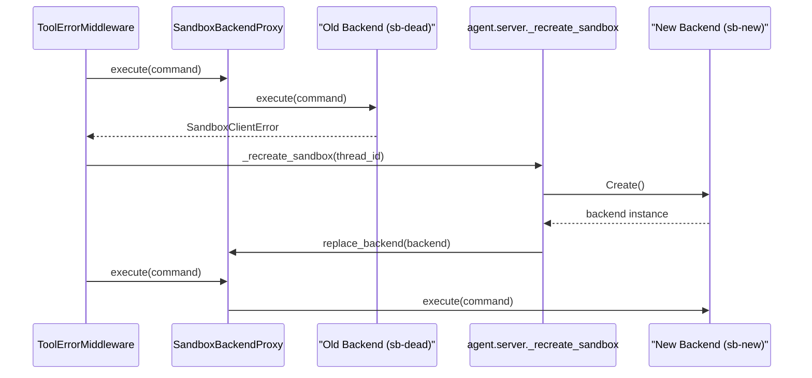

<!-- source: DeepWiki mcp.deepwiki.com · repo langchain-ai/open-swe · page 9.1 Custom Sandbox Providers · fetched 2026-10-26 -->

# Custom Sandbox Providers

<details>
<summary>Relevant source files</summary>

The following files were used as context for generating this wiki page:

- [agent/integrations/daytona.py](agent/integrations/daytona.py)
- [agent/integrations/local.py](agent/integrations/local.py)
- [agent/integrations/modal.py](agent/integrations/modal.py)
- [agent/integrations/runloop.py](agent/integrations/runloop.py)
- [agent/middleware/sandbox_circuit_breaker.py](agent/middleware/sandbox_circuit_breaker.py)
- [agent/middleware/tool_error_handler.py](agent/middleware/tool_error_handler.py)
- [agent/utils/sandbox.py](agent/utils/sandbox.py)
- [agent/utils/sandbox_paths.py](agent/utils/sandbox_paths.py)
- [agent/utils/sandbox_state.py](agent/utils/sandbox_state.py)
- [tests/middleware/test_sandbox_recovery.py](tests/middleware/test_sandbox_recovery.py)
- [tests/test_daytona_integration.py](tests/test_daytona_integration.py)

</details>


This document explains how to implement custom sandbox providers for Open SWE. A sandbox provider is a backend execution environment where the agent clones repositories and executes commands in isolation. Open SWE supports multiple providers (LangSmith, Modal, Daytona, Runloop, Local) through a pluggable architecture.

---

## Sandbox Provider Architecture

Open SWE uses a factory pattern to create sandbox backends. The `create_sandbox()` function reads the `SANDBOX_TYPE` environment variable and dispatches to the appropriate provider-specific factory function registered in `SANDBOX_FACTORIES`.

**Sandbox Provider Flow Diagram**


**Sources:** [agent/utils/sandbox.py:11-37](), [agent/integrations/local.py:6-26](), [agent/integrations/daytona.py:17-29]()

---

## SandboxBackendProtocol Requirements

All sandbox providers must implement `SandboxBackendProtocol` from the `deepagents` framework. This protocol defines the standard interface that agent tools use to interact with the execution environment.

**Protocol Implementation Diagram**


**Required Methods (Synchronous and Asynchronous):**

The protocol requires both sync and async versions of file and execution operations (e.g., `ls` and `als`, `execute` and `aexecute`).

| Method | Purpose |
|--------|---------|
| `id` | Unique identifier for the sandbox instance [agent/utils/sandbox_state.py:38-39]() |
| `execute()` / `aexecute()` | Execute shell commands [agent/utils/sandbox_state.py:114-118]() |
| `ls()` / `als()` | List directory contents [agent/utils/sandbox_state.py:44-48]() |
| `read()` / `aread()` | Read file contents with offset/limit [agent/utils/sandbox_state.py:50-54]() |
| `write()` / `awrite()` | Write file contents [agent/utils/sandbox_state.py:78-82]() |
| `edit()` / `aedit()` | Apply string replacements [agent/utils/sandbox_state.py:84-100]() |
| `upload_files()` | Transfer files to sandbox [agent/utils/sandbox_state.py:102-106]() |
| `download_files()` | Retrieve files from sandbox [agent/utils/sandbox_state.py:108-112]() |

**Sources:** [agent/utils/sandbox_state.py:8-19](), [agent/utils/sandbox_state.py:27-120]()

---

## Implementation Approaches

### Approach 1: Using Stable Proxies

Open SWE uses a `SandboxBackendProxy` to maintain a stable handle for a thread even if the underlying sandbox is recreated due to a failure.

**Proxy Replacement Sequence**


**Sources:** [agent/utils/sandbox_state.py:27-42](), [agent/middleware/tool_error_handler.py:176-185](), [tests/middleware/test_sandbox_recovery.py:50-91]()

---

## Factory Function Pattern

Each sandbox provider must have a factory function that follows this signature:

| Element | Requirement |
|---------|-------------|
| Function name | `create_<provider>_sandbox` |
| Parameter | `sandbox_id: str | None = None` |
| Return type | Object implementing `SandboxBackendProtocol` |

**Example Factory Logic (Daytona):**
The factory validates the `DAYTONA_API_KEY`, then either retrieves an existing sandbox using `daytona.get(sandbox_id)` or creates a new one using `daytona.create()` with snapshot parameters.

**Sources:** [agent/integrations/daytona.py:17-29](), [agent/integrations/runloop.py:7-30]()

---

## Step-by-Step Implementation Guide

### Step 1: Create Integration File
Create `agent/integrations/my_provider.py`. If a LangChain wrapper exists for your provider (like `langchain_daytona`), use it to simplify implementation.

### Step 2: Register Factory
Add the new factory to `SANDBOX_FACTORIES` in `agent/utils/sandbox.py`.

```python
# agent/utils/sandbox.py
from agent.integrations.my_provider import create_my_provider_sandbox

SANDBOX_FACTORIES = {
    # ... existing ...
    "my_provider": create_my_provider_sandbox,
}
```

### Step 3: Startup Validation (Optional)
Add a validation check in `validate_sandbox_startup_config()` to ensure required environment variables are present before the server starts.

**Sources:** [agent/utils/sandbox.py:11-17](), [agent/utils/sandbox.py:40-52]()

---

## Sandbox Recovery and Circuit Breaking

Custom providers benefit from built-in recovery logic in `ToolErrorMiddleware`. If a `SandboxClientError` is raised during a tool call, the middleware:
1. Calls `_recreate_sandbox_for_thread` [agent/middleware/tool_error_handler.py:116-124]().
2. Updates the thread metadata with the new `sandbox_id` [agent/middleware/tool_error_handler.py:122]().
3. Notifies the LLM via a `ToolMessage` with `recovery: "sandbox_recreated_after_client_error"` [agent/middleware/tool_error_handler.py:73]().

To prevent infinite loops of failures, the `SandboxCircuitBreakerMiddleware` monitors the message history. If it detects more than `SANDBOX_CIRCUIT_BREAKER_THRESHOLD` (default 2) consecutive recreations or failures, it halts the agent and notifies the user.

**Sources:** [agent/middleware/tool_error_handler.py:159-204](), [agent/middleware/sandbox_circuit_breaker.py:24-28](), [agent/middleware/sandbox_circuit_breaker.py:67-102]()

---

## Working Directory Resolution

Tools need to know where the code is located inside the sandbox. The `resolve_sandbox_work_dir()` helper iterates through candidates:
1. Calling `get_work_dir()` on the backend object [agent/utils/sandbox_paths.py:63]().
2. Executing `pwd` via shell [agent/utils/sandbox_paths.py:68]().
3. Checking `get_user_home_dir()` [agent/utils/sandbox_paths.py:75]().

**Sources:** [agent/utils/sandbox_paths.py:34-51](), [agent/utils/sandbox_paths.py:58-86]()

---

