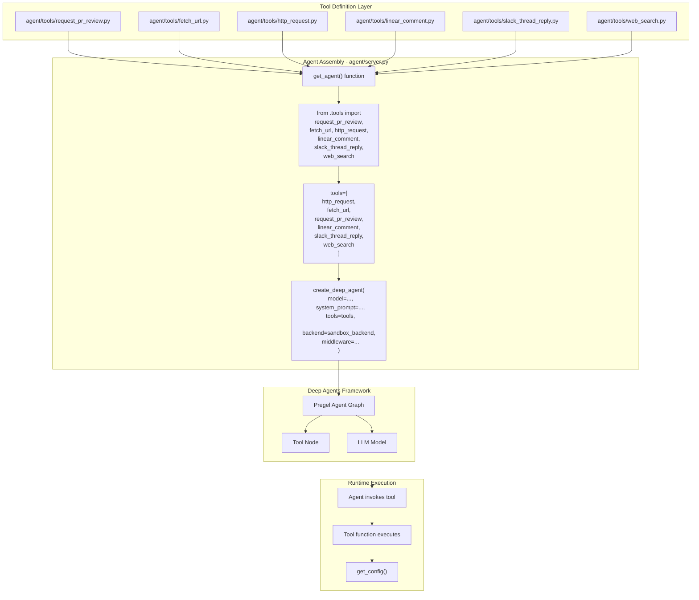
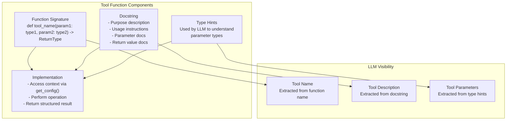
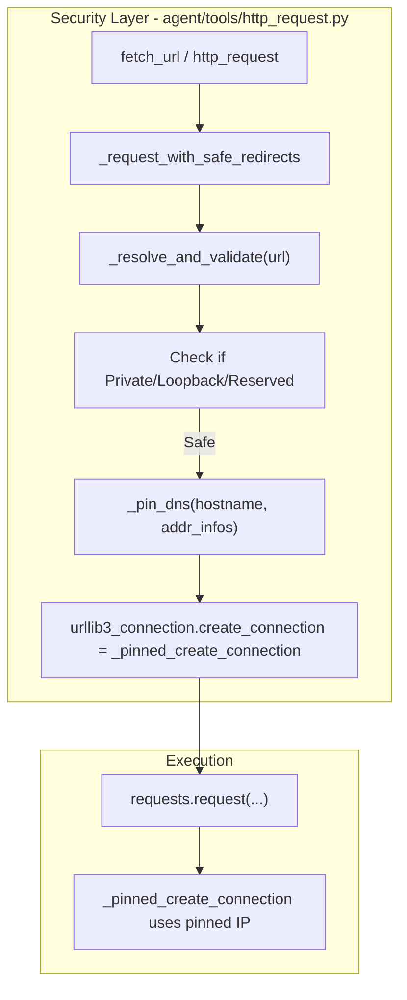

<!-- source: DeepWiki mcp.deepwiki.com · repo langchain-ai/open-swe · page 9.2 Custom Tools · fetched 2026-10-26 -->

# Custom Tools

<details>
<summary>Relevant source files</summary>

The following files were used as context for generating this wiki page:

- [Dockerfile](Dockerfile)
- [Makefile](Makefile)
- [agent/middleware/exclude_tools.py](agent/middleware/exclude_tools.py)
- [agent/server.py](agent/server.py)
- [agent/tools/__init__.py](agent/tools/__init__.py)
- [agent/tools/fetch_url.py](agent/tools/fetch_url.py)
- [agent/tools/http_request.py](agent/tools/http_request.py)
- [evals/reviewer/judge.py](evals/reviewer/judge.py)
- [langgraph.json](langgraph.json)
- [tests/test_http_security.py](tests/test_http_security.py)

</details>


This page documents how to add, modify, and remove tools in the Open SWE agent's tool suite. Tools are Python functions that the agent can invoke to perform operations like API calls, file manipulations, or external system integrations.

For information about the complete tool system including built-in Deep Agents tools (`read_file`, `write_file`, etc.), see [Tool System](#3.2). For information about middleware that runs around tool execution, see [Middleware System](#3.3).

---

## Tool Architecture

Open SWE's tool system is built on three layers: tool definition, tool registration, and tool execution. Tools are standard Python functions with type hints and docstrings that are passed to `create_deep_agent()` during agent assembly.

### Tool Registration Flow



**Sources:** [agent/server.py:55-69](), [agent/server.py:249-376](), [agent/tools/__init__.py:1-37]()

---

## Tool Function Structure

Tools are Python functions with specific conventions that allow the LLM to understand their purpose and parameters.

### Anatomy of a Tool



### Example Tool Structure: Fetch URL

The `fetch_url` tool demonstrates the standard structure using safe redirect logic and markdown conversion:

```python
def fetch_url(url: str, timeout: int = 30) -> dict[str, Any]:
    """Fetch content from a URL and convert HTML to markdown format.

    This tool fetches web page content and converts it to clean markdown text,
    making it easy to read and process HTML content. After receiving the markdown,
    you MUST synthesize the information into a natural, helpful response for the user.

    Args:
        url: The URL to fetch (must be a valid HTTP/HTTPS URL)
        timeout: Request timeout in seconds (default: 30)

    Returns:
        Dictionary containing:
        - success: Whether the request succeeded
        - url: The final URL after redirects
        - markdown_content: The page content converted to markdown
        - status_code: HTTP status code
        - content_length: Length of the markdown content in characters
    """
```

**Key conventions:**

| Element | Convention |
|---------|-----------|
| Function name | Lowercase with underscores, descriptive verb phrase |
| Parameters | Type-hinted, required parameters first |
| Return type | Structured dict or primitive type, always type-hinted |
| Docstring | First line is imperative summary, followed by usage details |
| Security | Use `_request_with_safe_redirects` for HTTP calls to prevent SSRF |

**Sources:** [agent/tools/fetch_url.py:9-33](), [agent/tools/http_request.py:180-210]()

---

## Security: HTTP and DNS Pinning

Custom tools that perform network requests must adhere to the system's security policies. Open SWE implements a DNS pinning mechanism to prevent DNS-rebinding attacks and SSRF.

### Safe Request Flow



**Sources:** [agent/tools/http_request.py:125-161](), [agent/tools/http_request.py:180-210](), [tests/test_http_security.py:143-180]()

---

## Registering Tools in the Agent

Tools are registered by passing them to `create_deep_agent()` in the `get_agent()` function in `agent/server.py`.

### Adding a Custom Tool

**Step 1: Create the tool file**
Create `agent/tools/my_custom_tool.py`.

**Step 2: Export in the tools package**
Add the tool to [agent/tools/__init__.py]().

**Step 3: Register in server.py**
Modify [agent/server.py]():

```python
from .tools import my_custom_tool  # Add import

async def get_agent(config: RunnableConfig) -> Pregel:
    # ... setup code ...
    
    return create_deep_agent(
        # ...
        tools=[
            http_request,
            fetch_url,
            request_pr_review,
            linear_comment,
            slack_thread_reply,
            web_search,
            my_custom_tool,  # Add to tools list
        ],
        # ...
    )
```

**Sources:** [agent/server.py:55-69](), [agent/server.py:249-376](), [agent/tools/__init__.py:1-37]()

---

## Removing Tools

Tools can be removed globally by deleting them from the `tools` list in `get_agent()`, or dynamically via middleware.

### Dynamic Removal via Middleware

The `ExcludeToolsMiddleware` allows hiding specific tools from the model without rebuilding the agent. This is used by the Reviewer agent to disable subagent spawning via the `task` tool.

```python
# agent/middleware/exclude_tools.py
class ExcludeToolsMiddleware(AgentMiddleware):
    def __init__(self, *, excluded: frozenset[str]) -> None:
        self._excluded = excluded

    def _filter(self, request: ModelRequest) -> ModelRequest:
        filtered = [t for t in request.tools if _tool_name(t) not in self._excluded]
        return request.override(tools=filtered)
```

**Sources:** [agent/middleware/exclude_tools.py:33-51](), [agent/server.py:49]()

---

## Tool Inventory

Open SWE includes several custom tools out-of-the-box for integration and discovery:

| Tool Name | File Path | Purpose |
|-----------|-----------|---------|
| `fetch_url` | [agent/tools/fetch_url.py]() | Fetches URL and converts HTML to Markdown |
| `http_request` | [agent/tools/http_request.py]() | Performs secure authenticated HTTP requests |
| `linear_comment` | [agent/tools/linear_comment.py]() | Posts comments to Linear issues |
| `slack_thread_reply` | [agent/tools/slack_thread_reply.py]() | Replies to Slack conversation threads |
| `web_search` | [agent/tools/web_search.py]() | Performs web searches via Exa API |
| `request_pr_review` | [agent/tools/request_pr_review.py]() | Triggers the Reviewer agent on a PR |
| `add_finding` | [agent/tools/add_finding.py]() | (Reviewer Only) Records a code review finding |

**Sources:** [agent/tools/__init__.py:1-37](), [agent/server.py:55-69]()

---

