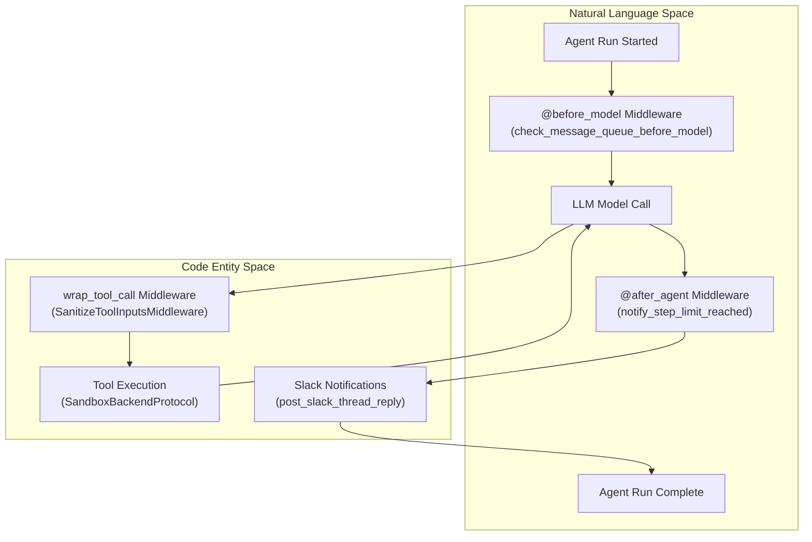
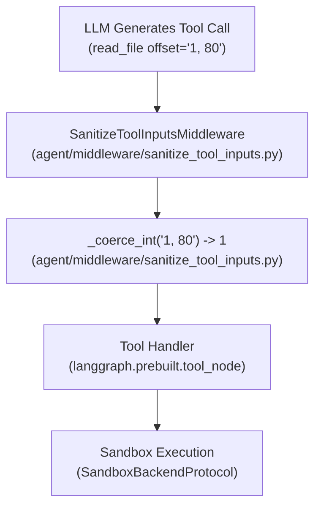

<!-- source: DeepWiki mcp.deepwiki.com · repo langchain-ai/open-swe · page 9.3 Custom Middleware · fetched 2026-10-26 -->

# Custom Middleware

<details>
<summary>Relevant source files</summary>

The following files were used as context for generating this wiki page:

- [agent/middleware/__init__.py](agent/middleware/__init__.py)
- [agent/middleware/notify_step_limit.py](agent/middleware/notify_step_limit.py)
- [agent/middleware/sanitize_tool_inputs.py](agent/middleware/sanitize_tool_inputs.py)
- [tests/test_notify_step_limit_middleware.py](tests/test_notify_step_limit_middleware.py)
- [tests/test_sanitize_tool_inputs.py](tests/test_sanitize_tool_inputs.py)

</details>


This page explains how to write custom middleware to extend agent behavior in Open SWE. Middleware functions run around the agent execution loop, allowing you to inject logic before the model is called, intercept tool calls, or execute logic after the agent completes. This enables patterns like input sanitization, safety nets, real-time message injection, and automated notifications.

---

## Middleware Architecture

Middleware in Open SWE runs at specific points in the agent execution lifecycle. The system uses decorators and class-based interfaces to define when logic executes within the `create_deep_agent` orchestration.

### Agent Lifecycle with Middleware Hooks

The following diagram illustrates how middleware hooks intercept the natural language processing and tool execution flow.



**Sources:**
- [agent/middleware/__init__.py:1-21]()
- [agent/middleware/notify_step_limit.py:37-46]()
- [agent/middleware/sanitize_tool_inputs.py:54-61]()

---

## Middleware Execution Points

Open SWE supports three primary types of middleware hooks:

| Hook Type | Implementation | When It Runs | Common Use Cases |
|-----------|----------------|--------------|------------------|
| **Before Model** | `@before_model` | Before each LLM call | Message injection, state validation, context modification |
| **Tool Wrapper** | `AgentMiddleware` | Around tool execution | Input sanitization, error handling, tool exclusion |
| **After Agent** | `@after_agent` | Once after agent completes | Notifications, safety nets, cleanup, result validation |

The middleware stack is exported in `agent/middleware/__init__.py` and configured during agent assembly.

**Sources:**
- [agent/middleware/__init__.py:11-21]()
- [agent/middleware/sanitize_tool_inputs.py:76-81]()

---

## Writing Custom Middleware

### Before Model Middleware

Before-model middleware runs before each LLM call and can modify the agent state. The function receives `AgentState` and `Runtime` objects.

**Function Signature:**

```python
from langchain.agents.middleware import AgentState, before_model
from langgraph.runtime import Runtime

@before_model
async def my_before_middleware(
    state: AgentState,
    runtime: Runtime,
) -> dict[str, Any] | None:
    """Execute logic before the model is called."""
    # Your logic here
    return None  # or {"messages": [...]}
```

The `check_message_queue_before_model` middleware demonstrates this by injecting queued messages from the thread's message queue before the next model call to handle concurrent user inputs.

**Sources:**
- [agent/middleware/check_message_queue.py:1-20]() (referenced via [agent/middleware/__init__.py:18-18]())

### Tool Wrapper Middleware

Tool wrapper middleware inherits from `AgentMiddleware` and implements `wrap_tool_call` (synchronous) and `awrap_tool_call` (asynchronous). This allows intercepting `ToolCallRequest` objects before they reach the sandbox.

**Implementation Example: `SanitizeToolInputsMiddleware`**
This middleware intercepts `read_file` calls to coerce malformed string arguments (e.g., `"1, 80"`) into valid integers for `offset` and `limit` fields [agent/middleware/sanitize_tool_inputs.py:54-61]().

```python
# agent/middleware/sanitize_tool_inputs.py
class SanitizeToolInputsMiddleware(AgentMiddleware):
    def wrap_tool_call(
        self,
        request: ToolCallRequest,
        handler: Callable[[ToolCallRequest], ToolMessage | Command],
    ) -> ToolMessage | Command:
        # Sanitize request before passing to handler
        return handler(self._sanitize_request(request))
```

**Sources:**
- [agent/middleware/sanitize_tool_inputs.py:54-81]()

### After Agent Middleware

After-agent middleware runs once after the agent finishes execution. This is useful for notifications or ensuring repository state is consistent.

**Implementation Example: `notify_step_limit_reached`**
This middleware checks if the last message contains a limit marker (e.g., "Model call limits exceeded") and posts a Slack reply to notify the user [agent/middleware/notify_step_limit.py:37-55]().

```python
# agent/middleware/notify_step_limit.py
@after_agent
async def notify_step_limit_reached(state: AgentState, runtime: Runtime):
    messages = state.get("messages", [])
    if not messages: return None
    
    # Check for limit marker in content
    if _LIMIT_MARKER in _content_to_text(messages[-1].content):
        config = get_config()
        # Send Slack notification using thread metadata
        await post_slack_thread_reply(...)
```

**Sources:**
- [agent/middleware/notify_step_limit.py:37-88]()

---

## Accessing Context in Middleware

Middleware functions can access thread-level configuration and persisted metadata via `get_config()`.

### Thread Configuration and Metadata

```python
from langgraph.config import get_config

config = get_config()
configurable = config.get("configurable", {})
# Access Slack thread details for notifications
slack_thread = configurable.get("slack_thread", {})
channel_id = slack_thread.get("channel_id")
thread_ts = slack_thread.get("thread_ts")
```

**Sources:**
- [agent/middleware/notify_step_limit.py:57-65]()

---

## Data Flow: Input Sanitization

This diagram maps how `SanitizeToolInputsMiddleware` bridges the gap between LLM output and valid tool execution.



**Sources:**
- [agent/middleware/sanitize_tool_inputs.py:25-39]()
- [agent/middleware/sanitize_tool_inputs.py:65-74]()

---

## Error Handling in Middleware

Middleware must handle exceptions internally to prevent interrupting the core agent response delivery. For instance, if a Slack notification fails in `notify_step_limit_reached`, it logs the error but allows the agent run to finish [agent/middleware/notify_step_limit.py:82-86]().

```python
try:
    await post_slack_thread_reply(channel_id, thread_ts, message)
except Exception:
    logger.exception("Failed to send step-limit notification")
return None
```

**Sources:**
- [agent/middleware/notify_step_limit.py:82-88]()

---

