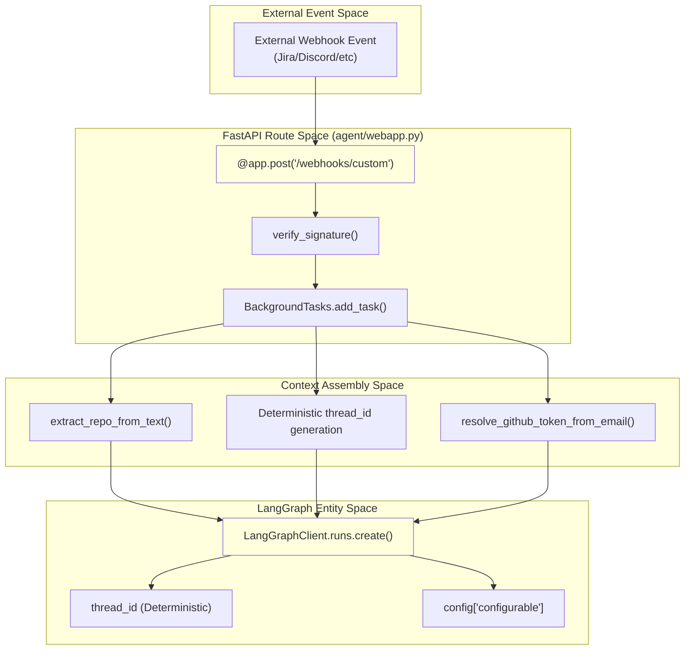
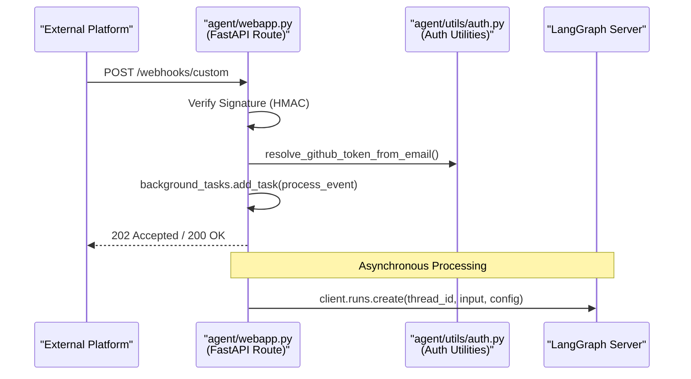

<!-- source: DeepWiki mcp.deepwiki.com · repo langchain-ai/open-swe · page 9.4 Custom Triggers · fetched 2026-10-26 -->

# Custom Triggers

<details>
<summary>Relevant source files</summary>

The following files were used as context for generating this wiki page:

- [CUSTOMIZATION.md](CUSTOMIZATION.md)
- [INSTALLATION.md](INSTALLATION.md)
- [README.md](README.md)
- [agent/webapp.py](agent/webapp.py)
- [tests/test_github_issue_webhook.py](tests/test_github_issue_webhook.py)

</details>


This guide explains how to create custom webhook endpoints to trigger Open SWE agents from new platforms beyond the built-in Slack, Linear, and GitHub integrations. This enables you to invoke agents from any external system that can send HTTP requests.

For information about the existing Slack, Linear, and GitHub integrations, see **2. Invocation Surfaces**. For adding custom tools that agents can use during execution, see **9.2 Custom Tools**.

---

## Overview

**Triggers** are the entry points that initiate agent runs. Open SWE receives webhook events from external platforms, parses them into structured tasks, and dispatches agent runs to the LangGraph server. Each trigger:

1.  Receives an HTTP POST request containing event data at an endpoint defined in `agent/webapp.py` [agent/webapp.py:101-115]().
2.  Verifies the request signature (optional but recommended) via utilities like `verify_github_signature` [agent/utils/github_comments.py:57-57]() or `verify_slack_signature` [agent/utils/slack.py:83-83]().
3.  Extracts task description and repository context using `extract_repo_from_text` [agent/utils/repo.py:65-65]().
4.  Generates a deterministic thread ID for conversation continuity (e.g., `get_thread_id_from_branch` [agent/utils/github_comments.py:53-53]()).
5.  Creates a LangGraph run with appropriate configuration via `langgraph_sdk.get_client` [agent/webapp.py:17-18]().
6.  Returns an acknowledgment to the caller.

The webhook processing flow is asynchronous—the HTTP response is sent immediately while the agent runs in the background using FastAPI's `BackgroundTasks` [agent/webapp.py:14-14]().

### Trigger Data Flow: Natural Language to Code Entity Space

The following diagram shows how an external event is transformed into a LangGraph `run` entity.



**Sources:** [agent/webapp.py:101-120](), [agent/utils/repo.py:65-65](), [agent/utils/auth.py:37-37](), [agent/utils/github_comments.py:53-53]()

---

## Webhook Endpoint Architecture

All triggers are implemented as FastAPI endpoints in `agent/webapp.py`. The application uses the following core components to manage the lifecycle of a trigger:

| Component | Role | Code Reference |
| :--- | :--- | :--- |
| `app` | FastAPI instance hosting routes | [agent/webapp.py:101-101]() |
| `BackgroundTasks` | Dispatches processing to avoid HTTP timeouts | [agent/webapp.py:14-14]() |
| `LangGraphClient` | SDK client to communicate with the agent graph | [agent/webapp.py:18-18]() |
| `get_client()` | Factory to initialize the SDK client | [agent/webapp.py:17-17]() |

### Webhook Reception Logic

The following diagram maps the logical flow of a webhook request to the specific functions in the codebase.



**Sources:** [agent/webapp.py:14-18](), [agent/utils/auth.py:37-37](), [agent/webapp.py:115-125]()

---

## Creating a Custom Trigger

### 1. Define the Route and Payload Parsing

New routes should be added to `agent/webapp.py`. The endpoint must extract the task and repository context. Open SWE provides `extract_repo_from_text` to find repository details within strings or URLs [agent/utils/repo.py:65-65]().

```python
# Example logic inspired by agent/webapp.py
@app.post("/webhooks/custom")
async def custom_webhook(request: Request, background_tasks: BackgroundTasks):
    payload = await request.json()
    # 1. Extract context
    text = payload.get("text", "")
    repo_config = extract_repo_from_text(text) or {
        "owner": os.environ["DEFAULT_REPO_OWNER"],
        "name": os.environ["DEFAULT_REPO_NAME"]
    }
    # 2. Dispatch
    background_tasks.add_task(process_custom_task, payload, repo_config)
    return {"status": "accepted"}
```

**Sources:** [agent/webapp.py:115-125](), [agent/utils/repo.py:65-65]()

### 2. Generate a Deterministic Thread ID

Thread IDs are crucial for state persistence. If a user replies to a message, the trigger must generate the same `thread_id` to reconnect to the existing sandbox and conversation state. Open SWE uses specific generation logic per platform:

| Source | ID Generation Logic | Code Reference |
| :--- | :--- | :--- |
| **Linear** | Deterministic hash from issue ID | [agent/webapp.py:200-218]() |
| **GitHub** | Derived from branch name | [agent/utils/github_comments.py:53-53]() |
| **Slack** | Thread-specific metadata mapping | [agent/utils/slack.py:81-81]() |

**Sources:** [agent/webapp.py:200-218](), [agent/utils/github_comments.py:53-53](), [agent/utils/slack.py:81-81]()

### 3. Configure the LangGraph Run

The `config` dictionary passed to the agent must contain the `configurable` block. This block is used by `get_agent()` in `agent/server.py` to set up the environment.

Required keys in `config["configurable"]`:
- `repo`: A dict with `owner` and `name` [agent/webapp.py:175-179]().
- `user_email`: Used to resolve GitHub OAuth tokens via `resolve_github_token_from_email` [agent/utils/auth.py:37-37]().
- `source`: The trigger source metadata (e.g., "slack", "linear", "github") [agent/webapp.py:29-31]().

**Sources:** [agent/webapp.py:175-198](), [agent/utils/auth.py:37-37](), [CUSTOMIZATION.md:12-23]()

---

## Repository Resolution Strategies

When creating a custom trigger, you must decide how to map the incoming event to a GitHub repository.

### Mapping via Config (Linear Style)
Use a mapping utility like `get_repo_config_from_team_mapping` [agent/webapp.py:175-177]() which looks up configurations in `LINEAR_TEAM_TO_REPO` [agent/utils/linear_team_repo_map.py:63-63]().

### Mapping via Text Extraction (Slack Style)
Use `extract_repo_from_text` to allow users to specify the repository in the trigger message (e.g., "fix this in repo:owner/name") [agent/utils/repo.py:65-65]().

### Default Fallbacks
If no repository is specified, fall back to `DEFAULT_REPO_OWNER` and `DEFAULT_REPO_NAME` defined in environment variables [agent/webapp.py:122-123]().

**Sources:** [agent/webapp.py:122-125](), [agent/webapp.py:175-198](), [agent/utils/repo.py:65-65]()

---

## Security: Signature Verification

To ensure that only authorized platforms can trigger your agent, implement signature verification. 

- **GitHub**: Uses `verify_github_signature` with `GITHUB_WEBHOOK_SECRET` [agent/utils/github_comments.py:57-57]().
- **Slack**: Uses `verify_slack_signature` with `SLACK_SIGNING_SECRET` [agent/utils/slack.py:83-83]().
- **Linear**: Verified via `LINEAR_WEBHOOK_SECRET` and HMAC hashing [agent/webapp.py:117-118]().

When implementing a custom trigger, you should use `hmac.new` and `hexdigest` to validate incoming signatures against your secrets [agent/webapp.py:3-5]().

**Sources:** [agent/webapp.py:3-5](), [agent/utils/github_comments.py:57-57](), [agent/utils/slack.py:83-83]()

---

