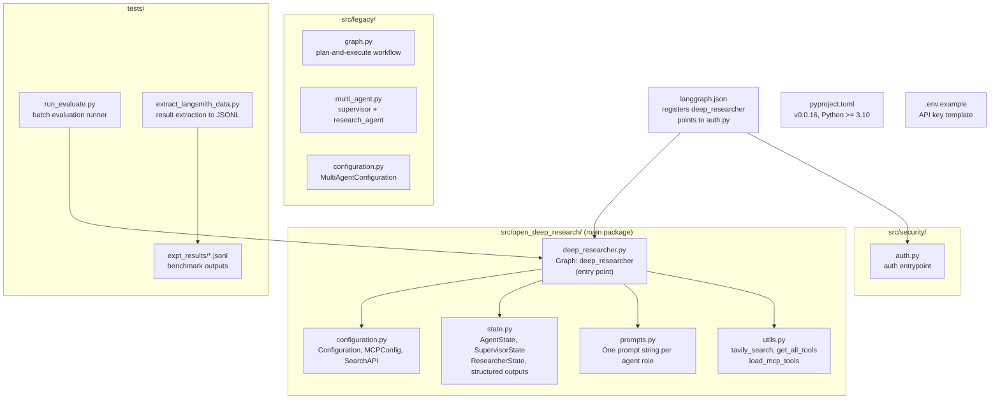
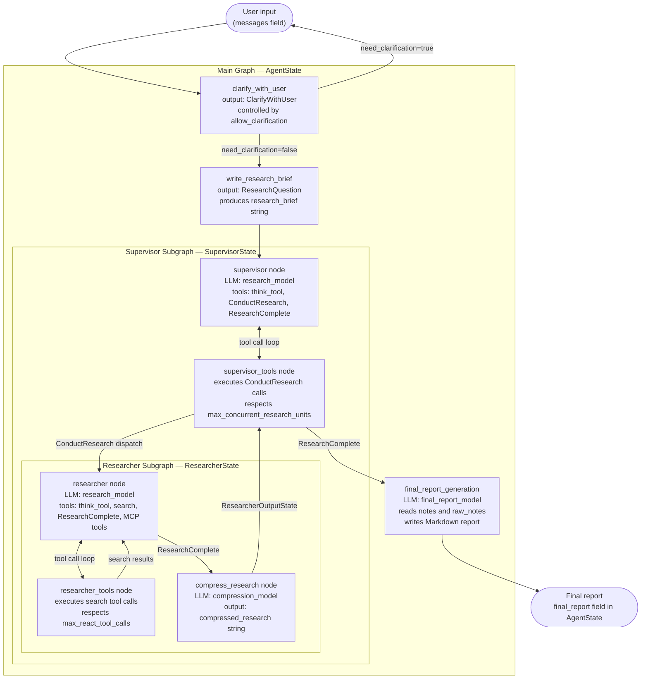

<!-- source: DeepWiki mcp.deepwiki.com · repo langchain-ai/open_deep_research · page 1 Overview · fetched 2026-10-26 -->

# Overview

Relevant source files

The following files were used as context for generating this wiki page:

- [CLAUDE.md](CLAUDE.md)
- [README.md](README.md)
- [tests/expt_results/deep_research_bench_gpt-4.1.jsonl](tests/expt_results/deep_research_bench_gpt-4.1.jsonl)
- [tests/expt_results/deep_research_bench_gpt-5.jsonl](tests/expt_results/deep_research_bench_gpt-5.jsonl)
- [tests/extract_langsmith_data.py](tests/extract_langsmith_data.py)

This page introduces the Open Deep Research repository: what it is, what it does, how its major components are organized, and how to orient yourself before diving into the detailed subsections of this wiki. For step-by-step setup instructions, see [Getting Started](#2). For the full architectural breakdown, see [System Architecture](#3).

---

## What It Is

Open Deep Research is a fully open-source, configurable deep research agent built on [LangGraph](https://github.com/langchain-ai/langgraph). Given a research question, the agent autonomously plans, searches, synthesizes, and writes a structured Markdown report. It is designed to work across many LLM providers, search backends, and MCP (Model Context Protocol) servers.

The primary graph is defined in `src/open_deep_research/deep_researcher.py` and is registered under the name `deep_researcher` in `langgraph.json`. This is the entry point for all research runs.

The agent has been evaluated on [Deep Research Bench](https://huggingface.co/spaces/Ayanami0730/DeepResearch-Leaderboard), a 100-task PhD-level benchmark spanning 22 fields, and achieved a RACE score competitive with leading commercial deep research systems.

Sources: [README.md:1-20](), [CLAUDE.md:1-20]()

---

## Repository Layout

**Title: Repository Module Map**

Sources: [README.md:1-20](), [CLAUDE.md:6-55](), [langgraph.json]()

---

## Core Capabilities

| Capability | Details |
|---|---|
| **Multi-agent research pipeline** | Supervisor subgraph coordinates multiple Researcher subgraphs in parallel |
| **LLM provider support** | Any model supported by `init_chat_model()`: OpenAI, Anthropic, Google, Groq, DeepSeek, Ollama, OpenRouter |
| **Search backends** | Tavily (default), OpenAI native web search, Anthropic native web search, or none |
| **MCP tool integration** | Configurable via `MCPConfig`; tools are loaded at runtime and injected into the researcher agent |
| **Configurable model roles** | Four separate model fields: `summarization_model`, `research_model`, `compression_model`, `final_report_model` |
| **Optional user clarification** | The `clarify_with_user` node can ask follow-up questions before beginning research |
| **Deployment targets** | Local dev server (`langgraph dev`), LangGraph Platform, Open Agent Platform (OAP) |
| **Evaluation pipeline** | LangSmith integration for running and scoring against Deep Research Bench |

Sources: [README.md:60-130](), [CLAUDE.md:47-66]()

---

## High-Level Runtime Flow

The diagram below maps the runtime execution path from user input to final report, naming the specific graph nodes and state types from the codebase.

**Title: Runtime Execution Flow (deep_researcher graph)**

Sources: [README.md:1-10](), [CLAUDE.md:17-19]()

---

## Key Code Entities at a Glance

The table below maps the major system concepts to their concrete code locations.

| Concept | Code Entity | File |
|---|---|---|
| Main compiled graph | `deep_researcher` | `src/open_deep_research/deep_researcher.py` |
| Primary state type | `AgentState` | `src/open_deep_research/state.py` |
| Supervisor state | `SupervisorState` | `src/open_deep_research/state.py` |
| Researcher state | `ResearcherState` | `src/open_deep_research/state.py` |
| Structured output: delegate work | `ConductResearch` | `src/open_deep_research/state.py` |
| Structured output: stop research | `ResearchComplete` | `src/open_deep_research/state.py` |
| All configuration fields | `Configuration` | `src/open_deep_research/configuration.py` |
| MCP server config | `MCPConfig` | `src/open_deep_research/configuration.py` |
| Search backend selection | `SearchAPI` (enum) | `src/open_deep_research/configuration.py` |
| Tool assembly function | `get_all_tools()` | `src/open_deep_research/utils.py` |
| MCP tool loading | `load_mcp_tools()` | `src/open_deep_research/utils.py` |
| Tavily search implementation | `tavily_search` | `src/open_deep_research/utils.py` |
| All agent prompt strings | module-level constants | `src/open_deep_research/prompts.py` |
| LangGraph deployment manifest | — | `langgraph.json` |
| Authentication entrypoint | `auth.py` | `src/security/auth.py` |

Sources: [CLAUDE.md:16-55]()

---

## Supported LLM Providers and Search APIs

**LLM Providers** — any model string accepted by `init_chat_model()` works, including:

- `openai:gpt-4.1`, `openai:gpt-5`, `openai:gpt-4.1-mini`
- `anthropic:claude-sonnet-4-20250514`
- Google, Groq, DeepSeek, Ollama (local), OpenRouter

> Models must support both **structured outputs** and **tool calling**.

**Search Backends** — controlled by the `search_api` field in `Configuration`:

| `SearchAPI` enum value | Mechanism | Notes |
|---|---|---|
| `TAVILY` (default) | `tavily_search` async multi-query tool | Requires `TAVILY_API_KEY` |
| `OPENAI` | OpenAI native `web_search_preview` tool | Requires `OPENAI_API_KEY` |
| `ANTHROPIC` | Anthropic native `web_search_20250305` tool | Requires `ANTHROPIC_API_KEY` |
| `NONE` | No search tool loaded | Useful for MCP-only setups |

Sources: [README.md:60-82]()

---

## Benchmark Performance

Open Deep Research is evaluated on [Deep Research Bench](https://huggingface.co/spaces/Ayanami0730/DeepResearch-Leaderboard), which provides 100 PhD-level tasks (50 English, 50 Chinese) across 22 domains. The scoring metric is **RACE** — an LLM-as-a-judge approach (using Gemini) that compares agent output against expert-written golden reports.

Evaluation is executed via `tests/run_evaluate.py` against the LangSmith dataset `deep_research_bench`. Results are extracted to JSONL format using `tests/extract_langsmith_data.py`.

| Configuration | Research Model | RACE Score |
|---|---|---|
| GPT-5 | `openai:gpt-5` | 0.4943 |
| Claude Sonnet 4 | `anthropic:claude-sonnet-4-20250514` | 0.4401 |
| Defaults | `openai:gpt-4.1` | 0.4309 |
| Deep Research Bench Submission | `openai:gpt-4.1` | 0.4344 |

Summarization model was `openai:gpt-4.1-mini` and compression model was `openai:gpt-4.1` for all runs. For details on running evaluations, see [Evaluation System](#5.1) and [Performance Benchmarks and Results](#5.2).

Sources: [README.md:83-114]()

---

## Legacy Implementations

The `src/legacy/` directory contains two earlier architectures that are less performant than the current implementation but demonstrate alternative design approaches:

| Implementation | File | Architecture |
|---|---|---|
| Workflow | `src/legacy/graph.py` | Plan-and-execute, sequential, human-in-the-loop |
| Multi-agent | `src/legacy/multi_agent.py` | Supervisor + `research_agent` StateGraph, parallel |

These are not registered in `langgraph.json` and are not part of the active deployment. For details, see [Legacy Implementations](#3.6).

Sources: [README.md:135-150](), [CLAUDE.md:24-31]()

---

## Where to Go Next

| Goal | Page |
|---|---|
| Install and run the agent locally | [Getting Started](#2) |
| Understand the full graph node-by-node | [Deep Research Agent Workflow](#3.1) |
| See all configuration options | [Configuration Options](#4.1) |
| Configure MCP servers | [MCP Server Integration](#4.3) |
| Deploy to production | [Deployment Options](#4.4) |
| Run benchmarks | [Evaluation System](#5.1) |

---

