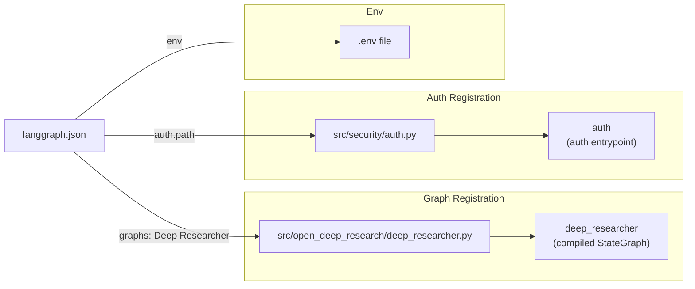
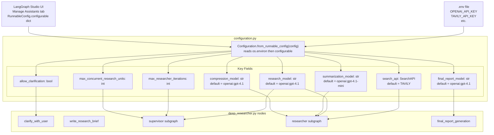
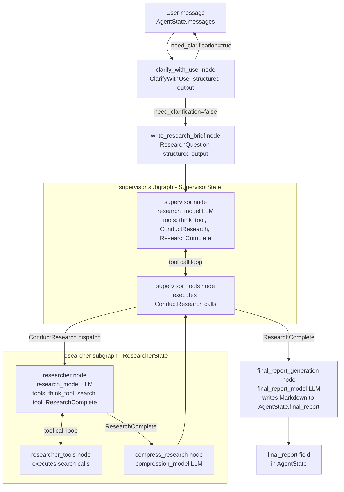

<!-- source: DeepWiki mcp.deepwiki.com · repo langchain-ai/open_deep_research · page 2 Getting Started · fetched 2026-10-26 -->

# Getting Started

<details>
<summary>Relevant source files</summary>

The following files were used as context for generating this wiki page:

- [.env.example](.env.example)
- [README.md](README.md)
- [langgraph.json](langgraph.json)
- [pyproject.toml](pyproject.toml)
- [tests/expt_results/deep_research_bench_gpt-5.jsonl](tests/expt_results/deep_research_bench_gpt-5.jsonl)

</details>


This page covers the steps required to install Open Deep Research, configure environment variables, launch a local LangGraph server, and submit a first research query. It is scoped to initial setup only. For a deeper explanation of how the system works internally, see [System Architecture](#3). For a full reference of configuration options, see [Configuration Options](#4.1).

---

## Prerequisites

| Requirement | Minimum Version | Notes |
|---|---|---|
| Python | 3.10 | 3.11 recommended (used in `langgraph.json`) |
| `uv` | any recent | Used for dependency management |
| API key (LLM) | — | OpenAI by default; Anthropic, Google, etc. also supported |
| API key (Search) | — | Tavily by default; OpenAI/Anthropic native search also supported |
| LangSmith API key | — | Required for tracing (optional but recommended) |

The full dependency list is declared in [pyproject.toml:11-47](). Python version constraint is set at [pyproject.toml:8]().

---

## Installation

**Step 1 — Clone the repository and create a virtual environment:**

```bash
git clone https://github.com/langchain-ai/open_deep_research.git
cd open_deep_research
uv venv
source .venv/bin/activate   # Windows: .venv\Scripts\activate
```

**Step 2 — Install dependencies:**

```bash
uv sync
```

Alternatively:

```bash
uv pip install -r pyproject.toml
```

The package layout is defined in [pyproject.toml:56-65](), mapping three top-level packages:

| Package name | Source directory |
|---|---|
| `open_deep_research` | `src/open_deep_research/` |
| `legacy` | `src/legacy/` |
| `tests` | `tests/` |

Sources: [pyproject.toml:1-65]()

---

## Environment Setup

Copy the environment variable template:

```bash
cp .env.example .env
```

Then open `.env` and populate the keys you need. The full template is at [.env.example:1-13]().

**Environment variable reference:**

| Variable | Required | Purpose |
|---|---|---|
| `OPENAI_API_KEY` | Yes (default config) | Powers all four model roles by default |
| `ANTHROPIC_API_KEY` | If using Anthropic models | Research, compression, or final report model |
| `GOOGLE_API_KEY` | If using Google models | Vertex AI / Gemini model roles |
| `TAVILY_API_KEY` | Yes (default search) | Tavily search API used by researcher agents |
| `LANGSMITH_API_KEY` | Recommended | Enables LangSmith tracing |
| `LANGSMITH_PROJECT` | Optional | Names the LangSmith project for traces |
| `LANGSMITH_TRACING` | Optional | Set to `true` to enable tracing |
| `SUPABASE_KEY` | OAP deployments only | Open Agent Platform auth |
| `SUPABASE_URL` | OAP deployments only | Open Agent Platform auth |
| `GET_API_KEYS_FROM_CONFIG` | Production only | Set `true` to read keys from `RunnableConfig` instead of env |

The `GET_API_KEYS_FROM_CONFIG` flag controls whether the system reads API keys from the environment (local dev) or from the `RunnableConfig.configurable` dict (production deployments). It defaults to `false` in [.env.example:13]().

Sources: [.env.example:1-13]()

---

## Launching the Local LangGraph Server

```bash
uvx --refresh --from "langgraph-cli[inmem]" --with-editable . --python 3.11 langgraph dev --allow-blocking
```

This command:
1. Uses `uvx` to run `langgraph dev` in an isolated environment with the current project installed as an editable package.
2. Reads [langgraph.json:1-14]() to discover the graph and auth entrypoint.
3. Starts the in-memory LangGraph server.

Once running, three endpoints are available:

| Endpoint | URL |
|---|---|
| REST API | `http://127.0.0.1:2024` |
| LangGraph Studio UI | `https://smith.langchain.com/studio/?baseUrl=http://127.0.0.1:2024` |
| API Docs (OpenAPI) | `http://127.0.0.1:2024/docs` |

Sources: [README.md:43-56](), [langgraph.json:1-14]()

---

## How `langgraph.json` Connects to the Code

The server entrypoint is declared in [langgraph.json:1-14](). It registers one graph and one auth handler:

**Diagram: `langgraph.json` wiring to Python entrypoints**



Sources: [langgraph.json:1-14](), [README.md:43-56]()

---

## Submitting a First Research Query

Once the Studio UI is open in your browser:

1. Locate the `messages` input field.
2. Enter a research question as a plain text message.
3. Click **Submit**.

The graph entry point is the `clarify_with_user` node in `deep_researcher.py`. If the `allow_clarification` configuration flag is enabled (it is by default), the agent may respond with a clarifying question before producing a report. Respond to it in the same `messages` field, or disable clarification via configuration (see below).

The final output appears in the `final_report` field of the graph state as a Markdown document.

---

## Selecting a Configuration Before Running

In the Studio UI, open the **Manage Assistants** tab to set configuration values before submitting. The values map directly to fields in the `Configuration` Pydantic model in [src/open_deep_research/configuration.py]().

**Diagram: Configuration flow from `.env` and Studio UI to graph nodes**



Sources: [README.md:60-81](), [.env.example:1-13](), [langgraph.json:1-14]()

---

## Common Initial Configuration Choices

| Goal | Field to Change | Example Value |
|---|---|---|
| Use Anthropic for research | `research_model` | `anthropic:claude-sonnet-4-20250514` |
| Use Anthropic native web search | `search_api` | `ANTHROPIC` |
| Use OpenAI native web search | `search_api` | `OPENAI` |
| Skip clarification step | `allow_clarification` | `false` |
| Limit search depth | `max_researcher_iterations` | `3` |
| Run researchers in parallel | `max_concurrent_research_units` | `3` |
| No web search at all | `search_api` | `NONE` |

Selected models must support both **structured outputs** and **tool calling**. See [Model Selection and Search APIs](#4.2) for provider-specific guidance.

Sources: [README.md:60-81]()

---

## What Happens When You Submit a Query

**Diagram: High-level execution path for a submitted query**



The compiled graph object is named `deep_researcher` and is defined at the bottom of [src/open_deep_research/deep_researcher.py](). It is this object that `langgraph.json` registers under the name `"Deep Researcher"`.

Sources: [langgraph.json:3-5](), [README.md:43-58]()

---

