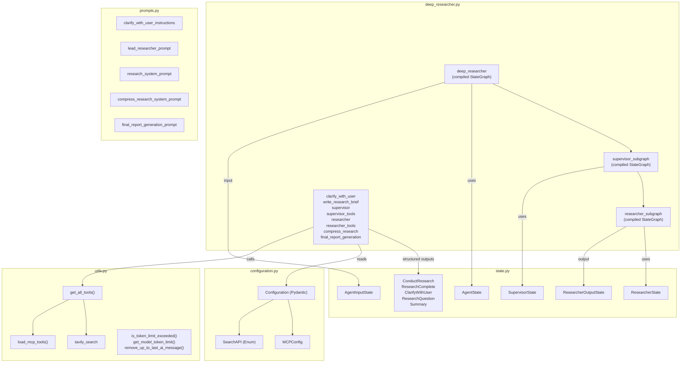
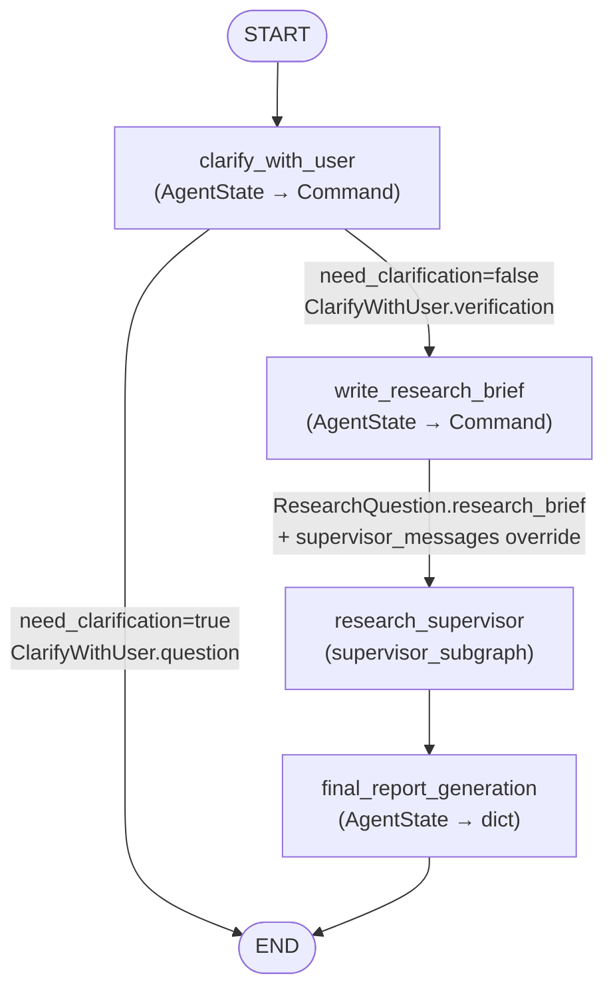
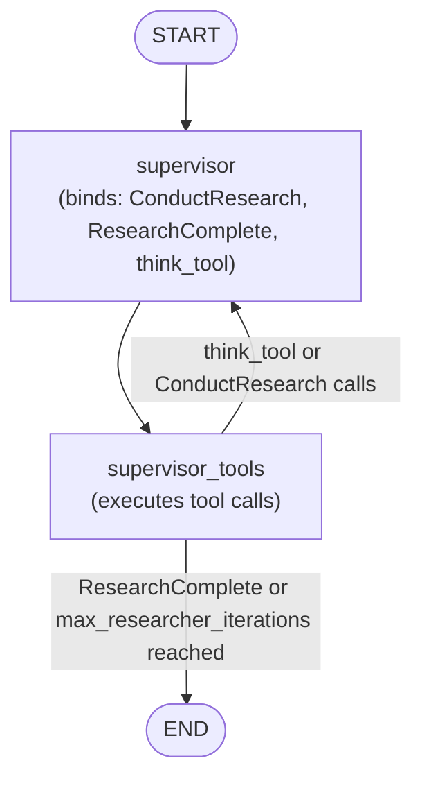
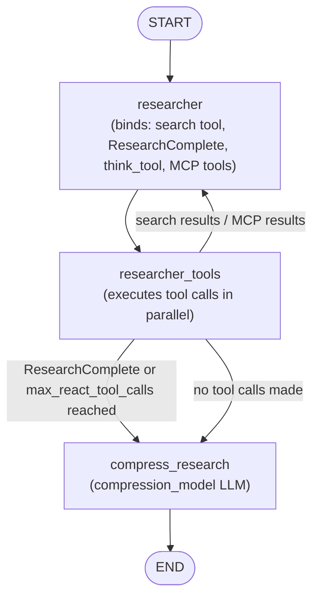
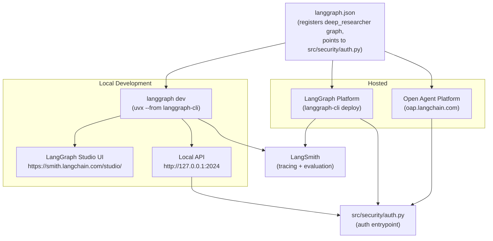
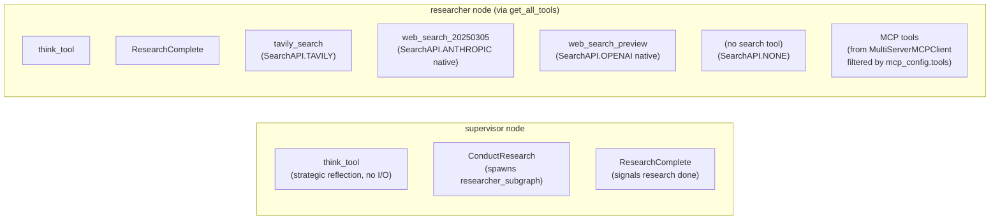

<!-- source: DeepWiki mcp.deepwiki.com · repo langchain-ai/open_deep_research · page 3 System Architecture · fetched 2026-10-26 -->

# System Architecture

<details>
<summary>Relevant source files</summary>

The following files were used as context for generating this wiki page:

- [README.md](README.md)
- [src/legacy/configuration.py](src/legacy/configuration.py)
- [src/open_deep_research/deep_researcher.py](src/open_deep_research/deep_researcher.py)
- [src/open_deep_research/state.py](src/open_deep_research/state.py)
- [tests/expt_results/deep_research_bench_gpt-5.jsonl](tests/expt_results/deep_research_bench_gpt-5.jsonl)
- [tests/run_evaluate.py](tests/run_evaluate.py)

</details>


This document provides a technical overview of the Open Deep Research system's architecture, covering the LangGraph graph, sub-graphs, state objects, configuration, tools, and prompts, and how they fit together.

For installation and setup, see page 2 (Getting Started). For configuration reference tables, see page 4 (Usage Guide). For evaluation details, see page 5 (Evaluation and Quality Assessment).

## Core System Overview

The system implements a multi-agent research pipeline where a supervisor agent coordinates multiple parallel researcher agents. The primary source files are:

| File | Role |
|------|------|
| `src/open_deep_research/deep_researcher.py` | Main LangGraph graph and all agent node functions |
| `src/open_deep_research/state.py` | State classes and structured output types |
| `src/open_deep_research/configuration.py` | `Configuration` Pydantic model, `MCPConfig`, `SearchAPI` enum |
| `src/open_deep_research/utils.py` | Tool assembly (`get_all_tools`), search, MCP loading, token utilities |
| `src/open_deep_research/prompts.py` | System prompt strings, one per agent role |
| `langgraph.json` | Deployment manifest — registers `deep_researcher` graph |
| `src/security/auth.py` | Auth entrypoint for hosted deployments |

Sources: [src/open_deep_research/deep_researcher.py:1-60](), [src/open_deep_research/state.py:1-15](), [src/open_deep_research/configuration.py:1-10]()

### Package-to-Code Map

The following diagram maps the main runtime objects to their source locations.



Sources: [src/open_deep_research/deep_researcher.py:353-719](), [src/open_deep_research/state.py:62-97](), [src/open_deep_research/configuration.py:1-120]()

## Agent Workflow and State Management

The workflow progresses from user input through optional clarification, research brief generation, parallel research execution, and final report synthesis.

### Main Graph Execution Flow

The outer graph (`deep_researcher`) is a `StateGraph(AgentState, input=AgentInputState)`. Inside it, the `research_supervisor` node is the compiled `supervisor_subgraph`, which in turn invokes `researcher_subgraph` instances in parallel.

**Main graph node execution order (`deep_researcher`):**



**Supervisor subgraph loop (`supervisor_subgraph`, `SupervisorState`):**



**Researcher subgraph loop (`researcher_subgraph`, `ResearcherState`, output=`ResearcherOutputState`):**



Sources: [src/open_deep_research/deep_researcher.py:60-719](), [src/open_deep_research/deep_researcher.py:353-363](), [src/open_deep_research/deep_researcher.py:587-605](), [src/open_deep_research/deep_researcher.py:699-717]()

### State Classes

The system defines five state classes in `state.py`, used by different layers of the graph hierarchy.

| Class | Graph layer | Key fields |
|-------|-------------|------------|
| `AgentInputState` | Main graph input | `messages` (from `MessagesState`) |
| `AgentState` | Main graph | `messages`, `supervisor_messages`, `research_brief`, `raw_notes`, `notes`, `final_report` |
| `SupervisorState` | Supervisor subgraph | `supervisor_messages`, `research_brief`, `notes`, `research_iterations`, `raw_notes` |
| `ResearcherState` | Researcher subgraph | `researcher_messages`, `tool_call_iterations`, `research_topic`, `compressed_research`, `raw_notes` |
| `ResearcherOutputState` | Researcher subgraph output | `compressed_research`, `raw_notes` |

Both `AgentState` and `SupervisorState` use an `override_reducer` on `supervisor_messages`, `raw_notes`, and `notes`. This reducer allows a node to either append to a list (default) or fully replace it by passing `{"type": "override", "value": [...]}`. See [src/open_deep_research/state.py:55-60]() for the implementation.

### Structured Output Types

Nodes use these `pydantic.BaseModel` subclasses as structured outputs or tool schemas:

| Type | Used by | Purpose |
|------|---------|---------|
| `ClarifyWithUser` | `clarify_with_user` | Determines whether to ask user a question |
| `ResearchQuestion` | `write_research_brief` | Extracts structured research brief from conversation |
| `ConductResearch` | `supervisor` (tool) | Instructs supervisor to spawn a researcher |
| `ResearchComplete` | `supervisor`, `researcher` (tool) | Signals task completion |
| `Summary` | `tavily_search` | Per-URL summarization output |

Sources: [src/open_deep_research/state.py:15-49](), [src/open_deep_research/state.py:55-97]()

## Configuration

Configuration is managed via the `Configuration` Pydantic model in `configuration.py`. Its `from_runnable_config` classmethod loads values, giving priority to environment variables (`os.environ.get(field.upper())`) over values from `RunnableConfig.configurable`.

### Configuration Loading Flow

```mermaid
flowchart LR
    DOTENV["`.env` file\n(OPENAI_API_KEY, TAVILY_API_KEY, etc.)"]
    RC["RunnableConfig.configurable\n(Studio UI or API body)"]
    FRC["Configuration.from_runnable_config(config)\niterates model_fields:\n1. os.environ.get(FIELD.upper()) — priority\n2. configurable.get(field) — fallback\n3. drop None → Pydantic defaults"]
    CFG["Configuration instance\n(consumed by all node functions)"]

    DOTENV --> FRC
    RC --> FRC
    FRC --> CFG
```

### Key Configuration Fields

| Field | Default | Controls |
|-------|---------|---------|
| `research_model` | `openai:gpt-4.1` | LLM for `supervisor`, `researcher`, `clarify_with_user`, `write_research_brief` |
| `summarization_model` | `openai:gpt-4.1-mini` | Per-URL summarization inside `tavily_search` |
| `compression_model` | `openai:gpt-4.1` | LLM for `compress_research` node |
| `final_report_model` | `openai:gpt-4.1` | LLM for `final_report_generation` node |
| `search_api` | `SearchAPI.TAVILY` | Which search tool the researcher receives |
| `allow_clarification` | `True` | Whether `clarify_with_user` may prompt the user |
| `max_researcher_iterations` | `6` | Max supervisor loop iterations before forced exit |
| `max_react_tool_calls` | `10` | Max researcher tool call rounds per researcher instance |
| `max_concurrent_research_units` | `10` | Max parallel `researcher_subgraph` invocations per supervisor step |
| `mcp_config` | `None` | `MCPConfig(url, tools, auth_required)` for MCP server integration |

All models are initialised via `init_chat_model(configurable_fields=("model", "max_tokens", "api_key"))`, so any provider string accepted by `langchain.chat_models.init_chat_model` is valid.

Sources: [src/open_deep_research/configuration.py:1-120](), [src/open_deep_research/deep_researcher.py:56-58]()

## Deployment and Runtime Architecture

The graph is registered for deployment via `langgraph.json`, which points to the compiled `deep_researcher` graph in `deep_researcher.py` and the `auth.py` entrypoint in `src/security/`.

### Deployment Targets



Sources: [README.md:21-58](), [README.md:115-134]()

## Tool Integration

Tools are assembled by `get_all_tools(config)` in `utils.py` and bound to the appropriate agent model at runtime.

### Tool Assignment by Agent



The `search_api` field on `Configuration` (a `SearchAPI` enum) selects exactly one search backend for the researcher. Options are `TAVILY`, `ANTHROPIC`, `OPENAI`, and `NONE`. MCP tools are additive — if `mcp_config` is set, tools from the configured MCP server are appended, skipping any name that already exists in the tool list.

`tavily_search` is an async multi-query tool defined in `utils.py`. For each URL returned by Tavily, it calls the `summarization_model` to produce a `Summary(summary, key_excerpts)` before returning results.

Sources: [src/open_deep_research/utils.py:1-300](), [src/open_deep_research/deep_researcher.py:200-210](), [src/open_deep_research/deep_researcher.py:383-389]()

## Budget and Resource Management

The system implements comprehensive resource management through configurable limits on iterations, token usage, and concurrent operations to ensure controlled execution and cost management.

| Resource Type | Configuration Parameter | Purpose |
|---------------|------------------------|---------|
| Research Iterations | `max_researcher_iterations` | Limits supervisor delegation cycles |
| Tool Calls | `max_react_tool_calls` | Prevents excessive API usage per researcher |
| Concurrent Research | `max_concurrent_research_units` | Controls parallel researcher spawning |
| Token Limits | Model-specific limits | Manages LLM token consumption |
| Search API Calls | Search provider limits | Controls external API usage |

Sources: [README.md:139-148](), [src/open_deep_research/state.py:74-96]()

The architecture enables scalable, configurable research workflows while maintaining resource control and quality assurance through its layered approach to agent coordination, state management, and external service integration.

---

