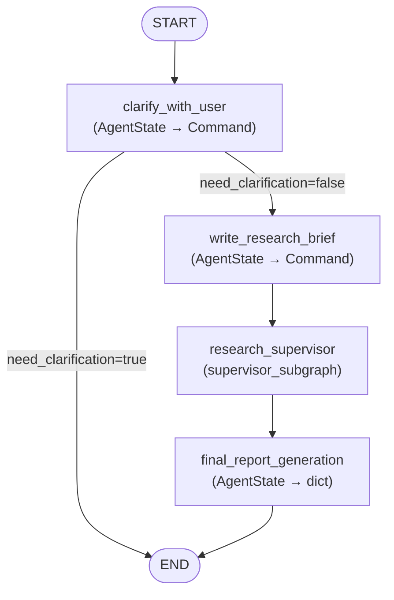
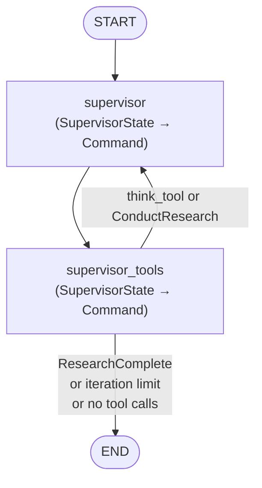
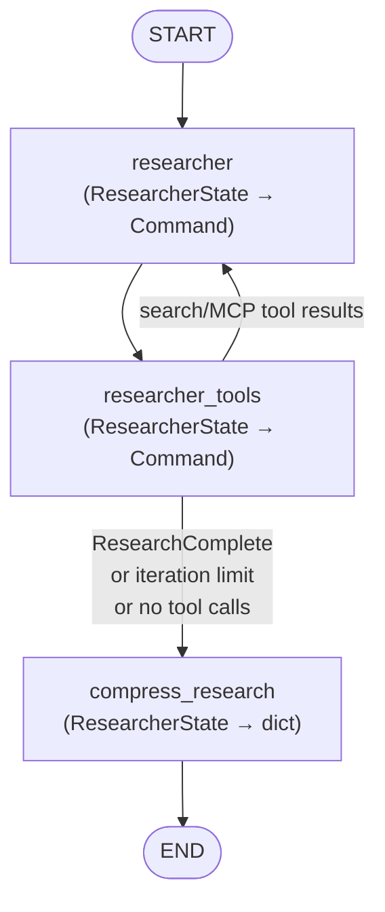
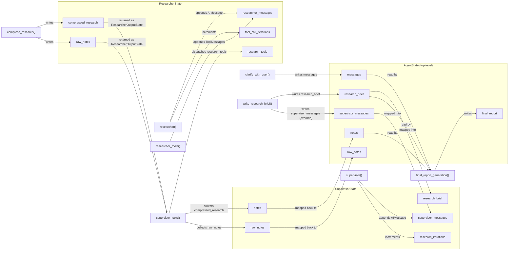

<!-- source: DeepWiki mcp.deepwiki.com · repo langchain-ai/open_deep_research · page 3.1 Deep Research Agent Workflow · fetched 2026-10-26 -->

# Deep Research Agent Workflow

<details>
<summary>Relevant source files</summary>

The following files were used as context for generating this wiki page:

- [src/legacy/configuration.py](src/legacy/configuration.py)
- [src/open_deep_research/deep_researcher.py](src/open_deep_research/deep_researcher.py)
- [src/open_deep_research/prompts.py](src/open_deep_research/prompts.py)
- [src/open_deep_research/state.py](src/open_deep_research/state.py)
- [tests/run_evaluate.py](tests/run_evaluate.py)

</details>


This page documents the complete execution flow of the deep research agent: every node in the main LangGraph graph, the subgraphs it contains, how nodes communicate through state, and the routing logic between them. The graph is defined entirely in [src/open_deep_research/deep_researcher.py]().

For the state types used by each node, see [State Management](#3.2). For configuration fields that control node behavior, see [Configuration System](#3.3). For tool implementations referenced here, see [Tool Integration and Utilities](#3.4). For the prompt strings passed into each node, see [Agent Prompts and Instructions](#3.5).

---

## Graph Overview

The system is composed of three nested LangGraph `StateGraph` instances:

| Graph variable | Builder variable | State type | Scope |
|---|---|---|---|
| `deep_researcher` | `deep_researcher_builder` | `AgentState` (input: `AgentInputState`) | Top-level graph |
| `supervisor_subgraph` | `supervisor_builder` | `SupervisorState` | Supervisor loop |
| `researcher_subgraph` | `researcher_builder` | `ResearcherState` (output: `ResearcherOutputState`) | Per-research-task loop |

The top-level graph embeds `supervisor_subgraph` as a node named `"research_supervisor"`, and `supervisor_subgraph` calls `researcher_subgraph` by direct `ainvoke` inside the `supervisor_tools` function — not as a declared LangGraph node.

Sources: [src/open_deep_research/deep_researcher.py:700-719](), [src/open_deep_research/deep_researcher.py:351-363](), [src/open_deep_research/deep_researcher.py:587-605]()

---

## Top-Level Graph Structure

**Diagram: Top-level `deep_researcher` graph node/edge structure**



Sources: [src/open_deep_research/deep_researcher.py:700-719]()

---

## Node Reference

### `clarify_with_user`

**Function:** `clarify_with_user(state: AgentState, config: RunnableConfig)`  
**Defined at:** [src/open_deep_research/deep_researcher.py:60-115]()

This is the entry point of the graph. It uses the `research_model` configured via `Configuration`, invokes it with `.with_structured_output(ClarifyWithUser)`, and decides whether to ask the user a follow-up question or proceed immediately.

**Routing logic:**

| Condition | Route | State update |
|---|---|---|
| `allow_clarification=False` (config flag) | → `write_research_brief` | none |
| `ClarifyWithUser.need_clarification=True` | → `END` | appends clarifying question as `AIMessage` |
| `ClarifyWithUser.need_clarification=False` | → `write_research_brief` | appends verification `AIMessage` |

The prompt used is `clarify_with_user_instructions` from [src/open_deep_research/prompts.py:3-41]().

---

### `write_research_brief`

**Function:** `write_research_brief(state: AgentState, config: RunnableConfig)`  
**Defined at:** [src/open_deep_research/deep_researcher.py:118-175]()

Transforms the conversation history into a focused `ResearchQuestion` structured output via `.with_structured_output(ResearchQuestion)`. It then initialises the supervisor's message history by:

1. Generating `research_brief: str` from `ResearchQuestion.research_brief`
2. Building the supervisor system prompt from `lead_researcher_prompt` (formatted with `date`, `max_concurrent_research_units`, `max_researcher_iterations`)
3. Writing `supervisor_messages` to state using the `override_reducer` pattern (type: `"override"`)

The prompt used is `transform_messages_into_research_topic_prompt` from [src/open_deep_research/prompts.py:44-77]().

**State updates written:** `research_brief`, `supervisor_messages`

---

### `research_supervisor` (Supervisor Subgraph)

This node is the compiled `supervisor_subgraph`, which is itself a two-node loop. See the subgraph section below for details.

**State boundary:** The supervisor subgraph operates on `SupervisorState`. It reads `supervisor_messages` and `research_brief` from the parent `AgentState` and writes back `notes` and `raw_notes`.

---

### `final_report_generation`

**Function:** `final_report_generation(state: AgentState, config: RunnableConfig)`  
**Defined at:** [src/open_deep_research/deep_researcher.py:607-697]()

Reads all `notes` (compressed research summaries) from state, concatenates them, and passes them along with `research_brief` and message history to the `final_report_model`. Produces a Markdown report.

**Token-limit retry logic:** If the model raises a token limit error, the node truncates `findings` by 10% per retry for up to 3 attempts. The initial truncation size is derived from `get_model_token_limit()` multiplied by 4 (character approximation).

**State updates written:** `final_report` (str), `messages` (appends report), `notes` (cleared via override reducer)

The prompt used is `final_report_generation_prompt` from [src/open_deep_research/prompts.py:228-308]().

---

## Supervisor Subgraph

**Diagram: `supervisor_subgraph` internal loop**



Sources: [src/open_deep_research/deep_researcher.py:351-363]()

### `supervisor` node

**Function:** `supervisor(state: SupervisorState, config: RunnableConfig)`  
**Defined at:** [src/open_deep_research/deep_researcher.py:178-223]()

Binds three tools to the `research_model`:

| Tool | Purpose |
|---|---|
| `ConductResearch` | Spawn a researcher subgraph on a topic |
| `ResearchComplete` | Signal end of research phase |
| `think_tool` | Strategic reflection (no I/O) |

Invokes the model with the full `supervisor_messages` history and appends the response. Increments `research_iterations` by 1.

### `supervisor_tools` node

**Function:** `supervisor_tools(state: SupervisorState, config: RunnableConfig)`  
**Defined at:** [src/open_deep_research/deep_researcher.py:225-348]()

**Exit conditions** (any one routes to `END`):

| Condition | Effect |
|---|---|
| `research_iterations > max_researcher_iterations` | Exits; writes `notes` from tool call history |
| No tool calls in last message | Exits |
| `ResearchComplete` tool called | Exits |

**`ConductResearch` execution:**

When the supervisor calls `ConductResearch`, this node:

1. Slices the calls to `max_concurrent_research_units` (extras receive an error `ToolMessage`)
2. Dispatches all allowed calls **in parallel** via `asyncio.gather` over `researcher_subgraph.ainvoke`
3. Each call passes `{"researcher_messages": [HumanMessage(content=research_topic)], "research_topic": research_topic}`
4. Results arrive as `ResearcherOutputState`; `compressed_research` is placed into a `ToolMessage`; `raw_notes` are concatenated and appended to state

**`think_tool` execution:**

Each `think_tool` call is handled inline — its `reflection` argument is echoed back as a `ToolMessage` with no external I/O.

Sources: [src/open_deep_research/deep_researcher.py:225-348]()

---

## Researcher Subgraph

**Diagram: `researcher_subgraph` internal loop and exit paths**



Sources: [src/open_deep_research/deep_researcher.py:587-605]()

### `researcher` node

**Function:** `researcher(state: ResearcherState, config: RunnableConfig)`  
**Defined at:** [src/open_deep_research/deep_researcher.py:365-424]()

Calls `get_all_tools(config)` to retrieve the configured search tool, `think_tool`, `ResearchComplete`, and any MCP tools. Raises `ValueError` if the tool list is empty (no search API or MCP configured).

Prepends `research_system_prompt` as a `SystemMessage`, then invokes `research_model` with the full `researcher_messages` history. Increments `tool_call_iterations`.

The prompt used is `research_system_prompt` from [src/open_deep_research/prompts.py:138-183]().

### `researcher_tools` node

**Function:** `researcher_tools(state: ResearcherState, config: RunnableConfig)`  
**Defined at:** [src/open_deep_research/deep_researcher.py:435-509]()

**Exit conditions** (route to `compress_research`):

| Condition | Notes |
|---|---|
| No tool calls and no native search (OpenAI/Anthropic) | Immediate exit |
| `tool_call_iterations >= max_react_tool_calls` | Exits after processing last tool calls |
| `ResearchComplete` tool called | Exits after processing all tool calls |

Tool calls are dispatched in parallel via `asyncio.gather` using `execute_tool_safely`, which wraps each invocation with a `try/except` to prevent one tool failure from aborting the entire batch.

Detects native provider search via `openai_websearch_called()` and `anthropic_websearch_called()` helpers from [src/open_deep_research/utils.py]().

### `compress_research` node

**Function:** `compress_research(state: ResearcherState, config: RunnableConfig)`  
**Defined at:** [src/open_deep_research/deep_researcher.py:511-585]()

Uses the `compression_model` (not `research_model`) to distill accumulated `researcher_messages` into a clean, citation-preserving summary. The output becomes the `ToolMessage` content returned to the supervisor.

**Retry logic:** Up to 3 attempts. On token limit error, older messages are removed via `remove_up_to_last_ai_message()` before retrying.

**Returns** (`ResearcherOutputState`):

| Field | Content |
|---|---|
| `compressed_research` | Cleaned, cited summary string |
| `raw_notes` | Concatenated raw tool + AI message content |

The prompt used is `compress_research_system_prompt` from [src/open_deep_research/prompts.py:186-226]().

---

## Complete Data Flow Diagram

**Diagram: State fields flowing between graph nodes**



Sources: [src/open_deep_research/deep_researcher.py:60-697](), [src/open_deep_research/state.py:62-96]()

---

## Iteration and Budget Controls

The following `Configuration` fields act as hard stops at specific points in the graph:

| Field | Enforced in | Effect when exceeded |
|---|---|---|
| `allow_clarification` | `clarify_with_user` | Skips clarification entirely if `False` |
| `max_researcher_iterations` | `supervisor_tools` | Exits supervisor loop, writes collected notes to state |
| `max_concurrent_research_units` | `supervisor_tools` | Caps parallel `ConductResearch` calls; extras receive error `ToolMessage` |
| `max_react_tool_calls` | `researcher_tools` | Exits researcher loop, routes to `compress_research` |
| `max_structured_output_retries` | `clarify_with_user`, `write_research_brief`, `supervisor`, `researcher` | Retries `.with_retry(stop_after_attempt=...)` on structured output calls |

Sources: [src/open_deep_research/deep_researcher.py:75-77](), [src/open_deep_research/deep_researcher.py:247-262](), [src/open_deep_research/deep_researcher.py:289-292](), [src/open_deep_research/deep_researcher.py:492-503]()

---

## Graph Compilation and Registration

The three compiled graph objects are:

```
deep_researcher       — top-level, registered in langgraph.json
supervisor_subgraph   — embedded as node "research_supervisor"
researcher_subgraph   — called directly from supervisor_tools via ainvoke
```

`deep_researcher` is built with:
- `input=AgentInputState` — only `messages` accepted on entry
- `config_schema=Configuration` — all configuration fields exposed to LangGraph Studio UI

`researcher_subgraph` is built with:
- `output=ResearcherOutputState` — only `compressed_research` and `raw_notes` returned to caller

[src/open_deep_research/deep_researcher.py:699-719](), [src/open_deep_research/deep_researcher.py:351-363](), [src/open_deep_research/deep_researcher.py:587-605]()

---

