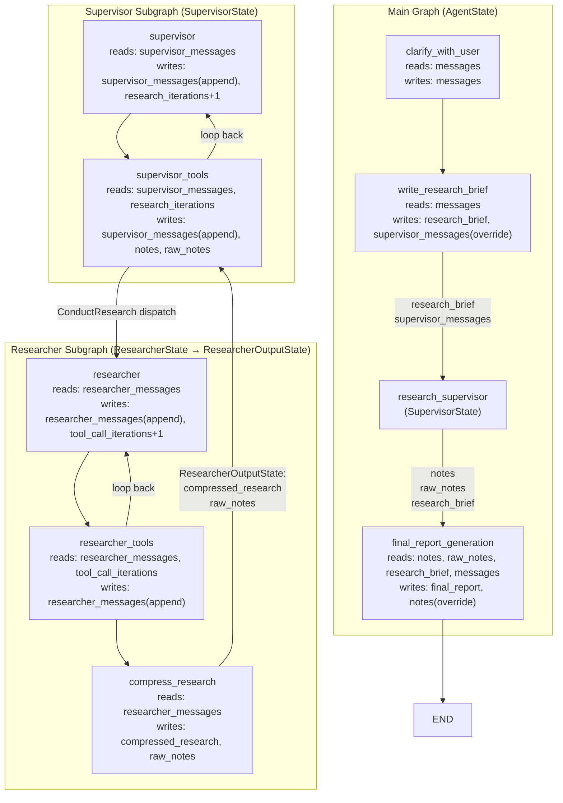
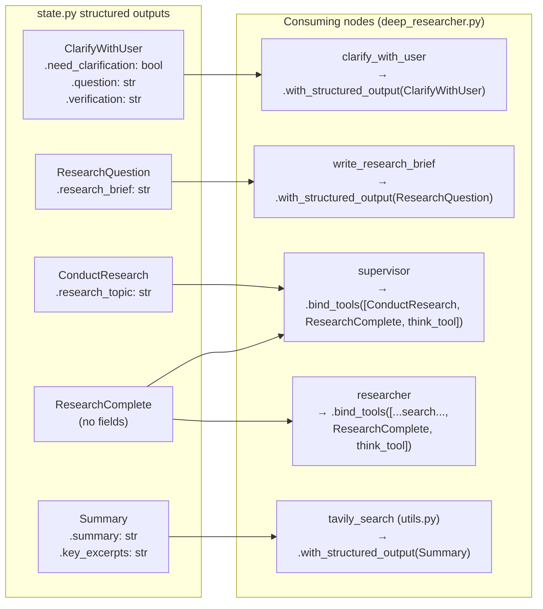

<!-- source: DeepWiki mcp.deepwiki.com · repo langchain-ai/open_deep_research · page 3.2 State Management · fetched 2026-10-26 -->

# State Management

<details>
<summary>Relevant source files</summary>

The following files were used as context for generating this wiki page:

- [src/legacy/configuration.py](src/legacy/configuration.py)
- [src/open_deep_research/deep_researcher.py](src/open_deep_research/deep_researcher.py)
- [src/open_deep_research/state.py](src/open_deep_research/state.py)
- [tests/run_evaluate.py](tests/run_evaluate.py)

</details>


This page documents the state classes and structured output types defined in [src/open_deep_research/state.py](), which form the data layer of the entire research pipeline. It covers what each state class holds, which graph layer uses it, how fields are annotated with reducers, and how the structured output types act as typed contracts between LLM calls and graph transitions.

For the graph nodes that read and write these states, see [3.1](#3.1). For configuration values that influence graph behavior, see [3.3](#3.3).

---

## Overview

The pipeline operates across three nested graph levels — a main graph, a supervisor subgraph, and one or more researcher subgraphs. Each level has its own state type. Because LangGraph merges state updates from concurrent nodes using reducer functions, every field with non-trivial merge behavior is annotated with an explicit reducer.

**State class → graph level mapping:**

| State Class | Graph Level | Defined In |
|---|---|---|
| `AgentInputState` | Main graph input | [src/open_deep_research/state.py:62-63]() |
| `AgentState` | Main graph | [src/open_deep_research/state.py:65-72]() |
| `SupervisorState` | Supervisor subgraph | [src/open_deep_research/state.py:74-81]() |
| `ResearcherState` | Researcher subgraph (internal) | [src/open_deep_research/state.py:83-90]() |
| `ResearcherOutputState` | Researcher subgraph output | [src/open_deep_research/state.py:92-96]() |

**Structured output types (used as LLM response schemas, not graph state):**

| Class | Used By |
|---|---|
| `ClarifyWithUser` | `clarify_with_user` node |
| `ResearchQuestion` | `write_research_brief` node |
| `ConductResearch` | `supervisor` node (tool call) |
| `ResearchComplete` | `supervisor` and `researcher` nodes (tool call) |
| `Summary` | `tavily_search` URL summarization |

Sources: [src/open_deep_research/state.py:1-96]()

---

## The `override_reducer` Pattern

LangGraph applies a reducer function whenever a state field is updated. The default reducer for lists is `operator.add`, which appends new values. The pipeline defines a custom reducer to allow nodes to selectively replace a list instead of extending it:

[src/open_deep_research/state.py:55-60]()

```
def override_reducer(current_value, new_value):
    if isinstance(new_value, dict) and new_value.get("type") == "override":
        return new_value.get("value", new_value)
    else:
        return operator.add(current_value, new_value)
```

- **Normal update**: pass a list → appended to the current value.
- **Override update**: pass `{"type": "override", "value": [...]}` → replaces the current value entirely.

This pattern is used in `write_research_brief` to reset `supervisor_messages` to a fresh system prompt at the start of each research session, rather than accumulating old messages:

[src/open_deep_research/deep_researcher.py:163-175]()

```python
update={
    "supervisor_messages": {
        "type": "override",
        "value": [SystemMessage(...), HumanMessage(...)]
    }
}
```

It is also used in `final_report_generation` to clear `notes` after the report is written:

[src/open_deep_research/deep_researcher.py:622]()

```python
cleared_state = {"notes": {"type": "override", "value": []}}
```

**Fields annotated with `override_reducer`:**

| Field | State Class |
|---|---|
| `supervisor_messages` | `AgentState`, `SupervisorState` |
| `raw_notes` | `AgentState`, `SupervisorState`, `ResearcherState`, `ResearcherOutputState` |
| `notes` | `AgentState`, `SupervisorState` |

Sources: [src/open_deep_research/state.py:55-96](), [src/open_deep_research/deep_researcher.py:163-175](), [src/open_deep_research/deep_researcher.py:622]()

---

## State Classes

### `AgentInputState`

[src/open_deep_research/state.py:62-63]()

```python
class AgentInputState(MessagesState):
    """InputState is only 'messages'."""
```

A thin wrapper around LangGraph's `MessagesState`. It restricts the external-facing input to only the `messages` field. The main graph is constructed with this as its input schema:

[src/open_deep_research/deep_researcher.py:701-705]()

```python
deep_researcher_builder = StateGraph(
    AgentState,
    input=AgentInputState,
    config_schema=Configuration
)
```

This means callers only need to provide `messages`; all other fields in `AgentState` are internal.

---

### `AgentState`

[src/open_deep_research/state.py:65-72]()

The full state of the main graph. It inherits `messages` from `MessagesState` and adds research-specific fields.

| Field | Type | Reducer | Purpose |
|---|---|---|---|
| `messages` | `list[BaseMessage]` | `add_messages` (from `MessagesState`) | Conversation history with the user |
| `supervisor_messages` | `list[MessageLikeRepresentation]` | `override_reducer` | Internal message thread for the supervisor subgraph |
| `research_brief` | `Optional[str]` | last-write-wins | Structured research brief produced by `write_research_brief` |
| `raw_notes` | `list[str]` | `override_reducer` | Raw tool/AI output collected from all researcher subgraphs |
| `notes` | `list[str]` | `override_reducer` | Compressed research summaries from the supervisor |
| `final_report` | `str` | last-write-wins | The completed Markdown report |

Sources: [src/open_deep_research/state.py:65-72]()

---

### `SupervisorState`

[src/open_deep_research/state.py:74-81]()

State for the supervisor subgraph. It is a `TypedDict`, not a `MessagesState`, because the supervisor maintains its own message thread (`supervisor_messages`) separate from the user-facing `messages` list.

| Field | Type | Reducer | Purpose |
|---|---|---|---|
| `supervisor_messages` | `list[MessageLikeRepresentation]` | `override_reducer` | Message thread between supervisor LLM calls |
| `research_brief` | `str` | last-write-wins | Passed in from `AgentState`; guides the supervisor |
| `notes` | `list[str]` | `override_reducer` | Compressed summaries accumulated across iterations |
| `research_iterations` | `int` | last-write-wins | Counter used to enforce `max_researcher_iterations` |
| `raw_notes` | `list[str]` | `override_reducer` | Raw notes passed up from researcher subgraphs |

`research_iterations` is incremented by the `supervisor` node on each pass and checked in `supervisor_tools` to determine whether to exit the loop:

[src/open_deep_research/deep_researcher.py:247]()

```python
exceeded_allowed_iterations = research_iterations > configurable.max_researcher_iterations
```

Sources: [src/open_deep_research/state.py:74-81](), [src/open_deep_research/deep_researcher.py:243-255]()

---

### `ResearcherState`

[src/open_deep_research/state.py:83-90]()

State for an individual researcher subgraph instance. Each parallel `ConductResearch` call spawns a fresh invocation with its own `ResearcherState`.

| Field | Type | Reducer | Purpose |
|---|---|---|---|
| `researcher_messages` | `list[MessageLikeRepresentation]` | `operator.add` | Message thread for the researcher's ReAct loop |
| `tool_call_iterations` | `int` | last-write-wins | Counter used to enforce `max_react_tool_calls` |
| `research_topic` | `str` | last-write-wins | The specific topic string assigned by the supervisor |
| `compressed_research` | `str` | last-write-wins | Output from `compress_research`; returned to supervisor |
| `raw_notes` | `list[str]` | `override_reducer` | Raw tool output collected during the ReAct loop |

Note that `researcher_messages` uses `operator.add` (plain append), not `override_reducer`. This is intentional — the researcher's message thread should only grow; it is never reset mid-execution.

Sources: [src/open_deep_research/state.py:83-90]()

---

### `ResearcherOutputState`

[src/open_deep_research/state.py:92-96]()

```python
class ResearcherOutputState(BaseModel):
    compressed_research: str
    raw_notes: Annotated[list[str], override_reducer] = []
```

A Pydantic `BaseModel` (not a `TypedDict`) that defines what the researcher subgraph exposes to its caller. The subgraph is built with this as its output schema:

[src/open_deep_research/deep_researcher.py:589-593]()

```python
researcher_builder = StateGraph(
    ResearcherState,
    output=ResearcherOutputState,
    config_schema=Configuration
)
```

When `supervisor_tools` calls `researcher_subgraph.ainvoke(...)`, it receives a dict matching this schema, and reads `compressed_research` to build a `ToolMessage` back to the supervisor.

Sources: [src/open_deep_research/state.py:92-96](), [src/open_deep_research/deep_researcher.py:589-605](), [src/open_deep_research/deep_researcher.py:308-313]()

---

## State Flow Across Graph Levels

The diagram below traces how data moves between the three graph levels, which state type each level uses, and how the key fields propagate.

**State Flow Diagram**



Sources: [src/open_deep_research/state.py:62-96](), [src/open_deep_research/deep_researcher.py:60-719]()

---

## Structured Output Types

These Pydantic `BaseModel` classes are used with `.with_structured_output()` or `.bind_tools()` to enforce typed LLM responses. They are not part of the graph state directly — they are instantiated per LLM call and their fields are then extracted to update state or route the graph.

**Structured Output Types Diagram**



### `ClarifyWithUser`

[src/open_deep_research/state.py:30-41]()

Returned by the `clarify_with_user` node. The `need_clarification` boolean determines whether the graph routes to `END` (asking the user a question) or continues to `write_research_brief`.

### `ResearchQuestion`

[src/open_deep_research/state.py:43-48]()

Returned by `write_research_brief`. Its `research_brief` field is written directly to `AgentState.research_brief` and also used as the initial `HumanMessage` to the supervisor.

### `ConductResearch`

[src/open_deep_research/state.py:15-19]()

A tool that the supervisor binds and calls to delegate research. Its `research_topic` field (described as "at least a paragraph") is passed as the initial message to a researcher subgraph instance. The field description instructs the LLM to be detailed.

### `ResearchComplete`

[src/open_deep_research/state.py:21-22]()

A signal-only tool with no fields. Both the supervisor and researcher agents can call it to indicate they are done. `supervisor_tools` checks for it to exit the supervisor loop; `researcher_tools` checks for it to route to `compress_research`.

### `Summary`

[src/open_deep_research/state.py:24-27]()

Used internally by `tavily_search` in `utils.py` to structure the per-URL summarization output. It is not directly referenced in any graph state class.

Sources: [src/open_deep_research/state.py:15-48](), [src/open_deep_research/deep_researcher.py:88-115](), [src/open_deep_research/deep_researcher.py:141-154](), [src/open_deep_research/deep_researcher.py:249-252](), [src/open_deep_research/deep_researcher.py:492-496]()

---

## Field Lifecycle Reference

The table below summarizes where each `AgentState` field originates and where it is consumed.

| Field | Written By | Read By | Notes |
|---|---|---|---|
| `messages` | User input; `clarify_with_user`; `final_report_generation` | `clarify_with_user`; `write_research_brief`; `final_report_generation` | Inherited from `MessagesState`; uses `add_messages` reducer |
| `supervisor_messages` | `write_research_brief` (override); `supervisor`; `supervisor_tools` | `supervisor` | Separate thread from user `messages` |
| `research_brief` | `write_research_brief` | `supervisor` (via `SupervisorState`); `final_report_generation` | Plain string; no reducer needed |
| `raw_notes` | `supervisor_tools` (aggregated from researchers) | `final_report_generation` | Uses `override_reducer`; appended per research round |
| `notes` | `supervisor_tools` (at END) | `final_report_generation` | Compressed summaries; cleared after report generation |
| `final_report` | `final_report_generation` | External caller | Terminal output field |

Sources: [src/open_deep_research/state.py:65-72](), [src/open_deep_research/deep_researcher.py:60-719]()

---

