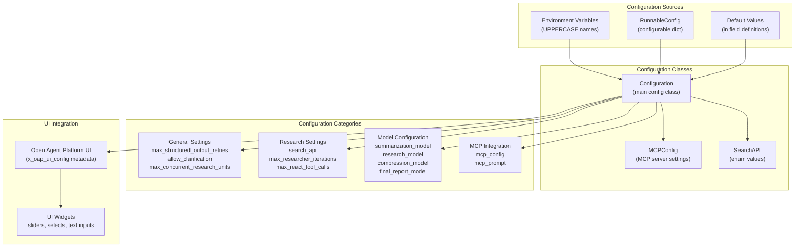
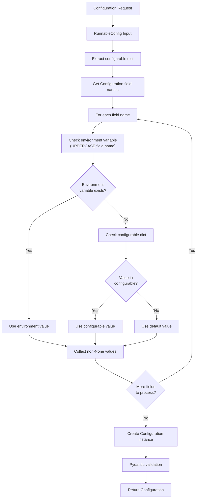
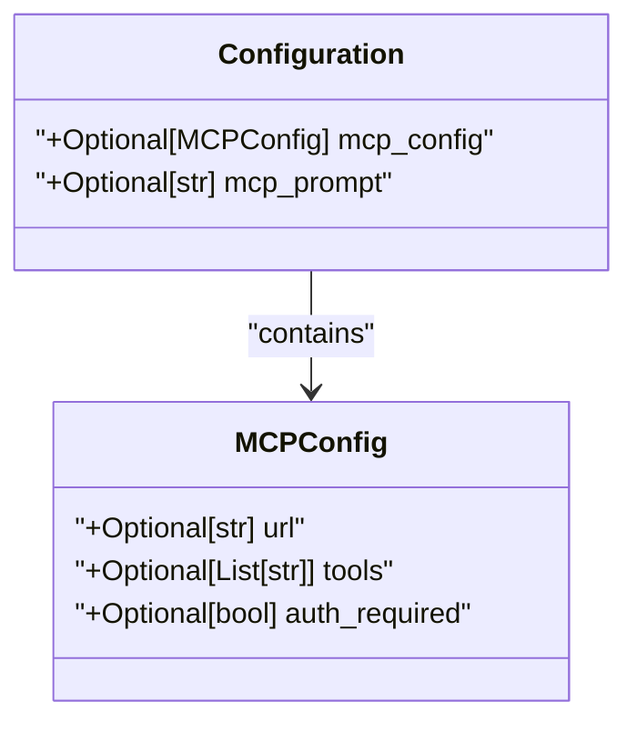
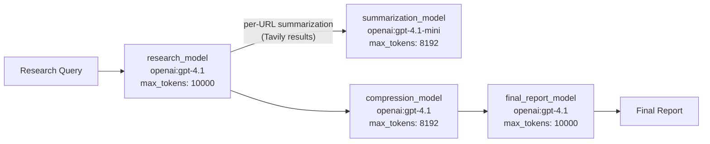
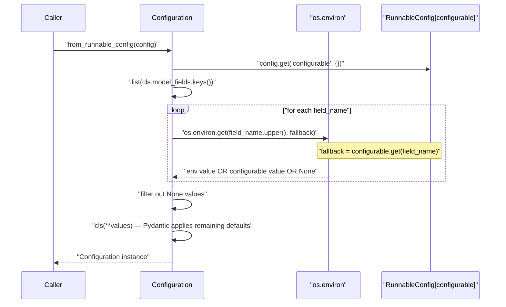

<!-- source: DeepWiki mcp.deepwiki.com · repo langchain-ai/open_deep_research · page 3.3 Configuration System · fetched 2026-10-26 -->

# Configuration System

Relevant source files

The following files were used as context for generating this wiki page:

- [.env.example](.env.example)
- [src/open_deep_research/configuration.py](src/open_deep_research/configuration.py)

## Purpose and Scope

The Configuration System provides centralized management of all configurable parameters for the Open Deep Research agent system. It defines model selections, research behavior settings, search API configurations, and MCP server integrations through a strongly-typed Pydantic-based configuration framework.

This document covers the configuration data structures, parameter definitions, and loading mechanisms. For information about deployment-specific configuration and environment setup, see [Deployment Options](#4.4). For details about model selection and API configuration, see [Model Selection and Search APIs](#4.2).

## Configuration Architecture

The configuration system is built around three main components: the `Configuration` class, `MCPConfig` class, and `SearchAPI` enum, all working together to provide a unified configuration interface.

### Configuration System Overview

**Sources:** [src/open_deep_research/configuration.py:1-252]()

### Configuration Loading Flow

**Sources:** [src/open_deep_research/configuration.py:236-247]()

## Configuration Classes

### Configuration Class

The `Configuration` class is the main configuration container that defines all system parameters through Pydantic fields with comprehensive UI metadata.

| Field Category | Purpose | Key Fields |
|---|---|---|
| General | Core system behavior | `max_structured_output_retries`, `allow_clarification`, `max_concurrent_research_units` |
| Research | Research execution control | `search_api`, `max_researcher_iterations`, `max_react_tool_calls` |
| Models | LLM model specifications | `summarization_model`, `research_model`, `compression_model`, `final_report_model` |
| MCP Integration | External tool connectivity | `mcp_config`, `mcp_prompt` |

**Sources:** [src/open_deep_research/configuration.py:38-252]()

### MCPConfig Class

The `MCPConfig` class manages Model Context Protocol server configuration for external tool integration.

**Sources:** [src/open_deep_research/configuration.py:19-36]()

### SearchAPI Enum

The `SearchAPI` enum defines available search providers for research operations.

| Value | Description |
|---|---|
| `ANTHROPIC` | Anthropic native web search |
| `OPENAI` | OpenAI native web search |
| `TAVILY` | Tavily search API (default) |
| `NONE` | No search API |

**Sources:** [src/open_deep_research/configuration.py:11-17]()

## Configuration Parameters

### General Configuration

These parameters control core system behavior and execution patterns.

| Parameter | Type | Default | Range | Description |
|---|---|---|---|---|
| `max_structured_output_retries` | `int` | `3` | 1–10 | Maximum retries for structured output calls from models |
| `allow_clarification` | `bool` | `True` | — | Whether to allow clarifying questions before starting research |
| `max_concurrent_research_units` | `int` | `5` | 1–20 | Maximum number of concurrent research units |

**Sources:** [src/open_deep_research/configuration.py:42-76]()

### Research Configuration

These parameters control research execution and iteration behavior.

| Parameter | Type | Default | Range | Description |
|---|---|---|---|---|
| `search_api` | `SearchAPI` | `TAVILY` | — | Search API provider for research operations |
| `max_researcher_iterations` | `int` | `6` | 1–10 | Maximum supervisor reflection/follow-up iterations |
| `max_react_tool_calls` | `int` | `10` | 1–30 | Maximum tool-call iterations per researcher step |

**Sources:** [src/open_deep_research/configuration.py:77-119]()

### Model Configuration

The system uses a specialized model pipeline where different models handle different stages of the research process.

**Model Pipeline — Configuration Fields to Pipeline Stages**

| Configuration Field | Default Value | Max Tokens Field | Default Max Tokens | Purpose |
|---|---|---|---|---|
| `summarization_model` | `openai:gpt-4.1-mini` | `summarization_model_max_tokens` | `8192` | Summarizing individual Tavily search result pages |
| `research_model` | `openai:gpt-4.1` | `research_model_max_tokens` | `10000` | Supervisor and researcher agents conducting research |
| `compression_model` | `openai:gpt-4.1` | `compression_model_max_tokens` | `8192` | Compressing sub-agent research findings |
| `final_report_model` | `openai:gpt-4.1` | `final_report_model_max_tokens` | `10000` | Writing the final Markdown report |

Also controlled by `max_content_length` (default: `50000` characters) — the maximum character length for webpage content before the `summarization_model` is invoked to trim it.

**Sources:** [src/open_deep_research/configuration.py:120-212]()

### MCP Integration Configuration

MCP (Model Context Protocol) configuration enables integration with external tools and services.

| Parameter | Type | Description |
|---|---|---|
| `mcp_config` | `Optional[MCPConfig]` | MCP server configuration object |
| `mcp_prompt` | `Optional[str]` | Additional instructions for MCP tool usage |

The `MCPConfig` object contains:
- `url`: MCP server endpoint URL
- `tools`: List of specific tool names to expose to the agent
- `auth_required`: Boolean flag for OAuth authentication requirements

**Sources:** [src/open_deep_research/configuration.py:213-233]()

## Configuration Loading and Initialization

### from_runnable_config Method

The primary configuration loading mechanism uses the `from_runnable_config` class method to create `Configuration` instances from `RunnableConfig` objects.

**`from_runnable_config` — Resolution Logic**

The resolution order for each field:

| Priority | Source | Mechanism |
|---|---|---|
| 1 (highest) | Environment variable | `os.environ.get(field_name.upper(), ...)` |
| 2 | `RunnableConfig` `configurable` dict | `configurable.get(field_name)` used as fallback to `os.environ.get` |
| 3 (lowest) | Pydantic field default | Applied when neither of the above provide a value |

The single-expression `os.environ.get(field_name.upper(), configurable.get(field_name))` means environment variables always shadow the `configurable` dict. Fields that resolve to `None` are excluded from the constructor call, allowing Pydantic defaults to apply.

**Sources:** [src/open_deep_research/configuration.py:236-247]()

## Open Agent Platform UI Integration

The configuration system includes comprehensive UI metadata for the Open Agent Platform, enabling dynamic form generation and user-friendly configuration interfaces.

### UI Widget Types

| Widget Type | Usage | Examples |
|---|---|---|
| `slider` | Numeric ranges with constraints | `max_concurrent_research_units`, `max_researcher_iterations` |
| `select` | Enumerated choices | `search_api` options |
| `text` | String input fields | Model names, prompts |
| `number` | Numeric input | Token limits, retry counts |
| `boolean` | Toggle switches | `allow_clarification` |
| `mcp` | MCP server configuration | `mcp_config` |

Each field's `x_oap_ui_config` metadata defines the UI widget properties, including type, default values, constraints, and descriptions.

**Sources:** [src/open_deep_research/configuration.py:34-210]()

---

