<!-- source: DeepWiki mcp.deepwiki.com · repo langchain-ai/open_deep_research · page 3.4 Tool Integration and Utilities · fetched 2026-10-26 -->

# Tool Integration and Utilities

<details>
<summary>Relevant source files</summary>

The following files were used as context for generating this wiki page:

- [src/open_deep_research/configuration.py](src/open_deep_research/configuration.py)
- [src/open_deep_research/utils.py](src/open_deep_research/utils.py)

</details>


This document covers the utility functions and external service integrations that support the Open Deep Research system's research capabilities. The utilities provide search functionality, tool management, Model Context Protocol (MCP) server integration, and various support functions for the research agents.

For configuration of these tools and services, see [Configuration Options](#4.1). For information about deploying with MCP servers, see [MCP Server Integration](#4.3).

## Search API Integration

The system supports multiple search providers through a unified interface, with Tavily Search being the primary implementation for comprehensive web search capabilities.

### Tavily Search Implementation

The `tavily_search` function provides the core web search functionality used by research agents:

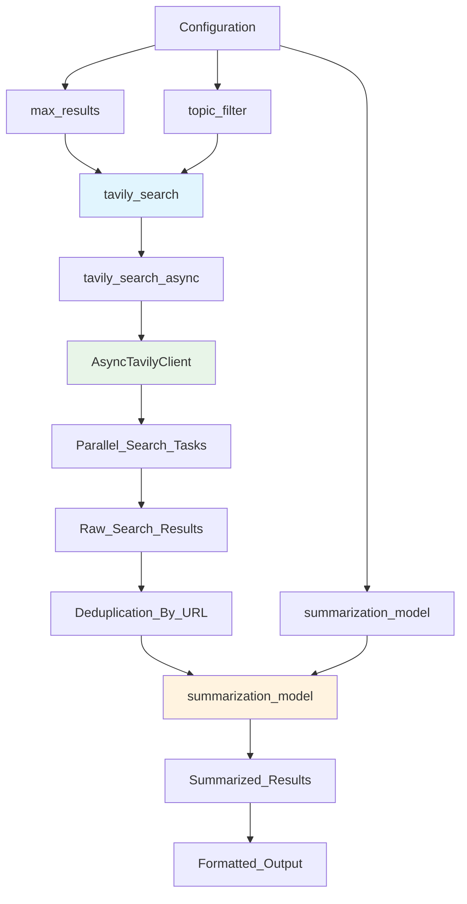

**Search Process Flow**

The search integration implements intelligent content processing:

| Component | Function | Implementation |
|-----------|----------|----------------|
| **Query Processing** | `tavily_search_async` | Executes multiple queries in parallel |
| **Result Deduplication** | URL-based filtering | Removes duplicate results across queries |
| **Content Summarization** | `summarize_webpage` | Uses configured summarization model |
| **Character Limits** | 50,000 character limit | Prevents token overflow |
| **Error Handling** | Timeout and retry logic | 60-second timeout with structured retries |

Sources: [src/open_deep_research/utils.py:43-136](), [src/open_deep_research/utils.py:138-173](), [src/open_deep_research/utils.py:175-213]()

### Multi-Provider Search Support

The system supports different search APIs through the `get_search_tool` function:

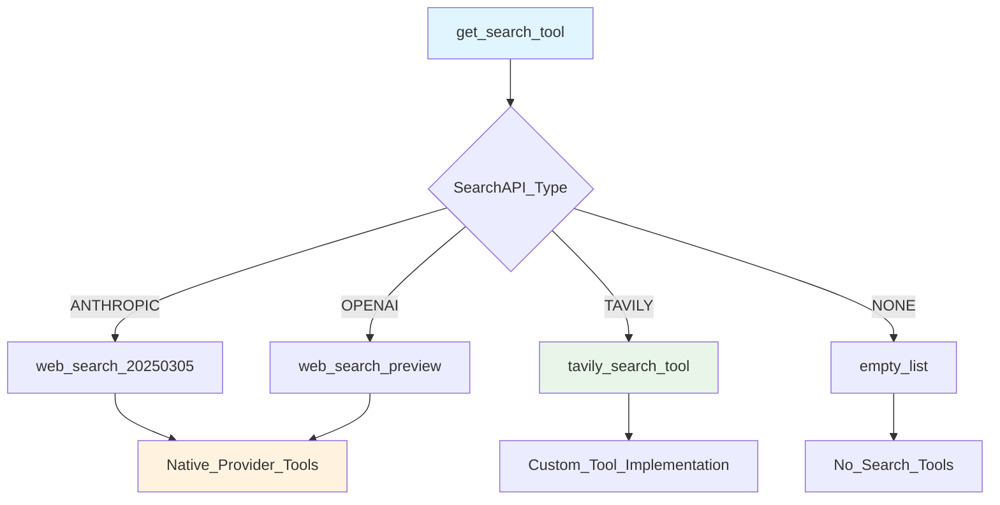

Sources: [src/open_deep_research/utils.py:531-567]()

## Reflection and Strategic Planning Tools

The system includes a strategic reflection tool that enables research agents to pause and analyze their progress during the research process.

### Think Tool Implementation

**Think Tool Architecture**

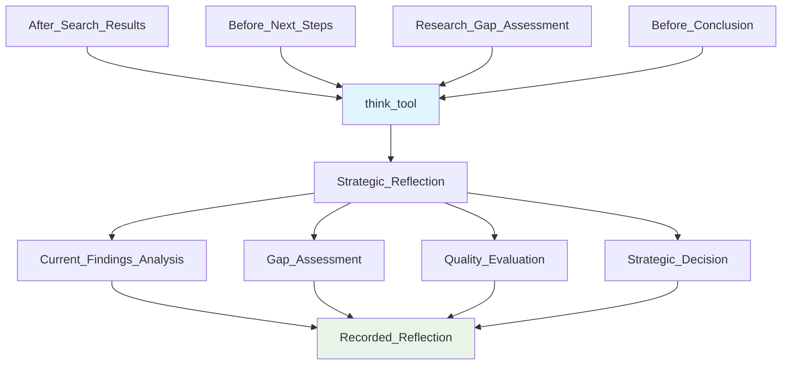

The `think_tool` creates deliberate pause points in the research workflow, allowing agents to systematically evaluate their progress and plan next steps. This tool addresses four key reflection areas:

| Reflection Area | Purpose | Implementation |
|----------------|---------|----------------|
| **Current Findings Analysis** | Assess concrete information gathered | What key information did I find? |
| **Gap Assessment** | Identify missing information | What crucial information is still missing? |
| **Quality Evaluation** | Determine sufficiency of evidence | Do I have sufficient evidence/examples? |
| **Strategic Decision** | Plan next research actions | Should I continue searching or conclude? |

**Usage Triggers:**
- After receiving search results to analyze findings
- Before deciding next steps to ensure systematic planning  
- When assessing research gaps to identify specific missing information
- Before concluding research to ensure completeness

Sources: [src/open_deep_research/utils.py:219-244]()

## MCP Server Integration

The Model Context Protocol (MCP) integration enables external tool access through standardized server connections.

### Authentication and Token Management

MCP authentication follows a token exchange pattern:

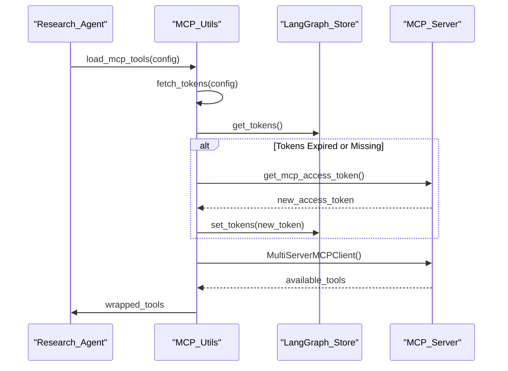

**Token Management Functions**

| Function | Purpose | Implementation |
|----------|---------|----------------|
| `get_tokens` | Retrieve stored tokens | Checks expiration and validates user context |
| `set_tokens` | Store authentication tokens | Thread and user-scoped storage |
| `fetch_tokens` | Obtain new tokens | Handles Supabase token exchange |
| `get_mcp_access_token` | Exchange tokens with MCP server | OAuth-style token exchange |

Sources: [src/open_deep_research/utils.py:250-383]()

### Tool Loading and Error Handling

MCP tools are loaded dynamically and wrapped with authentication handling:

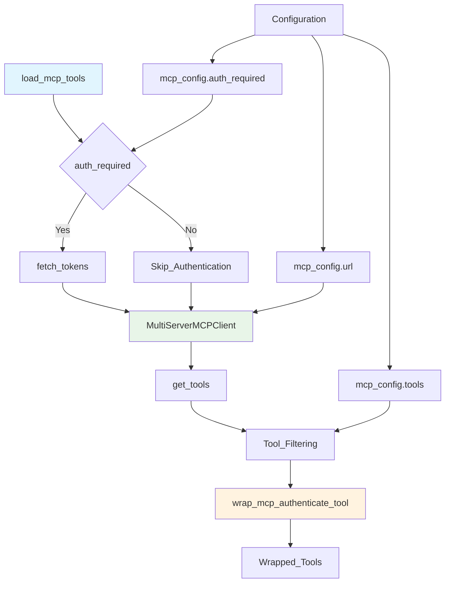

The `wrap_mcp_authenticate_tool` function provides intelligent error handling for MCP tool failures, specifically handling interaction-required errors (code -32003) and converting them to user-friendly `ToolException` messages.

Sources: [src/open_deep_research/utils.py:449-524](), [src/open_deep_research/utils.py:385-447]()

## Tool Management System

The tool management system coordinates different tool types and provides them to research agents.

### Unified Tool Loading

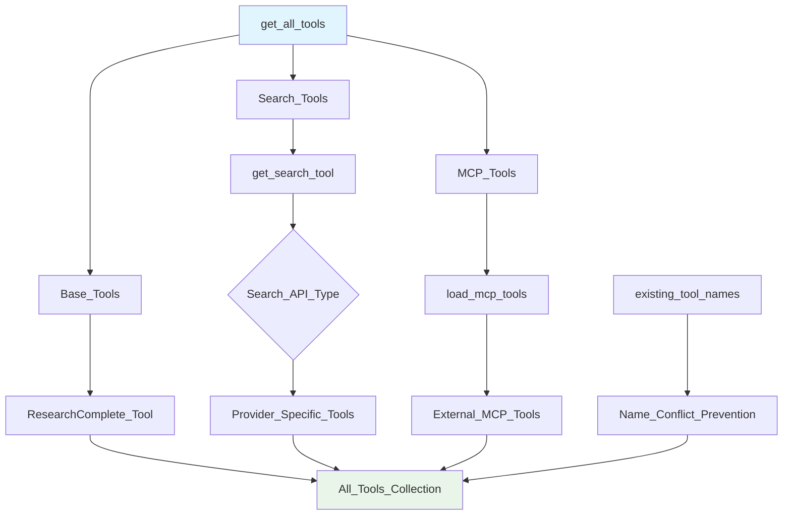

**Tool Categories**

| Category | Implementation | Purpose |
|----------|----------------|---------|
| **Base Tools** | `ResearchComplete` | Signal research completion |
| **Search Tools** | Provider-specific implementations | Web search capabilities |
| **MCP Tools** | External server tools | Extended functionality |
| **Name Deduplication** | `existing_tool_names` set | Prevents tool name conflicts |

Sources: [src/open_deep_research/utils.py:569-597]()

### Tool Call Processing

The system extracts information from tool calls in message histories:

```python
def get_notes_from_tool_calls(messages: list[MessageLikeRepresentation]):
    return [tool_msg.content for tool_msg in filter_messages(messages, include_types="tool")]
```

Sources: [src/open_deep_research/utils.py:599-601]()

## Provider-Specific Utilities

Different LLM providers have native search capabilities that require specific handling.

### Native Web Search Detection

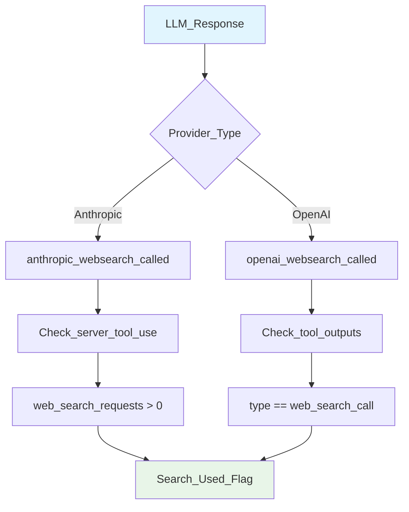

**Provider-Specific Implementation**

| Provider | Detection Method | Response Location |
|----------|------------------|-------------------|
| **Anthropic** | `server_tool_use.web_search_requests` | `response_metadata.usage` |
| **OpenAI** | `tool_outputs` with `web_search_call` type | `additional_kwargs.tool_outputs` |

Sources: [src/open_deep_research/utils.py:607-658]()

## Token Management and Error Handling

The system includes sophisticated token limit detection and handling across multiple LLM providers.

### Token Limit Detection

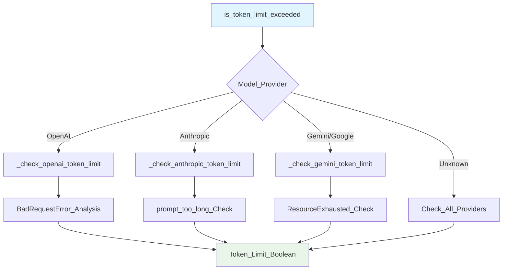

**Provider-Specific Error Patterns**

| Provider | Error Types | Detection Keywords |
|----------|-------------|-------------------|
| **OpenAI** | `BadRequestError`, `context_length_exceeded` | token, context, length, maximum context |
| **Anthropic** | `BadRequestError` | prompt is too long |
| **Google/Gemini** | `ResourceExhausted`, `GoogleGenerativeAIFetchError` | Resource exhaustion patterns |

Sources: [src/open_deep_research/utils.py:665-785]()

### Model Token Limits Database

The system maintains a comprehensive database of model token limits:

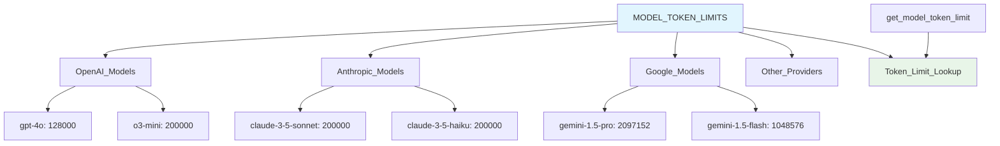

Sources: [src/open_deep_research/utils.py:788-846]()

### Message History Management

When token limits are exceeded, the system can truncate message history:

```python
def remove_up_to_last_ai_message(messages: list[MessageLikeRepresentation]) -> list[MessageLikeRepresentation]:
    for i in range(len(messages) - 1, -1, -1):
        if isinstance(messages[i], AIMessage):
            return messages[:i]  # Return everything up to (but not including) the last AI message
    return messages
```

Sources: [src/open_deep_research/utils.py:848-866]()

## General Utilities

### API Key Management

The system supports both environment variable and configuration-based API key management:

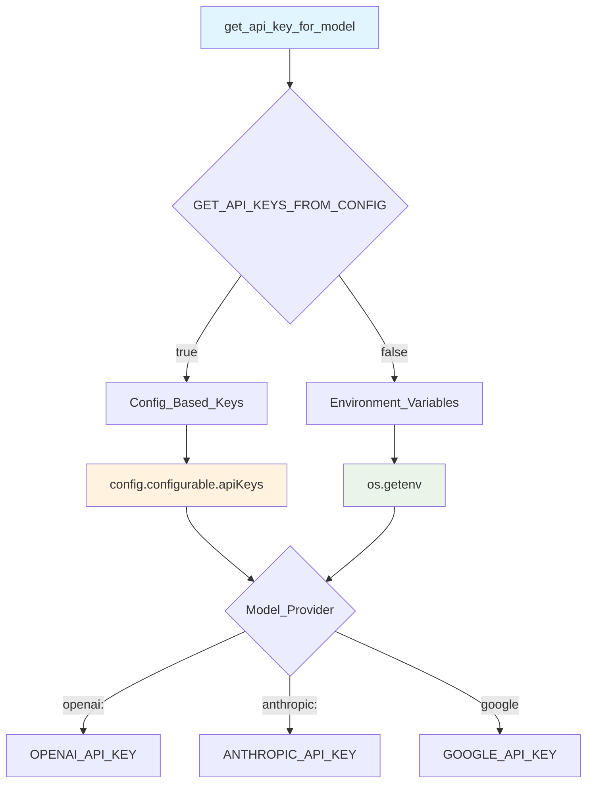

**Configuration Support**

| Function | Purpose | Implementation |
|----------|---------|----------------|
| `get_api_key_for_model` | Model-specific API key retrieval | Supports both config and env vars |
| `get_tavily_api_key` | Tavily search API key | Consistent with model key pattern |
| `get_config_value` | Generic configuration value extraction | Handles different value types |
| `get_today_str` | Current date formatting | Human-readable date strings |

Sources: [src/open_deep_research/utils.py:892-925](), [src/open_deep_research/utils.py:872-879]()

## Integration Architecture

The utilities system integrates with the broader Open Deep Research architecture:

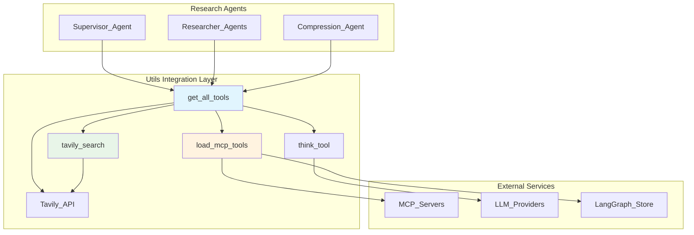

This utilities layer provides the foundation for all external integrations, enabling research agents to access web search, external tools, and provider-specific capabilities through a unified interface.

Sources: [src/open_deep_research/utils.py:1-494]()

---

