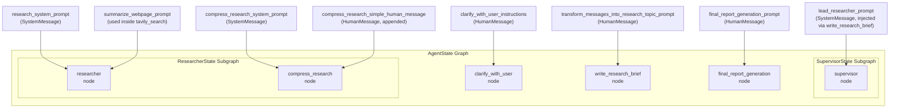
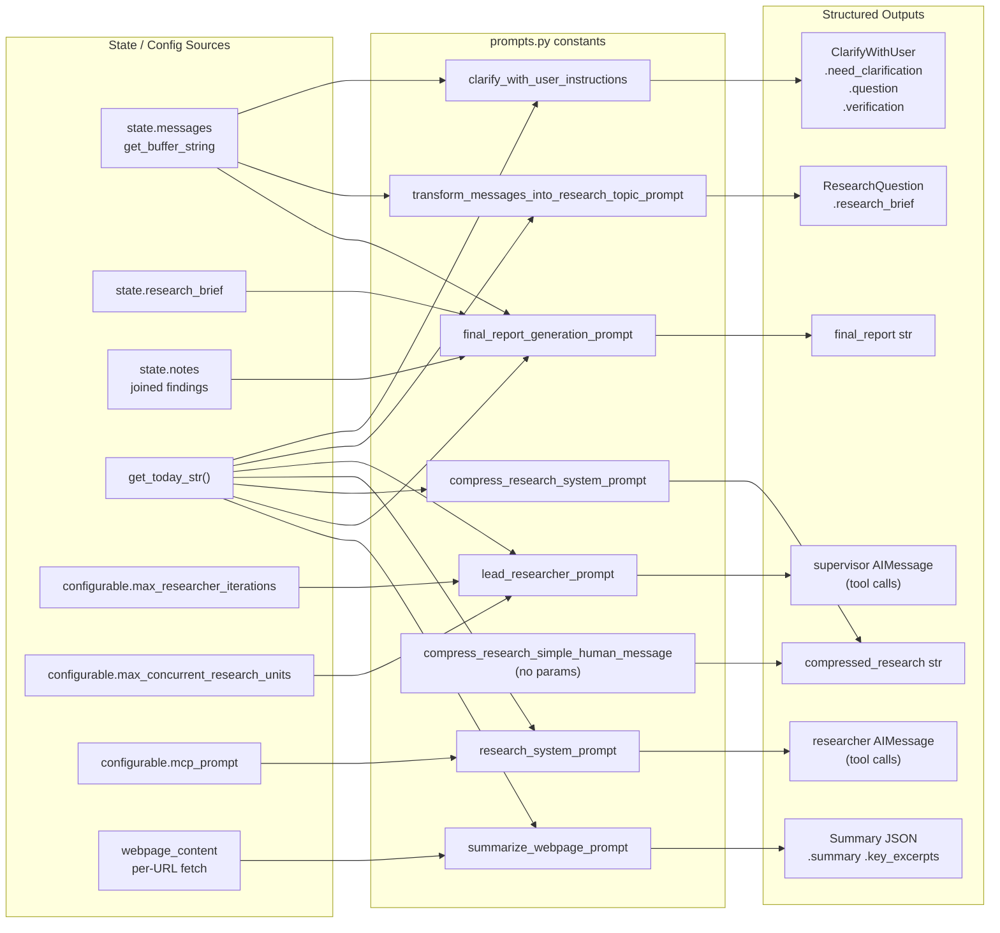

<!-- source: DeepWiki mcp.deepwiki.com · repo langchain-ai/open_deep_research · page 3.5 Agent Prompts and Instructions · fetched 2026-10-26 -->

# Agent Prompts and Instructions

<details>
<summary>Relevant source files</summary>

The following files were used as context for generating this wiki page:

- [src/legacy/configuration.py](src/legacy/configuration.py)
- [src/open_deep_research/deep_researcher.py](src/open_deep_research/deep_researcher.py)
- [src/open_deep_research/prompts.py](src/open_deep_research/prompts.py)
- [tests/run_evaluate.py](tests/run_evaluate.py)

</details>


This page documents every prompt template defined in [src/open_deep_research/prompts.py]() and describes how each is used by the nodes in the main research pipeline. The focus is on the text content, template parameters, output contracts, and which pipeline stage each prompt controls.

For the runtime nodes that consume these prompts, see [3.1 Deep Research Agent Workflow](#3.1). For the configuration fields that parameterize prompts (e.g., `max_researcher_iterations`, `mcp_prompt`), see [3.3 Configuration System](#3.3). For the tool definitions that prompts reference (e.g., `think_tool`, `ConductResearch`), see [3.4 Tool Integration and Utilities](#3.4).

---

## Prompt Overview

All prompts are plain module-level string constants in [src/open_deep_research/prompts.py](). They are imported by [src/open_deep_research/deep_researcher.py]() and injected into LangChain messages before being passed to LLMs.

**Prompt-to-node mapping:**

| Prompt Constant | Consuming Node | Role |
|---|---|---|
| `clarify_with_user_instructions` | `clarify_with_user` | Decides if user input needs clarification |
| `transform_messages_into_research_topic_prompt` | `write_research_brief` | Converts conversation into a structured research brief |
| `lead_researcher_prompt` | `write_research_brief` (injected into supervisor) | System instructions for the supervisor agent |
| `research_system_prompt` | `researcher` | System instructions for individual researcher agents |
| `compress_research_system_prompt` | `compress_research` | Instructions for compressing raw research output |
| `compress_research_simple_human_message` | `compress_research` | Human-turn trigger appended before compression |
| `final_report_generation_prompt` | `final_report_generation` | Instructions for writing the final markdown report |
| `summarize_webpage_prompt` | `tavily_search` (via `utils.py`) | Per-URL summarization during web search |

Sources: [src/open_deep_research/prompts.py:1-368](), [src/open_deep_research/deep_researcher.py:22-30]()

---

## Pipeline Position of Each Prompt

The following diagram maps each prompt constant to the node and message role it occupies.

**Diagram: Prompts in the Pipeline**



Sources: [src/open_deep_research/deep_researcher.py:97-101](), [src/open_deep_research/deep_researcher.py:150-174](), [src/open_deep_research/deep_researcher.py:400-415](), [src/open_deep_research/deep_researcher.py:540-552](), [src/open_deep_research/deep_researcher.py:642-647]()

---

## `clarify_with_user_instructions`

[src/open_deep_research/prompts.py:3-41]()

### Purpose

Determines whether additional clarification from the user is needed before initiating research. This is rendered as a `HumanMessage` and passed to a model configured with `with_structured_output(ClarifyWithUser)`.

### Template Parameters

| Parameter | Source |
|---|---|
| `{messages}` | `get_buffer_string(state["messages"])` — the full conversation history |
| `{date}` | `get_today_str()` — today's date for temporal context |

### Output Contract

The model must respond with a `ClarifyWithUser` structured output (JSON with three fields):

| Field | Type | Meaning |
|---|---|---|
| `need_clarification` | `bool` | Whether a question should be asked |
| `question` | `str` | The clarifying question text (empty if not needed) |
| `verification` | `str` | Acknowledgement message to show the user when proceeding |

### Routing Logic

The consuming node `clarify_with_user` in [src/open_deep_research/deep_researcher.py:104-115]() routes based on `response.need_clarification`:
- `True` → returns `AIMessage(content=response.question)` and ends the turn (prompts user reply)
- `False` → returns `AIMessage(content=response.verification)` and continues to `write_research_brief`

### Key Behavioral Rules in the Prompt

- If a clarifying question has already been asked, do **not** ask another unless absolutely necessary.
- Ask about acronyms, abbreviations, or unknown terms.
- Format questions using markdown (bullet points, numbered lists).

Sources: [src/open_deep_research/prompts.py:3-41](), [src/open_deep_research/deep_researcher.py:60-115]()

---

## `transform_messages_into_research_topic_prompt`

[src/open_deep_research/prompts.py:44-77]()

### Purpose

Converts the conversation history (user messages plus any clarification exchange) into a single, self-contained research brief. This prompt is used inside `write_research_brief`, which uses `with_structured_output(ResearchQuestion)`.

### Template Parameters

| Parameter | Source |
|---|---|
| `{messages}` | `get_buffer_string(state["messages"])` |
| `{date}` | `get_today_str()` |

### Output Contract

The model returns a `ResearchQuestion` structured output. Its `research_brief` field is stored in `AgentState.research_brief` and passed as the first `HumanMessage` to the supervisor.

[src/open_deep_research/deep_researcher.py:150-175]()

### Key Behavioral Rules in the Prompt

1. **Maximize specificity** — include all user-stated preferences and attributes.
2. **Fill gaps as open-ended** — do not invent constraints not stated by the user.
3. **Avoid assumptions** — label unspecified dimensions as flexible.
4. **Use first-person** — phrase from the user's perspective.
5. **Source guidance** — prefer primary sources over aggregators; academic queries should point to original papers; people queries should prefer LinkedIn or personal sites; language-specific queries prefer same-language sources.

Sources: [src/open_deep_research/prompts.py:44-77](), [src/open_deep_research/deep_researcher.py:118-175]()

---

## `lead_researcher_prompt`

[src/open_deep_research/prompts.py:79-136]()

### Purpose

System instructions for the **supervisor agent**. This prompt is formatted in `write_research_brief` and injected as the `SystemMessage` that opens the supervisor's message history.

### Template Parameters

| Parameter | Source |
|---|---|
| `{date}` | `get_today_str()` |
| `{max_researcher_iterations}` | `configurable.max_researcher_iterations` |
| `{max_concurrent_research_units}` | `configurable.max_concurrent_research_units` |

[src/open_deep_research/deep_researcher.py:157-161]()

### Supervisor Tool Contract

The prompt explicitly names the three tools available to the supervisor:

| Tool | Purpose |
|---|---|
| `ConductResearch` | Delegate a research subtask to a sub-agent |
| `ResearchComplete` | Signal that research is finished |
| `think_tool` | Strategic reflection (must not be called in parallel with other tools) |

### Key Behavioral Rules in the Prompt

**Scaling rules** govern how many sub-agents to spawn:
- Simple fact-finding → 1 sub-agent
- Comparisons → 1 sub-agent per element (e.g., A vs B vs C → 3 agents)
- Default: bias toward a single agent

**Hard limits:**
- Maximum `{max_concurrent_research_units}` parallel `ConductResearch` calls per iteration
- Stop after `{max_researcher_iterations}` total tool calls

**Process:**
1. Use `think_tool` before calling `ConductResearch` (plan)
2. After each `ConductResearch` result, use `think_tool` to assess whether the research is sufficient
3. Pass complete, standalone instructions to each sub-agent (sub-agents cannot see each other's work)
4. Avoid acronyms in research topics passed to sub-agents

Sources: [src/open_deep_research/prompts.py:79-136](), [src/open_deep_research/deep_researcher.py:155-174]()

---

## `research_system_prompt`

[src/open_deep_research/prompts.py:138-183]()

### Purpose

System instructions for each individual **researcher agent**. This is prepended as a `SystemMessage` to the researcher's message list on every invocation of the `researcher` node.

### Template Parameters

| Parameter | Source |
|---|---|
| `{date}` | `get_today_str()` |
| `{mcp_prompt}` | `configurable.mcp_prompt or ""` — injected MCP tool descriptions |

[src/open_deep_research/deep_researcher.py:400-403]()

### Researcher Tool Contract

The prompt lists the standard tools by name:

| Tool | Notes |
|---|---|
| `tavily_search` | Primary web search (exact name varies by `search_api` config) |
| `think_tool` | Reflection after each search; **must not** be called in parallel with other tools |
| MCP tools | Described via `{mcp_prompt}` placeholder |

The `{mcp_prompt}` slot allows the system to inject descriptions of any MCP tools loaded at runtime, making the researcher aware of what additional capabilities are available.

### Key Behavioral Rules in the Prompt

**Search budget (hard limits):**
- Simple queries: 2–3 search calls maximum
- Complex queries: up to 5 search calls maximum
- Always stop after 5 total search calls

**Stop conditions:**
- Question can be answered comprehensively
- 3+ relevant sources gathered
- Last 2 searches returned similar information

**Process:**
1. Read question carefully
2. Start with broad searches; narrow progressively
3. After each search, use `think_tool` to assess: what was found, what is missing, whether to continue

Sources: [src/open_deep_research/prompts.py:138-183](), [src/open_deep_research/deep_researcher.py:396-415]()

---

## `compress_research_system_prompt` and `compress_research_simple_human_message`

[src/open_deep_research/prompts.py:186-226]()

### Purpose

These two constants work together to drive the **compression step**, which distills a researcher's full tool call history into a clean, structured summary.

- `compress_research_system_prompt` is rendered as a `SystemMessage`
- `compress_research_simple_human_message` is appended as the final `HumanMessage` to the researcher's message list immediately before calling the compression model

[src/open_deep_research/deep_researcher.py:538-548]()

### Template Parameters

`compress_research_system_prompt` takes one parameter:

| Parameter | Source |
|---|---|
| `{date}` | `get_today_str()` |

`compress_research_simple_human_message` has no parameters — it is a static string.

### Output Contract

The compression model produces a free-form text block (stored as `compressed_research` in `ResearcherOutputState`) structured as:

```
**List of Queries and Tool Calls Made**
**Fully Comprehensive Findings**
**List of All Relevant Sources (with citations in the report)**
```

Citations within the findings use sequential numbered references:
```
[1] Source Title: URL
[2] Source Title: URL
```

### Key Behavioral Rules in the Prompt

- **Do not summarize or paraphrase** — reproduce relevant information verbatim or near-verbatim.
- **No information loss** — the compressed output is the only artifact forwarded to the supervisor; nothing else from the raw researcher session survives.
- Deduplicate only when multiple sources say exactly the same thing (e.g., "These three sources all stated X").
- Include all sources, even marginally relevant ones — a downstream LLM will merge multiple compressed reports.

Sources: [src/open_deep_research/prompts.py:186-226](), [src/open_deep_research/deep_researcher.py:511-585]()

---

## `final_report_generation_prompt`

[src/open_deep_research/prompts.py:228-308]()

### Purpose

Instructions for writing the final, user-facing research report. This is the only prompt rendered as a single large `HumanMessage` (no system message) sent directly to `final_report_model`.

### Template Parameters

| Parameter | Source |
|---|---|
| `{research_brief}` | `state.get("research_brief", "")` — the structured brief from `write_research_brief` |
| `{messages}` | `get_buffer_string(state.get("messages", []))` — full conversation history |
| `{findings}` | `"\n".join(state.get("notes", []))` — concatenated compressed research from all researchers |
| `{date}` | `get_today_str()` |

[src/open_deep_research/deep_researcher.py:642-647]()

### Output Contract

A well-formed markdown document, written in **the same language as the user's input messages**. The prompt makes this requirement explicit with a `CRITICAL` notice.

**Structural options described in the prompt:**

| Query type | Suggested structure |
|---|---|
| Comparison | Intro → Topic A → Topic B → Comparison → Conclusion |
| List | Single list section or one section per item (no intro/conclusion required) |
| Overview / Summary | Overview → Concept 1 → Concept 2 → ... → Conclusion |
| Simple answer | Single answer section |

**Formatting rules:**
- `#` for the title, `##` for sections, `###` for subsections
- Write in paragraph form by default; use bullet points only when appropriate
- No self-referential language ("I will now discuss...")
- Each section should be as long as necessary — this is a deep research report

**Citation rules:**
- Inline citations using `[Title](URL)` format within the text
- Numbered sequential citation list at the end under `### Sources`
- No gaps in numbering

### Token Limit Retry Behavior

If the model raises a token limit error, `final_report_generation` progressively truncates `findings`:
- Retry 1: truncate to `model_token_limit * 4` characters
- Retry 2+: reduce by 10% per attempt, up to 3 retries

[src/open_deep_research/deep_researcher.py:663-683]()

Sources: [src/open_deep_research/prompts.py:228-308](), [src/open_deep_research/deep_researcher.py:607-697]()

---

## `summarize_webpage_prompt`

[src/open_deep_research/prompts.py:311-368]()

### Purpose

Used during the `tavily_search` tool execution (in `utils.py`) to compress the raw text content of individual web pages into structured summaries before returning results to the researcher agent. This happens **inside the tool**, not inside a pipeline node directly.

### Template Parameters

| Parameter | Source |
|---|---|
| `{webpage_content}` | Raw text of the fetched URL |
| `{date}` | `get_today_str()` |

### Output Contract

The model must return a JSON object with two fields:

```json
{
  "summary": "Paragraphs or bullet points summarizing the page",
  "key_excerpts": "Quote 1, Quote 2, Quote 3, ..."
}
```

The prompt targets **25–30% of original content length** while remaining self-contained.

### Content-Type Guidelines in the Prompt

| Content type | Instruction |
|---|---|
| News articles | Focus on who, what, when, where, why, how |
| Scientific content | Preserve methodology, results, conclusions |
| Opinion pieces | Retain main arguments and supporting points |
| Product pages | Keep features, specifications, selling points |

Sources: [src/open_deep_research/prompts.py:311-368]()

---

## Prompt Data Flow Diagram

The following diagram maps the exact variables that flow into each prompt at runtime, bridging the prompt constants to the state fields and configuration that supply them.

**Diagram: Prompt Inputs and Outputs**



Sources: [src/open_deep_research/prompts.py:1-368](), [src/open_deep_research/deep_researcher.py:97-101](), [src/open_deep_research/deep_researcher.py:150-161](), [src/open_deep_research/deep_researcher.py:400-403](), [src/open_deep_research/deep_researcher.py:540-548](), [src/open_deep_research/deep_researcher.py:642-647]()

---

## Design Patterns Across Prompts

Several consistent patterns appear across all prompts:

| Pattern | Where Applied |
|---|---|
| `{date}` injection via `get_today_str()` | Every prompt — provides temporal grounding |
| `<Task>` / `<Instructions>` / `<Hard Limits>` XML tags | `lead_researcher_prompt`, `research_system_prompt`, `compress_research_system_prompt` |
| `think_tool` usage guidance | `lead_researcher_prompt`, `research_system_prompt` — both enforce that `think_tool` must not be called in parallel with other tools |
| Citation numbering rules | `compress_research_system_prompt`, `final_report_generation_prompt` — consistent `[N] Title: URL` format |
| Language matching | `final_report_generation_prompt` — explicitly instructs the model to write in the user's language |
| "Do not lose information" emphasis | `compress_research_system_prompt` — warns that a downstream LLM will merge reports, so all sources must be preserved |

Sources: [src/open_deep_research/prompts.py:1-368]()

---

