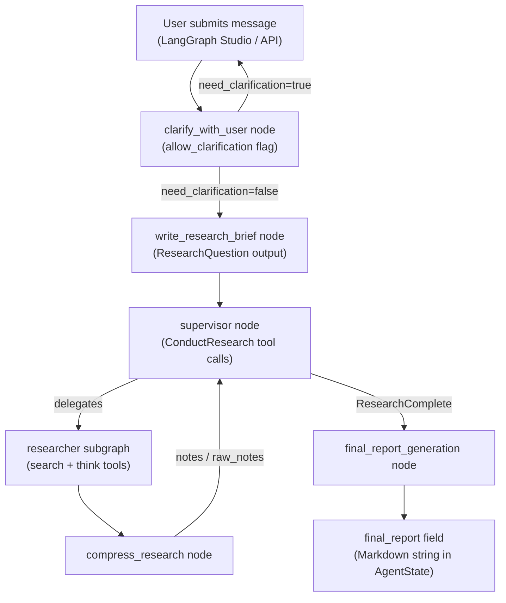
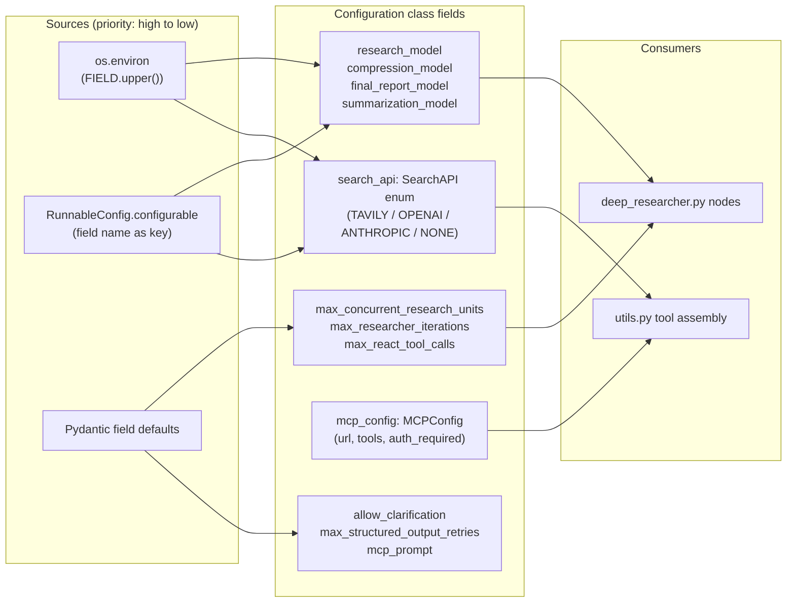
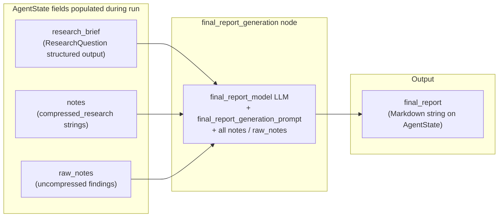
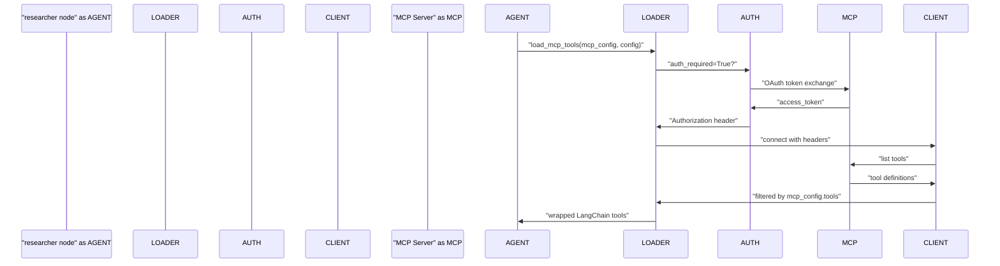
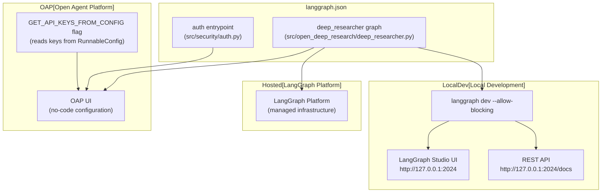

<!-- source: DeepWiki mcp.deepwiki.com · repo langchain-ai/open_deep_research · page 4 Usage Guide · fetched 2026-10-26 -->

# Usage Guide

<details>
<summary>Relevant source files</summary>

The following files were used as context for generating this wiki page:

- [README.md](README.md)
- [src/open_deep_research/configuration.py](src/open_deep_research/configuration.py)
- [tests/expt_results/deep_research_bench_gpt-5.jsonl](tests/expt_results/deep_research_bench_gpt-5.jsonl)

</details>


This document is a practical reference for operating the Open Deep Research agent: submitting queries, selecting configurations, understanding the output, and common usage patterns.

For detailed system architecture information, see page 3 (System Architecture). For development setup and dependencies, see page 6 (Development Guide). This page summarizes configuration and deployment; detailed breakdowns are in the child pages:

- **Page 4.1** — Complete Configuration Options reference table
- **Page 4.2** — Model Selection and Search API configuration
- **Page 4.3** — MCP Server Integration
- **Page 4.4** — Deployment Options (local, hosted, OAP)

## Running a Research Query

The Open Deep Research system operates as a configurable deep research agent built on LangGraph. The basic end-to-end workflow is:

1. **Environment Setup**: Configure API keys and environment variables in `.env`
2. **Configuration**: Set model preferences, search APIs, and operational parameters via Studio UI or `RunnableConfig`
3. **Deployment**: Launch via local development server or production platforms
4. **Submit Query**: Post a message through LangGraph Studio UI, the REST API, or the LangGraph SDK
5. **Review Output**: The agent writes a Markdown report to the `final_report` field of `AgentState`

**End-to-End Request Flow**



Sources: [src/open_deep_research/deep_researcher.py](), [src/open_deep_research/state.py]()

## Configuration System

Configuration is managed by the `Configuration` Pydantic model in [src/open_deep_research/configuration.py:38-248](). Settings are resolved through `Configuration.from_runnable_config()` [src/open_deep_research/configuration.py:236-247]() using the following priority order:

1. **Environment variables** (highest priority) — e.g., `RESEARCH_MODEL`, `SEARCH_API`
2. **`RunnableConfig.configurable` dict** — set via LangGraph Studio "Manage Assistants" or API request body
3. **Pydantic field defaults** (lowest priority)

**How Configuration Resolves to Agent Behavior**



Sources: [src/open_deep_research/configuration.py:38-248](), [src/open_deep_research/configuration.py:236-247]()

### Key Configuration Parameters

| Parameter | Default | Controls | Env Var |
|-----------|---------|---------|---------|
| `research_model` | `openai:gpt-4.1` | Supervisor and researcher LLM | `RESEARCH_MODEL` |
| `compression_model` | `openai:gpt-4.1` | `compress_research` node LLM | `COMPRESSION_MODEL` |
| `final_report_model` | `openai:gpt-4.1` | `final_report_generation` node LLM | `FINAL_REPORT_MODEL` |
| `summarization_model` | `openai:gpt-4.1-mini` | Per-URL summarization in `tavily_search` | `SUMMARIZATION_MODEL` |
| `search_api` | `SearchAPI.TAVILY` | Which search tool researcher agents receive | `SEARCH_API` |
| `max_concurrent_research_units` | `5` | Parallelism of `ConductResearch` dispatches | `MAX_CONCURRENT_RESEARCH_UNITS` |
| `max_researcher_iterations` | `6` | Max supervisor tool-call loops | `MAX_RESEARCHER_ITERATIONS` |
| `max_react_tool_calls` | `10` | Max researcher tool-call loops per task | `MAX_REACT_TOOL_CALLS` |
| `allow_clarification` | `True` | Whether `clarify_with_user` node is active | `ALLOW_CLARIFICATION` |
| `mcp_config` | `None` | MCP server URL, tool list, auth flag | — (set via configurable) |

See page 4.1 for the complete reference table including token-limit fields and `mcp_prompt`.

Sources: [src/open_deep_research/configuration.py:42-233]()

## Model Selection and Search APIs

The system uses four model roles, each independently configurable via the `init_chat_model()` format (`provider:model-name`). Models must support structured outputs and tool calling.

| Role field | Default | Used in node |
|-----------|---------|-------------|
| `research_model` | `openai:gpt-4.1` | `supervisor`, `researcher` |
| `compression_model` | `openai:gpt-4.1` | `compress_research` |
| `final_report_model` | `openai:gpt-4.1` | `final_report_generation` |
| `summarization_model` | `openai:gpt-4.1-mini` | `tavily_search` (per-URL) |

The `search_api` field (type: `SearchAPI` enum in [src/open_deep_research/configuration.py:11-17]()) selects which search tool researcher agents receive:

| `search_api` value | Search tool given to researcher |
|---|---|
| `SearchAPI.TAVILY` (default) | `tavily_search` async multi-query tool |
| `SearchAPI.OPENAI` | `web_search_preview` (OpenAI native) |
| `SearchAPI.ANTHROPIC` | `web_search_20250305` (Anthropic native) |
| `SearchAPI.NONE` | No search tool; MCP tools only |

> **Note**: When using `SearchAPI.OPENAI` or `SearchAPI.ANTHROPIC`, the `research_model` must be a model from that same provider.

See page 4.2 for full details on provider setup and API key requirements.

Sources: [src/open_deep_research/configuration.py:11-17](), [src/open_deep_research/configuration.py:78-93](), [src/open_deep_research/configuration.py:121-212]()

## Understanding the Output

When a research run completes, the primary output is the `final_report` field on `AgentState` (defined in [src/open_deep_research/state.py]()). This is a Markdown string produced by the `final_report_generation` node.

**What the agent accumulates during a run:**

| State field | Type | Description |
|---|---|---|
| `research_brief` | `str` | Structured research plan from `write_research_brief` |
| `notes` | `list[str]` | Compressed researcher outputs (one per `ConductResearch` call) |
| `raw_notes` | `list[str]` | Uncompressed raw findings before compression |
| `final_report` | `str` | Final Markdown report (the primary output) |

**From State Fields to Final Report**



Sources: [src/open_deep_research/state.py](), [src/open_deep_research/deep_researcher.py](), [src/open_deep_research/prompts.py]()

### Clarification Interrupts

When `allow_clarification=True` (default), the `clarify_with_user` node may interrupt the run to ask the user a question before research begins. In LangGraph Studio, this appears as a message in the thread. Through the API, it surfaces as a human-in-the-loop `interrupt` event. Respond to it with additional context; the run then continues to `write_research_brief`.

To disable this behavior and have research start immediately, set `allow_clarification=False`.

Sources: [src/open_deep_research/configuration.py:54-63](), [src/open_deep_research/deep_researcher.py]()

## MCP Server Integration

MCP servers add external tools (databases, APIs, custom data sources) to researcher agents. Configuration uses the `MCPConfig` class in [src/open_deep_research/configuration.py:19-36]():

| `MCPConfig` field | Type | Description |
|---|---|---|
| `url` | `Optional[str]` | MCP server endpoint URL |
| `tools` | `Optional[List[str]]` | Allowlist of tool names to expose to the agent |
| `auth_required` | `Optional[bool]` | Whether the server requires OAuth token exchange |

MCP tools are loaded at runtime via `load_mcp_tools()` in [src/open_deep_research/utils.py:449-524]() and added to the researcher's tool set alongside the search tool. Tools whose names conflict with existing tools are skipped.

**MCP Authentication and Tool Loading**



Sources: [src/open_deep_research/configuration.py:19-36](), [src/open_deep_research/utils.py:449-524](), [src/open_deep_research/utils.py:250-383]()

See page 4.3 for the full OAuth flow, token persistence functions, and error handling details.

## Deployment Options

Three deployment targets are supported. The graph is registered in `langgraph.json` [langgraph.json]() pointing to the `deep_researcher` compiled graph in [src/open_deep_research/deep_researcher.py]().

**Deployment Targets and Their Entry Points**



Sources: [langgraph.json](), [src/open_deep_research/deep_researcher.py](), [src/security/auth.py](), [README.md:115-133]()

### Local Development

```
uvx --refresh --from "langgraph-cli[inmem]" --with-editable . --python 3.11 langgraph dev --allow-blocking
```

Starts:
- **API**: `http://127.0.0.1:2024`
- **Studio UI**: `https://smith.langchain.com/studio/?baseUrl=http://127.0.0.1:2024`
- **API Docs**: `http://127.0.0.1:2024/docs`

Configuration is changed in Studio via the "Manage Assistants" tab. Each assistant stores a `RunnableConfig` that overrides field defaults.

### LangGraph Platform (Hosted)

Deploy directly from the repository to LangGraph Platform. Environment variables set in the platform UI are picked up by `Configuration.from_runnable_config()` at priority above `RunnableConfig.configurable`.

### Open Agent Platform (OAP)

OAP provides a no-code UI for non-technical users. When the `GET_API_KEYS_FROM_CONFIG` environment variable is set, `get_api_key_for_model()` in [src/open_deep_research/utils.py]() reads provider API keys from the `RunnableConfig.configurable` dict instead of environment variables — enabling per-user key injection from the OAP frontend.

See page 4.4 for full deployment configuration details.

Sources: [README.md:115-133](), [src/open_deep_research/utils.py]()

## Environment Configuration Examples

The `.env.example` file at the repository root documents all supported environment variables. Copy it to `.env` and fill in your values before starting the server.

```
# Provider API Keys
OPENAI_API_KEY=sk-...
ANTHROPIC_API_KEY=sk-ant-...
TAVILY_API_KEY=tvly-...
LANGSMITH_API_KEY=ls__...

# Model selection (provider:model-name format)
RESEARCH_MODEL=openai:gpt-4.1
COMPRESSION_MODEL=openai:gpt-4.1
FINAL_REPORT_MODEL=openai:gpt-4.1
SUMMARIZATION_MODEL=openai:gpt-4.1-mini

# Search backend
SEARCH_API=tavily

# Operational limits
MAX_CONCURRENT_RESEARCH_UNITS=5
MAX_RESEARCHER_ITERATIONS=6
MAX_REACT_TOOL_CALLS=10

# Behaviour flags
ALLOW_CLARIFICATION=true
```

**Note**: Environment variables take precedence over values set in the LangGraph Studio "Manage Assistants" UI. To allow Studio/API-level overrides, leave the corresponding environment variable unset.

Sources: [.env.example](), [src/open_deep_research/configuration.py:236-247]()

## Common Usage Patterns

### Research Query Execution

1. **Input**: Submit research question through LangGraph Studio UI
2. **Clarification**: System may ask clarifying questions if `allow_clarification=True`
3. **Research Planning**: Lead researcher creates research plan and delegates tasks
4. **Parallel Research**: Multiple researcher agents work concurrently within `max_concurrent_research_units`
5. **Synthesis**: Findings compressed and synthesized into final report

### Configuration Validation

The system validates all configuration parameters through Pydantic models in [src/open_deep_research/configuration.py:38-248](). Invalid configurations result in clear error messages and suggested corrections.

### Token Limit Handling

Advanced token limit detection and handling is implemented in [src/open_deep_research/utils.py:665-866]() with provider-specific error patterns and recovery strategies.

Sources: [src/open_deep_research/configuration.py:38-248](), [src/open_deep_research/utils.py:665-866]()

---

