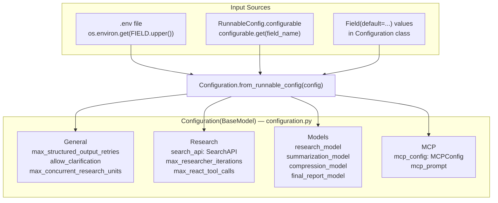
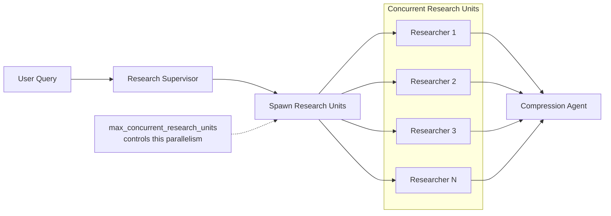
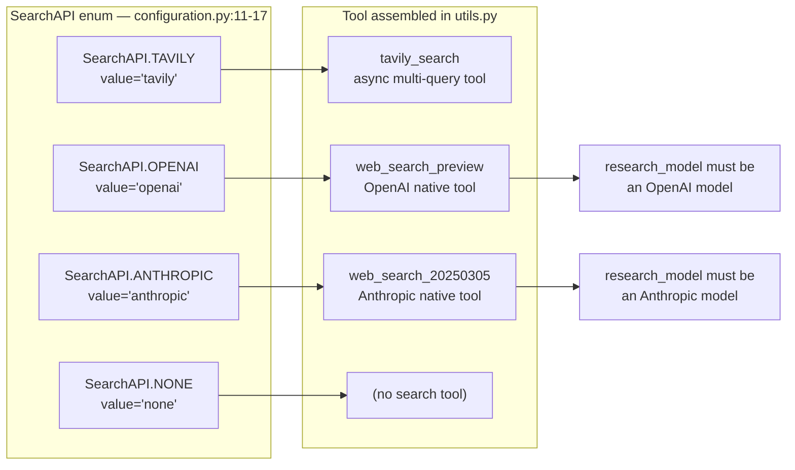
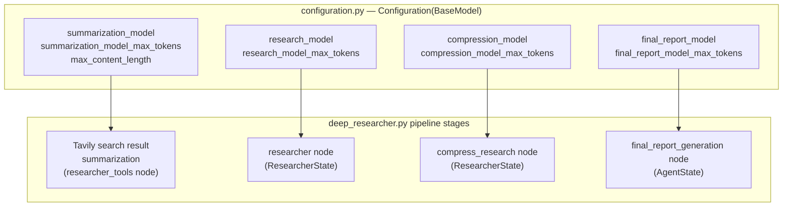
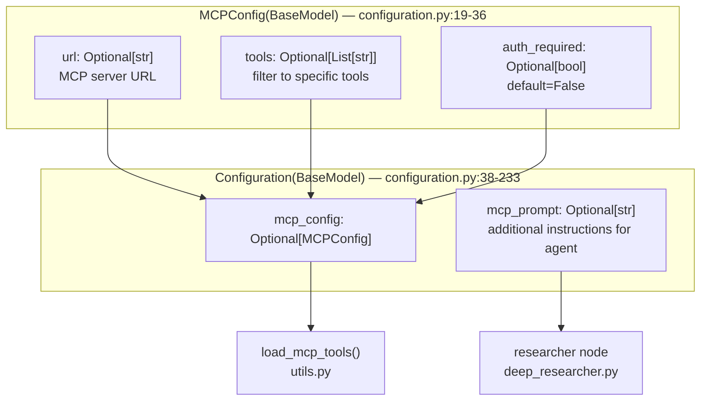
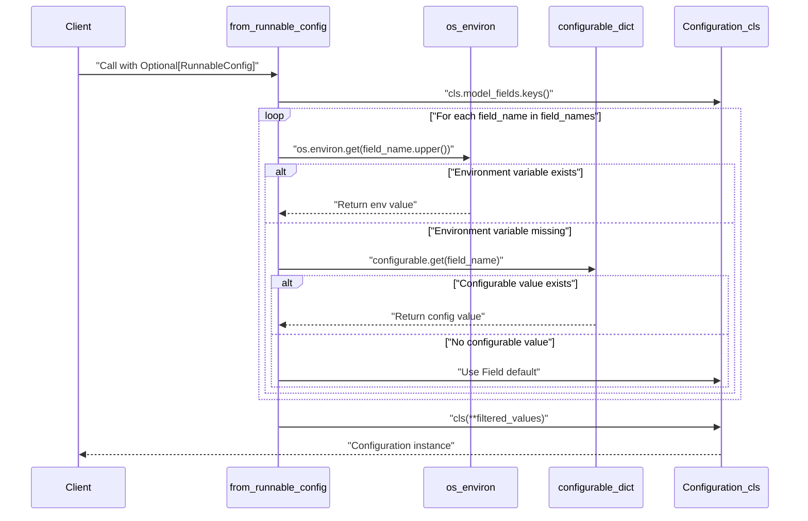

<!-- source: DeepWiki mcp.deepwiki.com · repo langchain-ai/open_deep_research · page 4.1 Configuration Options · fetched 2026-10-26 -->

# Configuration Options

Relevant source files

The following files were used as context for generating this wiki page:

- [.env.example](.env.example)
- [src/open_deep_research/configuration.py](src/open_deep_research/configuration.py)

This document provides a complete reference for all configuration parameters available in the Open Deep Research system. It covers the `Configuration` class structure, environment variables, model fields, and how each option affects runtime behavior. For deployment-specific configuration, see page 4.4. For guidance on model and search API selection, see page 4.2.

## Configuration System Overview

The Open Deep Research system uses a centralized configuration approach built on Pydantic's `BaseModel`. The primary configuration is managed through the `Configuration` class in [src/open_deep_research/configuration.py:38-252](), which defines all configurable parameters with validation, default values, and UI metadata.

The configuration system supports multiple input sources with the following priority order:
1. Environment variables (highest priority — uppercase field name, e.g. `MAX_CONCURRENT_RESEARCH_UNITS`)
2. `RunnableConfig.configurable` dict (passed at runtime via Studio UI or API)
3. `Field(default=...)` values defined in the `Configuration` class (lowest priority)

**Diagram: `Configuration` class structure and loading sources**

Sources: [src/open_deep_research/configuration.py:38-248]()

## Configuration Categories

### General Configuration

The general configuration controls system-wide behavior and operational parameters:

| Parameter | Type | Default | Description |
|-----------|------|---------|-------------|
| `max_structured_output_retries` | int | 3 | Maximum retries for structured output calls from models |
| `allow_clarification` | bool | true | Whether to allow clarifying questions before research |
| `max_concurrent_research_units` | int | 5 | Maximum concurrent research sub-agents (1-20) |

The `max_concurrent_research_units` parameter is particularly important for performance tuning. Higher values enable more parallel research but may trigger rate limits:

**Sources:** [src/open_deep_research/configuration.py:42-76]()

### Research Configuration

Research configuration parameters control the research process behavior:

| Parameter | Type | Default | Description |
|-----------|------|---------|-------------|
| `search_api` | SearchAPI | TAVILY | Search API provider (tavily/openai/anthropic/none) |
| `max_researcher_iterations` | int | 6 | Maximum research iterations for supervisor reflection |
| `max_react_tool_calls` | int | 10 | Maximum tool calls per researcher step |

The `SearchAPI` enum defines available search providers:

**Diagram: `SearchAPI` enum values and compatibility constraints**

Sources: [src/open_deep_research/configuration.py:11-17](), [src/open_deep_research/configuration.py:78-93]()

### Model Configuration

The system uses four specialized models for different research pipeline stages:

| Model Role | Parameter | Default | Max Tokens | Purpose |
|------------|-----------|---------|------------|---------|
| Summarization | `summarization_model` | `openai:gpt-4.1-mini` | 8192 | Summarize Tavily search results |
| Research | `research_model` | `openai:gpt-4.1` | 10000 | Conduct research and use tools |
| Compression | `compression_model` | `openai:gpt-4.1` | 8192 | Compress findings from sub-agents |
| Final Report | `final_report_model` | `openai:gpt-4.1` | 10000 | Generate final research report |

Additional model configuration parameters:

| Parameter | Type | Default | Description |
|-----------|------|---------|-------------|
| `max_content_length` | int | 50000 | Maximum character length for webpage content before summarization |

Each model configuration field has a paired `_max_tokens` field that caps output length for that stage. The `max_content_length` field caps the character length of raw webpage content before it is passed to the summarization model.

**Diagram: Model configuration fields mapped to pipeline stages**

Sources: [src/open_deep_research/configuration.py:121-212]()

### MCP Configuration

Model Context Protocol (MCP) configuration enables integration with external tools and services:

**Diagram: `MCPConfig` fields and their relation to `Configuration`**

The `MCPConfig` class supports optional MCP server integration:

| Field | Type | Default | Description |
|-------|------|---------|-------------|
| `url` | Optional[str] | None | MCP server URL |
| `tools` | Optional[List[str]] | None | Available tools list |
| `auth_required` | Optional[bool] | False | Authentication requirement |

**Sources:** [src/open_deep_research/configuration.py:19-37](), [src/open_deep_research/configuration.py:214-233]()

## Environment Variables and API Keys

The system requires various API keys and environment variables for external service integration. The [.env.example:1-13]() file provides a template:

### Required API Keys

| Environment Variable | Service | Purpose |
|---------------------|---------|---------|
| `OPENAI_API_KEY` | OpenAI | GPT model access |
| `ANTHROPIC_API_KEY` | Anthropic | Claude model access |
| `GOOGLE_API_KEY` | Google | Gemini model access |
| `TAVILY_API_KEY` | Tavily | Web search API |

### Optional Configuration

| Environment Variable | Default | Purpose |
|---------------------|---------|---------|
| `LANGSMITH_API_KEY` | None | LangSmith tracing |
| `LANGSMITH_PROJECT` | None | Project name for tracing |
| `LANGSMITH_TRACING` | None | Enable/disable tracing |

### Platform-Specific Variables

For Open Agent Platform deployment:

| Environment Variable | Purpose |
|---------------------|---------|
| `SUPABASE_KEY` | Supabase authentication |
| `SUPABASE_URL` | Supabase instance URL |
| `GET_API_KEYS_FROM_CONFIG` | Use platform-managed keys (true/false) |

**Sources:** [.env.example:1-13]()

## Configuration Loading Process

The configuration loading follows a specific hierarchy implemented in the `Configuration.from_runnable_config` class method:

**Configuration Resolution Priority**

The loading process prioritizes environment variables over runtime configuration:

1. **Environment Variables**: Uppercase field names (e.g., `MAX_CONCURRENT_RESEARCH_UNITS`)
2. **RunnableConfig.configurable**: Values from the `configurable` dictionary  
3. **Field Defaults**: Class-defined `Field(default=...)` values

**Sources:** [src/open_deep_research/configuration.py:237-248]()

## Configuration in Practice

`Configuration.from_runnable_config(config)` is called at the start of each node in `deep_researcher.py`. Any field can be overridden at runtime by passing it in the `configurable` dict of a `RunnableConfig`, or permanently by setting the corresponding uppercase environment variable.

### UI Integration Metadata

Each configuration field includes `x_oap_ui_config` metadata for Open Agent Platform integration:

| UI Type | Fields | Description |
|---------|--------|-------------|
| `slider` | `max_concurrent_research_units`, `max_researcher_iterations` | Numeric range controls |
| `select` | `search_api` | Dropdown with predefined options |
| `boolean` | `allow_clarification` | Toggle switches |
| `text` | Model identifiers | Text input fields |
| `number` | Token limits | Numeric input fields |
| `mcp` | `mcp_config` | Special MCP server configuration |

**Sources:** [src/open_deep_research/configuration.py:34-211]()

---

