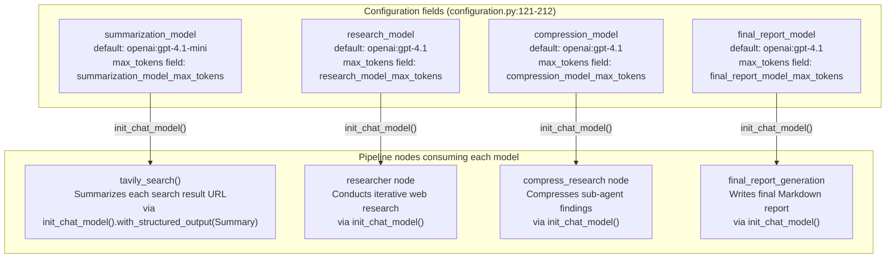
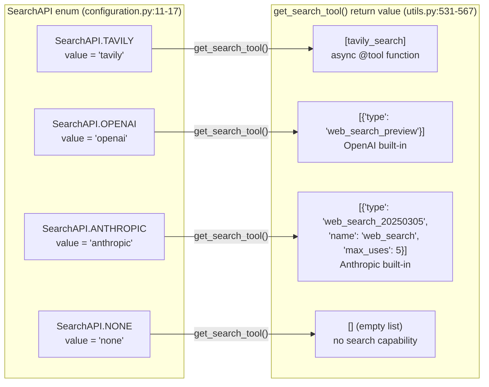
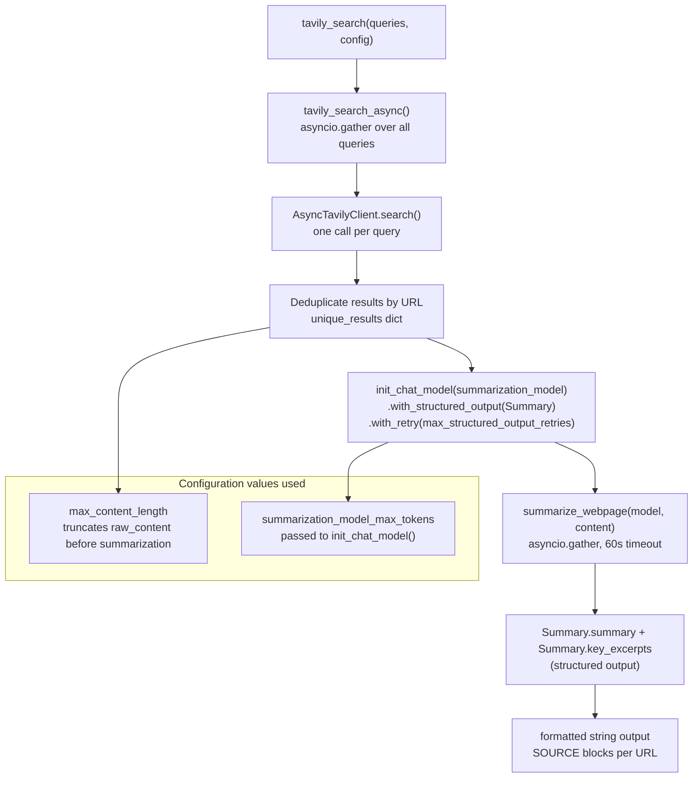
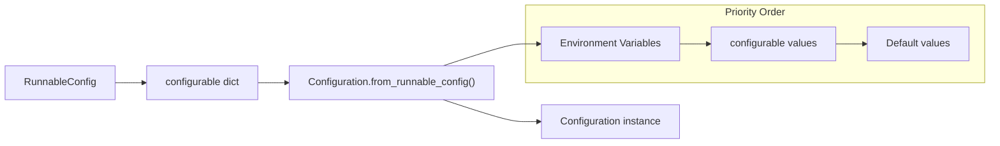
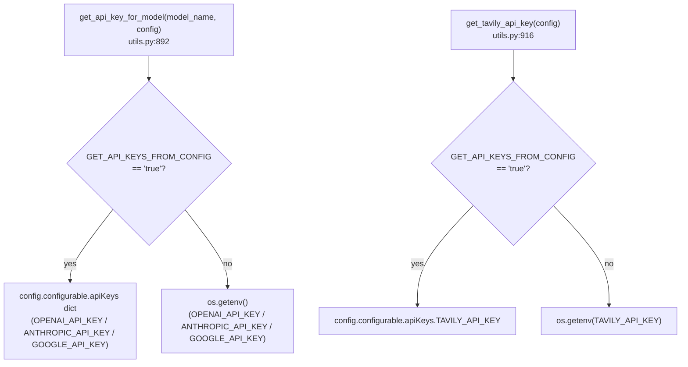
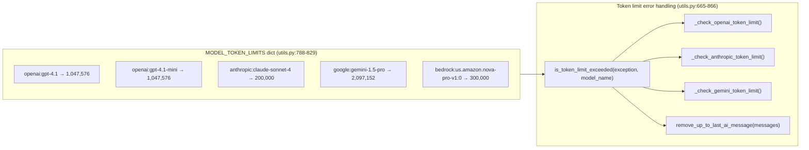
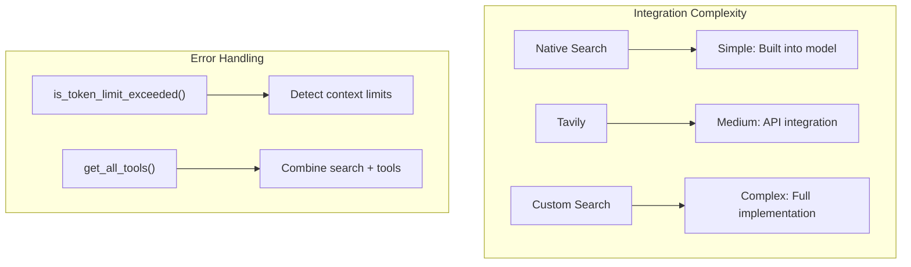
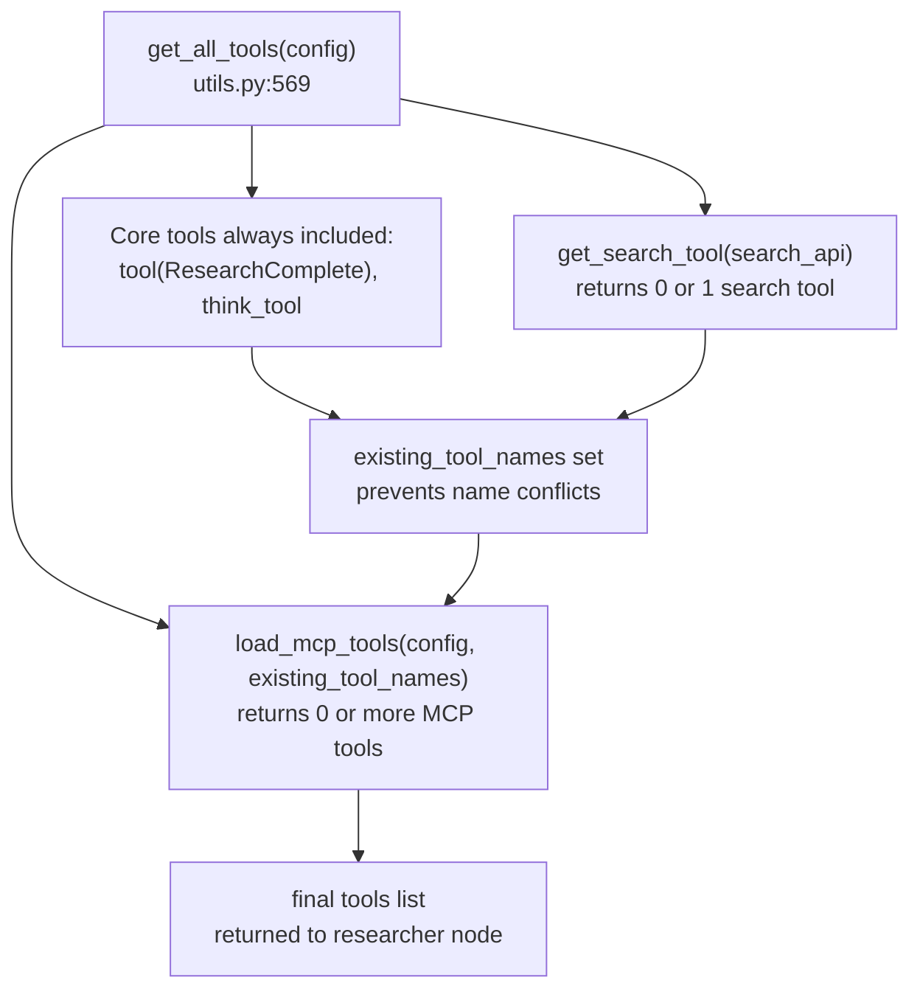

<!-- source: DeepWiki mcp.deepwiki.com · repo langchain-ai/open_deep_research · page 4.2 Model Selection and Search APIs · fetched 2026-10-26 -->

# Model Selection and Search APIs

<details>
<summary>Relevant source files</summary>

The following files were used as context for generating this wiki page:

- [README.md](README.md)
- [src/open_deep_research/configuration.py](src/open_deep_research/configuration.py)
- [src/open_deep_research/utils.py](src/open_deep_research/utils.py)
- [tests/expt_results/deep_research_bench_gpt-5.jsonl](tests/expt_results/deep_research_bench_gpt-5.jsonl)

</details>


This page provides guidance on selecting and configuring LLM providers and search APIs for the Open Deep Research system. It covers the available options, their capabilities, trade-offs, and configuration approaches.

For information about the overall configuration system and available parameters, see [Configuration Options](#4.1). For details on MCP server integration, see [MCP Server Integration](#4.3).

## Overview

The Open Deep Research system uses a multi-model architecture with specialized models for different research tasks, combined with configurable search APIs for information retrieval. The system supports multiple LLM providers and search services, allowing for flexible deployment based on requirements, costs, and capabilities.

## LLM Model Architecture

### Specialized Model Roles

The `Configuration` class defines four model fields. Each field value is passed to `init_chat_model()` (from `langchain.chat_models`) at runtime in the relevant pipeline node. All selected models must support both **structured outputs** and **tool calling**.

**`Configuration` field → pipeline node (in `deep_researcher.py`) → task:**



Sources: [src/open_deep_research/configuration.py:121-212](), [src/open_deep_research/utils.py:85-93](), [README.md:64-71]()

### Model Provider Support

All models are initialized via `init_chat_model()` from `langchain.chat_models`, which dispatches to the correct provider based on the `provider:model-name` string format. The `get_api_key_for_model()` function in `utils.py` reads the appropriate API key for each provider prefix.

| Provider Prefix | Example Model String | Strengths | API Key Env Var |
|-----------------|----------------------|-----------|-----------------|
| `openai:` | `openai:gpt-4.1`, `openai:gpt-4.1-mini` | High quality, fast, reliable | `OPENAI_API_KEY` |
| `anthropic:` | `anthropic:claude-sonnet-4-20250514` | Strong reasoning | `ANTHROPIC_API_KEY` |
| `google:` | `google:gemini-1.5-pro` | Large context windows | `GOOGLE_API_KEY` |
| `bedrock:` | `bedrock:us.amazon.nova-pro-v1:0` | Enterprise, AWS-native | AWS credentials |
| `ollama:` | `ollama:llama2` | Local, no API costs | None required |

> **Note:** For OpenRouter or other proxy providers, see the community guidance in the README. For local models via Ollama, see the [setup instructions](https://github.com/langchain-ai/open_deep_research/issues/65#issuecomment-2743586318).

Sources: [README.md:62-74](), [src/open_deep_research/utils.py:892-915]()

### Model String Format

The model string follows the `provider:model-name` convention required by `init_chat_model()`. The `get_api_key_for_model()` function in `utils.py` parses the prefix to select the correct API key:

```python
# utils.py — get_api_key_for_model() logic
if model_name.startswith("openai:"):
    return os.getenv("OPENAI_API_KEY")
elif model_name.startswith("anthropic:"):
    return os.getenv("ANTHROPIC_API_KEY")
elif model_name.startswith("google"):
    return os.getenv("GOOGLE_API_KEY")
```

The `summarization_model` is also wrapped with `.with_structured_output(Summary)` and `.with_retry(stop_after_attempt=max_structured_output_retries)` when used inside `tavily_search()`.

Sources: [src/open_deep_research/utils.py:85-93](), [src/open_deep_research/utils.py:892-915]()

### Default Model Configuration

| `Configuration` field | Default value | `max_tokens` field | Default max tokens |
|-----------------------|---------------|---------------------|-------------------|
| `summarization_model` | `openai:gpt-4.1-mini` | `summarization_model_max_tokens` | 8192 |
| `research_model` | `openai:gpt-4.1` | `research_model_max_tokens` | 10000 |
| `compression_model` | `openai:gpt-4.1` | `compression_model_max_tokens` | 8192 |
| `final_report_model` | `openai:gpt-4.1` | `final_report_model_max_tokens` | 10000 |

All four model roles must support both **structured outputs** and **tool calling**. The `research_model` is additionally required to support the selected `search_api` natively if `SearchAPI.ANTHROPIC` or `SearchAPI.OPENAI` is chosen.

Sources: [src/open_deep_research/configuration.py:121-212](), [README.md:66-71]()

## Search API Selection

### Available Search Providers

The `SearchAPI` enum (defined in `configuration.py`) controls which search tool is returned by `get_search_tool()` in `utils.py`. This bridges the configuration string to the actual tool object passed to the researcher agent.

**`SearchAPI` enum value → `get_search_tool()` return value:**



Sources: [src/open_deep_research/configuration.py:11-17](), [src/open_deep_research/utils.py:531-567]()

### Search API Comparison

| `SearchAPI` value | Tool type | Strengths | Limitations | Required API key |
|-------------------|-----------|-----------|-------------|------------------|
| `SearchAPI.TAVILY` | `tavily_search` async tool | Research-optimized, multi-query, per-URL summarization | Requires separate API key | `TAVILY_API_KEY` |
| `SearchAPI.OPENAI` | `web_search_preview` dict | Integrated natively into OpenAI model calls | Preview feature; only works with OpenAI `research_model` | `OPENAI_API_KEY` |
| `SearchAPI.ANTHROPIC` | `web_search_20250305` dict, `max_uses: 5` | Integrated natively into Anthropic model calls | Hard limit of 5 uses per turn; only works with Anthropic `research_model` | `ANTHROPIC_API_KEY` |
| `SearchAPI.NONE` | `[]` (empty) | No external dependencies | No web access; only MCP tools or no search | None |

> **Compatibility note:** Native search options (`OPENAI`, `ANTHROPIC`) must match the `research_model` provider. Using `SearchAPI.ANTHROPIC` with an OpenAI `research_model` will not work as expected.

Sources: [src/open_deep_research/utils.py:539-567](), [README.md:75-77]()

### Tavily Search Implementation

`tavily_search` is an `async` `@tool`-decorated function. It runs multiple queries in parallel, deduplicates by URL, and then summarizes each unique URL using the configured `summarization_model`.

**`tavily_search()` internal pipeline:**



Sources: [src/open_deep_research/utils.py:43-136](), [src/open_deep_research/utils.py:175-213]()

## Configuration Approaches

### Environment Variables

```bash
# Model configuration
SUMMARIZATION_MODEL=openai:gpt-4.1-mini
RESEARCH_MODEL=openai:gpt-4.1
COMPRESSION_MODEL=openai:gpt-4.1
FINAL_REPORT_MODEL=openai:gpt-4.1

# Search API
SEARCH_API=tavily

# API keys
OPENAI_API_KEY=your_key_here
TAVILY_API_KEY=your_key_here
```

**Sources:** [src/open_deep_research/configuration.py:236-247]()

### Runtime Configuration

The `Configuration.from_runnable_config()` method allows runtime configuration through RunnableConfig:



**Sources:** [src/open_deep_research/configuration.py:236-247]()

### API Key Management

Two functions in `utils.py` handle key retrieval: `get_api_key_for_model()` (for LLM providers) and `get_tavily_api_key()` (for Tavily). Both check the `GET_API_KEYS_FROM_CONFIG` environment variable to decide whether to read from the runtime config (used in hosted deployments like OAP) or from environment variables (used locally).



Sources: [src/open_deep_research/utils.py:892-926]()

## Model Selection Trade-offs

### Performance vs Cost

| Model Tier | Use Case | Cost | Performance | Examples |
|------------|----------|------|-------------|-----------|
| High-end | Final reports, complex research | High | Excellent | `gpt-4.1`, `claude-sonnet-4` |
| Mid-tier | Compression, analysis | Medium | Good | `gpt-4.1-mini` |
| Local | Privacy-sensitive, offline | Hardware | Variable | `ollama:llama2` |

### Context Window Considerations

Different models offer varying context windows. The `MODEL_TOKEN_LIMITS` dict in `utils.py` stores known limits keyed by model string, used by `get_model_token_limit()` and `is_token_limit_exceeded()` to detect and handle context overflow errors gracefully.



| Role | Typical context need | Recommended model size |
|------|----------------------|------------------------|
| `summarization_model` | Short (one webpage at a time, capped by `max_content_length`) | Small/fast (e.g., `gpt-4.1-mini`) |
| `research_model` | Medium (growing tool call history) | Full-size with large context |
| `compression_model` | Medium-large (accumulated research notes) | Full-size |
| `final_report_model` | Large (all compressed notes) | Full-size with largest context |

Sources: [src/open_deep_research/utils.py:787-846](), [src/open_deep_research/utils.py:665-786]()

## Search API Trade-offs

### Coverage and Quality

| Provider | Coverage | Quality | Real-time | Cost Model |
|----------|----------|---------|-----------|------------|
| Tavily | Comprehensive | High (research-optimized) | Yes | Per search |
| OpenAI Native | Good | Good | Yes | Model usage |
| Anthropic Native | Limited | Good | Yes | Usage limits |

### Integration Complexity



**Sources:** [src/open_deep_research/utils.py:665-786](), [src/open_deep_research/utils.py:569-597]()

## Advanced Configuration

### Tool Integration

`get_all_tools(config)` in `utils.py` assembles the complete tool list passed to the researcher agent. It always includes the core tools, conditionally adds the configured search tool, and appends any MCP tools (skipping name conflicts).



Sources: [src/open_deep_research/utils.py:569-597]()

### Error Handling and Fallbacks

The system includes robust error handling for model and search API failures:

- Token limit detection and graceful degradation
- API key validation and fallback mechanisms  
- Search result deduplication and filtering
- Model-specific error pattern recognition

**Sources:** [src/open_deep_research/utils.py:665-866]()

---

