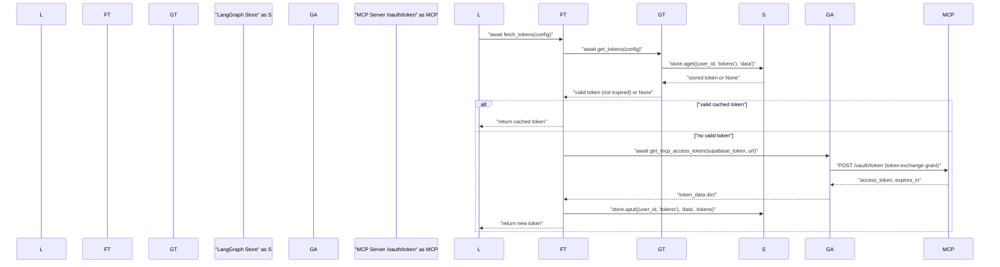
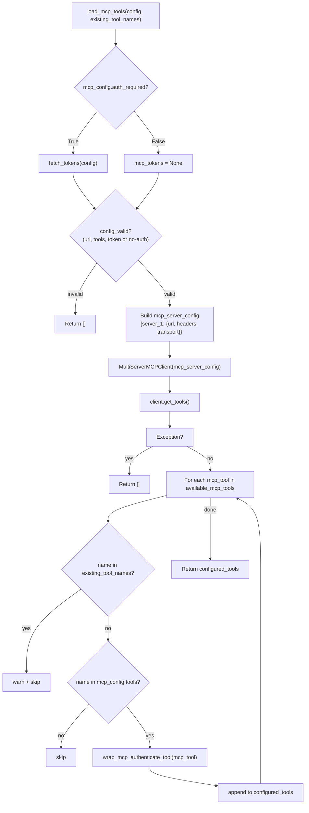
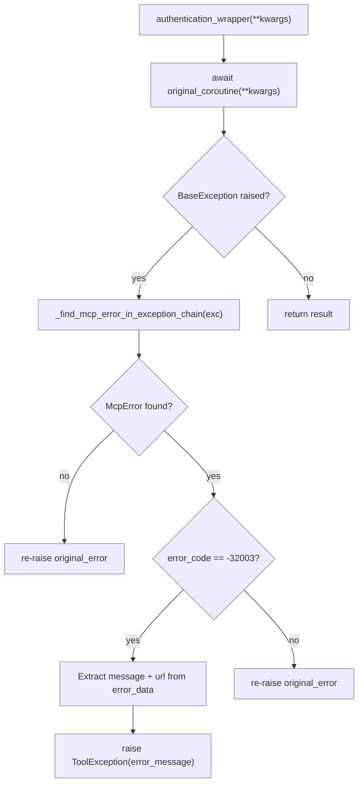
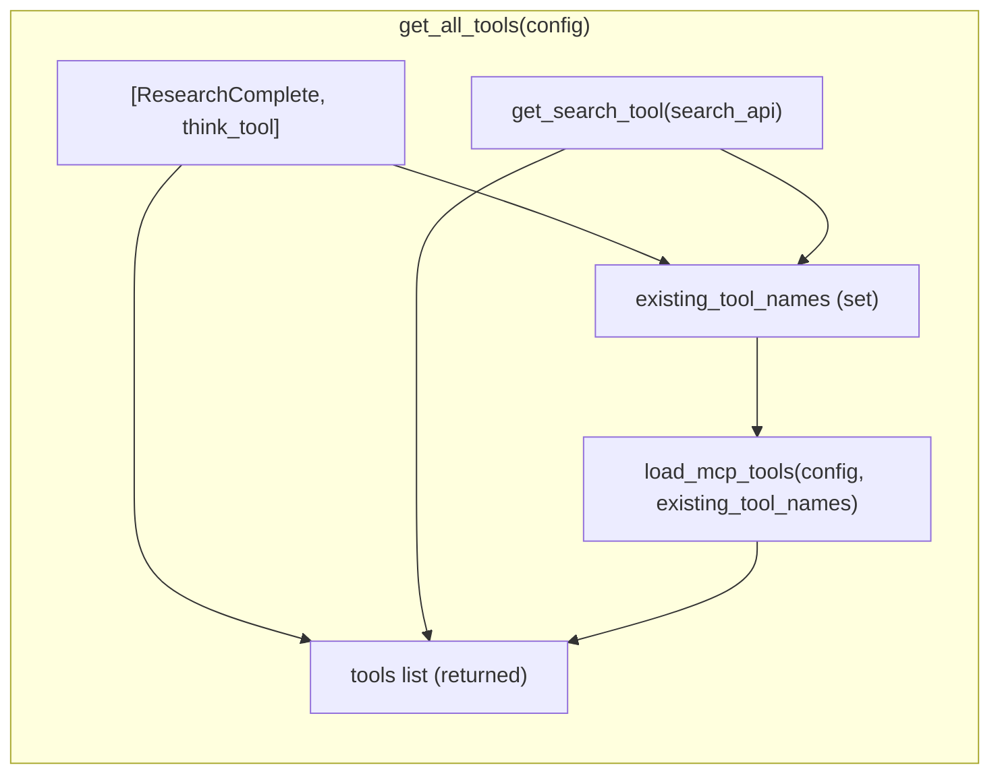

<!-- source: DeepWiki mcp.deepwiki.com · repo langchain-ai/open_deep_research · page 4.3 MCP Server Integration · fetched 2026-10-26 -->

# MCP Server Integration

<details>
<summary>Relevant source files</summary>

The following files were used as context for generating this wiki page:

- [src/open_deep_research/configuration.py](src/open_deep_research/configuration.py)
- [src/open_deep_research/utils.py](src/open_deep_research/utils.py)

</details>


This page covers how the Open Deep Research agent connects to Model Context Protocol (MCP) servers: the `MCPConfig` data model, the OAuth token exchange flow for authenticated servers, the tool loading pipeline, and error handling behavior. This is specifically about how MCP tools are made available to the **researcher agent** at runtime.

For the broader tool ecosystem (how MCP tools combine with search tools and core tools), see [Tool Integration and Utilities](#3.4). For setting configuration fields like `mcp_config` via environment or the Studio UI, see [Configuration System](#3.3).

---

## MCPConfig — The Configuration Model

MCP connectivity is controlled by the `MCPConfig` Pydantic model, defined in [src/open_deep_research/configuration.py:19-36]().

| Field | Type | Default | Description |
|---|---|---|---|
| `url` | `Optional[str]` | `None` | Base URL of the MCP server |
| `tools` | `Optional[List[str]]` | `None` | Allowlist of tool names to expose to the agent |
| `auth_required` | `Optional[bool]` | `False` | Whether the server requires OAuth authentication |

`MCPConfig` is embedded as an optional field in the main `Configuration` model:

```
mcp_config: Optional[MCPConfig] = Field(default=None, ...)
```

[src/open_deep_research/configuration.py:214-223]()

An additional field, `mcp_prompt: Optional[str]`, allows passing supplementary instructions to the agent about available MCP tools [src/open_deep_research/configuration.py:224-233]().

**Sources:** [src/open_deep_research/configuration.py:19-36](), [src/open_deep_research/configuration.py:213-233]()

---

## Authentication Flow

When `auth_required` is `True`, the system performs an OAuth token exchange before connecting to the MCP server. The flow involves three storage-backed helpers and one HTTP call.

**Diagram: OAuth Token Exchange Flow**



**Sources:** [src/open_deep_research/utils.py:250-383]()

### Function Responsibilities

| Function | Location | Purpose |
|---|---|---|
| `get_mcp_access_token` | [utils.py:250-291]() | Performs the HTTP POST to `/oauth/token` using an RFC 8693 token-exchange grant |
| `get_tokens` | [utils.py:293-329]() | Retrieves stored tokens from the LangGraph store, validates expiration |
| `set_tokens` | [utils.py:331-350]() | Persists tokens to the LangGraph store keyed by `(user_id, "tokens")` |
| `fetch_tokens` | [utils.py:352-383]() | Orchestrates: checks cache first, falls back to `get_mcp_access_token` |

#### Token Exchange Request Detail

`get_mcp_access_token` sends a `POST` to `{base_mcp_url}/oauth/token` with the following form fields [src/open_deep_research/utils.py:265-270]():

| Field | Value |
|---|---|
| `client_id` | `"mcp_default"` |
| `subject_token` | Supabase access token from `x-supabase-access-token` config key |
| `grant_type` | `urn:ietf:params:oauth:grant-type:token-exchange` |
| `resource` | `{base_mcp_url}/mcp` |
| `subject_token_type` | `urn:ietf:params:oauth:token-type:access_token` |

#### Token Expiration Check

`get_tokens` computes expiration from the stored `expires_in` (seconds) and the `created_at` timestamp on the store entry. If `current_time > created_at + expires_in`, the token is deleted and `None` is returned [src/open_deep_research/utils.py:319-328]().

**Sources:** [src/open_deep_research/utils.py:250-383]()

---

## Tool Loading Pipeline

The central function for MCP integration is `load_mcp_tools` [src/open_deep_research/utils.py:449-524](). It is called from `get_all_tools` and returns a filtered, authenticated list of `BaseTool` instances.

**Diagram: load_mcp_tools Execution Path**



**Sources:** [src/open_deep_research/utils.py:449-524]()

### Key Behaviors

- **Server URL construction**: The tool appends `/mcp` to the configured base URL — `configurable.mcp_config.url.rstrip("/") + "/mcp"` [src/open_deep_research/utils.py:482]().
- **Transport protocol**: Uses `"streamable_http"` as the transport for `MultiServerMCPClient` [src/open_deep_research/utils.py:492-494]().
- **Authentication header**: If tokens are available, sets `Authorization: Bearer {access_token}` in the server config headers [src/open_deep_research/utils.py:486-487]().
- **Name conflict avoidance**: Any MCP tool whose name already appears in `existing_tool_names` is skipped with a `warnings.warn` call [src/open_deep_research/utils.py:510-513]().
- **Allowlist filtering**: Only tools whose names appear in `mcp_config.tools` are included [src/open_deep_research/utils.py:517-518]().
- **Connection failure**: If `client.get_tools()` raises any exception, the function returns an empty list rather than propagating the error [src/open_deep_research/utils.py:499-503]().

> **Note**: The current implementation connects to a single MCP server keyed as `"server_1"`. A TODO comment at [src/open_deep_research/utils.py:496]() marks where multi-server support is planned.

**Sources:** [src/open_deep_research/utils.py:449-524]()

---

## Error Handling: wrap_mcp_authenticate_tool

Every MCP tool returned by `load_mcp_tools` is wrapped with `wrap_mcp_authenticate_tool` before being handed to the agent [src/open_deep_research/utils.py:385-447]().

This wrapper replaces the tool's `coroutine` with an async function that intercepts `McpError` instances anywhere in the exception chain (including inside `ExceptionGroup`s in Python 3.11+).

**Diagram: wrap_mcp_authenticate_tool Logic**



**Key error code:**

| Code | Meaning | Behavior |
|---|---|---|
| `-32003` | Interaction required (e.g. OAuth consent needed) | Raises `ToolException` with a user-readable message and optional URL |
| Other | Non-auth MCP error | Re-raises original exception unchanged |

The helper `_find_mcp_error_in_exception_chain` recursively walks exception chains including `ExceptionGroup.exceptions` to locate `McpError` instances [src/open_deep_research/utils.py:399-409]().

**Sources:** [src/open_deep_research/utils.py:385-447]()

---

## Integration with get_all_tools

MCP tools are assembled as part of the researcher agent's full tool set by `get_all_tools` [src/open_deep_research/utils.py:569-597]().

**Diagram: get_all_tools Assembly**



The ordering matters: `existing_tool_names` is computed from `core` + `search` tools before calling `load_mcp_tools`, ensuring MCP tools cannot shadow built-in tool names [src/open_deep_research/utils.py:588-595]().

**Sources:** [src/open_deep_research/utils.py:569-597]()

---

## Configuration Reference Summary

| Configuration Path | Effect |
|---|---|
| `mcp_config.url` | Base URL for the MCP server (required for any MCP tool loading) |
| `mcp_config.tools` | Explicit list of tool names to expose; tools not in this list are filtered out |
| `mcp_config.auth_required` | When `True`, triggers the OAuth token exchange before connecting |
| `mcp_prompt` | Optional instruction string passed to the agent alongside MCP tools |
| `x-supabase-access-token` (in `configurable`) | Supabase bearer token used as the subject token in the OAuth exchange |

**Sources:** [src/open_deep_research/configuration.py:19-36](), [src/open_deep_research/configuration.py:213-233](), [src/open_deep_research/utils.py:352-383]()

---

