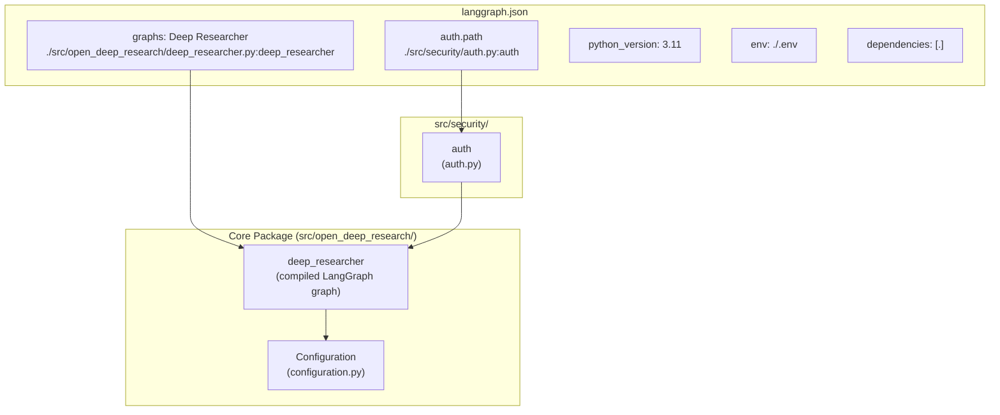
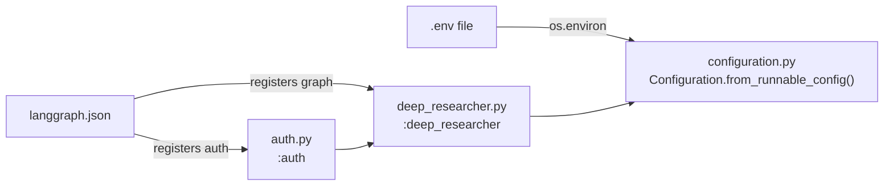
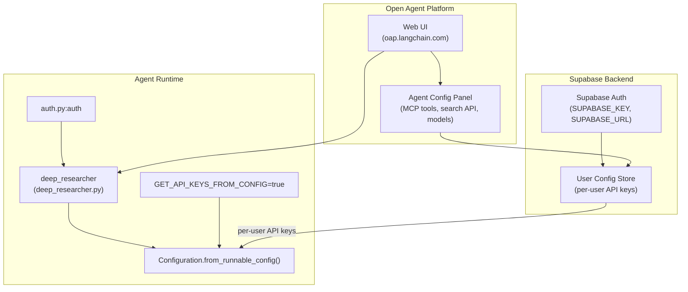
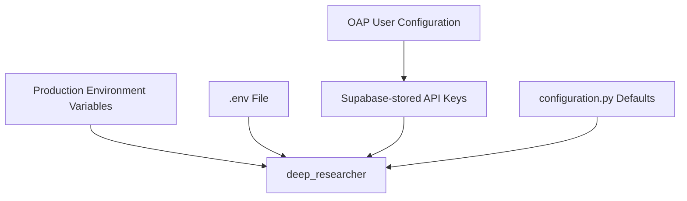

<!-- source: DeepWiki mcp.deepwiki.com · repo langchain-ai/open_deep_research · page 4.4 Deployment Options · fetched 2026-10-26 -->

# Deployment Options

<details>
<summary>Relevant source files</summary>

The following files were used as context for generating this wiki page:

- [.env.example](.env.example)
- [README.md](README.md)
- [langgraph.json](langgraph.json)
- [tests/expt_results/deep_research_bench_gpt-5.jsonl](tests/expt_results/deep_research_bench_gpt-5.jsonl)

</details>


This document covers the three deployment targets for Open Deep Research: a local development server, LangGraph Platform (hosted), and Open Agent Platform (OAP). All three rely on the same `langgraph.json` manifest to register the graph and authentication entrypoints, and the same `Configuration` class to resolve runtime settings.

For runtime configuration fields and their defaults, see page 4.1. For the core agent architecture, see page 3.

## Overview of Deployment Architectures

The system supports three deployment patterns differentiated primarily by where environment variables are sourced and how API keys reach the agent.

| Deployment | Environment | API Keys Source | Auth | Target Users |
|---|---|---|---|---|
| `langgraph dev` (local) | `.env` file | OS environment | `auth.py` | Developers |
| LangGraph Platform | Platform env vars | Platform secrets manager | `auth.py` | Engineering teams |
| Open Agent Platform (OAP) | `.env` + Supabase | Supabase (`GET_API_KEYS_FROM_CONFIG=true`) | `auth.py` + Supabase Auth | Non-technical users |

**Deployment Manifest (`langgraph.json`) and Core Entrypoints**



Sources: [langgraph.json:1-14](), [README.md:115-134]()

## Local Development Environment

Local development provides the most flexibility for testing, debugging, and customizing the research agent. The system runs on your local machine with full access to logs and debugging tools.

### Setup Process

The local deployment uses the LangGraph in-memory development server:

```bash
uvx --refresh --from "langgraph-cli[inmem]" --with-editable . --python 3.11 langgraph dev --allow-blocking
```

This starts three endpoints:

| Endpoint | URL |
|---|---|
| API | `http://127.0.0.1:2024` |
| Studio UI | `https://smith.langchain.com/studio/?baseUrl=http://127.0.0.1:2024` |
| API Docs | `http://127.0.0.1:2024/docs` |

The Studio UI (at smith.langchain.com) connects to the local server and provides a chat interface and the "Manage Assistants" panel for configuration overrides.

### langgraph.json — Deployment Manifest

`langgraph.json` [langgraph.json:1-14]() is the single file that registers the graph and auth handler for any deployment target.

| Field | Value | Purpose |
|---|---|---|
| `graphs."Deep Researcher"` | `./src/open_deep_research/deep_researcher.py:deep_researcher` | Registers the compiled graph |
| `python_version` | `3.11` | Runtime Python version |
| `env` | `./.env` | Path to env file (local dev only) |
| `dependencies` | `["."]` | Install package from current directory |
| `auth.path` | `./src/security/auth.py:auth` | Auth handler entrypoint |

### Local Environment File

Copy `.env.example` to `.env` and populate the required keys before starting the server:

```
OPENAI_API_KEY=
ANTHROPIC_API_KEY=
GOOGLE_API_KEY=
TAVILY_API_KEY=
LANGSMITH_API_KEY=
LANGSMITH_PROJECT=
LANGSMITH_TRACING=
GET_API_KEYS_FROM_CONFIG=false   # must be false for local dev
```

The `Configuration.from_runnable_config()` method reads these as OS environment variables at runtime [src/open_deep_research/configuration.py]().

**Local Configuration Flow**



Sources: [README.md:43-58](), [langgraph.json:1-14](), [.env.example:1-13]()

## LangGraph Platform Deployment

LangGraph Platform provides a hosted, production-ready deployment option with managed infrastructure and scaling capabilities.

### Platform Integration

LangGraph Platform reads the same `langgraph.json` manifest used locally. The platform handles container orchestration, scaling, API endpoint management, and dependency installation automatically. No changes to application code are needed to deploy.

Environment variables are set via the platform's secrets/environment management interface instead of a local `.env` file. The `env` field in `langgraph.json` is ignored in hosted deployments. Required variables:

| Variable | Purpose |
|---|---|
| `OPENAI_API_KEY` | OpenAI model access |
| `ANTHROPIC_API_KEY` | Anthropic model access |
| `GOOGLE_API_KEY` | Google model access |
| `TAVILY_API_KEY` | Tavily search API |
| `LANGSMITH_API_KEY` | Tracing and evaluation |
| `LANGSMITH_TRACING` | Set to `true` to enable tracing |
| `GET_API_KEYS_FROM_CONFIG` | Set to `false` (not OAP mode) |

The `Configuration.from_runnable_config()` loader reads all fields from `os.environ` first before falling back to `RunnableConfig.configurable` values passed in the API request body [src/open_deep_research/configuration.py]().

Sources: [README.md:121-123](), [.env.example:1-13]()

## Open Agent Platform (OAP) Deployment

Open Agent Platform provides a non-technical user interface for configuring and using the Deep Researcher agent. This deployment option targets users who need the research capabilities without requiring technical setup.

Open Agent Platform (OAP) allows non-technical users to configure and run the Deep Researcher through a web UI, selecting MCP tools, search APIs, and model settings without writing code.

### OAP-Specific Environment Variables

These variables are only required for OAP deployments [.env.example:9-13]():

| Variable | Required For | Description |
|---|---|---|
| `SUPABASE_KEY` | OAP only | Auth key for the Supabase backend |
| `SUPABASE_URL` | OAP only | URL for the Supabase instance |
| `GET_API_KEYS_FROM_CONFIG` | OAP only | Set to `true` in OAP production; `false` elsewhere |

### `GET_API_KEYS_FROM_CONFIG` Flag

This flag controls where the agent retrieves LLM/search API keys at request time:

- **`false`** (default): Keys come from OS environment variables — standard for local dev and LangGraph Platform.
- **`true`**: Keys are retrieved from the per-user configuration stored in Supabase — required for OAP so each user's keys are used, not a shared server-level key.

The comment in `.env.example` states this explicitly [.env.example:12-13]():
> *Should be set to `true` for a production deployment on Open Agent Platform. Should be set to `false` otherwise, such as for local development.*

**OAP Architecture and Key Flow**



### Deployment Options for OAP

| Option | Description |
|---|---|
| **Public demo** | `oap.langchain.com` — add your own API keys to test immediately |
| **Self-hosted** | Deploy your own OAP instance and register `deep_researcher` as an available agent |

Sources: [README.md:125-134](), [.env.example:9-13]()

## Authentication

The `auth` entrypoint is registered in `langgraph.json` [langgraph.json:11-13]():

```
"auth": {
  "path": "./src/security/auth.py:auth"
}
```

This causes LangGraph (in all deployment modes) to invoke the `auth` object defined in `src/security/auth.py` for request authentication and authorization. The module integrates with Supabase in OAP deployments for per-user session and API key isolation.

| Deployment | Auth Behavior |
|---|---|
| Local (`langgraph dev`) | Minimal enforcement; suitable for development |
| LangGraph Platform | Platform-level hardening layered on top of `auth.py` |
| OAP | Full user session management via Supabase Auth; per-user API key retrieval |

Sources: [langgraph.json:11-13](), [src/security/auth.py](), [README.md:38-42]()

## Configuration Management Across Deployments

The configuration system adapts to different deployment environments while maintaining consistency in agent behavior and capabilities.

### Environment Variable Hierarchy



**Configuration Sources by Deployment Type**

### Deployment-Specific Considerations

Each deployment type has unique configuration requirements:

- **Local**: Uses `.env` file with development API keys and debugging enabled
- **Platform**: Uses platform environment variables with production API keys and monitoring
- **OAP**: Uses Supabase-stored user configurations with per-user API key isolation

The `GET_API_KEYS_FROM_CONFIG` flag determines whether API keys are retrieved from environment variables (local/platform) or from user configuration stored in Supabase (OAP).

Sources: [.env.example:1-13](), [README.md:60-82]()

---

