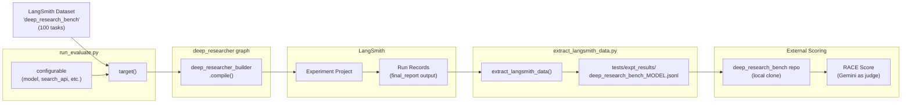
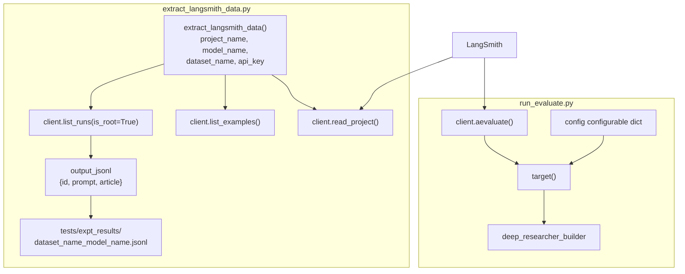

<!-- source: DeepWiki mcp.deepwiki.com · repo langchain-ai/open_deep_research · page 5 Evaluation and Quality Assessment · fetched 2026-10-26 -->

# Evaluation and Quality Assessment

Relevant source files

The following files were used as context for generating this wiki page:

- [CLAUDE.md](CLAUDE.md)
- [README.md](README.md)
- [tests/expt_results/deep_research_bench_gpt-4.1.jsonl](tests/expt_results/deep_research_bench_gpt-4.1.jsonl)
- [tests/expt_results/deep_research_bench_gpt-5.jsonl](tests/expt_results/deep_research_bench_gpt-5.jsonl)
- [tests/extract_langsmith_data.py](tests/extract_langsmith_data.py)

Open Deep Research is benchmarked against [Deep Research Bench](https://huggingface.co/spaces/Ayanami0730/DeepResearch-Leaderboard), a public benchmark of 100 PhD-level research tasks. The evaluation pipeline runs the `deep_researcher` graph against this dataset via LangSmith, then scores outputs using the RACE metric with Gemini as judge comparing generated reports to expert-compiled golden reports.

For implementation details on running evaluations and extracting results, see [Evaluation System](5.1). For published benchmark results and leaderboard context, see [Performance Benchmarks and Results](5.2).

Sources: [README.md:84-104]()

## Evaluation Pipeline Overview

**Diagram: End-to-End Evaluation Flow**

Sources: [README.md:84-104](), [tests/extract_langsmith_data.py:13-58]()

## Deep Research Bench Dataset

The Deep Research Bench is a public benchmark for evaluating deep research systems at expert-level synthesis quality.

| Characteristic | Value |
|---|---|
| **Total Tasks** | 100 |
| **Language Split** | 50 English, 50 Chinese |
| **Domain Coverage** | 22 academic fields |
| **Example Fields** | Science & Technology, Business & Finance |
| **Task Complexity** | PhD-level research questions |
| **Reference Standard** | Expert-compiled golden reports |
| **LangSmith Dataset Name** | `"Deep Research Bench"` |
| **Evaluation Judge** | Gemini LLM (RACE score) |

Each task is a comprehensive research question designed to mirror real-world expert research needs. The dataset is publicly available on LangSmith and referenced in `tests/run_evaluate.py` via the `dataset_name` variable.

Sources: [README.md:85-86]()

## RACE Scoring Methodology

RACE is the primary metric used on the Deep Research Bench leaderboard. It uses an LLM-as-a-judge approach:

1. **Reference reports**: Domain experts compile high-quality golden reports for each benchmark task.
2. **Generated reports**: The `deep_researcher` graph produces a `final_report` for each task.
3. **Judgment**: A Gemini model evaluates the generated report against the golden report across multiple quality dimensions.
4. **Score**: The RACE score is a normalized aggregate reflecting overall research quality relative to expert-level standards.

This scoring is performed externally by the Deep Research Bench repository after JSONL results are submitted. The `tests/extract_langsmith_data.py` script packages outputs into the required submission format.

> **Cost note**: Running the full 100-task evaluation costs approximately $20–$100 depending on model selection.

Sources: [README.md:85-86](), [README.md:97-104]()

## Evaluation Tooling

Two scripts implement the evaluation workflow:

| Script | Role |
|---|---|
| `tests/run_evaluate.py` | Submits all 100 tasks to `deep_researcher_builder.compile()`, configures model and search settings via `config['configurable']`, logs results to a named LangSmith experiment |
| `tests/extract_langsmith_data.py` | Reads a LangSmith experiment by `--project-name`, extracts `final_report` outputs from root runs, writes a JSONL file formatted for Deep Research Bench submission |

**Diagram: Script Responsibilities and Key Code Entities**

The output JSONL file contains one record per completed run with fields `id`, `prompt`, and `article` (the `final_report`). Only runs where `run.outputs["final_report"]` is non-null are included.

See [Evaluation System](5.1) for full usage instructions.

Sources: [tests/extract_langsmith_data.py:13-58](), [README.md:94-104]()

## Published Results Summary

Results stored in `tests/expt_results/` represent runs against the full Deep Research Bench. All configurations use `openai:gpt-4.1-mini` for summarization and `openai:gpt-4.1` for compression and final report unless noted.

| Name | Research Model | RACE Score | Total Tokens | Cost |
|---|---|---|---|---|
| GPT-5 | `openai:gpt-5` | **0.4943** | 204,640,896 | — |
| Claude Sonnet 4 | `anthropic:claude-sonnet-4-20250514` | 0.4401 | 138,917,050 | $187.09 |
| Deep Research Bench Submission | `openai:gpt-4.1` (summarization: `gpt-4.1-nano`) | 0.4344 | 207,005,549 | $87.83 |
| Default Configuration | `openai:gpt-4.1` | 0.4309 | 58,015,332 | $45.98 |

The Deep Research Bench Submission achieved #6 on the public leaderboard with a RACE score of 0.4344.

See [Performance Benchmarks and Results](5.2) for detailed analysis of these results.

Sources: [README.md:108-114](), [tests/expt_results/deep_research_bench_gpt-5.jsonl:1-2](), [tests/expt_results/deep_research_bench_gpt-4.1.jsonl:1-2]()

## Evaluation Workflow Integration

The evaluation system operates as a parallel workflow to the main research system, allowing for systematic quality assessment without interfering with production usage:

```mermaid
graph LR
    subgraph "Research Execution"
        DRB[Deep Research Bench] --> TF[target function]
        TF --> DRA[deep_researcher_builder.compile]
        DRA --> CONFIG[RunnableConfig]
        CONFIG --> FS[final_state]
    end
    
    subgraph "Quality Assessment" 
        FS --> LSE[LangSmith evaluators]
        LSE --> QM[quality metrics]
        QM --> ER[experiment results]
    end
    
    subgraph "Analysis & Reporting"
        ER --> ELD[extract_langsmith_data.py]
        ELD --> JSONL[results.jsonl]
        JSONL --> PERF[performance analysis]
    end
```

This architecture enables continuous evaluation and improvement of the research system while maintaining separation of concerns between research execution and quality assessment.

Sources: [tests/run_evaluate.py:32-41](), [tests/run_evaluate.py:63-86]()

---

