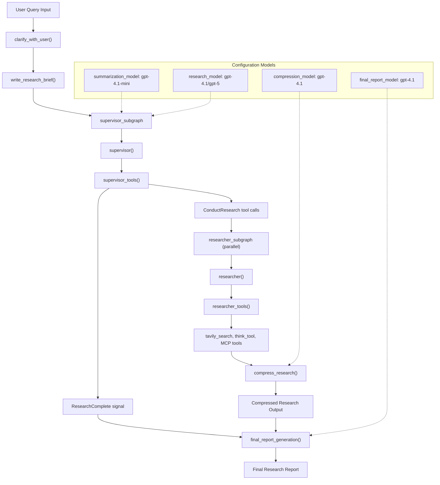
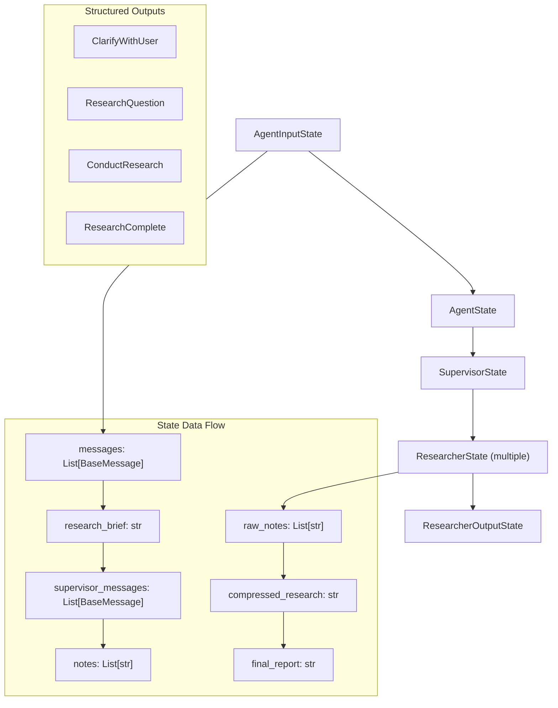
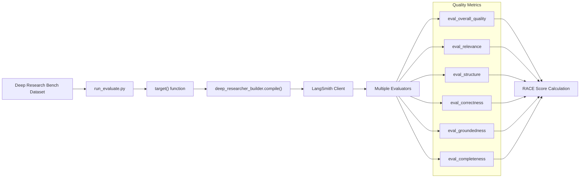
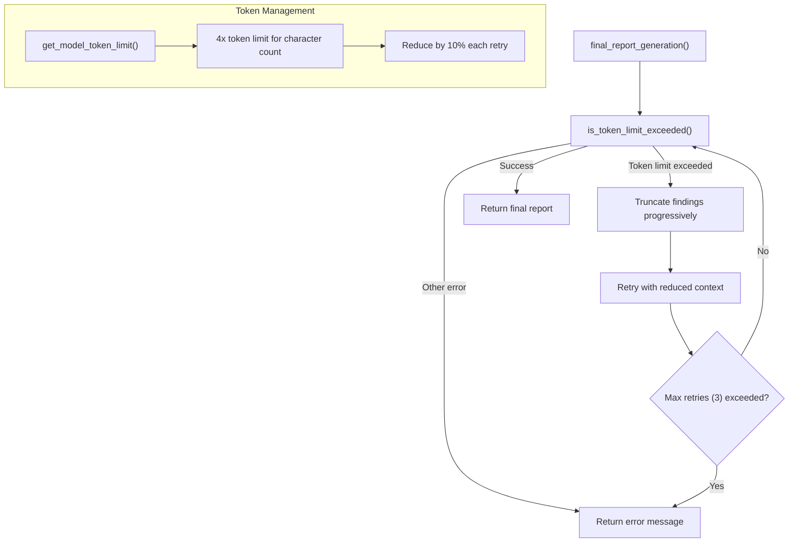

<!-- source: DeepWiki mcp.deepwiki.com · repo langchain-ai/open_deep_research · page 5.2 Performance Benchmarks and Results · fetched 2026-10-26 -->

# Research Report Examples

<details>
<summary>Relevant source files</summary>

The following files were used as context for generating this wiki page:

- [CLAUDE.md](CLAUDE.md)
- [README.md](README.md)
- [tests/expt_results/deep_research_bench_gpt-4.1.jsonl](tests/expt_results/deep_research_bench_gpt-4.1.jsonl)
- [tests/expt_results/deep_research_bench_gpt-5.jsonl](tests/expt_results/deep_research_bench_gpt-5.jsonl)
- [tests/extract_langsmith_data.py](tests/extract_langsmith_data.py)

</details>


This page presents examples of research reports generated by the Open Deep Research system and analysis of their quality through systematic evaluation. It demonstrates the system's output capabilities, evaluation methodology, and performance metrics against academic-level research tasks.

For information about the underlying evaluation framework and metrics, see [Evaluation System](#5.1). For guidance on configuring the system for optimal performance, see [Configuration Options](#4.1).

## Report Generation Pipeline

The Open Deep Research system follows a structured multi-stage pipeline to generate comprehensive research reports. This process transforms user queries into well-structured, evidence-based documents through systematic research and synthesis.

### Research Report Generation Flow



Sources: [src/open_deep_research/deep_researcher.py:60-716](), [tests/run_evaluate.py:23-30]()

### State Management and Data Flow

The system maintains research context through structured state objects that track progress and aggregate findings across the pipeline stages.



Sources: [src/open_deep_research/state.py](), [src/open_deep_research/deep_researcher.py:118-175]()

## Performance Evaluation Results

The system is evaluated against the Deep Research Bench, a dataset of 100 PhD-level research tasks, using multiple quality metrics including the RACE (Research Assessment Comprehensive Evaluation) score.

### Benchmark Configuration and Results

The evaluation pipeline in [tests/run_evaluate.py]() demonstrates systematic testing with different model configurations:

| Configuration | Research Model | RACE Score | Notes |
|---------------|---------------|------------|-------|
| GPT-5 Setup | `openai:gpt-5` | 0.4943 | Best performing configuration |
| Default Setup | `openai:gpt-4.1` | 0.4309 | Standard configuration |
| Custom Configs | Various models | Variable | Multiple provider testing |

### Evaluation Framework Components



Sources: [tests/run_evaluate.py:1-90](), [tests/evaluators.py]()

### Configuration Parameters for Optimal Performance

The evaluation script demonstrates key configuration parameters that affect report quality:

```python
# Research execution parameters
max_concurrent_research_units = 10
max_researcher_iterations = 6
max_react_tool_calls = 10

# Model specialization
summarization_model = "openai:gpt-4.1-mini"
research_model = "openai:gpt-5"  # Best performing
compression_model = "openai:gpt-4.1"
final_report_model = "openai:gpt-4.1"

# Token limits per model
summarization_model_max_tokens = 8192
research_model_max_tokens = 10000
compression_model_max_tokens = 10000
final_report_model_max_tokens = 10000
```

Sources: [tests/run_evaluate.py:17-31](), [tests/run_evaluate.py:42-55]()

## Report Structure and Quality Assessment

Research reports generated by the system follow a structured format designed to provide comprehensive coverage of complex topics while maintaining academic rigor.

### Report Generation Prompts

The system uses specialized prompts at different stages to ensure high-quality output:

- `clarify_with_user_instructions`: Analyzes user queries for clarity requirements
- `transform_messages_into_research_topic_prompt`: Converts user input to structured research brief
- `lead_researcher_prompt`: Guides research strategy and task delegation
- `research_system_prompt`: Directs individual researcher behavior
- `compress_research_system_prompt`: Synthesizes findings into coherent summaries  
- `final_report_generation_prompt`: Creates comprehensive final reports

Sources: [src/open_deep_research/prompts.py](), [src/open_deep_research/deep_researcher.py:22-30]()

### Error Handling and Retry Logic

The system implements robust error handling for token limits and execution failures:



Sources: [src/open_deep_research/deep_researcher.py:607-697](), [src/open_deep_research/utils.py:is_token_limit_exceeded]()

### Research Quality Indicators

The evaluation system assesses multiple dimensions of research quality:

1. **Overall Quality**: Comprehensive assessment of report usefulness and accuracy
2. **Relevance**: Alignment with user's research question and objectives  
3. **Structure**: Organization, flow, and logical presentation of information
4. **Correctness**: Factual accuracy and proper interpretation of sources
5. **Groundedness**: Citations and evidence supporting claims made
6. **Completeness**: Coverage of important aspects of the research topic

These metrics combine to produce the RACE score, where the GPT-5 configuration achieved 0.4943, representing strong performance on PhD-level research tasks.

Sources: [tests/run_evaluate.py:14-15](), [tests/evaluators.py]()

---

