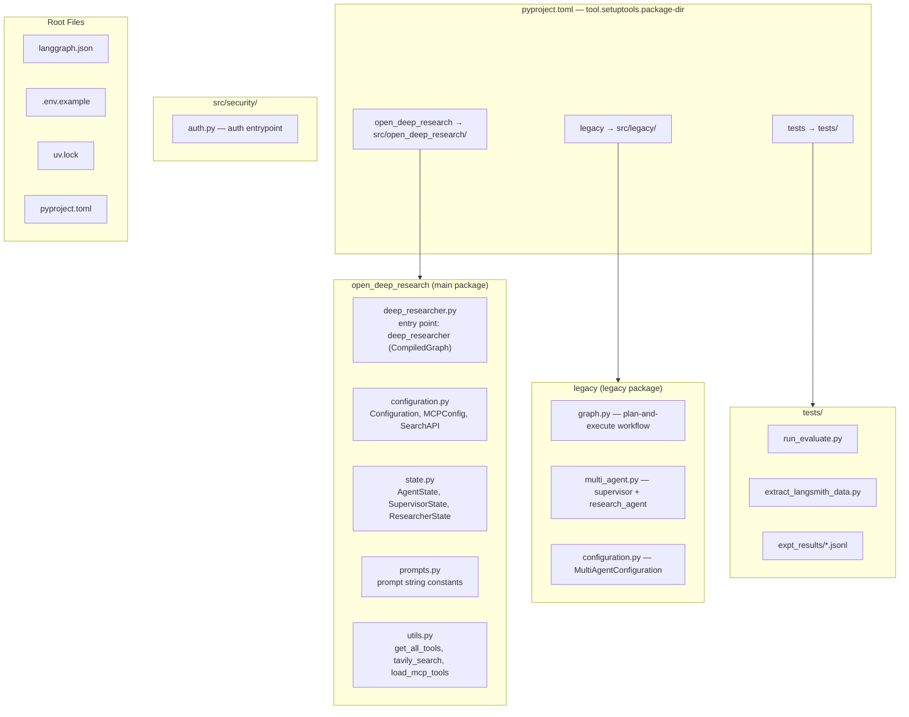
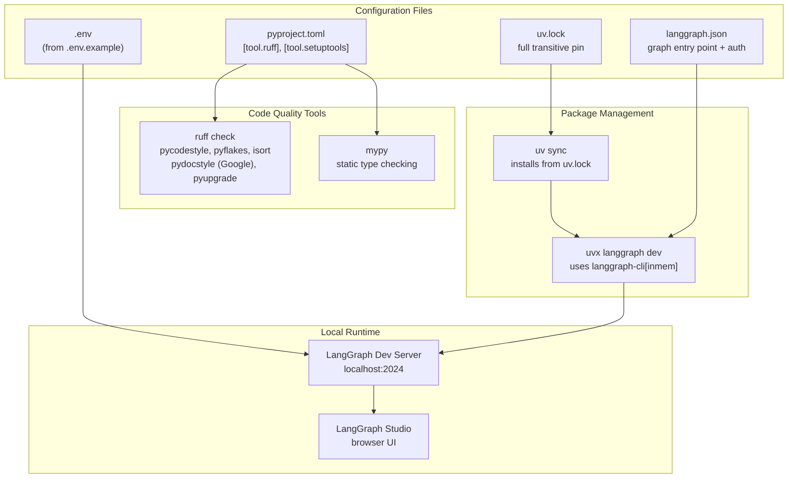

<!-- source: DeepWiki mcp.deepwiki.com · repo langchain-ai/open_deep_research · page 6 Development Guide · fetched 2026-10-26 -->

# Development Guide

<details>
<summary>Relevant source files</summary>

The following files were used as context for generating this wiki page:

- [CLAUDE.md](CLAUDE.md)
- [pyproject.toml](pyproject.toml)
- [tests/expt_results/deep_research_bench_gpt-4.1.jsonl](tests/expt_results/deep_research_bench_gpt-4.1.jsonl)
- [tests/extract_langsmith_data.py](tests/extract_langsmith_data.py)

</details>


This page is a reference for developers contributing to or extending the `open_deep_research` project. It covers the overall codebase structure, development tooling, and code quality standards. For runtime configuration and deployment, see [Usage Guide](#4) and [Deployment Options](#4.4). For evaluation methodology, see [Evaluation System](#5.1).

Detailed sub-pages:
- **[6.1 — Dependencies and Environment Setup](#6.1)**: Direct dependency catalog, `uv.lock`, and `.env` configuration
- **[6.2 — Project Configuration and Build System](#6.2)**: `pyproject.toml` structure, `setuptools` layout, `ruff`/`mypy` settings, and `langgraph.json`
- **[6.3 — Testing and CI/CD](#6.3)**: Evaluation scripts, GitHub Actions workflows, and Dependabot configuration

---

## Repository Layout

The project uses a `src/`-layout. Three Python packages are declared and mapped in [pyproject.toml:56-62]().

**Package Boundaries and Module Map**



Sources: [pyproject.toml:56-62](), [CLAUDE.md:8-43]()

---

## Development Tooling

### Package Manager

The project uses `uv` as the package manager. `uv.lock` pins the full transitive dependency tree for reproducible installs.

```bash
uv sync                  # install all dependencies from uv.lock
uvx langgraph dev        # start local dev server (auto-installs langgraph-cli[inmem])
```

`langgraph-cli[inmem]` is declared as a direct dependency [pyproject.toml:38]() so that the in-memory backend is available without a separate install step.

### Linting — `ruff`

`ruff` is configured under `[tool.ruff]` in [pyproject.toml:67-89](). The active rule sets are:

| Code | Rule Set | Purpose |
|---|---|---|
| `E` | pycodestyle | Style errors |
| `F` | pyflakes | Undefined names, unused imports |
| `I` | isort | Import ordering |
| `D` | pydocstyle | Docstring completeness and format |
| `D401` | pydocstyle | Imperative mood in first-line summary |
| `T201` | flake8-print | `print()` statement detection |
| `UP` | pyupgrade | Modern Python syntax enforcement |

Explicitly ignored rules [pyproject.toml:77-83]():

| Rule | Reason |
|---|---|
| `UP006`, `UP007`, `UP035` | Typing alias migration rules — both old and new styles are acceptable |
| `D417` | Missing argument descriptions in docstrings |
| `E501` | Line length — not enforced |

Test files under `tests/*` have `D` and `UP` suppressed entirely [pyproject.toml:85-86]().

Docstring convention is Google-style [pyproject.toml:88-89]().

```bash
ruff check           # lint all source files
ruff check --fix     # lint and auto-fix where possible
```

### Type Checking — `mypy`

`mypy` is listed under `[project.optional-dependencies] dev` [pyproject.toml:50](). No custom `[tool.mypy]` section is present, so `mypy` operates with its default settings.

```bash
mypy
```

---

## Tooling Chain Diagram

**Dev Workflow: Configuration Files to Runtime**



Sources: [pyproject.toml:49-89](), [CLAUDE.md:54-58]()

---

## Quick Reference: Common Commands

| Command | Purpose |
|---|---|
| `uv sync` | Install all dependencies from `uv.lock` |
| `uvx langgraph dev` | Start local LangGraph dev server with Studio UI |
| `ruff check` | Run linter |
| `ruff check --fix` | Run linter with auto-fix |
| `mypy` | Run static type checker |
| `python tests/run_evaluate.py` | Run batch evaluation against Deep Research Bench |
| `python tests/extract_langsmith_data.py --project-name NAME --model-name MODEL --dataset-name DS` | Extract LangSmith run results to JSONL |

Sources: [CLAUDE.md:54-63](), [tests/extract_langsmith_data.py:61-79]()

---

## Dependency Categories

All direct dependencies are declared in [pyproject.toml:11-47](). The table below groups them by function.

| Category | Packages |
|---|---|
| LangGraph / LangChain core | `langgraph`, `langchain-community` |
| LLM providers | `langchain-openai`, `langchain-anthropic`, `langchain-deepseek`, `langchain-groq`, `langchain-google-vertexai`, `langchain-google-genai`, `langchain-aws`, `openai` |
| Search integrations | `langchain-tavily`, `tavily-python`, `duckduckgo-search`, `exa-py`, `linkup-sdk` |
| MCP | `langchain-mcp-adapters`, `mcp` |
| Document processing | `arxiv`, `pymupdf`, `xmltodict`, `beautifulsoup4`, `markdownify` |
| Azure Search | `azure-identity`, `azure-search`, `azure-search-documents` |
| Persistence | `supabase` |
| Data analysis | `pandas` |
| HTTP / networking | `requests`, `httpx` |
| Environment / display | `python-dotenv`, `rich` |
| Evaluation / observability | `langsmith`, `langgraph-cli[inmem]`, `pytest`, `ipykernel` |
| Dev extras (optional) | `mypy`, `ruff` |

For version constraints and rationale, see [6.1 — Dependencies and Environment Setup](#6.1).

---

## Code Quality Standards

### Python Version

Python ≥ 3.10 is required [pyproject.toml:10]().

### Docstrings

All public APIs use Google-style docstrings [pyproject.toml:88-89](). The `D401` rule enforces imperative mood in the first-line summary (e.g., "Return the result." not "Returns the result.").

### Imports

Import ordering follows `isort` conventions (rule `I`). `ruff` enforces this automatically on each check run.

### Type Annotations

`mypy` is available for static checks. The `UP006`, `UP007`, and `UP035` pyupgrade rules are suppressed [pyproject.toml:78-80](), meaning both `Optional[X]` and `X | None` annotation styles are accepted.

### Test Files

Files under `tests/*` are exempt from docstring rules (`D`) and pyupgrade rules (`UP`) [pyproject.toml:85-86](). This allows evaluation scripts to use more informal style.

Sources: [pyproject.toml:10](), [pyproject.toml:67-89]()

---

## Project Metadata

| Field | Value |
|---|---|
| Package name | `open_deep_research` |
| Version | `0.0.16` |
| License | MIT |
| Python requirement | `>=3.10` |
| Build backend | `setuptools>=73.0.0` + `wheel` |

Sources: [pyproject.toml:1-54]()

---

