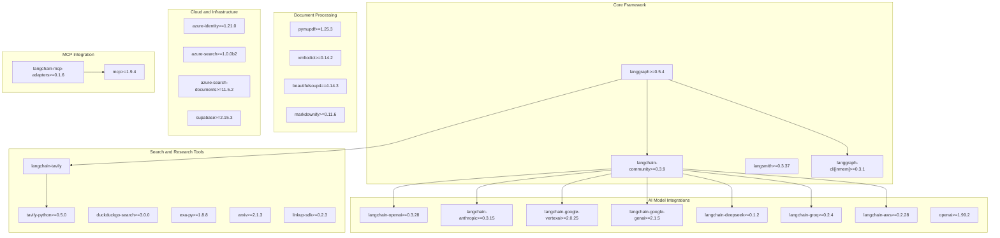
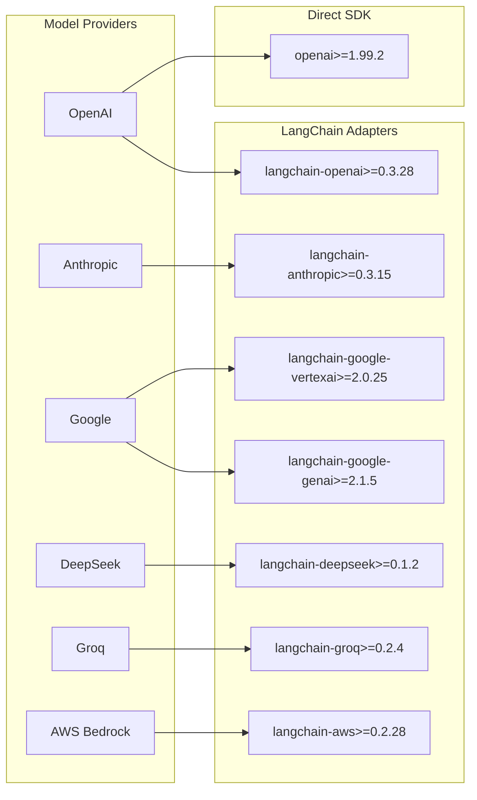
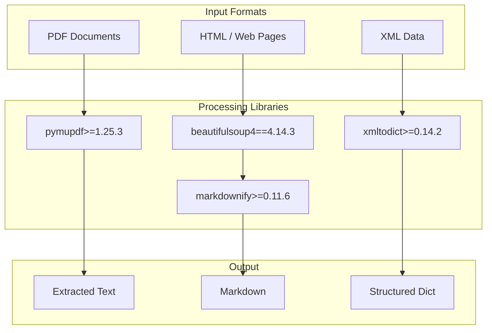
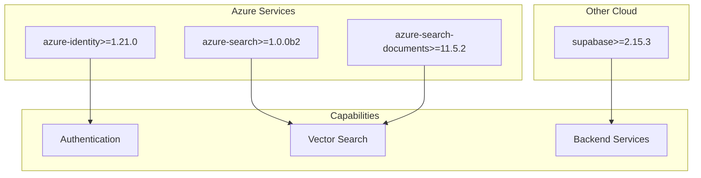
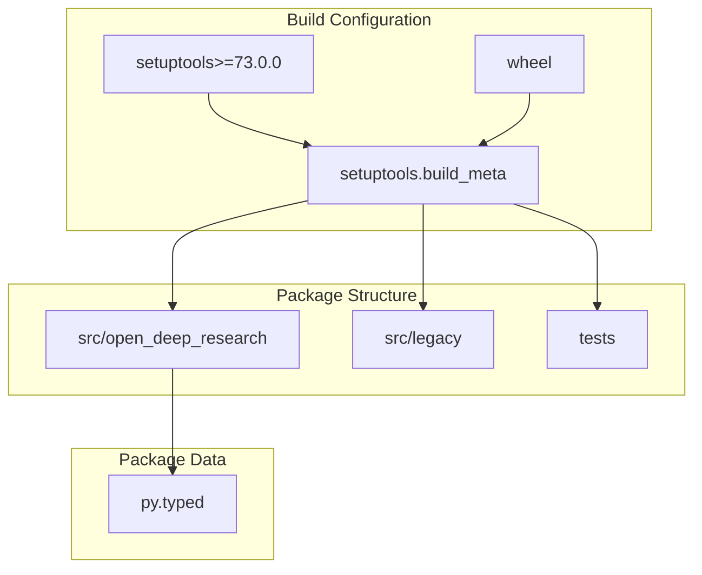
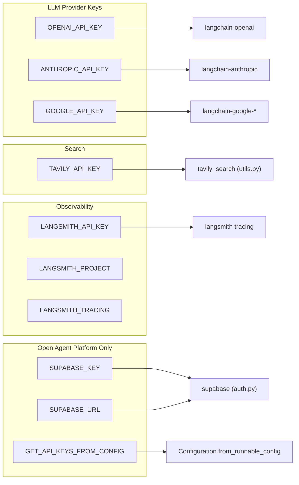
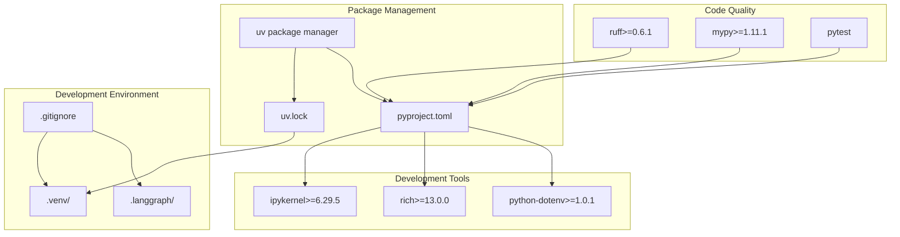

<!-- source: DeepWiki mcp.deepwiki.com · repo langchain-ai/open_deep_research · page 6.1 Dependencies and Environment Setup · fetched 2026-10-26 -->

# Dependencies and Environment Setup

<details>
<summary>Relevant source files</summary>

The following files were used as context for generating this wiki page:

- [.env.example](.env.example)
- [.gitignore](.gitignore)
- [pyproject.toml](pyproject.toml)
- [uv.lock](uv.lock)

</details>


This document provides detailed information about project dependencies, Python environment requirements, and development setup for the Open Deep Research system. It covers package management, build configuration, and development workflow setup for contributors and maintainers.

For information about project configuration and deployment settings, see [Project Configuration and Build System](#6.2). For details about testing frameworks and quality assurance, see [Testing and Quality Assurance](#6.3).

## Python Environment Requirements

The Open Deep Research system requires **Python 3.10 or higher** as specified in the project configuration. The system uses modern Python features and depends on recent versions of AI/ML libraries that require this minimum version.

**Sources:** [pyproject.toml:10-10]()

## Core Dependencies Architecture

The system's dependencies are organized into several functional categories that support the multi-agent research architecture:

**Dependency Categories and Key Packages**


Sources: [pyproject.toml:11-47]()

## LangGraph and LangChain Ecosystem

The system is built on the LangGraph framework for orchestrating multi-agent workflows, with extensive integration across the LangChain ecosystem:

| Component | Version | Purpose |
|-----------|---------|---------|
| `langgraph` | >=0.5.4 | Core agent orchestration framework |
| `langchain-community` | >=0.3.9 | Community integrations and utilities |
| `langsmith` | >=0.3.37 | Monitoring and evaluation platform |
| `langgraph-cli[inmem]` | >=0.3.1 | Development and deployment CLI |

**Sources:** [pyproject.toml:12-12](), [pyproject.toml:13-13](), [pyproject.toml:39-39](), [pyproject.toml:38-38]()

## AI Model Provider Integrations

The system supports multiple AI model providers through dedicated LangChain integrations. Each provider has a corresponding adapter package that implements the `init_chat_model` interface used throughout `configuration.py`.

**LangChain Provider Adapters**


| Package | Min Version | Provider |
|---------|-------------|----------|
| `langchain-openai` | >=0.3.28 | OpenAI (GPT-4.1, o-series) |
| `langchain-anthropic` | >=0.3.15 | Anthropic (Claude) |
| `langchain-google-vertexai` | >=2.0.25 | Google Vertex AI (Gemini) |
| `langchain-google-genai` | >=2.1.5 | Google AI Studio (Gemini) |
| `langchain-deepseek` | >=0.1.2 | DeepSeek |
| `langchain-groq` | >=0.2.4 | Groq (fast inference) |
| `langchain-aws` | >=0.2.28 | AWS Bedrock |
| `openai` | >=1.99.2 | OpenAI SDK (native web search tool) |

Sources: [pyproject.toml:14-20](), [pyproject.toml:40-41](), [pyproject.toml:45-45]()

## Search and Research Tools

The system integrates multiple search providers and research tools. The active search backend is selected at runtime via the `SearchAPI` enum in `configuration.py`.

| Package | Min Version | Role |
|---------|-------------|------|
| `langchain-tavily` | (latest) | LangChain wrapper for `tavily_search` tool |
| `tavily-python` | >=0.5.0 | Tavily web search SDK |
| `duckduckgo-search` | >=3.0.0 | DuckDuckGo search backend |
| `exa-py` | >=1.8.8 | Exa semantic search API |
| `arxiv` | >=2.1.3 | arXiv academic paper search |
| `linkup-sdk` | >=0.2.3 | Linkup search backend |

Sources: [pyproject.toml:18-18](), [pyproject.toml:21-21](), [pyproject.toml:25-27]()

## Document Processing Pipeline

The system includes libraries for parsing and converting content retrieved during research. These are used primarily inside `utils.py` for processing web page content returned by search tools.

**Document Processing Library Map**


Sources: [pyproject.toml:23-24](), [pyproject.toml:29-29](), [pyproject.toml:33-33]()

## Model Context Protocol (MCP) Integration

The system supports extensible tool integration through the MCP protocol:

| Package | Version | Purpose |
|---------|---------|---------|
| `mcp` | >=1.9.4 | Core MCP protocol implementation |
| `langchain-mcp-adapters` | >=0.1.6 | LangChain integration for MCP tools |

**Sources:** [pyproject.toml:44-44](), [pyproject.toml:16-16]()

## Cloud Service Integrations

The system includes integrations with major cloud platforms:



**Sources:** [pyproject.toml:34-36](), [pyproject.toml:43-43]()

## Development and Utility Dependencies

In addition to runtime dependencies, several packages support development workflows, evaluation, and notebook-based experimentation:

| Package | Min Version | Purpose |
|---------|-------------|---------|
| `pytest` | (latest) | Test runner |
| `httpx` | >=0.24.0 | HTTP client (also used at runtime for MCP) |
| `requests` | >=2.32.3 | HTTP library |
| `python-dotenv` | >=1.0.1 | `.env` file loading |
| `rich` | >=13.0.0 | Formatted terminal output |
| `ipykernel` | >=6.29.5 | Jupyter kernel for notebooks |
| `pandas` | >=2.3.1 | Data manipulation (used in evaluation scripts) |
| `langsmith` | >=0.3.37 | Tracing, evaluation platform |

Optional development tools are declared under `[project.optional-dependencies]`:

| Tool | Min Version | Purpose |
|------|-------------|---------|
| `mypy` | >=1.11.1 | Static type checking |
| `ruff` | >=0.6.1 | Linter and formatter |

Install dev extras with:

```
uv sync --extra dev
```

Sources: [pyproject.toml:31-32](), [pyproject.toml:37-39](), [pyproject.toml:42-42](), [pyproject.toml:46-46](), [pyproject.toml:49-50]()

## Build System Configuration

The project uses setuptools as the build backend with specific package structure:



**Sources:** [pyproject.toml:50-52](), [pyproject.toml:55-55](), [pyproject.toml:57-60](), [pyproject.toml:62-63]()

## Linting and Code Quality Configuration

The project uses Ruff for comprehensive code quality enforcement:

| Rule Set | Purpose |
|----------|---------|
| `E`, `F` | pycodestyle and pyflakes |
| `I` | isort import sorting |
| `D` | pydocstyle documentation |
| `T201` | print statement detection |
| `UP` | pyupgrade modernization |

**Sources:** [pyproject.toml:65-82]()

## Package Management with uv

The project uses `uv` as its package manager. The `uv.lock` file pins exact versions for all transitive dependencies across Python 3.10–3.13, ensuring reproducible installs.

**uv.lock resolution markers** cover the following Python versions:

| Marker | Versions |
|--------|----------|
| `python_full_version >= '3.13'` | 3.13+ |
| `python_full_version >= '3.12.4' and < '3.13'` | 3.12.4–3.12.x |
| `python_full_version >= '3.12' and < '3.12.4'` | 3.12.0–3.12.3 |
| `python_full_version == '3.11.*'` | 3.11.x |
| `python_full_version < '3.11'` | 3.10.x |

**Install commands:**

```
# Install all runtime dependencies (creates .venv automatically)
uv sync

# Install with optional dev tools (mypy, ruff)
uv sync --extra dev

# Re-generate lock file after editing pyproject.toml
uv lock
```

Sources: [uv.lock:1-10](), [pyproject.toml:1-50]()

## Environment Variable Setup

All secrets and runtime flags are provided through environment variables. Copy `.env.example` to `.env` and fill in the required values before starting the server.

**Environment Variables from `.env.example`**


| Variable | Required For | Default | Notes |
|----------|-------------|---------|-------|
| `OPENAI_API_KEY` | OpenAI models | — | Needed when `research_model` uses `openai:` prefix |
| `ANTHROPIC_API_KEY` | Anthropic models | — | Needed when `research_model` uses `anthropic:` prefix |
| `GOOGLE_API_KEY` | Google AI models | — | For `google_genai:` model prefix |
| `TAVILY_API_KEY` | Tavily search | — | Required when `search_api = SearchAPI.TAVILY` |
| `LANGSMITH_API_KEY` | Tracing & eval | — | Required for LangSmith tracing and evaluation runs |
| `LANGSMITH_PROJECT` | Tracing | — | Groups traces by project name |
| `LANGSMITH_TRACING` | Tracing | — | Set to `true` to enable trace export |
| `SUPABASE_KEY` | OAP deployment | — | Only for Open Agent Platform |
| `SUPABASE_URL` | OAP deployment | — | Only for Open Agent Platform |
| `GET_API_KEYS_FROM_CONFIG` | OAP deployment | `false` | Set `true` in production to read keys from `RunnableConfig` instead of env |

> **Local development:** Keep `GET_API_KEYS_FROM_CONFIG=false`. When set to `true`, the system reads API keys from the `configurable` dict passed in each request (used in production OAP deployments where per-user API keys are stored in Supabase).

The `Configuration.from_runnable_config` method in `configuration.py` checks `os.environ` first, then falls back to `RunnableConfig.configurable`. Environment variables always take precedence. See page 3.3 for full details on how configuration loading works.

Sources: [.env.example:1-13](), [pyproject.toml:43-43]()

## Development Environment Setup

The development environment includes Jupyter notebook support and rich terminal output:

| Package | Version | Purpose |
|---------|---------|---------|
| `ipykernel` | >=6.29.5 | Jupyter notebook kernel |
| `rich` | >=13.0.0 | Rich terminal output |
| `python-dotenv` | >=1.0.1 | Environment variable management |

## IDE and Development Tool Support

The system includes comprehensive support for modern development workflows:

**Development Setup Diagram**


**Sources:** [pyproject.toml:42-42](), [pyproject.toml:37-37](), [pyproject.toml:30-30](), [.gitignore:27-31](), [.gitignore:62-63]()

## Network and HTTP Dependencies

The system includes robust HTTP client capabilities:

| Package | Version | Purpose |
|---------|---------|---------|
| `httpx` | >=0.24.0 | Modern HTTP client |
| `requests` | >=2.32.3 | Traditional HTTP library |

**Sources:** [pyproject.toml:32-32](), [pyproject.toml:28-28]()

---

