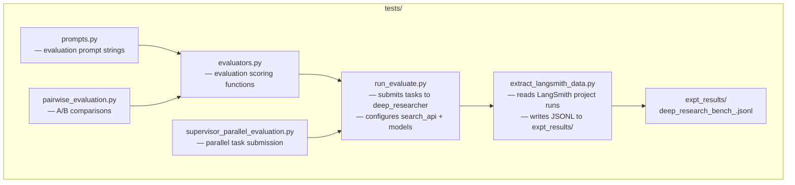
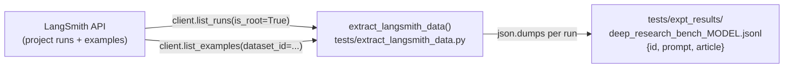
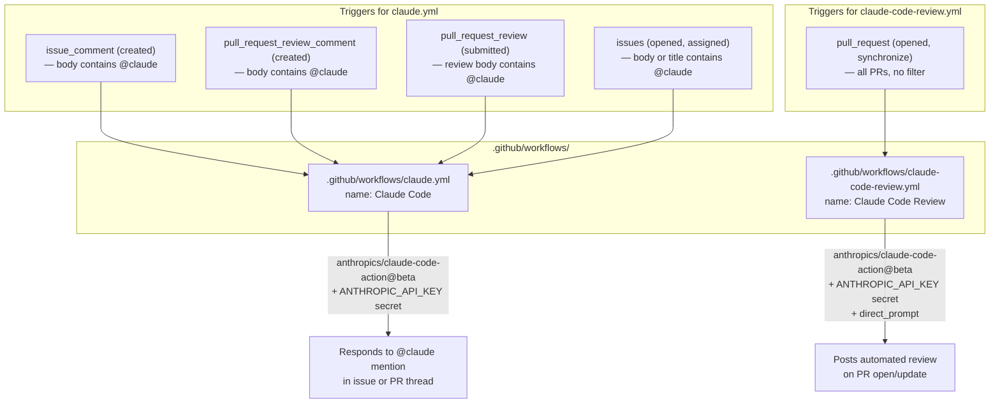

<!-- source: DeepWiki mcp.deepwiki.com · repo langchain-ai/open_deep_research · page 6.3 Testing and CI/CD · fetched 2026-10-26 -->

# Testing and CI/CD

<details>
<summary>Relevant source files</summary>

The following files were used as context for generating this wiki page:

- [.github/dependabot.yml](.github/dependabot.yml)
- [.github/workflows/claude-code-review.yml](.github/workflows/claude-code-review.yml)
- [.github/workflows/claude.yml](.github/workflows/claude.yml)
- [CLAUDE.md](CLAUDE.md)
- [tests/expt_results/deep_research_bench_gpt-4.1.jsonl](tests/expt_results/deep_research_bench_gpt-4.1.jsonl)
- [tests/extract_langsmith_data.py](tests/extract_langsmith_data.py)

</details>


This page covers the test suite layout, how to run evaluations locally, the GitHub Actions automation workflows, and dependency update configuration for the `open_deep_research` repository. For details on the *content* of the evaluation benchmarks and RACE scoring methodology, see [Evaluation System](#5.1) and [Performance Benchmarks and Results](#5.2).

---

## Test Suite Structure

The repository does not contain a traditional unit test suite. Correctness validation is performed through end-to-end evaluation runs against the LangSmith Deep Research Bench dataset. Code quality is enforced via linter and type checker invocations.

```
tests/
├── run_evaluate.py               # Batch evaluation runner against LangSmith dataset
├── extract_langsmith_data.py     # Extracts run outputs from LangSmith into JSONL
├── evaluators.py                 # Specialized evaluation functions
├── prompts.py                    # Evaluation prompt templates
├── pairwise_evaluation.py        # Comparative (A/B) evaluation tools
├── supervisor_parallel_evaluation.py  # Multi-threaded evaluation runner
└── expt_results/
    └── deep_research_bench_<model>.jsonl  # Stored benchmark outputs
```

**Diagram: Test Artifacts and Their Roles**



Sources: [CLAUDE.md:35-44](), [tests/extract_langsmith_data.py:1-83]()

---

## Running Evaluations Locally

### Batch Evaluation

The primary evaluation entry point is `tests/run_evaluate.py`. It submits all tasks from the LangSmith `deep_research_bench` dataset to the compiled `deep_researcher` graph and logs results to a named LangSmith project.

```bash
python tests/run_evaluate.py
```

Required environment variables: `LANGSMITH_API_KEY`, plus at least one LLM provider key and a search API key (see [Dependencies and Environment Setup](#6.1)).

### Extracting Results

After a run completes, `tests/extract_langsmith_data.py` pulls outputs from LangSmith and serializes them to JSONL for external scoring:

```bash
python tests/extract_langsmith_data.py \
  --project-name <langsmith-project-name> \
  --model-name <label-for-filename> \
  --dataset-name deep_research_bench
```

| Argument | Required | Description |
|---|---|---|
| `--project-name` | Yes | LangSmith project containing the evaluation run |
| `--model-name` | Yes | Label appended to the output filename |
| `--dataset-name` | Yes | Dataset name (typically `deep_research_bench`) |
| `--api-key` | No | Defaults to `LANGSMITH_API_KEY` env var |

Output is written to `tests/expt_results/{dataset_name}_{model_name}.jsonl`. Each line is a JSON object with fields `id`, `prompt`, and `article`.

**Diagram: extract_langsmith_data.py Data Flow**



Sources: [tests/extract_langsmith_data.py:13-58]()

### Code Quality Checks

Two tools are used locally for code quality, as noted in `CLAUDE.md`:

| Tool | Command | Purpose |
|---|---|---|
| `ruff` | `ruff check` | Linting (style, imports, common errors) |
| `mypy` | `mypy` | Static type checking |

Both are configured via `pyproject.toml` (see [Project Configuration and Build System](#6.2)).

Sources: [CLAUDE.md:55-57]()

---

## GitHub Actions CI/CD

The repository has two GitHub Actions workflows, both powered by the `anthropics/claude-code-action@beta` action. There are no traditional CI workflows (no build, lint, or test jobs run on push).

**Diagram: GitHub Actions Workflows and Triggers**



Sources: [.github/workflows/claude.yml:1-65](), [.github/workflows/claude-code-review.yml:1-79]()

### Claude Code (On-Demand Assistance)

**File:** [.github/workflows/claude.yml:1-65]()

This workflow enables any repository participant to invoke Claude directly in GitHub issues or pull requests by mentioning `@claude`.

| Property | Value |
|---|---|
| Workflow name | `Claude Code` |
| Action | `anthropics/claude-code-action@beta` |
| Default model | Claude Sonnet 4 (configurable via `model` input) |
| Trigger phrase | `@claude` (default, configurable) |
| Secret required | `ANTHROPIC_API_KEY` |

**Permissions granted to the job:**

| Permission | Level | Purpose |
|---|---|---|
| `contents` | `read` | Read repository files |
| `pull-requests` | `read` | Read PR context |
| `issues` | `read` | Read issue context |
| `id-token` | `write` | OIDC authentication |
| `actions` | `read` | Read CI results referenced in PR comments |

The `additional_permissions: actions: read` setting [.github/workflows/claude.yml:40-41]() allows Claude to read CI logs when responding to PR comments, enabling it to reference build failures or test output in its answers.

Sources: [.github/workflows/claude.yml:1-65]()

### Claude Code Review (Automatic PR Review)

**File:** [.github/workflows/claude-code-review.yml:1-79]()

This workflow fires automatically on every PR open or synchronize event and posts a structured code review comment.

| Property | Value |
|---|---|
| Workflow name | `Claude Code Review` |
| Action | `anthropics/claude-code-action@beta` |
| Default model | Claude Sonnet 4 |
| Trigger | All PRs (opened or updated) |
| Mode | `direct_prompt` (no `@claude` mention required) |

The `direct_prompt` instructs Claude to review for [.github/workflows/claude-code-review.yml:44-51]():

- Code quality and best practices
- Potential bugs or issues
- Performance considerations
- Security concerns
- Test coverage

The review is posted as a comment on the PR. The `use_sticky_comment` option (commented out in the config) would make Claude update a single comment on each subsequent push rather than posting a new one.

**Permissions granted to the job:**

| Permission | Level |
|---|---|
| `contents` | `read` |
| `pull-requests` | `read` |
| `issues` | `read` |
| `id-token` | `write` |

Sources: [.github/workflows/claude-code-review.yml:1-79]()

---

## Dependabot Configuration

**File:** [.github/dependabot.yml:1-17]()

Dependabot is configured to open weekly pull requests for outdated dependencies across two package ecosystems:

| Ecosystem | Directory | Schedule |
|---|---|---|
| `pip` | `/` (reads `pyproject.toml`) | Weekly |
| `github-actions` | `/` (reads workflow `.yml` files) | Weekly |

The `github-actions` ecosystem entry keeps the `anthropics/claude-code-action@beta` and `actions/checkout` action versions current without manual tracking.

> **Note:** The `dependabot.yml` file as written has two `updates` keys at the same level [.github/dependabot.yml:8-16](), which means only the second `updates` block (`github-actions`) is parsed. The `pip` block is effectively overridden. In practice, only GitHub Actions dependencies receive automated Dependabot PRs unless this is corrected.

Sources: [.github/dependabot.yml:1-17]()

---

## Summary

| Concern | Mechanism | File |
|---|---|---|
| Functional correctness | LangSmith evaluation runs | `tests/run_evaluate.py` |
| Result archival | JSONL export | `tests/extract_langsmith_data.py` |
| Code linting | `ruff check` (manual) | `pyproject.toml` |
| Type checking | `mypy` (manual) | `pyproject.toml` |
| Automated PR review | `claude-code-review.yml` | `.github/workflows/claude-code-review.yml` |
| On-demand AI assistance | `claude.yml` via `@claude` | `.github/workflows/claude.yml` |
| Dependency updates | Dependabot (weekly) | `.github/dependabot.yml` |