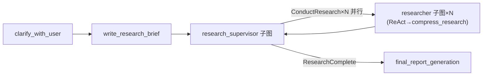

# 讲透 Open Deep Research（langchain-ai/open_deep_research）

> v0.0.16（pyproject.toml:3）｜41 文件｜图谱 194n/373e｜行号锚全部源码核实

## 一、定位

LangChain 官方（Lance Martin 主笔）的开源深度研究智能体：澄清→立简报→并行子研究→压缩→带引用长报告，deep research 类产品的 LangGraph 官方范式样本。Deep Research Bench 上 GPT-5 配置 RACE 0.4943、全默认 0.4309/$45.98/58M tokens（README.md:108-113）。取向**可配置而非全功能**：任意 init_chat_model 兼容模型、四选一搜索、MCP 工具，参数经 Studio/OAP UI 热调。

## 二、总体架构：三层嵌套图 + Python 层并行

文件头注释即架构图（deep_researcher.py:4-7）：

- **主图**（deep_researcher.py:737-755）：四节点直线+Command 跳转，`config_schema=Configuration`，编译产物即 langgraph.json:4 的唯一图。
- **监督者子图**（389-399 行）：supervisor↔supervisor_tools 循环，只绑 `[ConductResearch, ResearchComplete, think_tool]`（deep_researcher.py:238）——不搜索，只规划委派。
- **研究员子图**（625-641 行）：ReAct→压缩，`output=ResearcherOutputState` 只回传 compressed_research/raw_notes，屏蔽内部消息史。

**关键决策：并行在 Python 层不在 LangGraph 层。** supervisor_tools 把放行委派做成 `researcher_subgraph.ainvoke` 后 `asyncio.gather`（deep_researcher.py:331-341）；超发截断并回错误 ToolMessage 逼模型降并发（352-357 行）。legacy 用 `Send()` 派发是两代分水岭——gather 让子智能体数量成运行时变量，代价是失去节点级可视化。

## 三、核心模块

### deep_researcher.py（755 行，心脏）
- **单模型工厂**：`init_chat_model(configurable_fields=("model","max_tokens","api_key"))`（92-94 行），全角色按 config 现场实例化，换模型零改动。
- **人机协同**：clarify_with_user 结构化输出判断是否提问，`allow_clarification=False` 一行短路直入研究（111-113 行）。
- **简报即锚**：write_research_brief 把对话蒸馏成单条 research_brief（180 行）并以 override 重置 supervisor_messages（203-209 行）——监督者的世界观就是这份简报。
- **三层防失控**：监督者迭代上限 6（三终止条件，283-291 行）、并发单元上限 5（327-328 行）、单研究员工具轮次 `max_react_tool_calls=10`（528 行）。
- **压缩层**：compress_research 要求"逐字保留全部信息+编号引用"（prompts.py:208-238），重试 3 次，token 超限砍到上一条 AI 消息再试（605-606 行）。
- **报告 token 自救**：超限按模型上限×4 字符截断 findings，每轮再乘 0.9（711-718 行）。

### configuration.py（308 行）
四模型分工：summarization（gpt-4.1-mini）/research/compression/final_report（默认 gpt-4.1），各带 max_tokens（155-255 行）；字段全带 `x_oap_ui_config` 元数据渲染为 UI 控件。**取值优先级 env > UI**（from_runnable_config，298-301 行）——"改 UI 不生效"先查 env。并发 5/迭代 6/工具轮 10 默认值在 87-149 行。

### state.py（144 行）
`override_reducer`（80-85 行）：`{"type":"override"}` 整体覆盖、否则追加，一键两语义。`ConductResearch.research_topic` 要求"至少一段话高细节"（state.py:29-31）——子研究员彼此不可见，隔离靠提示词配套。

### utils.py（942 行，四族）
- **tavily_search**（57-149 行）：批量查询→URL 去重（84-89 行）→summarization 模型逐页结构化摘要（99-106 行）→SOURCE 分段；单页 60s 超时回退原文（210-213 行）。
- **think_tool**（237-261 行）：只回显"Reflection recorded"，价值在提示词强制搜索前后写四段反思（发现/缺口/质量/决策）。
- **MCP 全链**：Supabase 令牌 OAuth token-exchange 换 MCP 令牌（267-308 行）、store 缓存+过期删除（331-344 行）、streamable_http 白名单加载（466-541 行，513 行 TODO：单服务器待扩）、-32003 交互错误转 ToolException（445 行）。
- **token 判定**：按模型前缀路由三家 provider（682-718 行）+ `MODEL_TOKEN_LIMITS` 手工表（805-846 行）——新模型不补表，报告自救直接报错。
- **原生 websearch 探测**：服务器端搜索不产生 tool_calls，须靠 `usage.server_tool_use`（624-654 行）与 `tool_outputs`（656-675 行）识别，否则研究员被误判结束（deep_researcher.py:493-500）。

### security/auth.py（166 行）
Platform 多租户层：Supabase JWT 验证（34-81 行），threads/assistants 注入 owner、读取按 owner 过滤，store 命名空间首段强制等于用户身份（160-167 行）——MCP 令牌正按此存放，安全闭环。

### tests/（评估线）
run_evaluate.py 为 Bench 主入口：模块级硬编码实验配置（GPT-5+Tavily+并发 10，29-45 行），每用例全新 compile(MemorySaver)（50 行）；六维 LLM-as-judge（evaluators.py）；extract_langsmith_data.py 抽实验成提交榜 JSONL；supervisor_parallel_evaluation.py 专项查"并行串味"。

## 四、与 LangGraph 的关系

原生应用教科书：三层嵌套子图、`Command(goto=...)` 函数式路由、config_schema 把 Pydantic 透成运行时配置、MessagesState+自定义 reducer、interrupt 人审（legacy）、Platform 部署+auth 钩子（langgraph.json:11-13）。同时示范何时**绕开**框架：并行用 asyncio.gather 而非 Send()——"N 个同构研究员"是数据不是图结构。

## 五、三代演进（src/legacy 对照）

1. **graph.py（一代 plan-and-execute）**：搜背景→定大纲→interrupt 人审→Send() 并行各节（查询→搜索→撰写→自评反思环）→汇编。重控制、慢。
2. **multi_agent.py（二代）**：监督者可问用户/自搜/定结构，研究员按节并行写，支持 MCP；但监督者仍背负写作。
3. **现行版（三代）**：监督者退化为纯"委派+验收"，研究员自带完整工具箱，新增压缩层与四模型分工；搜索收敛到 Tavily+原生 websearch+MCP——legacy utils.py 1697 行十余家适配器全部留在过去。官方博客称 bitter lesson 式减法：更强模型+更薄脚手架。

## 六、使用建议与坑

- **上手**：`uv sync` 后 `uvx --from "langgraph-cli[inmem]" --with-editable . langgraph dev --allow-blocking`（README.md:47）；`.env` 配 `OPENAI_API_KEY`/`TAVILY_API_KEY`。
- **选型**：看 supervisor/worker+上下文压缩的最小干净实现，读 deep_researcher.py 一个文件够；要人审大纲/学术源检索抄 legacy graph.py；评估自己的研究 agent 复用 tests/evaluators.py。
- **坑 1（源码实证）**：supervisor_tools 写了 `if is_token_limit_exceeded(...) or True:`（deep_researcher.py:370）——恒真，token 判定是死代码；任何并行异常都终止研究阶段、靠已有 notes 出报告。行为是优雅降级，排障别被字面误导。
- **坑 2**：env 覆盖 UI（configuration.py:298-301）；`GET_API_KEYS_FROM_CONFIG=true` 走 config 注入托管键（utils.py:909-931）。
- **坑 3**：换新模型先补 MODEL_TOKEN_LIMITS（utils.py:805）并确认支持 structured output+tool calling（README.md:71）。
- **坑 4**：并发 5 是性价比点，10 已有 rate limit 风险（configuration.py:96）；全量基准 $20-100/轮（README.md:89）。

📌 **一句话**：监督者出题、研究员并行做题、压缩层防上下文爆炸、报告层兜底 token——这四件套是本仓留给后续 deep research 产品的可复用骨架。
