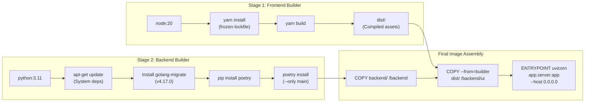
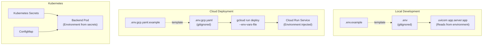
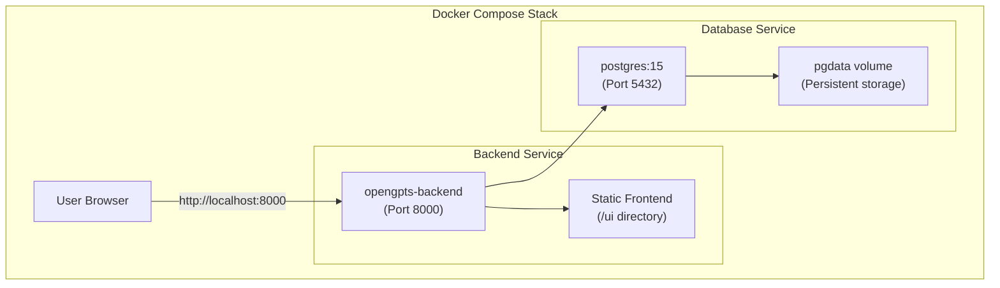
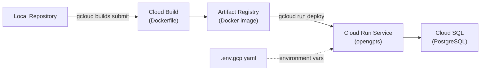
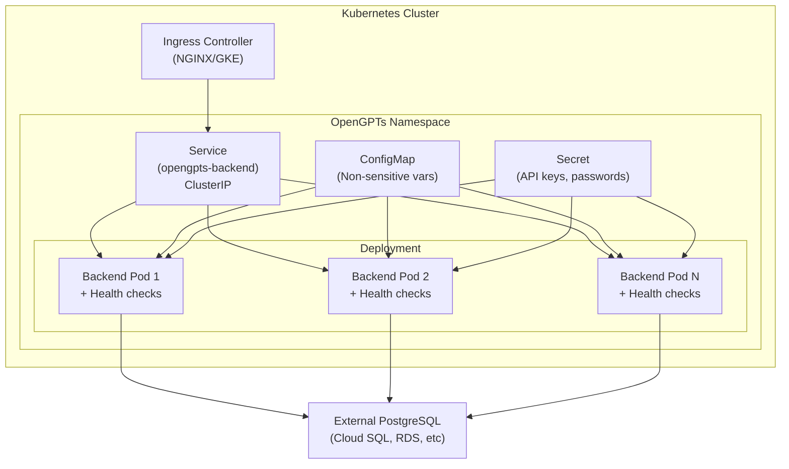

<!-- source: DeepWiki mcp.deepwiki.com · repo langchain-ai/opengpts · page 1.2 Deployment and Configuration · fetched 2026-10-26 -->

# Deployment and Configuration

<details>
<summary>Relevant source files</summary>

The following files were used as context for generating this wiki page:

- [.env.example](.env.example)
- [.env.gcp.yaml.example](.env.gcp.yaml.example)
- [Dockerfile](Dockerfile)
- [backend/Dockerfile](backend/Dockerfile)
- [backend/Makefile](backend/Makefile)

</details>


## Purpose and Scope

This document covers the deployment and configuration infrastructure for OpenGPTs, including Docker containerization, environment variable management, database setup, and deployment to various platforms. It focuses on the technical mechanics of getting the application running in different environments, from local development to cloud production.

For information about the runtime API endpoints and backend server configuration, see [API Endpoints](#2.5). For database schema and state management details, see [Storage and State Management](#2.3).

---

## Deployment Modes Overview

OpenGPTs supports three primary deployment modes, each optimized for different use cases:

```mermaid
graph TB
    subgraph "Mode 1: Local Development"
        DevMake["make start<br/>(Port 8100)"]
        DevFE["npm run dev<br/>(Port 5173)"]
        DevDB["PostgreSQL<br/>(Local/Docker)"]
        
        DevMake --> DevDB
        DevFE -.proxy to.-> DevMake
    end
    
    subgraph "Mode 2: Docker Compose"
        Compose["docker-compose up"]
        ComposeBackend["Backend Container<br/>(Port 8000)"]
        ComposeFE["Compiled Frontend<br/>(Served from /ui)"]
        ComposeDB["PostgreSQL Container<br/>(Port 5432)"]
        
        Compose --> ComposeBackend
        Compose --> ComposeDB
        ComposeBackend --> ComposeFE
        ComposeBackend --> ComposeDB
    end
    
    subgraph "Mode 3: Production Cloud"
        CloudImage["Multi-stage<br/>Docker Build"]
        K8s["Kubernetes<br/>(Helm Chart)"]
        CloudRun["Google Cloud Run<br/>(Serverless)"]
        ExtDB["External PostgreSQL<br/>(Cloud SQL, RDS, etc)"]
        
        CloudImage --> K8s
        CloudImage --> CloudRun
        K8s --> ExtDB
        CloudRun --> ExtDB
    end
    
    style DevMake fill:#f9f9f9
    style ComposeBackend fill:#f9f9f9
    style CloudImage fill:#f9f9f9
```



**Deployment Mode Comparison**

| Mode | Use Case | Frontend | Backend | Database | Ports |
|------|----------|----------|---------|----------|-------|
| Local Dev | Development with hot reload | Separate Vite server | Poetry + uvicorn | Local PostgreSQL | FE: 5173, BE: 8100 |
| Docker Compose | Local testing, demos | Compiled into backend | Single container | Docker container | Exposed: 8000, 5432 |
| Production Cloud | Scalable deployment | Compiled into backend | Multi-replica | External managed | Load balancer → 8000 |

**Sources:** [Dockerfile:1-49](), [backend/Dockerfile:1-33](), [backend/Makefile:16-20]()

---

## Multi-Stage Docker Build

The production Dockerfile uses a multi-stage build to optimize image size and separate frontend and backend compilation:



### Stage 1: Frontend Compilation

The frontend build stage uses Node.js 20 to compile the React application:

**Key Steps:**
1. **Dependency Installation**: `yarn install --frozen-lockfile --network-timeout 600000` ensures reproducible builds [Dockerfile:7]()
2. **Environment Cleanup**: Removes `.env` file to prevent accidental inclusion of secrets [Dockerfile:11]()
3. **Production Build**: `yarn build` generates optimized static assets in `dist/` [Dockerfile:13]()

### Stage 2: Backend Setup

The backend stage installs system dependencies and Python packages:

**Key Components:**
- **Base Image**: `python:3.11` provides the runtime environment [Dockerfile:16]()
- **Multi-architecture Support**: Uses `TARGETOS`, `TARGETARCH`, `TARGETVARIANT` build args for cross-platform builds [Dockerfile:18-20]()
- **Migration Tool**: Installs `golang-migrate` v4.17.0 for database schema management [Dockerfile:24-26]()
- **Poetry Configuration**: Disables virtualenv creation and installs only production dependencies (`--only main`) [Dockerfile:39-40]()

### Final Image Assembly

The final image copies both frontend and backend, serving the frontend from the backend:

**File Structure:**
```
/backend/
├── app/
│   └── server.py          # FastAPI application
├── ui/                     # Frontend static assets (from Stage 1)
│   ├── index.html
│   └── assets/
├── migrations/             # Database migration files
└── log_config.json         # Uvicorn logging configuration
```

**Entrypoint:** `uvicorn app.server:app --host 0.0.0.0 --log-config log_config.json` [Dockerfile:48]()

**Sources:** [Dockerfile:1-49]()

---

## Backend-Only Docker Build

The `backend/Dockerfile` provides an alternative build for development and Kubernetes deployments that require health checks:

**Key Differences from Multi-Stage Build:**

| Feature | Multi-Stage Dockerfile | Backend-Only Dockerfile |
|---------|----------------------|------------------------|
| Frontend | Compiled and included | Not included (expects external build) |
| Dependencies | Production only (`--only main`) | All dependencies including dev [backend/Dockerfile:24-25]() |
| Health Check | None | Configured with curl [backend/Dockerfile:30]() |
| Use Case | Cloud Run, standalone deployment | Kubernetes, development |

**Health Check Configuration:**
```dockerfile
HEALTHCHECK --interval=30s --timeout=5s --start-period=10s --start-interval=1s --retries=3 \
  CMD [ "curl", "-f", "http://localhost:8000/health" ]
```

This probes the `/health` endpoint every 30 seconds, allowing Kubernetes to detect and restart unhealthy pods.

**Sources:** [backend/Dockerfile:1-33]()

---

## Environment Configuration

OpenGPTs uses environment variables for all configuration. Two template files document the required variables:

### Configuration Files



### Environment Variables Reference

**LLM Provider Configuration**

| Variable | Purpose | Required | Example |
|----------|---------|----------|---------|
| `OPENAI_API_KEY` | OpenAI API authentication | For GPT models | `sk-...` |
| `ANTHROPIC_API_KEY` | Anthropic API authentication | For Claude models | `sk-ant-...` |
| `AZURE_OPENAI_DEPLOYMENT_NAME` | Azure OpenAI deployment identifier | For Azure OpenAI | `gpt-4-deployment` |
| `AZURE_OPENAI_API_KEY` | Azure OpenAI authentication | For Azure OpenAI | `...` |
| `AZURE_OPENAI_API_BASE` | Azure OpenAI endpoint URL | For Azure OpenAI | `https://your-resource.openai.azure.com/` |
| `AZURE_OPENAI_API_VERSION` | Azure OpenAI API version | For Azure OpenAI | `2023-05-15` |
| `AZURE_OPENAI_EMBEDDINGS_DEPLOYMENT_NAME` | Embeddings model deployment | For Azure embeddings | `text-embedding-ada-002` |
| `FIREWORKS_API_KEY` | Fireworks.ai API key | For Mixtral models | `...` |
| `AWS_ACCESS_KEY_ID` | AWS credentials for Bedrock | For Bedrock models | `AKIA...` |
| `AWS_SECRET_ACCESS_KEY` | AWS secret key for Bedrock | For Bedrock models | `...` |

**Tool and Service Configuration**

| Variable | Purpose | Required | Example |
|----------|---------|----------|---------|
| `TAVILY_API_KEY` | Tavily search API | For Tavily search tool | `tvly-...` |
| `YDC_API_KEY` | You.com API key | For You.com search tool | `...` |
| `KAY_API_KEY` | Kay.ai API authentication | For SEC filings tool | `...` |
| `CONNERY_RUNNER_URL` | Connery runner endpoint | For Connery actions | `https://your-runner-url` |
| `CONNERY_RUNNER_API_KEY` | Connery authentication | For Connery actions | `...` |
| `PROXY_URL` | HTTP proxy for outbound requests | Optional | `http://proxy:8080` |

**Database Configuration**

| Variable | Purpose | Required | Example |
|----------|---------|----------|---------|
| `POSTGRES_HOST` | PostgreSQL hostname | Yes | `localhost` or `your-db.region.rds.amazonaws.com` |
| `POSTGRES_PORT` | PostgreSQL port | Yes | `5432` |
| `POSTGRES_DB` | Database name | Yes | `opengpts` |
| `POSTGRES_USER` | Database username | Yes | `postgres` |
| `POSTGRES_PASSWORD` | Database password | Yes | `secure_password` |

**Observability Configuration**

| Variable | Purpose | Required | Example |
|----------|---------|----------|---------|
| `LANGCHAIN_TRACING_V2` | Enable LangSmith tracing | Optional | `true` |
| `LANGCHAIN_PROJECT` | LangSmith project name | Optional | `opengpts-production` |
| `LANGCHAIN_API_KEY` | LangSmith API key | Optional | `ls__...` |
| `SCARF_NO_ANALYTICS` | Disable Scarf telemetry | Optional | `true` |

**Sources:** [.env.example:1-17](), [.env.gcp.yaml.example:1-20]()

---

## Local Development Setup

For local development with hot reload capabilities:

### Prerequisites

1. **PostgreSQL Database**: Install locally or run via Docker:
   ```bash
   docker run -d --name opengpts-postgres \
     -e POSTGRES_DB=opengpts \
     -e POSTGRES_USER=postgres \
     -e POSTGRES_PASSWORD=password \
     -p 5432:5432 \
     postgres:15
   ```

2. **Environment Configuration**: Copy and populate `.env.example`:
   ```bash
   cp .env.example .env
   # Edit .env with your API keys and database credentials
   ```

3. **Python Dependencies**: Install via Poetry in the backend directory:
   ```bash
   cd backend
   poetry install
   ```

4. **Frontend Dependencies**: Install via Yarn in the frontend directory:
   ```bash
   cd frontend
   yarn install
   ```

### Starting the Development Servers

**Backend (Port 8100):**
```bash
cd backend
make start
```

This executes: `poetry run uvicorn app.server:app --reload --port 8100 --log-config log_config.json` [backend/Makefile:17]()

**Frontend (Port 5173):**
```bash
cd frontend
yarn dev
```

The frontend development server proxies API requests to `http://localhost:8100`, enabling hot module replacement while maintaining backend connectivity.

**Port Convention Note:** Development uses port 8100 instead of 8000 to avoid conflicts with other services commonly running on port 8000. Production deployments use port 8000.

**Sources:** [backend/Makefile:16-17]()

---

## Database Migrations

OpenGPTs uses `golang-migrate` for schema versioning and migrations.

### Migration Execution

**Programmatic Migration (Recommended):**
The migration occurs automatically when the backend starts, using the embedded migration files in `backend/migrations/`.

**Manual Migration via Makefile:**
```bash
cd backend
make migrate
```

This executes the migration command with environment variables [backend/Makefile:19-20]():
```bash
migrate -database postgres://$(POSTGRES_USER):$(POSTGRES_PASSWORD)@$(POSTGRES_HOST):$(POSTGRES_PORT)/$(POSTGRES_DB)?sslmode=disable \
  -path ./migrations up
```

### Migration Tool Installation

The migration tool is installed during Docker image builds [Dockerfile:24-26]():
```dockerfile
RUN wget -O golang-migrate.deb \
  https://github.com/golang-migrate/migrate/releases/download/v4.17.0/migrate.${TARGETOS}-${TARGETARCH}${TARGETVARIANT}.deb \
  && dpkg -i golang-migrate.deb \
  && rm golang-migrate.deb
```

**Multi-Architecture Support:** The installation URL uses build arguments (`TARGETOS`, `TARGETARCH`, `TARGETVARIANT`) to download the correct binary for ARM64, AMD64, and other architectures.

### Migration Files Structure

Migration files are stored in `backend/migrations/` with paired up/down versions:
```
migrations/
├── 000001_initial.up.sql
├── 000001_initial.down.sql
├── 000002_add_checkpoints.up.sql
├── 000002_add_checkpoints.down.sql
└── ...
```

For details on the database schema created by these migrations, see [Storage and State Management](#2.3).

**Sources:** [backend/Makefile:19-20](), [Dockerfile:24-26](), [backend/Dockerfile:10-12]()

---

## Docker Compose Deployment

For local testing or single-machine deployments, Docker Compose provides a complete stack:

### Service Architecture



### Starting the Stack

```bash
docker-compose up -d
```

This starts:
1. **PostgreSQL container** with persistent volume
2. **Backend container** built from the multi-stage Dockerfile
3. **Networking** between containers via Docker bridge

### Accessing the Application

- **Web Interface**: `http://localhost:8000`
- **API Documentation**: `http://localhost:8000/docs`
- **Health Check**: `http://localhost:8000/health`
- **PostgreSQL**: `localhost:5432` (for database clients)

### Building the Frontend

Before running Docker Compose, build the frontend if not already done:

```bash
cd backend
make build_ui
```

This executes [backend/Makefile:6-7]():
```bash
cd ../frontend && yarn build && cp -r dist/* ../backend/ui
```

**Sources:** [backend/Makefile:6-7]()

---

## Google Cloud Run Deployment

Cloud Run provides serverless, auto-scaling deployment for OpenGPTs:

### Deployment Flow



### Deployment Command

```bash
gcloud run deploy opengpts \
  --source . \
  --region us-central1 \
  --env-vars-file .env.gcp.yaml \
  --allow-unauthenticated \
  --max-instances 10 \
  --memory 2Gi \
  --cpu 2 \
  --timeout 300
```

**Configuration Options:**
- **`--source .`**: Builds from the current directory using the root Dockerfile
- **`--env-vars-file .env.gcp.yaml`**: Injects environment variables from YAML file [.env.gcp.yaml.example:1-20]()
- **`--max-instances 10`**: Limits concurrent instances for cost control
- **`--memory 2Gi`**: Allocates sufficient memory for LLM operations
- **`--timeout 300`**: Allows up to 5 minutes for long-running agent executions

### Cloud SQL Connection

For managed PostgreSQL, configure Cloud SQL Proxy or direct VPC connection:

**Environment Variables:**
```yaml
POSTGRES_HOST: /cloudsql/project:region:instance  # Unix socket path
POSTGRES_PORT: 5432
POSTGRES_DB: opengpts
POSTGRES_USER: postgres
POSTGRES_PASSWORD: stored_in_secret_manager
```

**Cloud Run Service Configuration:**
- Add `--add-cloudsql-instances=project:region:instance` to the deploy command
- Ensure the Cloud Run service account has `cloudsql.client` role

**Sources:** [.env.gcp.yaml.example:15-19]()

---

## Kubernetes Deployment

For production environments requiring high availability and control:

### Helm Chart Structure

OpenGPTs provides a Helm chart for Kubernetes deployment in `helm/open-gpts/`:

```
helm/open-gpts/
├── Chart.yaml                 # Chart metadata
├── values.yaml                # Default configuration
├── templates/
│   ├── deployment.yaml        # Backend pods
│   ├── service.yaml           # ClusterIP service
│   ├── ingress.yaml           # HTTP(S) routing
│   ├── configmap.yaml         # Non-sensitive config
│   └── secrets.yaml           # Sensitive credentials
```

### Deployment Architecture



### Installing the Helm Chart

```bash
# Add Helm repository (if published)
helm repo add opengpts https://charts.opengpts.example.com
helm repo update

# Install with custom values
helm install opengpts opengpts/open-gpts \
  --namespace opengpts \
  --create-namespace \
  --values custom-values.yaml
```

### Values Configuration Example

```yaml
# custom-values.yaml
replicaCount: 3

image:
  repository: gcr.io/your-project/opengpts
  tag: "latest"
  pullPolicy: IfNotPresent

service:
  type: ClusterIP
  port: 8000

ingress:
  enabled: true
  className: nginx
  hosts:
    - host: opengpts.example.com
      paths:
        - path: /
          pathType: Prefix
  tls:
    - secretName: opengpts-tls
      hosts:
        - opengpts.example.com

env:
  POSTGRES_HOST: "postgres.database.svc.cluster.local"
  POSTGRES_PORT: "5432"
  POSTGRES_DB: "opengpts"
  LANGCHAIN_TRACING_V2: "true"
  LANGCHAIN_PROJECT: "opengpts-production"

secrets:
  OPENAI_API_KEY: "sk-..."
  ANTHROPIC_API_KEY: "sk-ant-..."
  POSTGRES_PASSWORD: "secure_password"
  LANGCHAIN_API_KEY: "ls__..."

resources:
  requests:
    memory: "1Gi"
    cpu: "500m"
  limits:
    memory: "2Gi"
    cpu: "2000m"

livenessProbe:
  httpGet:
    path: /health
    port: 8000
  initialDelaySeconds: 30
  periodSeconds: 10

readinessProbe:
  httpGet:
    path: /health
    port: 8000
  initialDelaySeconds: 10
  periodSeconds: 5
```

### Health Checks Configuration

The backend Dockerfile includes a health check endpoint [backend/Dockerfile:30]():

**Liveness Probe:** Restarts the pod if `/health` fails for 3 consecutive checks
**Readiness Probe:** Removes pod from service endpoints if `/health` fails

This ensures traffic is only routed to healthy pods and failed pods are automatically recovered.

**Sources:** [backend/Dockerfile:30]()

---

## Configuration Best Practices

### Security Recommendations

1. **Never commit `.env` or `.env.gcp.yaml` files**: These are `.gitignored` to prevent accidental credential exposure
2. **Use secret management systems**: 
   - Google Cloud: Secret Manager
   - AWS: Secrets Manager or Parameter Store
   - Kubernetes: Sealed Secrets or External Secrets Operator
3. **Rotate API keys regularly**: Especially for LLM providers with high usage costs
4. **Enable LANGCHAIN_TRACING_V2**: Helps debug agent execution and detect security issues

### Performance Optimization

1. **Database Connection Pooling**: Configure `asyncpg` pool size based on expected concurrency
2. **Memory Allocation**: Allocate at least 2Gi for LLM operations, especially with embeddings
3. **CPU Limits**: Set realistic CPU limits to prevent throttling during agent execution
4. **Persistent Volumes**: Use SSD-backed storage for PostgreSQL to improve checkpoint read/write performance

### Monitoring and Observability

1. **LangSmith Integration**: Configure `LANGCHAIN_TRACING_V2=true` for execution traces [.env.gcp.yaml.example:2-4]()
2. **Health Checks**: Ensure `/health` endpoint is monitored by load balancers
3. **Logging**: The `log_config.json` file configures structured logging for uvicorn [Dockerfile:48]()
4. **Metrics**: Consider adding Prometheus exporters for custom agent metrics

**Sources:** [.env.gcp.yaml.example:2-4](), [Dockerfile:48]()

---

## Troubleshooting

### Common Issues

**Issue: "ConnectionRefusedError: [Errno 111] Connect call failed"**
- **Cause**: Backend cannot reach PostgreSQL
- **Solution**: Verify `POSTGRES_HOST`, `POSTGRES_PORT`, and database is running
- **Docker Compose**: Ensure services are on the same network

**Issue: "ImportError: cannot import name 'ConfigurableAgent'"**
- **Cause**: Poetry dependencies not installed
- **Solution**: Run `poetry install` in `backend/` directory

**Issue: Frontend shows blank page after Docker build**
- **Cause**: Frontend not copied to `/backend/ui`
- **Solution**: Verify multi-stage build completed and `COPY --from=builder` succeeded [Dockerfile:46]()

**Issue: "migrate: no such file or directory"**
- **Cause**: golang-migrate not installed in Docker image
- **Solution**: Check Dockerfile includes migration tool installation [Dockerfile:24-26]()

**Issue: Health check failing in Kubernetes**
- **Cause**: Pod not fully initialized before first probe
- **Solution**: Increase `initialDelaySeconds` in liveness/readiness probe configuration [backend/Dockerfile:30]()

### Port Conflicts

If port 8100 (development) or 8000 (production) are in use:

**Development:**
```bash
poetry run uvicorn app.server:app --reload --port 8200 --log-config log_config.json
```

**Docker Override:**
```bash
docker-compose up -d -p 8888:8000
```

**Sources:** [Dockerfile:24-26](), [Dockerfile:46](), [backend/Dockerfile:30]()

---

