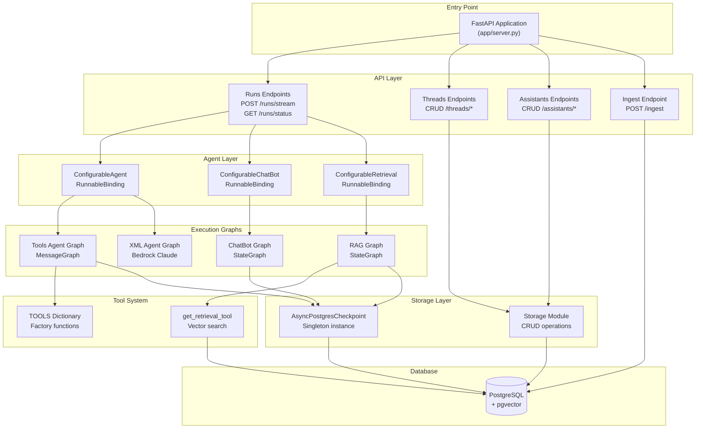
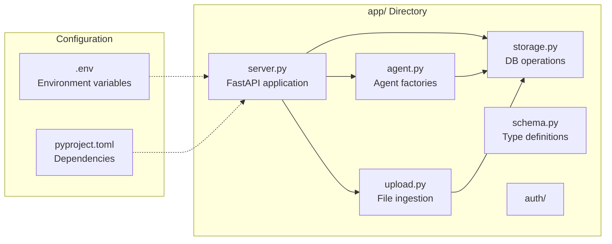
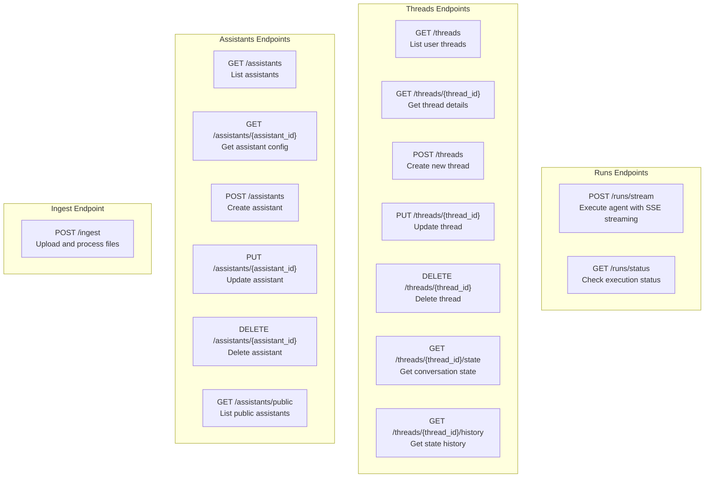
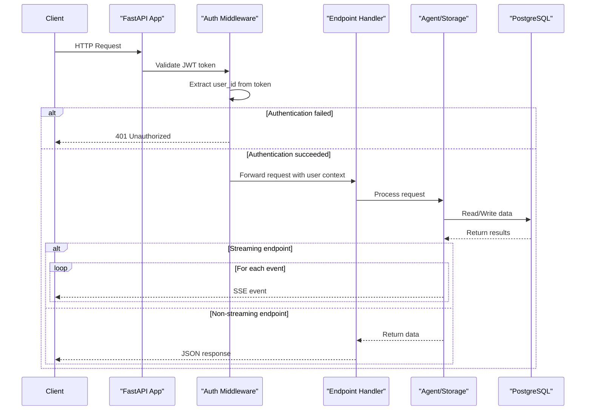
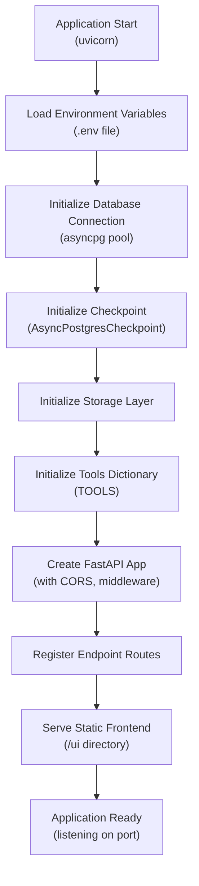

<!-- source: DeepWiki mcp.deepwiki.com · repo langchain-ai/opengpts · page 2 Backend System · fetched 2026-10-26 -->

# Backend System

Relevant source files

The following files were used as context for generating this wiki page:

- [backend/poetry.lock](backend/poetry.lock)
- [backend/pyproject.toml](backend/pyproject.toml)

The Backend System implements the core server-side logic for OpenGPTs using Python, FastAPI, and the LangChain ecosystem. This page provides an overview of the backend architecture, technology stack, application structure, and module organization. For detailed information on specific subsystems, see [Agent System](#2.1), [Cognitive Architectures](#2.2), [Storage and State Management](#2.3), [File Upload and Vector Storage](#2.4), [API Endpoints](#2.5), and [Streaming System](#2.6).

## Technology Stack

The backend is built on the following core technologies:

| Technology | Version | Purpose |
|------------|---------|---------|
| Python | 3.9.0 - 3.11.x | Core runtime environment |
| Poetry | 1.8.3+ | Dependency management and packaging |
| FastAPI | 0.103.2+ | Web framework for API endpoints |
| LangChain | 0.3.x | LLM application framework |
| LangGraph | 0.2.45 | State machine orchestration for agents |
| LangServe | (via LangChain) | Serving LangChain/LangGraph runnables as REST/SSE endpoints |
| asyncpg | 0.29.0+ | Async PostgreSQL driver |
| PostgreSQL + pgvector | - | Persistence and vector storage |

**Sources:** [backend/pyproject.toml:1-89]()

## Dependency Management

Dependencies are managed through Poetry, with the main configuration in `pyproject.toml`. The lockfile `poetry.lock` ensures reproducible builds across environments.

**Key dependency categories:**

- **LLM Providers**: `langchain-openai`, `langchain-anthropic`, `langchain-google-vertexai`, `fireworks-ai`, boto3 (for Bedrock)
- **Tools**: `duckduckgo-search`, `arxiv`, `wikipedia`, `kay` (for SEC filings)
- **Storage**: `asyncpg`, `psycopg2-binary`, `pgvector`, `langgraph-checkpoint-postgres`
- **Document Processing**: `beautifulsoup4`, `pdfminer-six`, `unstructured`, `python-multipart`
- **API Infrastructure**: `fastapi`, `uvicorn`, `sse-starlette`, `httpx`
- **Authentication**: `pyjwt` with crypto extras

**Sources:** [backend/pyproject.toml:9-47]()

## Application Architecture

**Core Application Flow:**

1. **Request Ingestion**: FastAPI receives HTTP requests at defined endpoints
2. **Routing**: Requests are routed to appropriate endpoint handlers based on path and method
3. **Agent Selection**: For execution requests, the appropriate agent type (ConfigurableAgent/ChatBot/Retrieval) is selected based on configuration
4. **Graph Execution**: The selected factory instantiates and executes the appropriate LangGraph execution graph
5. **Streaming**: Results are streamed back to the client via Server-Sent Events (SSE)
6. **State Persistence**: All graph state is persisted to PostgreSQL via AsyncPostgresCheckpoint

**Sources:** High-level architecture diagrams (Diagram 1, Diagram 2)

## Core Modules

### Module Structure

**Sources:** Inferred from high-level architecture and typical FastAPI application structure

### Key Responsibilities by Module

| Module | Primary Responsibilities | Key Classes/Functions |
|--------|-------------------------|----------------------|
| `agent.py` | Agent factory definitions, LLM configuration, tool binding | `ConfigurableAgent`, `ConfigurableChatBot`, `ConfigurableRetrieval`, `AgentType`, `LLMType` |
| `storage.py` | CRUD operations for assistants and threads, checkpoint management | `Storage` class, CRUD functions |
| `upload.py` | File upload handling, MIME detection, document parsing, embedding generation | File processing pipeline functions |
| `server.py` | FastAPI application, endpoint definitions, CORS, authentication | FastAPI app instance, endpoint decorators |
| `schema.py` | Pydantic models for request/response validation | `Assistant`, `Thread`, configuration schemas |

**Sources:** High-level architecture diagrams (Diagram 2, Diagram 5)

## FastAPI Application Structure

### Endpoint Organization

The application exposes four primary endpoint groups:

**Sources:** High-level architecture diagrams (Diagram 1, Diagram 3)

### Request Flow

**Key flow characteristics:**

1. **Authentication**: JWT tokens are validated on each request, extracting `user_id` from the token claims
2. **User Isolation**: Database queries are scoped by `user_id` to ensure data isolation
3. **Streaming**: `/runs/stream` uses Server-Sent Events (SSE) for real-time response streaming
4. **Error Handling**: FastAPI exception handlers provide structured error responses

**Sources:** High-level architecture diagrams (Diagram 3), inferred from authentication patterns

## Configuration and Environment

### Environment Variables

The application is configured through environment variables, typically stored in a `.env` file:

| Variable Category | Example Variables | Purpose |
|------------------|-------------------|---------|
| Database | `POSTGRES_URI`, `CHECKPOINT_POSTGRES_URI` | PostgreSQL connection strings |
| LLM API Keys | `OPENAI_API_KEY`, `ANTHROPIC_API_KEY`, `GOOGLE_API_KEY` | LLM provider authentication |
| Tool API Keys | `TAVILY_API_KEY`, `KAY_API_KEY` | Tool service authentication |
| Authentication | `JWT_SECRET`, `AUTH_TYPE` | JWT signing and auth configuration |
| Observability | `LANGSMITH_API_KEY`, `LANGSMITH_TRACING` | LangSmith tracing configuration |
| Server | `PORT`, `HOST`, `CORS_ORIGINS` | Server binding and CORS |

### Configuration Pattern

The application follows a configurable fields pattern where:

1. **Configuration Objects**: Pydantic models define valid configurations for agents, assistants, and threads
2. **Dynamic LLM Selection**: LLM providers are selected at runtime based on `LLMType` enum values
3. **Tool Selection**: Tools are selected from the `TOOLS` dictionary based on configuration
4. **Checkpointing**: All agents share a singleton `AsyncPostgresCheckpoint` instance for state persistence

**Sources:** High-level architecture diagrams, [backend/pyproject.toml:44]() for JWT crypto dependency

## Server Initialization

### Startup Sequence

**Startup responsibilities:**

1. **Environment Loading**: Read configuration from environment variables
2. **Database Pool**: Create async connection pool to PostgreSQL
3. **Checkpoint Singleton**: Initialize shared checkpoint instance for LangGraph state persistence
4. **Storage Layer**: Set up CRUD operations with database pool
5. **Tools Registry**: Build dictionary of available tools with their factory functions
6. **FastAPI App**: Create application with middleware (CORS, authentication, logging)
7. **Route Registration**: Mount all endpoint handlers
8. **Static Frontend**: Serve compiled React frontend from `/ui` directory

**Sources:** High-level architecture diagrams (Diagram 1, Diagram 7)

## Key Design Patterns

### Factory Pattern for Agents

The backend uses `RunnableBinding` from LangChain to create configurable agent factories:

- **ConfigurableAgent**: Binds tool-enabled agents with configurable LLM and tool selection
- **ConfigurableChatBot**: Binds simple conversational agents
- **ConfigurableRetrieval**: Binds RAG agents with document retrieval

These factories allow runtime selection of LLM providers, tools, and parameters without code changes.

### Singleton Pattern for Checkpointing

A single `AsyncPostgresCheckpoint` instance is shared across all agent executions to:
- Ensure consistent state serialization
- Pool database connections efficiently
- Maintain schema compatibility

### Streaming Pattern

Server-Sent Events (SSE) streaming is used for agent execution to:
- Provide real-time feedback to users
- Stream partial results as they're generated
- Enable human-in-the-loop workflows with interrupts

**Sources:** High-level architecture diagrams (Diagram 2, Diagram 3, Diagram 6)

## Extension Points

The backend is designed to be extensible at several layers:

1. **New LLM Providers**: Add entries to `LLMType` enum and corresponding initialization logic
2. **New Tools**: Add factory functions to `TOOLS` dictionary
3. **New Agent Types**: Implement new `AgentType` variants with corresponding graph definitions
4. **Custom Endpoints**: Add new FastAPI route handlers
5. **Custom Authentication**: Replace JWT middleware with alternative auth schemes

For detailed information on extending specific subsystems, refer to the relevant sub-sections: [Agent System](#2.1), [Cognitive Architectures](#2.2), [Storage and State Management](#2.3), [File Upload and Vector Storage](#2.4), [API Endpoints](#2.5), [Streaming System](#2.6).

**Sources:** High-level architecture diagrams (Diagram 2, Diagram 6)

---

