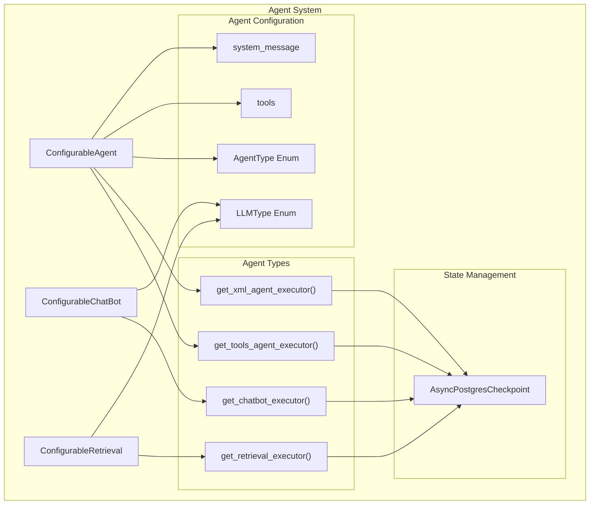
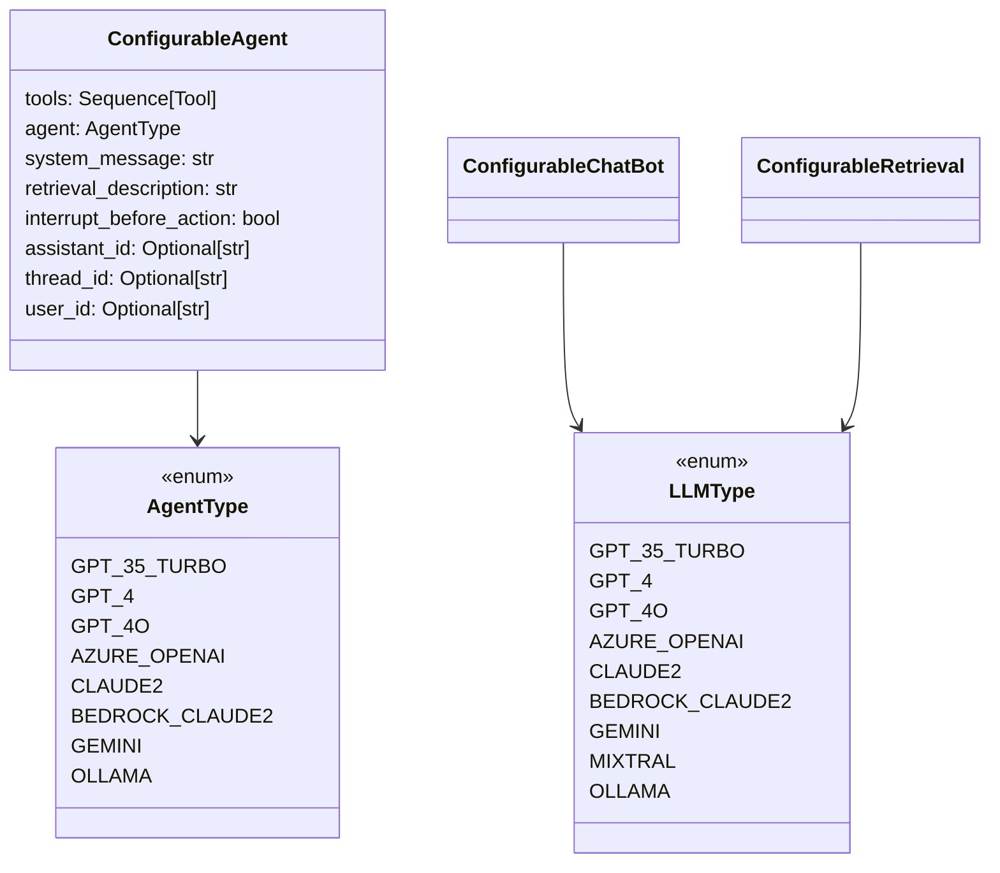
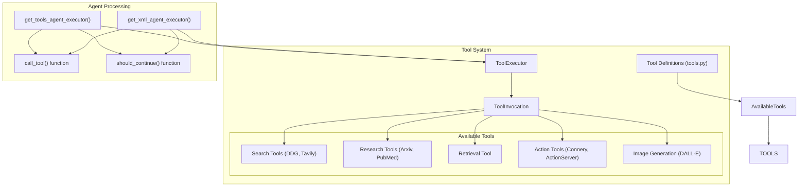
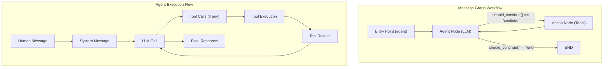
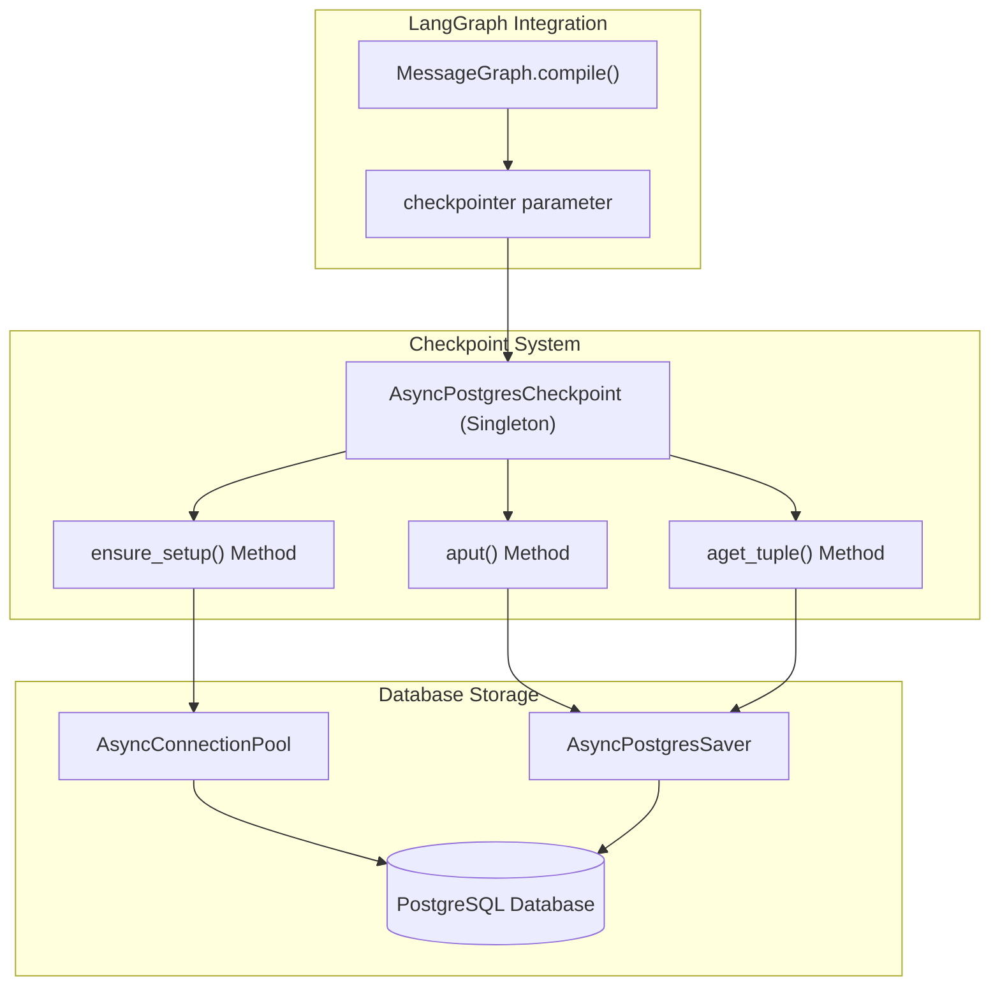

<!-- source: DeepWiki mcp.deepwiki.com · repo langchain-ai/opengpts · page 2.1 Agent System · fetched 2026-10-26 -->

# Agent System

<details>
<summary>Relevant source files</summary>

The following files were used as context for generating this wiki page:

- [backend/app/agent.py](backend/app/agent.py)
- [backend/app/llms.py](backend/app/llms.py)
- [backend/app/tools.py](backend/app/tools.py)

</details>


## Purpose and Scope

This document describes the Agent System in OpenGPTs, which is responsible for configuring and executing different types of agents that utilize language models and external tools to handle user queries. The Agent System serves as the core execution engine that powers the conversational capabilities of OpenGPTs.

For information about the Retrieval and Chatbot Components that build upon this system, see [Retrieval and Chatbot Components](#2.2). For details about how agent state is stored, see [Storage and Database System](#2.3).

Sources: [backend/app/agent.py:1-31]()

## Architecture Overview

The Agent System provides a flexible framework for creating and configuring different types of agent architectures. It bridges LLM capabilities with tool execution and state management to create conversational agents that can perform tasks.



Diagram: Agent System Core Components

Sources: [backend/app/agent.py:127-371](), [backend/app/checkpoint.py:1-119]()

## Agent Types and Configuration

OpenGPTs supports three primary agent architectures, each with different capabilities and interaction patterns:

1. **Tools Agent**: The most flexible architecture that uses tools based on LLM decisions
2. **XML Agent**: A specialized agent that can parse XML-structured responses for tool calls
3. **Simple Chatbot**: The most basic architecture, consisting of direct responses without tool use
4. **RAG Agent**: Retrieval-augmented generation that incorporates document knowledge

The agent type is selected using the `ConfigurableAgent` class, which provides a unified interface for configuring and running different agent architectures.



Diagram: Agent Configuration Classes

Sources: [backend/app/agent.py:62-76](), [backend/app/agent.py:128-147](), [backend/app/agent.py:185-195]()

## LLM Integration

The Agent System supports multiple language model providers through a set of factory functions. Each function creates and configures a specific LLM client with appropriate settings.

| LLM Provider | Function | Models |
|--------------|----------|--------|
| OpenAI | `get_openai_llm()` | GPT-3.5-Turbo, GPT-4, GPT-4o |
| Azure OpenAI | `get_openai_llm(azure=True)` | Depends on Azure deployment |
| Anthropic | `get_anthropic_llm()` | Claude 3 Haiku |
| Amazon Bedrock | `get_anthropic_llm(bedrock=True)` | Claude v2 |
| Google | `get_google_llm()` | Gemini Pro |
| Fireworks | `get_mixtral_fireworks()` | Mixtral 8x7B |
| Ollama | `get_ollama_llm()` | Various local models |

The LLM selection is determined by the `AgentType` or `LLMType` enum value provided during agent configuration.

Sources: [backend/app/agent.py:78-125](), [backend/app/llms.py:1-101]()

## Tool System Architecture

The Agent System includes a comprehensive tool system that allows agents to interact with external services and data sources.



Diagram: Tool System Architecture

Sources: [backend/app/tools.py:30-325](), [backend/app/agent_types/tools_agent.py:20-128](), [backend/app/agent_types/xml_agent.py:62-159]()

### Available Tools

The system provides a variety of tools that agents can use to accomplish tasks. These tools are defined in the `AvailableTools` enum and implemented as BaseTool classes.

| Tool Type | Description | Examples |
|-----------|-------------|----------|
| Search | Web search capabilities | DuckDuckGo, Tavily |
| Research | Academic and specialized search | Arxiv, PubMed, Wikipedia |
| Retrieval | Document retrieval from uploaded files | Retrieval tool |
| Actions | External action execution | Connery, Action Server |
| Image Generation | AI image creation | DALL-E |

Each tool is defined with a name, description, and configuration options, and can be added to an agent during configuration.

Sources: [backend/app/tools.py:46-205](), [backend/app/tools.py:313-325]()

## Agent Workflow Architecture

The Agent System uses the LangGraph framework to define workflow graphs that control agent execution. These graphs determine how messages flow between the agent and tools.



Diagram: Agent Workflow and Execution Flow

Sources: [backend/app/agent_types/tools_agent.py:50-128](), [backend/app/agent_types/xml_agent.py:84-159]()

### Message Graph Implementation

The agent workflow is implemented using a MessageGraph from LangGraph. This creates a directed graph with nodes for the LLM and tool execution, and edges that determine the flow between them:

1. The agent node processes messages and generates a response
2. The `should_continue` function checks if the response contains tool calls
3. If there are tool calls, control passes to the action node
4. The action node executes the tools and returns the results
5. Control flows back to the agent node to process the tool results
6. This cycle continues until the agent produces a final response with no tool calls

This architecture allows the agent to use tools iteratively to solve complex problems.

Sources: [backend/app/agent_types/tools_agent.py:87-128](), [backend/app/agent_types/xml_agent.py:118-159]()

## Checkpoint System

The Agent System includes a robust checkpointing mechanism that persists agent state in PostgreSQL, allowing conversations to be resumed.



Diagram: Checkpoint System Architecture

Sources: [backend/app/checkpoint.py:21-119](), [backend/app/agent.py:75-75](), [backend/app/agent_types/tools_agent.py:125-128](), [backend/app/agent_types/xml_agent.py:156-159]()

The checkpoint system is implemented as a singleton to ensure a single instance throughout the application. It connects to PostgreSQL during application startup and provides methods to save and retrieve agent state.

Sources: [backend/app/checkpoint.py:21-43](), [backend/README.md:1-27]()

## Integration in OpenGPTs

The Agent System is integrated into the broader OpenGPTs system through configurable agent instances that are exposed as endpoints in the API. The main configurable agent instance is defined at the end of [backend/app/agent.py]() and serves as the entry point for agent execution.

```python
agent: Pregel = (
    ConfigurableAgent(
        agent=AgentType.GPT_35_TURBO,
        tools=[],
        system_message=DEFAULT_SYSTEM_MESSAGE,
        retrieval_description=RETRIEVAL_DESCRIPTION,
        assistant_id=None,
        thread_id="",
    )
    .configurable_fields(
        agent=ConfigurableField(id="agent_type", name="Agent Type"),
        system_message=ConfigurableField(id="system_message", name="Instructions"),
        interrupt_before_action=ConfigurableField(
            id="interrupt_before_action",
            name="Tool Confirmation",
            description="If Yes, you'll be prompted to continue before each tool is executed.\nIf No, tools will be executed automatically by the agent.",
        ),
        assistant_id=ConfigurableField(
            id="assistant_id", name="Assistant ID", is_shared=True
        ),
        thread_id=ConfigurableField(
            id="thread_id", name="Thread ID", annotation=str, is_shared=True
        ),
        tools=ConfigurableField(id="tools", name="Tools"),
        retrieval_description=ConfigurableField(
            id="retrieval_description", name="Retrieval Description"
        ),
    )
    .configurable_alternatives(
        ConfigurableField(id="type", name="Bot Type"),
        default_key="agent",
        prefix_keys=True,
        chatbot=chatbot,
        chat_retrieval=chat_retrieval,
    )
)
```

This configuration allows users to select between different agent types, configure the system message, choose which tools to include, and set other parameters.

Sources: [backend/app/agent.py:332-371]()

## Summary

The Agent System provides a flexible and powerful framework for creating conversational agents that can use tools to accomplish tasks. It supports multiple agent architectures, integrates with various language model providers, and includes a comprehensive tool system. The use of LangGraph for workflow management and PostgreSQL for state persistence makes it robust and scalable.

The key components of the system are:
1. Configurable agent classes that provide a unified interface
2. LLM integration for various providers
3. Tool definitions and execution mechanisms
4. Workflow graphs that control agent execution
5. Checkpoint system for state persistence

Together, these components form the core execution engine of OpenGPTs, enabling the creation of sophisticated conversational agents.

---

