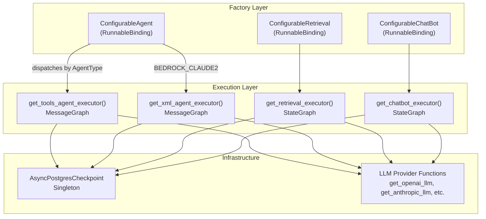
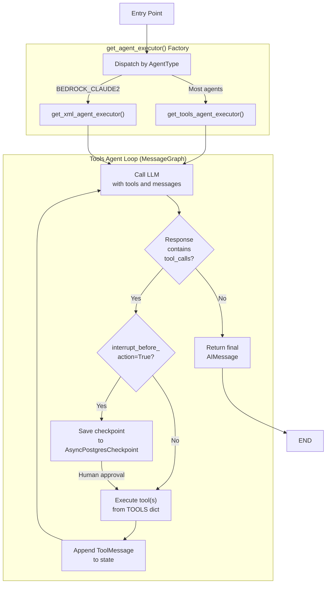
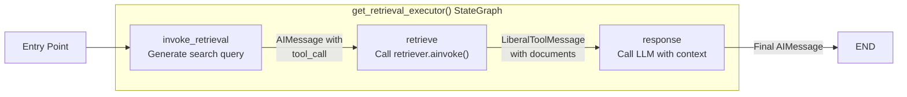
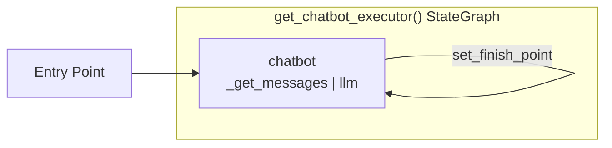
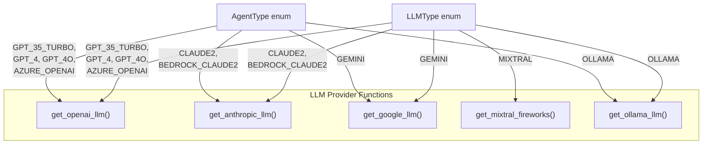
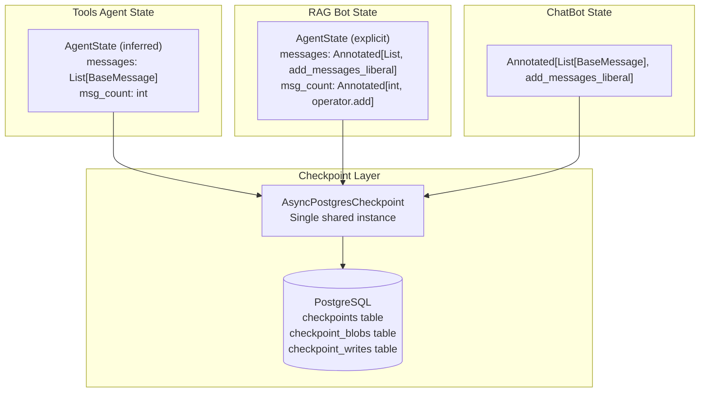

<!-- source: DeepWiki mcp.deepwiki.com · repo langchain-ai/opengpts · page 2.2 Cognitive Architectures · fetched 2026-10-26 -->

# Cognitive Architectures

<details>
<summary>Relevant source files</summary>

The following files were used as context for generating this wiki page:

- [backend/app/agent.py](backend/app/agent.py)
- [backend/app/chatbot.py](backend/app/chatbot.py)
- [backend/app/llms.py](backend/app/llms.py)
- [backend/app/message_types.py](backend/app/message_types.py)
- [backend/app/retrieval.py](backend/app/retrieval.py)
- [backend/app/tools.py](backend/app/tools.py)

</details>


## Purpose and Scope

This document describes the three cognitive architectures implemented in OpenGPTs: **Tools Agent**, **RAG Bot**, and **ChatBot**. Each architecture represents a different execution model for processing user messages, from simple direct LLM invocation to complex tool-enabled agent loops with retrieval capabilities.

This page focuses on the execution graphs, state management, and control flow of each architecture. For information about the agent system's configuration interface and tool definitions, see [Agent System](#2.1). For details about checkpoint persistence and state storage, see [Storage and State Management](#2.3). For the API endpoints that invoke these architectures, see [API Endpoints](#2.5).

## Architecture Overview

OpenGPTs implements three distinct cognitive architectures, each represented as a LangGraph execution graph:

| Architecture | Factory Class | Graph Type | Primary Use Case | Checkpoint Support |
|-------------|---------------|------------|------------------|-------------------|
| **Tools Agent** | `ConfigurableAgent` | MessageGraph | Tool-enabled AI workflows with 13+ tools | ✓ |
| **RAG Bot** | `ConfigurableRetrieval` | StateGraph | Document-based question answering | ✓ |
| **ChatBot** | `ConfigurableChatBot` | StateGraph | Simple conversational AI | ✓ |

All three architectures share a common infrastructure:
- **Unified checkpointing** via `AsyncPostgresCheckpoint` singleton ([backend/app/agent.py:75]())
- **Configurable LLM providers** supporting OpenAI, Anthropic, Google, Fireworks, and Ollama
- **State management** through LangGraph's checkpoint system
- **Streaming support** for incremental response delivery



**Sources:** [backend/app/agent.py:1-387](), [backend/app/chatbot.py:1-27](), [backend/app/retrieval.py:1-142]()

## Tools Agent Architecture

The Tools Agent is the most sophisticated architecture, implementing an agentic loop where the LLM can repeatedly invoke tools until it reaches a final answer. This architecture is instantiated via `ConfigurableAgent` ([backend/app/agent.py:128-183]()) and dispatched to either `get_tools_agent_executor()` or `get_xml_agent_executor()` based on the selected `AgentType`.

### Graph Structure and Execution Flow

The Tools Agent uses a MessageGraph (referenced but not provided in files) with the following execution pattern:



**Sources:** [backend/app/agent.py:78-126](), [backend/app/agent.py:128-183]()

### Tool Selection and Invocation

The `ConfigurableAgent.__init__()` method processes tool configurations and instantiates tool objects from the `TOOLS` dictionary ([backend/app/agent.py:152-169]()):

1. **Retrieval Tool**: Special handling for `AvailableTools.RETRIEVAL`, requiring both `assistant_id` and `thread_id` to create a scoped retriever ([backend/app/agent.py:155-162]())
2. **Standard Tools**: Fetched from `TOOLS` dict using factory functions ([backend/app/agent.py:164-169]())
3. **Multi-use Tools**: Some tools like Action Server return multiple tool instances

The agent executor is configured with `recursion_limit=50` ([backend/app/agent.py:173]()), allowing up to 50 tool invocations before terminating.

### Human-in-the-Loop Interruption

When `interrupt_before_action=True` ([backend/app/agent.py:133]()), the agent saves a checkpoint before executing any tool. This enables:
- **Approval workflows**: User can review and approve/reject tool executions
- **State persistence**: Conversation state preserved during interruption
- **Resume capability**: Execution continues from exact checkpoint after approval

The interruption is configured via `ConfigurableField` and exposed to the frontend ([backend/app/agent.py:344-348]()).

**Sources:** [backend/app/agent.py:128-183](), [backend/app/tools.py:313-325]()

## RAG Bot Architecture

The RAG (Retrieval-Augmented Generation) Bot implements a two-phase process: retrieve relevant documents, then generate a response based on those documents. This architecture is instantiated via `ConfigurableRetrieval` ([backend/app/agent.py:263-310]()) and executed by `get_retrieval_executor()` ([backend/app/retrieval.py:38-141]()).

### Three-Node Graph Structure

The RAG Bot uses a StateGraph with three sequential nodes:



**State Type**: `AgentState` with `messages: List[BaseMessage]` and `msg_count: int` ([backend/app/retrieval.py:44-46]())

### Node Implementation Details

#### Node 1: invoke_retrieval

Generates a search query from conversation history ([backend/app/retrieval.py:80-114]()):

- **First message**: Uses human input directly as query ([backend/app/retrieval.py:82-97]())
- **Multi-turn**: Invokes `get_search_query` chain to synthesize query from conversation ([backend/app/retrieval.py:99-114]())
- **Output**: Returns `AIMessage` with `tool_calls` containing retrieval parameters

The search query generation uses a prompt template that extracts the search intent from conversation context ([backend/app/retrieval.py:16-28]()).

#### Node 2: retrieve

Executes the actual vector search ([backend/app/retrieval.py:116-125]()):

1. Extracts query from previous node's `tool_calls` ([backend/app/retrieval.py:117-119]())
2. Invokes retriever via `await retriever.ainvoke(query)` ([backend/app/retrieval.py:120]())
3. Serializes documents to dictionaries ([backend/app/retrieval.py:121]())
4. Returns `LiberalToolMessage` containing document list ([backend/app/retrieval.py:122-125]())

The retriever is created with namespace filtering by `assistant_id` and `thread_id` ([backend/app/tools.py:214-217]()).

#### Node 3: response

Generates final answer using retrieved context ([backend/app/retrieval.py:127-130]()):

1. Formats documents into context string via `_get_messages()` ([backend/app/retrieval.py:48-64]())
2. Injects system message with instruction: "Respond to the user using ONLY the context provided below" ([backend/app/retrieval.py:31-35]())
3. Invokes LLM with formatted messages ([backend/app/retrieval.py:129]())
4. Returns final `AIMessage` ([backend/app/retrieval.py:130]())

### Message Formatting

The `_get_messages()` helper extracts chat history and formats retrieval results ([backend/app/retrieval.py:48-64]()):

```python
# Pseudocode showing key logic
def _get_messages(messages):
    chat_history = extract_ai_and_human_messages(messages)
    documents = messages[-1].content  # From retrieve node
    context = join_document_contents(documents)
    
    return [
        SystemMessage(
            content=f"{system_message}\n\nContext:\n{context}"
        )
    ] + chat_history
```

This ensures the LLM receives both conversation context and retrieved documents in a single prompt.

**Sources:** [backend/app/retrieval.py:1-142](), [backend/app/agent.py:263-310](), [backend/app/tools.py:214-227]()

## ChatBot Architecture

The ChatBot implements the simplest cognitive architecture: direct LLM invocation with conversation history. This architecture is instantiated via `ConfigurableChatBot` ([backend/app/agent.py:224-247]()) and executed by `get_chatbot_executor()` ([backend/app/chatbot.py:11-26]()).

### Single-Node Graph Structure

The ChatBot uses a minimal StateGraph with one node:



**State Type**: `Annotated[List[BaseMessage], add_messages_liberal]` ([backend/app/chatbot.py:21]()) - a simple list of messages using liberal message merging.

### Execution Implementation

The entire chatbot logic is expressed as a chain ([backend/app/chatbot.py:16-19]()):

```python
def _get_messages(messages):
    return [SystemMessage(content=system_message)] + messages

chatbot = _get_messages | llm
```

This creates a LangChain chain that:
1. Prepends system message to conversation history
2. Invokes the LLM with combined messages
3. Returns the LLM's response

The StateGraph wrapper provides:
- **Checkpoint integration**: Conversation history persisted to `AsyncPostgresCheckpoint`
- **Streaming support**: Compatible with `astream_events()` interface
- **Message merging**: Uses `add_messages_liberal` for flexible message handling ([backend/app/message_types.py:35-44]())

### Set Finish Point Pattern

The graph uses `set_finish_point("chatbot")` ([backend/app/chatbot.py:24]()), which is equivalent to adding an edge to `END`. This pattern indicates:
- Single execution pass (no loops)
- Node output becomes graph output directly
- Checkpoint saved after node execution

**Sources:** [backend/app/chatbot.py:1-27](), [backend/app/agent.py:224-247](), [backend/app/message_types.py:1-45]()

## Factory Pattern and Configurable Fields

All three architectures use the `RunnableBinding` pattern with `ConfigurableField` to enable dynamic runtime configuration. This pattern is central to OpenGPTs' flexibility.

### ConfigurableAgent Example

The agent factory exposes multiple configurable parameters ([backend/app/agent.py:341-359]()):

| Field | ConfigurableField ID | Type | Shared | Description |
|-------|---------------------|------|--------|-------------|
| `agent` | `agent_type` | `AgentType` | No | LLM provider (GPT-4, Claude, etc.) |
| `system_message` | `system_message` | `str` | No | Instructions prepended to every call |
| `interrupt_before_action` | `interrupt_before_action` | `bool` | No | Enable human-in-the-loop |
| `assistant_id` | `assistant_id` | `str` | Yes | Links to assistant config |
| `thread_id` | `thread_id` | `str` | Yes | Links to conversation thread |
| `tools` | `tools` | `Sequence[Tool]` | No | List of enabled tools |
| `retrieval_description` | `retrieval_description` | `str` | No | Custom retrieval tool description |

**Shared Fields**: Marked with `is_shared=True` ([backend/app/agent.py:349-353]()), these are passed through to checkpoint namespace for data isolation.

### Configurable Alternatives Pattern

The top-level `agent` object uses `configurable_alternatives()` to enable switching between architectures at runtime ([backend/app/agent.py:360-366]()):

```python
agent = (
    ConfigurableAgent(...)
    .configurable_fields(...)
    .configurable_alternatives(
        ConfigurableField(id="type", name="Bot Type"),
        default_key="agent",
        prefix_keys=True,
        chatbot=chatbot,
        chat_retrieval=chat_retrieval,
    )
)
```

This allows the API to route to different architectures by setting `config={"configurable": {"type": "chatbot"}}` or `{"type": "chat_retrieval"}`.

### LLM Provider Dispatch

Both `get_agent_executor()` ([backend/app/agent.py:78-126]()) and `get_chatbot()` ([backend/app/agent.py:197-221]()) implement dispatch logic based on enum values:



All LLM functions use `@lru_cache` for instance reuse ([backend/app/llms.py:17](), [backend/app/llms.py:60](), [backend/app/llms.py:79](), [backend/app/llms.py:86](), [backend/app/llms.py:91]()).

**Sources:** [backend/app/agent.py:332-371](), [backend/app/agent.py:78-126](), [backend/app/agent.py:197-221](), [backend/app/llms.py:1-101]()

## State Management Across Architectures

All three architectures use LangGraph's checkpoint system for state persistence, but with different state schemas:

### State Schema Comparison



### Message Reducer Functions

Both RAG Bot and ChatBot use `add_messages_liberal` ([backend/app/message_types.py:35-44]()), a custom reducer that:

1. Coerces single messages to lists
2. Converts Pydantic dicts to message objects via `_convert_pydantic_dict_to_message()` ([backend/app/message_types.py:21-32]())
3. Delegates to LangGraph's `add_messages()` for deduplication

This enables flexible message handling, including non-standard message types like `LiberalToolMessage` with `content: Any` ([backend/app/message_types.py:17-18]()).

### Checkpoint Singleton Pattern

All architectures share a single `AsyncPostgresCheckpoint` instance ([backend/app/agent.py:75]()):

```python
CHECKPOINTER = AsyncPostgresCheckpoint()
```

This singleton is passed to:
- `get_tools_agent_executor()` ([backend/app/agent.py:87](), [backend/app/agent.py:92](), etc.)
- `get_xml_agent_executor()` ([backend/app/agent.py:112]())
- `get_chatbot_executor()` ([backend/app/agent.py:221]())
- `get_retrieval_executor()` ([backend/app/agent.py:303]())

The checkpointer uses `thread_id` and `assistant_id` from configurable fields to create isolated namespaces for each conversation.

**Sources:** [backend/app/agent.py:75](), [backend/app/agent.py:78-126](), [backend/app/agent.py:197-221](), [backend/app/retrieval.py:44-46](), [backend/app/chatbot.py:21](), [backend/app/message_types.py:1-45]()

## Architecture Selection and Routing

The backend API routes to different architectures based on the `type` configurable field. The top-level `agent` object ([backend/app/agent.py:332-371]()) uses `configurable_alternatives()` to dispatch to:

| Type Value | Architecture | Factory | Use Case |
|-----------|-------------|---------|----------|
| `"agent"` (default) | Tools Agent | `ConfigurableAgent` | Tool-enabled workflows |
| `"chatbot"` | ChatBot | `ConfigurableChatBot` | Simple conversation |
| `"chat_retrieval"` | RAG Bot | `ConfigurableRetrieval` | Document Q&A |

### Type Coercion and Input/Output Types

Each architecture declares its input/output types via `.with_types()` ([backend/app/agent.py:367-370]()):

- **Tools Agent & ChatBot**: `input_type=Messages, output_type=Sequence[AnyMessage]`
- **RAG Bot**: `input_type=Dict[str, Any], output_type=Dict[str, Any]`

This enables LangServe to validate payloads and generate OpenAPI schemas for the API.

### Recursion Limit Configuration

The Tools Agent explicitly sets `recursion_limit=50` ([backend/app/agent.py:173]()), allowing up to 50 iterations of the agent loop. This prevents infinite loops while supporting complex multi-step reasoning.

RAG Bot and ChatBot do not require recursion limits as they execute fixed-length graphs (3 nodes and 1 node respectively).

**Sources:** [backend/app/agent.py:332-371](), [backend/app/agent.py:173]()

## Architecture Comparison Matrix

| Feature | Tools Agent | RAG Bot | ChatBot |
|---------|-------------|---------|---------|
| **Graph Type** | MessageGraph | StateGraph | StateGraph |
| **Node Count** | Variable (loop) | 3 (sequential) | 1 (single) |
| **Tool Support** | 13+ tools | None | None |
| **Retrieval Support** | Optional (as tool) | Built-in (required) | None |
| **Execution Pattern** | Iterative loop | Three-phase pipeline | Single pass |
| **State Schema** | `messages + msg_count` | `messages + msg_count` | `messages` only |
| **Interruption Support** | Yes (configurable) | No | No |
| **Recursion Limit** | 50 iterations | N/A (no recursion) | N/A (no recursion) |
| **Primary Use Cases** | Multi-step reasoning, external APIs, complex workflows | Document Q&A, knowledge base queries | Conversation, simple Q&A |
| **Configuration Complexity** | High (8 fields) | Medium (4 fields) | Low (2 fields) |
| **LLM Variants** | 8 (via AgentType) | 9 (via LLMType) | 9 (via LLMType) |

### When to Use Each Architecture

**Tools Agent**: Choose when you need:
- External data access (search, APIs, databases)
- Multi-step workflows requiring multiple tool calls
- Human-in-the-loop approval for actions
- Complex reasoning over multiple information sources

**RAG Bot**: Choose when you need:
- Question answering over uploaded documents
- Grounded responses with source citations
- Context-aware retrieval with conversation history
- Controlled generation from specific knowledge base

**ChatBot**: Choose when you need:
- Simple conversational AI
- Minimal latency (single LLM call)
- No external dependencies
- Straightforward question-answering

**Sources:** [backend/app/agent.py:1-387](), [backend/app/chatbot.py:1-27](), [backend/app/retrieval.py:1-142]()

---

