<!-- source: DeepWiki mcp.deepwiki.com · repo langchain-ai/opengpts · page 2.3 Storage and State Management · fetched 2026-10-26 -->

# Storage and State Management

<details>
<summary>Relevant source files</summary>

The following files were used as context for generating this wiki page:

- [backend/README.md](backend/README.md)
- [backend/app/agent_types/tools_agent.py](backend/app/agent_types/tools_agent.py)
- [backend/app/api/assistants.py](backend/app/api/assistants.py)
- [backend/app/api/threads.py](backend/app/api/threads.py)
- [backend/app/checkpoint.py](backend/app/checkpoint.py)
- [backend/app/storage.py](backend/app/storage.py)
- [tools/redis_to_postgres/migrate_data.py](tools/redis_to_postgres/migrate_data.py)

</details>


This document describes the storage and state management components of OpenGPTs, including the persistence layer for assistants and threads, the `AsyncPostgresCheckpoint` system for LangGraph state persistence, and the checkpoint migration from v4 to v5. For information about file uploads and vector storage, see [File Upload and Vector Storage](#2.4).

## Overview

OpenGPTs uses PostgreSQL as its primary database for storing both structured data (users, assistants, threads) and conversational state (LangGraph checkpoints). The storage system consists of two layers:

1. **Storage Layer** (`app/storage.py`): High-level CRUD operations for assistants and threads
2. **Checkpoint Layer** (`app/checkpoint.py`): LangGraph state persistence using `AsyncPostgresCheckpoint`

The checkpoint system enables conversation continuity, time-travel debugging, and human-in-the-loop workflows by persisting the complete state of agent executions.

**Storage and Checkpoint Architecture Diagram**

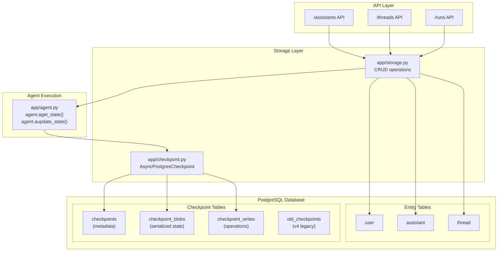

Sources: [backend/app/storage.py](), [backend/app/checkpoint.py](), [backend/app/api/assistants.py](), [backend/app/api/threads.py]()

## Data Models

The system uses three primary data models to represent entities in the database:

### User Model

Represents a user of the system.

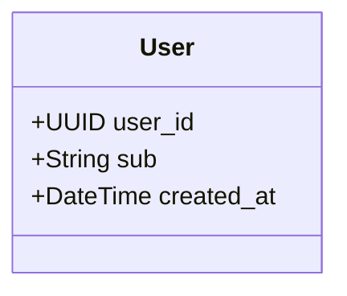

### Assistant Model

Represents an assistant configuration that can be used to power conversations.

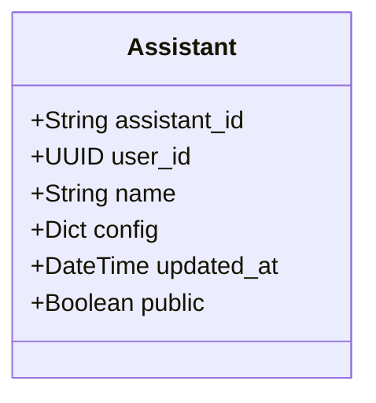

### Thread Model

Represents a conversation thread between a user and an assistant.

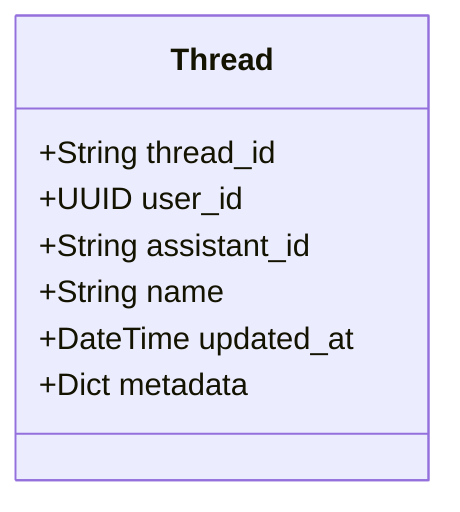

Sources: [backend/app/schema.py:7-43]()

## Database Schema

The database schema consists of two groups: entity tables (users, assistants, threads) and checkpoint tables (for LangGraph state persistence).

**Entity Relationship Diagram**

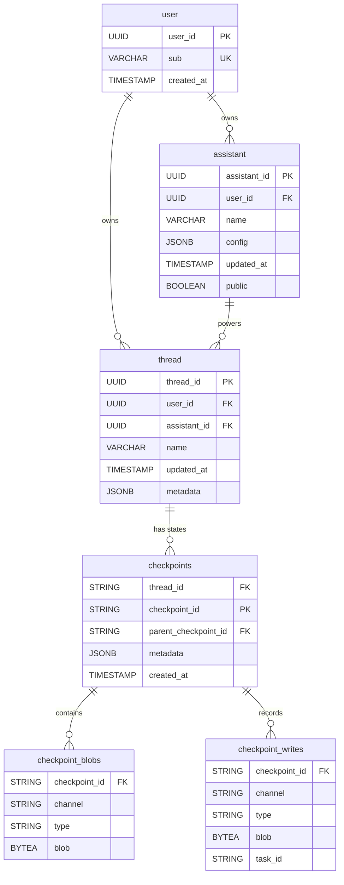

### Checkpoint Tables

The checkpoint system uses three tables for state persistence:

| Table | Purpose |
|-------|---------|
| `checkpoints` | Core metadata (checkpoint ID, parent ID, thread ID, timestamp) |
| `checkpoint_blobs` | Serialized state data organized by channel |
| `checkpoint_writes` | Records of write operations performed during execution |

This multi-table design replaced the single `checkpoints` table (now `old_checkpoints`) in Migration 5. The new architecture aligns with LangGraph's latest checkpoint protocol and improves serialization flexibility.

Sources: [backend/app/checkpoint.py:21-119](), [backend/README.md:5-26]()

## Storage Functions

The storage module (`app/storage.py`) provides functions for interacting with the database:

### Assistant Management

| Function | Description |
|----------|-------------|
| `list_assistants(user_id)` | Lists all assistants for a user |
| `get_assistant(user_id, assistant_id)` | Retrieves a specific assistant |
| `list_public_assistants()` | Lists all public assistants |
| `put_assistant(user_id, assistant_id, name, config, public)` | Creates or updates an assistant |
| `delete_assistant(user_id, assistant_id)` | Deletes an assistant |

### Thread Management

| Function | Description |
|----------|-------------|
| `list_threads(user_id)` | Lists all threads for a user |
| `get_thread(user_id, thread_id)` | Retrieves a specific thread |
| `put_thread(user_id, thread_id, assistant_id, name)` | Creates or updates a thread |
| `delete_thread(user_id, thread_id)` | Deletes a thread |

### Thread State Management

| Function | Description |
|----------|-------------|
| `get_thread_state(user_id, thread_id, assistant)` | Gets the current state for a thread |
| `update_thread_state(config, values, user_id, assistant)` | Updates the state of a thread |
| `get_thread_history(user_id, thread_id, assistant)` | Gets all past states for a thread |

Sources: [backend/app/storage.py:12-268]()

## Checkpoint System Architecture

The checkpoint system provides persistent state management for LangGraph agent executions. It consists of a singleton `AsyncPostgresCheckpoint` instance that all agents share.

**Checkpoint System Lifecycle Diagram**

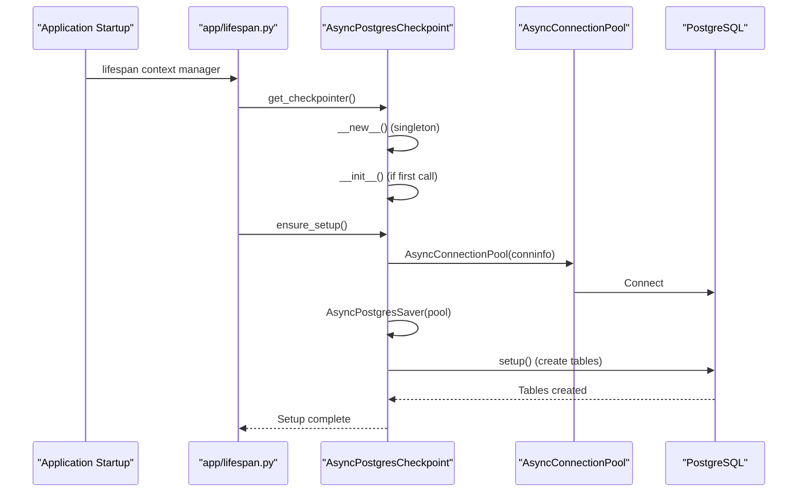

### AsyncPostgresCheckpoint Implementation

The `AsyncPostgresCheckpoint` class ([backend/app/checkpoint.py:21-119]()) implements a singleton pattern to ensure all agents use the same checkpoint instance:

```python
class AsyncPostgresCheckpoint(BasePostgresSaver):
    """A singleton implementation of AsyncPostgresSaver with separate setup."""
    
    _instance = None
    
    def __new__(cls, *args, **kwargs):
        if not cls._instance:
            cls._instance = super().__new__(cls)
        return cls._instance
```

Key methods:

| Method | Description |
|--------|-------------|
| `ensure_setup()` | Idempotent setup called during application startup |
| `aget_tuple(config)` | Retrieve a specific checkpoint by config |
| `aput(config, checkpoint, metadata, new_versions)` | Save a checkpoint to the database |
| `aput_writes(config, writes, task_id)` | Store intermediate writes for a checkpoint |
| `alist(config, filter, before, limit)` | List checkpoints with optional filtering |

The singleton pattern ensures that:
1. Only one database connection pool is created
2. All agents share the same checkpoint instance
3. Setup operations (table creation) only run once

Sources: [backend/app/checkpoint.py:21-119]()

### Checkpoint Configuration

Checkpoints are identified by a `RunnableConfig` that includes:

```python
{
    "configurable": {
        "thread_id": "<thread_id>",
        "assistant_id": "<assistant_id>",
        # ... other assistant config fields
    }
}
```

This configuration is passed to LangGraph's `agent.aget_state()` and `agent.aupdate_state()` methods to retrieve or modify state.

Sources: [backend/app/storage.py:116-178]()

## Thread State Storage

Thread state (messages and conversation context) is persisted through the checkpoint system. The storage layer provides high-level functions that delegate to LangGraph's state management:

**Thread State Operations Diagram**

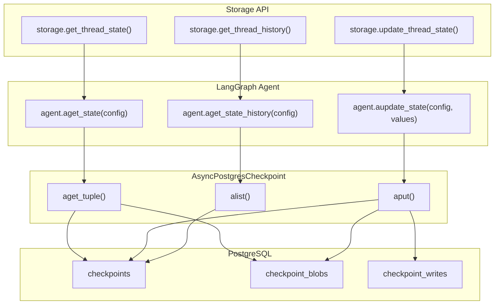

### State Structure by Agent Type

Different agent types store state in different formats:

| Agent Type | State Structure | Example |
|------------|----------------|---------|
| Tools Agent | List of messages | `[HumanMessage(...), AIMessage(...), ToolMessage(...)]` |
| Chatbot | List of messages | `[HumanMessage(...), AIMessage(...)]` |
| RAG Agent | Dict with messages + context | `{"messages": [...], "retrieval_context": {...}}` |

The `update_thread_state()` function ([backend/app/storage.py:136-178]()) handles these different formats by inspecting the current state structure:

```python
# Get the current state to determine the format
current_state = await agent.aget_state(config)

# If current state is a dict (retrieval agent), maintain dict structure
if current_state.values and isinstance(current_state.values, dict):
    if isinstance(values, dict):
        state_values = values
    else:
        # Update just the messages in the existing state
        state_values = {**current_state.values, "messages": values}
else:
    # For message-only states (tools_agent, chatbot), just use the messages
    state_values = values
```

Sources: [backend/app/storage.py:116-198]()

### Thread State History

The `get_thread_history()` function ([backend/app/storage.py:180-198]()) retrieves all past states for a thread, enabling time-travel debugging:

```python
async def get_thread_history(*, user_id: str, thread_id: str, assistant: Assistant):
    """Get the history of a thread."""
    return [
        {
            "values": c.values,
            "next": c.next,
            "config": c.config,
            "parent": c.parent_config,
        }
        async for c in agent.aget_state_history(config)
    ]
```

This returns a list of checkpoints in reverse chronological order, each containing:
- `values`: The state at that checkpoint
- `next`: The next node(s) to execute
- `config`: The configuration used
- `parent`: The parent checkpoint config

Sources: [backend/app/storage.py:180-198]()

## Database Connection

The storage system uses an asyncpg connection pool to interact with PostgreSQL:

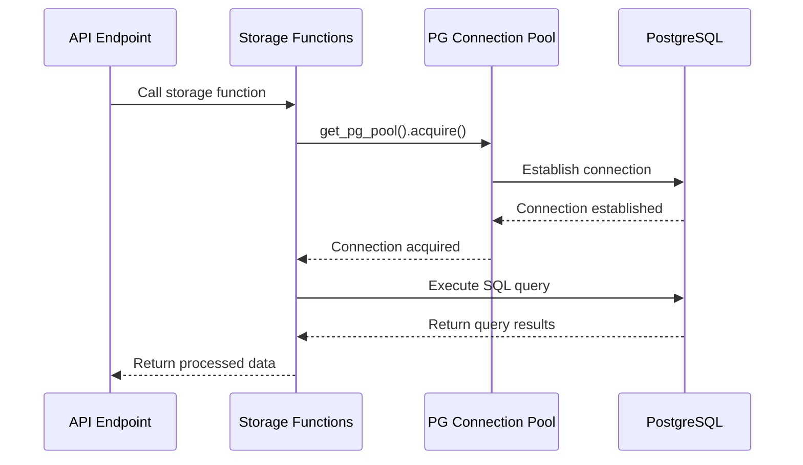

The connection pool is initialized during application startup and used throughout the application lifecycle.

Sources: [backend/app/storage.py:14-17](), [backend/tests/unit_tests/conftest.py:63-68]()

## API Integration

The storage system is called from API endpoints to handle data operations:

```mermaid
flowchart TD
    subgraph "API Endpoints"
        AssistantsList["/assistants/\nlist_assistants()"]
        AssistantsGet["/assistants/{aid}\nget_assistant()"]
        AssistantsPut["/assistants/{aid}\nupsert_assistant()"]
        AssistantsDelete["/assistants/{aid}\ndelete_assistant()"]
        
        ThreadsList["/threads/\nlist_threads()"]
        ThreadsGet["/threads/{tid}\nget_thread()"]
        ThreadsPut["/threads/{tid}\nupsert_thread()"]
        ThreadsDelete["/threads/{tid}\ndelete_thread()"]
        
        ThreadState["/threads/{tid}/state\nget_thread_state()"]
        ThreadStateUpdate["/threads/{tid}/state\nadd_thread_state()"]
        ThreadHistory["/threads/{tid}/history\nget_thread_history()"]
    end
    
    subgraph "Storage Functions"
        StorageAssistantsList["storage.list_assistants()"]
        StorageAssistantsGet["storage.get_assistant()"]
        StorageAssistantsPut["storage.put_assistant()"]
        StorageAssistantsDelete["storage.delete_assistant()"]
        
        StorageThreadsList["storage.list_threads()"]
        StorageThreadsGet["storage.get_thread()"]
        StorageThreadsPut["storage.put_thread()"]
        StorageThreadsDelete["storage.delete_thread()"]
        
        StorageThreadState["storage.get_thread_state()"]
        StorageThreadStateUpdate["storage.update_thread_state()"]
        StorageThreadHistory["storage.get_thread_history()"]
    end
    
    AssistantsList --> StorageAssistantsList
    AssistantsGet --> StorageAssistantsGet
    AssistantsPut --> StorageAssistantsPut
    AssistantsDelete --> StorageAssistantsDelete
    
    ThreadsList --> StorageThreadsList
    ThreadsGet --> StorageThreadsGet
    ThreadsPut --> StorageThreadsPut
    ThreadsDelete --> StorageThreadsDelete
    
    ThreadState --> StorageThreadState
    ThreadStateUpdate --> StorageThreadStateUpdate
    ThreadHistory --> StorageThreadHistory
```

Sources: [backend/app/api/assistants.py:27-89](), [backend/app/api/threads.py:32-145]()

## Assistant Configuration Storage

Assistants store their configuration in a JSON/JSONB field in the database. This configuration includes:

1. **Agent Type**: Determines the cognitive architecture (tools_agent, rag, chatbot)
2. **LLM Configuration**: Settings for the language model
3. **Tool Configuration**: Available tools and their settings
4. **Retrieval Configuration**: Document retrieval settings (for RAG)

The configuration structure varies by assistant type but follows this general pattern:

```
{
  "configurable": {
    "type": "<agent_type>",
    "llm": { <llm_config> },
    "tools": [ <tool_configs> ],
    "retrieval": { <retrieval_config> }
  }
}
```

Sources: [backend/app/storage.py:41-83](), [backend/app/storage.py:201-210]()

## Public vs. Private Assistants

The system supports both private assistants (accessible only to their owner) and public assistants (accessible to all users):

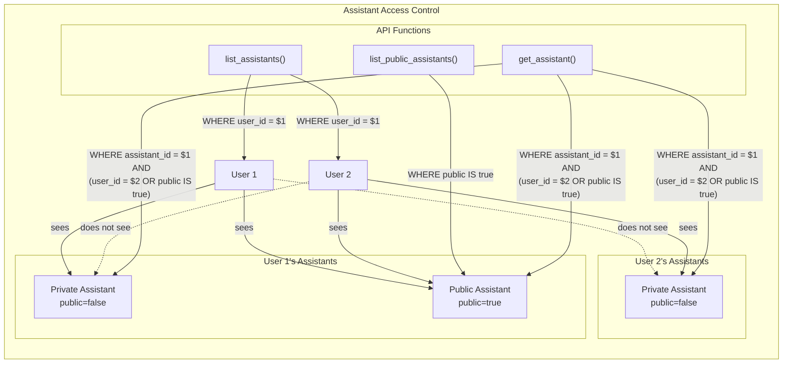

Sources: [backend/app/storage.py:21-38](), [backend/app/api/assistants.py:33-48]()

## Authentication and User Storage

User records are created automatically through the authentication system. Each user has a unique identifier:

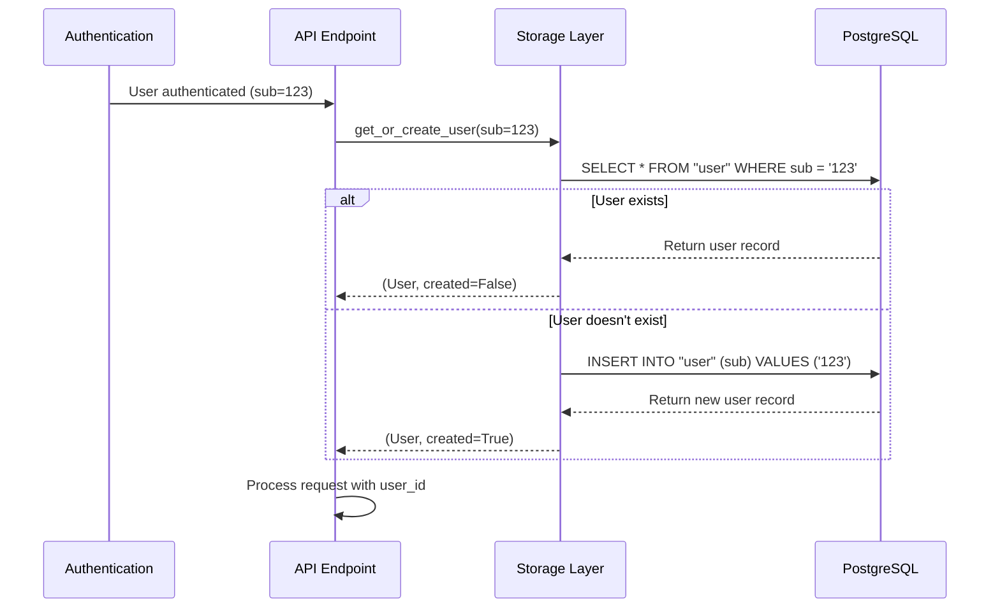

Sources: [backend/app/storage.py:260-268]()

## Thread Metadata

Thread records include a metadata field which stores additional information about the thread, such as the assistant type:

```python
metadata = {"assistant_type": get_assistant_type(assistant.config)}
```

This metadata helps identify the type of conversation architecture used in the thread (chatbot, tools_agent, or rag).

Sources: [backend/app/storage.py:213-246]()

---

